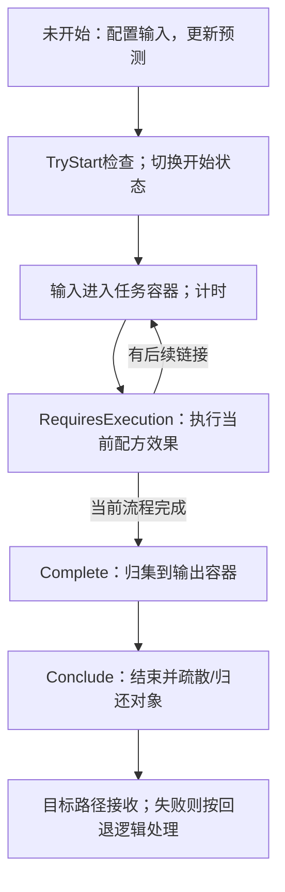
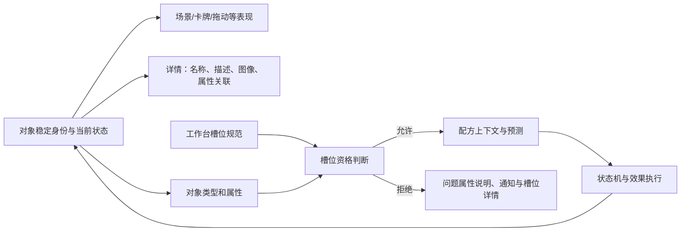

# BOOK OF HOURS：按DIR-042清单的REA深度分析

2026-10-28 · BOH-REA-2026-10-28-v01 · Research / LimitedEvidence。**静态分析已完成；实机清单未完成。**

最有参考价值的是四个相互配合的结构：**主题与功能角色分开的符号、同一对象的多种表现、能解释原因的槽位、分阶段表达的加工过程。** 另有一条会改变原研究预期的发现：该构建打开一个新的操作情况窗口时，会关闭其他情况窗口；多任务并存不等于多个制作窗口同时常开。

本轮实际使用本地 REA 6.4.0 解析主程序集，普通JSON解析核对发布内容，以UnityPy解码本地纹理并直接查看像素；少量ILSpy辅助还原静态分支。已经启动指定游戏，但首次启动的Windows防火墙提示需要用户手动处理，未进入玩法场景。因此没有制作前后截图、真实误读、收藏查找或多窗口体验记录。下文的配方链和状态图是静态证据重建，不能标为实玩结果。

## 范围与版本

| 项目 | 本轮记录 |
| --- | --- |
| 指定安装 | `E:/Game/BOOK OF HOURS v2024.12.m.3/`，原件只读，分析导出另存 |
| 实际版本 | `version.txt`、启动日志及菜单角标均对应2024.12.m.3；Unity播放器版本2022.3.52f1 |
| 语言 | 本机config为zh-hans，菜单显示简体中文；简中覆盖文本和纹理已核对 |
| DLC / 模组 | 发布目录包含HOL内容，启动日志报告HOL installed；本轮未进入DLC流程；额外模组状态Unknown |
| 显示 | 抓取窗口外框1283×751，游戏区域约1280×720；界面缩放、实际渲染分辨率未在设置内核实 |
| 目标项目背景 | 沿DIR-042既定CUSTOM及共同版本 `f8849ed93c159ecee6baceddb5cfa52cde4084cf`；本轮仅使用方向摘要和指定清单，不重读或扩读主系统 |
| 本轮文档基准 | 启动HEAD `14255158cf8bebeebb564fd0399b8ff3b535c993`；不纳入工作树中的无关修改 |
| 固定文件身份 | [source-manifest.json](../source-manifest.json)；304个发布文件的身份清单，列入不等于全部逐条研究 |
| 原始取证 | `E:/Game/BOOK OF HOURS-analysis/2026-10-28/`；第三方纹理、完整REA记录和辅助反编译留本机，未加入Git |

Addressables设置的buildTarget字段写作StandaloneLinux64，而本轮启动的是Windows可执行文件；这是包内配置观察，不据此更改版本判断或声称分析了Linux实机。

## 证据地图

| 引用 | 内容与定位 | 能支持什么 |
| --- | --- | --- |
| T1 | [引擎静态核对](../evidence/engine-static.md)；REA身份与完整成员Evidence见下 | 发布程序集中的对象、判断、调用和状态结构；不等于已执行 |
| T2 | [符号与对象内容](../evidence/symbols-objects.md) | 具体ID、属性、继承、文本层、图像地址 |
| T3 | [配方与槽位内容](../evidence/recipes-slots.md) | 耀素配方、三个对照、提示、整理与回访选项 |
| V1 | [符号资源图](E:/Game/BOOK%20OF%20HOURS-analysis/2026-10-28/visual/symbols-contact.png) | 实际像素的颜色、中央图形和角色变体 |
| V2 | [对象资源图](E:/Game/BOOK%20OF%20HOURS-analysis/2026-10-28/visual/objects-contact.png) | 中文书封/书脊、器物、工作台图标与卡图 |
| V3 | [缩小与灰度图](E:/Game/BOOK%20OF%20HOURS-analysis/2026-10-28/visual/symbols-scale-gray.png) | 指定尺寸下可见的形状损失；尺寸不是游戏默认值 |
| V4 | [同名资源歧义图](E:/Game/BOOK%20OF%20HOURS-analysis/2026-10-28/visual/identity-variants.png) | 语言与图像角色必须结合pathID识别 |

REA身份Evidence为 `ev_32b9e977d21f2176238c65f759ebe6295ab7ea35bb815c4d3b8d69e8e167a40c`；成员Evidence为 `ev_d9041c25a6fcfeb1b7724df8890ffecb79a09c82bdc369e048fd05439dd81c9e`。下文引擎结论均继承T1的构建、token、IL锚点和局限，不把普通JSON解析或ILSpy输出称为REA Evidence。原始记录路径及文件哈希见[REA索引](../rea-evidence-index.json)。

主程序集SHA-256为 `820df80128d65d066b1dfa7d9590cfa2ef60575136a4c764d484f06077e3b6c8`。REA识别为Unity/Mono CIL；其complete覆盖指这一个程序集的元数据和可读方法体，不代表整个游戏或全部行为已经验证。

## 图文证据

四张分析图均已经主agent直接打开检查，详见[视觉审计](../visual/visual-audit.md)。它们由发布资源离线编排，不是实机截图。图像中一律保留资源名称、pathID和解码尺寸；当前包的37张采样导出及其哈希在本机 `visual/sample-manifest.json`。图片仅供本地研究，公开再分发条件Unknown。

## 模块1：产品与本轮定位

本轮研究的是一个具体发布包如何把书籍、神秘知识、器物与操作组织起来。所读内容包含书籍挑战、技能、回忆、魂质、材料和工作台之间的引用；这些足以支持本次视觉及交互结构分析，不足以复盘销量、留存、完整流程或最终平衡。

本轮没有联网补充官方日志，也没有把清单准备阶段引用的早期原型视作2024.12.m.3的实际行为。全剧情、全配方与长期成长仍在范围外。

## 模块2：P0-1——符号的可学习性来自主题与角色两条线

**同一主题复用，并不意味着同一种功能复用。** 灯、铸、穹的语义键跨对象、技艺和工作台出现；但灯强度、灯奥秘、已掌握、可阅读和疲劳恢复值分别有独立定义与图像。T2与V1相互补足：内容告诉我们含义，像素告诉我们区别落在哪里。

*V1：黄色建立灯主题的关联，但中央图形、外环与灰化还承担角色差异；这张图没有游戏里的数值或悬停说明。*

| 视觉样本 | 数据角色 | 读图时需要防止的误推 |
| --- | --- | --- |
| 普通灯：灯具、黑线、黄色底 | `lantern`，可被相关对象提供的强度 | 见到黄色灯主题就把所有数字相加 |
| 奥秘灯：眼与环形结构 | `mystery.lantern`，书籍挑战 | 书上的奥秘4不是它提供灯4 |
| 已掌握灯：保留灯具，加完整外环/放射线 | `mastery.lantern`，文本掌握状态 | 状态标记不是另一份可投入资源 |
| 可阅读灯：书页和圆点结构 | `readable.lantern`，与可阅读状态相关 | 不能只凭图像推断已达到阅读门槛 |
| 疲劳灯：同灯具、灰底 | `zlantern`，疲劳后将恢复的数值 | 未来恢复量不能当作当前可用量 |

跨对象的具体关联可复核：透显镜有灯1，启示之墨有灯2，阅览室书桌的魂质/技艺/回忆槽可接纳带灯属性的相应类型。铸可在圆规、焰形学及相应工作台之间追踪；穹可在星盘、净化与升华及望远镜之间追踪。`boost.*`是另一组隐藏属性，不是面板必定展示的第二份数值。[T2]

### 易混样本与缩小代价

普通灯与已掌握灯保留相同主体，区别主要依赖外围结构；普通灯与疲劳灯主体相同，区别偏向颜色/明度。它们是本轮选出的易混候选，**没有把候选写成玩家已经误读**。

*V3：在16像素样本中，灯主题的细部挤得很密；月牙、星芒、竖线等大形状仍有线索。这不证明实机使用这些尺寸，也不是色觉或真人辨识结果。*

对言咒的启发是先区分文字语义、对象类别和操作角色。“庇护/打击”承担词义时，必要文字应保留；不要让同一枚印章仅靠换颜色同时表示需求、已满足、消耗及未来用途。需要多少图标仍是设计选择。

## 模块3：P1-6——制作不是一次同时发生的“变牌”

**最适合补拍的样例是制作耀素，因为它把可复用技艺、疲劳魂质、短暂回忆和新物四种关系放在一次操作中。** 这是静态上可构造的复核案例，当前没有证明新游戏已拥有这些对象或已开放阅览室。

### 核心循环图

图概括已读样例的静态闭环；不是全游戏进度图，也没有把“取回”自动套入言咒的生产时序。[T1§4、T3§1]

### 具体输入与预判

| 对象 | 类型/贡献 | 本例中的用途 |
| --- | --- | --- |
| 明识 `xpho` | 魂质；灯2、穹1 | 满足魂质类型并提供灯 |
| 启示之墨 `s.inks.revelation` | 初级技艺；灯2、蛾1 | 提供具名技艺标记和灯 |
| 回忆：景象 `mem.sight` | 回忆；灯1 | 补足第五点灯 |
| 书桌：阅览室 `library.desk.reading.consider` | 工作台；具有相应类型/准则槽 | 承载本次配方 |

配方 `craft.inks.revelation_pigment.refulgin_lantern` 要求魂质、启示之墨和灯5；配置 `warmup=60`、`effects={pigment.refulgin:1}`、`aspects={fatiguing:1}`。本例没有要求额外实体原料；不能因为叫“制作”就补出一张被消耗的材料卡。60目前只按配置计时值记录，不写成实测60秒。[T3§1]

### 状态链重建：哪些只是预告，哪些才改变对象

静态调用链把“执行配方效果”和“取回/疏散输出”分开。`fatiguing`是执行阶段的催化条件；它会逐个检查相关对象自己的触发映射。Transform分支改变原stack的element类型并保留Token，不等于凭空多出一份对象。某些流程可能先执行零计时启动配方，因此不能把所有疲劳统一说成“开始时”或“最终完成时”。[T1§4]

| 初始数量/位置 | 静态指向的变化 | 本轮仍欠的实际证据 |
| --- | --- | --- |
| 明识1，起始位置未观察 | `fatiguing`映射到疲劳明识 `zpho`；不是不可逆删除 | 原Token在何时变灰、何时可取回、落点 |
| 初级启示之墨1，起始位置未观察 | 该对象未配置fatiguing变形；可复用候选 | 运行中占用、完成后是否仍1、回到哪里 |
| 回忆：景象1，起始位置未观察 | 继承的fatiguing触发转成 `echo`，其lifetime=1 | 回声何时可见、何时消失、窗口是否说明消耗 |
| 耀素0为复核案例的设定，非存档事实 | 配方声明新增耀素1 | 实例化时点、完成未领取时位置、取回后实际数量 |

这张表**不满足清单要求的“操作前后数量和位置实测链”**。它把必须拍到的区别精确化，避免随后只拍配方说明便宣称已核实材料扣除。

## 模块4：P0-2、P0-3与P1-5——身份、查看与操作资格怎样连接

### 系统关系图

**同一物可以换表示，但表示的存在不等于增加库存。** 引擎保存payload、容器和表现为不同成员；书籍封面和书脊使用同一个Icon身份键。查看详情的入口读取当前对象，不能据一张放大的图就认定新建了第二本书。[T1§1]

*V2：样本《锁匠的梦境：穿过锁孔之光》的中文封面与书脊保留黄黑配色和缩写题签。图中的阅览室书桌图标、纳坦书桌实物属于不同ID，不作同一桌的表示证据。*

### 同一本书的分层证据

| 层 | 本轮确认内容 | 不可由此代替的观察 |
| --- | --- | --- |
| 场景/卡图 | 中文封面pathID892，143×197；中文书脊pathID1458，75×197；同一书ID，后缀用于书脊资源 | 书在具体架位、选中后外观、真实移动 |
| 名称与简介 | `Label`为书名，`Desc`为作者/卷次介绍 | 哪些文字常驻、哪些悬停才显示 |
| 机制属性 | 奥秘：灯4；时代、物理类别、相关技艺等分字段保存 | 属性在本次界面的位置、能否只看主桌操作 |
| 详情模板 | 分别读取名称、描述、详情图和属性关联；描述有方括号强调处理 | 玩家是否能迅速从“奥秘4”查到需要哪些投入 |
| 深入阅读 | `xexts`中有阅读引子和更深文本；`xtriggers`关联技艺课题与回忆 | 具体文本在哪一帧出现、实际阅读体验 |

封面到书脊保留的是身份线索，不是完整信息。玩家需要规则时，应该能沿属性关联和明确条件找到答案；神秘叙述可以延伸理解，但无法替代下一步动作说明。这是基于结构的判断，尚未记录清单要求的真实查答案路径。[T1§2、T2§2—3]

### 槽位：类型、可选准则与配方门槛是三层问题

阅览室书桌魂质槽的Essential要求 `ability`；其Required列出心、灯、月、穹。实际引擎语义是：Essential各项均需满足，Required任意一项达到即可，Forbidden任一被禁key出现即拒绝。**Required的OR语义不能外推成配方Reqs也按OR。**[T1§3]

| 复核案例 | 操作前预判 | 本轮实际证据 |
| --- | --- | --- |
| 明识＋启示之墨＋景象 | 类型成立，灯合计5，候选配方为耀素 | 配置与槽位逻辑支持此预判；未操作 |
| 明识＋启示之墨，不放景象 | 类型可成立，但本配方灯仅4 | 已定位入门门槛和缺口提示分支；不能预写按钮必灰，因为可能显示其他配方或hint |
| 把有灯2的耀素放进魂质槽 | 有灯也不能替代魂质类型 | `ability`缺失；引擎拒绝路径包含拒绝状态、退离、具体通知和槽位详情；实际动画未见 |

此外有“总量已达标但所选技艺没有匹配配方”的独立提示。这说明槽能接纳、总力量足够和当前技艺能做出目标物，分别需要表达。只给一层红/绿容易让玩家无法判断该换对象、补量还是换目标。[T3§2]

## 模块5：内容组织——对象关系比图标百科更值得保留

本次样本展示的是一组可追踪引用：书籍具有挑战与阅读文本；掌握钩子关联技艺课题，阅读钩子关联回忆；技艺、魂质和回忆再进入工作台配方；产物有自己的属性与查看线索。它支持“发现—理解—再使用”的候选内容关系，但本轮没有走完这条路径。[T2、T3]

研究上应继续用一个对象追完整链，而不是先整理全图标百科。对言咒也一样：如果词块、法器和卡牌都用相近印记，要先检验玩家能否追踪同一对象和它的本次用途，再决定符号规模。全房间、技能树、长期成长与剧情分支材料不足，保持Unknown。

## 模块6：资源约束——强度、占用与损耗不能共用一种“费用”

已读工作台配置区分5/10/15三个级别。初级耀素不要求实体原料；学者级玻璃相关配方另要求玻璃类型、灯10和具名技艺，计时字段也不同。总力量之外还有对象类型、技艺资格、暂时占用、疲劳转化和回忆寿命。[T3§1—2]

可借鉴的不是这组数值，而是**把“能否放入”“是否足量”“这次会失去什么”“何时重新可用”分开**。即使一个对象最终保留，它在运行中也可能不可再次使用；即使原Token保留，它的功能也可能已变。缺少实机前后状态时，不能给出平均成本、效率最优解或平衡结论。

## 模块7：P0-4——统一感不要求所有对象都画成同一种图标

**资源样本同时容纳黑色几何符号、方形象征插画、带纹理器物和较复杂家具。** 同世界的关系可以来自有限的主题色、相近的材料色与稳定识别轮廓，而不必把全部画法压成一致的细节密度。[V1、V2]

| 样本 | 在当前图中起识别作用的部分 | 缩小或使用上的代价 |
| --- | --- | --- |
| 中文书封/书脊 | 黄黑大色块、白题签或竖排标题；封脊变形时保留同系列特征 | 完整标题不可能都常驻，必须有查看途径 |
| 圆规 | 两条长脚和顶部连接，棕黑材料色 | 原纹理窄，细尖容易丢失；真实命中区未知 |
| 透显镜 | 镜面数量、大小关系、金属支架 | 细支架在小尺寸更弱，不能只靠材质噪声区分 |
| 星盘 | 环套结构、球体轮廓、底座 | 多环本身有身份意义，缩小后也可能混在一起 |
| 望远镜 | 细长金色筒身、端部宽度差 | 过长剪影占横向空间，需核对局部裁切 |
| 家具/工作台图标 | 家具保留木质与柜格；图标提炼为黑色剪影和底色 | 两者要分别满足场景体量与操作识别，不能只缩小实物图完事 |

这组样本的器物纹理主要留在物体本身，符号主要靠实色和黑线；它不支持继续为DIR-042大面积增加纸斑和装饰文字。更可行的候选是先用双法器的大轮廓建立分工，再让附着字块、状态图形与短文本承担细节。

同名资源核对暴露了一次真实取证错误风险：直接取第一个名为sky的纹理会得到40×40色块，而不是准则图标；同一书名也对应俄文、中文和英文资源。已按实际像素改选中文书封/书脊及128×128穹图标。这个过程说明资源名不能替代直接读图，不能把它包装成玩家误操作。[V4]

## 模块8：P1-7与P1-8——查找和注意力必须按真实任务评价

**静态上已经存在从槽位反查候选、分类整理、恢复位置及回访完成任务的结构；尚没有证据证明大收藏时足够好用。**[T1§5—6、T3§3—4]

| 手段 | 已确认的证据层 | 仍要检查的实际代价 |
| --- | --- | --- |
| 点槽/悬停属性提示可用对象 | 发布提示语；槽位进入事件触发PulseUsables | 远处、被遮挡或组内折叠对象是否容易找到 |
| 分类、叠放、排序 | memories/abilities/skills/misc配置；UIHand排序保存原Token位置并可恢复 | 排序后新增/消失对象怎样影响位置记忆，重叠是否隐藏数量 |
| 轮转完成工作台 | 提示语指定Backspace | 完成任务是否能被发现、切回后是否保留目标上下文 |
| 窗口拖动和边界修正 | 静态拖动/越屏修正调用 | 不代表窗间不遮挡，也不代表缩放后文字舒适 |
| 打开新情况关闭旧情况 | `Situation.OpenAt→CloseAllSituationWindowsExcept` | 两任务同时运行时怎样切换；属性详情/通知等非情况窗口仍可能并存 |

三种收藏任务不能混成一个指标：“知道名字但不记得位置”“只知道条件”“找刚获得对象”需要的线索不同。本轮未取得其中任何一个大收藏的实测案例，也没有用内部ID前缀过滤窗口冒充玩家搜索功能。是否提供普通玩家名称搜索仍Unknown，不能写成没有。

多任务部分需要调整拍摄计划：先观察两个任务同时运行和在两者之间切换，再看情况窗口与属性详情/通知怎样共存。不能为满足原清单假造两个制作情况窗同时展开的画面。其互斥结构可能减轻遮挡，也可能增加切换成本，当前无法判定哪一项更大。

## 对本项目的转化

以下为面向DIR-042的5条候选，均为 **Raw / Unqualified**。本轮不改言咒规则，不启动言咒实验，也不把外部实现当成体验成立。

| 要解决的言咒问题 | 可参考结构 | 条件/代价 | 最小下一步核对 |
| --- | --- | --- | --- |
| 铭文、用途、类别及费用容易混读 | 主题语义与角色标记分开；保留必要词义文字 | 角色变体增加学习负担，小尺寸差异可能不够 | 在同一主题三处表示中，分别指出“是什么/要求什么/现在可用多少” |
| 实体铭文、详情、手中/行上卡像多份库存 | 共用身份、状态和唯一当前位置，查看层只展示信息 | 外观可变时需保留稳定线索，拖动影像不能像新增实物 | 追踪一个对象完成查看与位置变动，核对前后数量和唯一去向 |
| 当前批次、未来用途与不同投入代价混淆 | 预览、承诺投入、运行、效果、入手分别表达 | 不能直接复制等待、领取或疲劳时序 | 先以已有规则标注一个生产情境各时点，再选择各自显示/动画 |
| 双法器、持牌与供料的资格难判断 | 从当前槽反查候选，并区分类型错、缺量和目标不支持 | 只能显示玩家有权知道的条件；高亮不替玩家作选择 | 为已知合法/类型错/缺量各写一句能指导下一步的原因，再审阅静态图 |
| 双法器与持牌在有限视口争夺注意力 | 物体剪影先分工，详情按需展开；完成任务有回访入口 | 窗口互斥/切换也有成本；大地图规模不适用于固定桌面 | 先完成一张繁忙但可定位的静态布局，后续单独授权交互核对 |

**不适合直接迁移：**Book of Hours整套准则/状态变体的规模、空间藏书方式、按最近窗口快捷投送，以及情况窗口互斥的原样照搬。言咒双法器和战斗行共享桌面，“最近”不一定是玩家当前目标；自动关闭另一法器详情也可能损害比较。先借鉴解决问题的结构，是否引入额外符号、窗口或快捷键仍待设计选择。

## 清单逐项覆盖

“已回答”只指本轮证据足以回答对应静态问题，不代表体验通过；“部分”表示已有可复查依据但尚缺原清单指定的操作/界面状态；“待实机”保持未执行。原清单勾选框不据静态证据自动勾满。

| 清单子项 | 本轮覆盖 | 状态 |
| --- | --- | --- |
| P0-1.1 同义符号跨界面出现和学到的含义 | 内容跨对象/技艺/工作台引用、资源像素已查；跨界面实际图未拍 | 部分 |
| P0-1.2 形状、颜色、变体、易混和缩小/灰度 | V1/V3拆分可见职责与损失；实机边框、数字位置未知 | 部分 |
| P0-1.3 正确预测一次与误读一次 | 已定义易混候选，没有真实行动结果 | 待实机 |
| P0-2.1 一本书完整操作与去向 | 选定具体书，身份/表现链已查；未走过程 | 部分 |
| P0-2.2 多种表示不变/省略信息 | 中文封面/书脊像素及同Icon调用已对上；卡片/详情实际画面缺失 | 部分 |
| P0-2.3 查看与真实位置/占用变动 | 静态上查看与变表现分离；数量和位置未实测 | 部分 |
| P0-3.1 常态/悬停/详情/背景层 | 内容与详情模板已查；没有四种实机状态图 | 部分 |
| P0-3.2 名称、属性、条件、结果和叙事位置 | 数据通道明确；具体排版及仅看常驻能否操作未查 | 部分 |
| P0-3.3 氛围/阻碍文字及真实查答案路径 | 可区分样本文本职责；没有真实查找阻力记录 | 部分 |
| P0-4.1 书、工具、家具/工作台与图标 | V2提供实际资源样本；完整场景关系未见 | 部分 |
| P0-4.2 近看与操作尺寸 | V3为受控缩小；实际常用尺寸Unknown | 部分 |
| P0-4.3 可操作/装饰/禁用/选中及点错 | 只有对象类别/反馈实现，没有一组实际状态 | 待实机 |
| P1-5.1 合法/不足/类型错，先预判再操作 | 三个同桌对照已具体化；未执行 | 部分 |
| P1-5.2 选择/拖动/放入/撤回提示 | 资格、拒绝、通知及槽详情的调用链已查；实际表现未见 | 部分 |
| P1-5.3 找候选且保留上下文 | 槽位反查和提示已查；任务中真实路径未见 | 部分 |
| P1-6.1 完整制作状态链 | 静态阶段与耀素案例已重建；无实测链 | 部分 |
| P1-6.2 消耗/占用/保留/变形及产物时点位置 | 逐对象配置与Transform实现已查；运行数量/位置缺失 | 部分 |
| P1-6.3 运行中修改、离开、完成未处理 | 状态实现提供入口；无对照 | 待实机 |
| P1-7.1 已知名/条件/刚获得三种查找 | 高亮、分类、排序线索已查；大收藏真实任务未执行 | 部分 |
| P1-7.2 同名多份/占用/不可用及一次漏找 | 数量、疲劳状态和拆分实现已查；实际表达/漏找未见 | 部分 |
| P1-7.3 少收藏与多收藏负担比较 | 没有两种收藏规模的同任务记录 | 待实机 |
| P1-8.1 总览/局部/详情信息位置 | 有表现与窗口结构，没有三种画面 | 待实机 |
| P1-8.2 双任务完成发现/切回/遮挡 | 完成轮转提示、窗口互斥和边界修正已查；未运行任务 | 部分 |
| P1-8.3 舒适繁忙图与迷失图对照 | 没有真实画面与使用感受 | 待实机 |

## 未确认信息与恢复入口

1. 当前首要阻塞是Windows首次启动防火墙提示；已请求用户手动处理。computer-use明确禁止代理操作安全/隐私权限提示，故未点击允许或取消，也未改系统设置。该限制只阻止继续实机，不影响已完成的本地静态分析。
2. 提示处理后，先恢复当前游戏窗口并确认菜单/存档状态。当前只看到新游戏入口，尚未发现可用的后期收藏存档；不擅自覆盖存档、不以构造状态冒充自然进度。
3. 优先补一本书的四种表示与真实位置链，再补耀素的合法/不足/类型错和完成未领取状态。没有所需对象时，先如实记录新游戏已达状态，另选当前可达配方，不假定它等价覆盖所有四种去向。
4. 高收藏和双任务样例依赖相应进度；缺少存档时继续Unknown。窗口研究按“多任务切换＋非情况详情并存”执行，不预设多个情况窗口常开。
5. 符号预测、误读、舒适和迷失应记录实际操作者经验。模型从资源图得出的可读性风险不能替代真人证据。

材料包、视觉审计和八模块结构检查仅验证产物完整性，不把表中的实机缺口变成通过。所有迁移建议仍留DIR-042候选区，正式资格与采纳另行处理。
