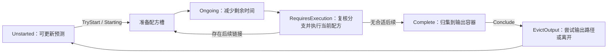

# BOOK OF HOURS：REA 托管程序集证据

2026-10-28 · 本页为只读静态分析；按清单追踪身份、槽位、制作、查找与窗口。以下是已发行程序集的元数据、CIL 锚点及调用关系，**静态取证工具没有加载或执行该程序集，输出不是原始 C# 源码或真人操作记录**。父任务另行启动过游戏并受安全提示阻塞，见[实机启动记录](runtime-attempt.md)，不与本页静态Evidence混为一层。

## 固定输入与实际覆盖

- 目标：`E:/Game/BOOK OF HOURS v2024.12.m.3/bh_Data/Managed/SecretHistories.Main.dll`，1,106,432 bytes。
- SHA-256：`820df80128d65d066b1dfa7d9590cfa2ef60575136a4c764d484f06077e3b6c8`；MVID：`e6a6fd0c-aaa3-45d3-bb18-0e215b918415`。以下所有 metadata token 仅在这个构建内有效。
- REA 6.4.0，provider `rea-dotnet-static` v1；authority `shipped-artifact`。身份解析：Unity/Mono、CIL、managed AnyCPU。PE machine 的 x86 标志不能据此解释为整款游戏只能运行于 32 位。
- 身份 Evidence：`ev_32b9e977d21f2176238c65f759ebe6295ab7ea35bb815c4d3b8d69e8e167a40c`。
- 成员 Evidence（下文简称 **EM**）：`ev_d9041c25a6fcfeb1b7724df8890ffecb79a09c82bdc369e048fd05439dd81c9e`。
- 完整原件本机保存：`E:/Game/BOOK OF HOURS-analysis/2026-10-28/rea/managed-identity.json` 与 `managed-members.json`。本报告只保存分析摘要，不把完整程序集、反汇编或全部游戏字符串发布进设计仓库。
- EM 的 inventory 覆盖：1,033 types、3,796 fields、8,359 methods（7,968 body present／391 absent）、29,959 call edges、11,986 field accesses、1,192 个已加载字面量；`coverage.state=complete`、issues 为空、body 报告的 truncated instructions 合计为 0。这里的 complete 指该解析器对这一个程序集的覆盖，**不表示全游戏、完整语义、动态调用目标或体验已验证**。

复核方法：在 EM 的 `normalized_result.methods` 按 method token 查 `body.anchors`；`il_offset` 为十进制，本页以十六进制 `IL_....` 展示。`call_edges` 与 `field_accesses` 交叉核对目标名；成员引用的 `parent_name` 用于标明外部调用，不把未解析的 MethodSpec 或接口分派编造成确定实现。

## 1. 同一对象有身份、当前位置和表现，书封与书脊共用图像键

**静态观察：书籍并非靠两张图碰巧长得相似来建立联系。** `BookManifestation.UpdateVisuals` 对同一个 manifestable 的 Icon 分别索取封面和书脊；Token 同时保存 payload、sphere 和 manifestation。由此可推断：同一份对象数据可以在不同容器中更换表现，封面／书脊属于这一对象的不同外观。

| 入口（均属 EM） | 可核对的锚点／字段 | 支持的结论及边界 |
| --- | --- | --- |
| `BookManifestation.UpdateVisuals`，`0x06000385` | `IL_0007` 读 `IManifestable.Icon`；`IL_000c` 调 `GetSpriteForBookCover`；`IL_001d` 再读 Icon，`IL_0022` 调 `GetSpriteForBookSpine`；两处随后写 `Image.sprite` | 封面与书脊共享身份键；没有证明某本具体书的图像已经成功加载，也不证明颜色或字形相同 |
| `ResourcesManager.GetSpriteForBookCover`，`0x0600013e`；`GetSpriteForBookSpine`，`0x0600013f` | 前者 `IL_0000` 加载 `books`，`IL_0015` 调本地化查找；后者 `IL_0006` 加载 `_` 并拼接键，`IL_001f` 调本地化查找，`IL_004f` 有 `_x_` 回退键 | 图像关联支持文化／语言差异与回退；不能仅凭英文图推断中文书脊的实际像素 |
| `Token`，type `0x02000216`，以 EM 的完整类型名定位为准 | `_payload`=`0x04000803`、`_manifestation`=`0x04000804`、`Sphere` backing field=`0x04000802` | 身份、表现、容器是不同数据成员；字段存在本身不证明某次交互的去向 |
| `Token.ReplaceManifestation`，`0x0600148c` | `IL_0003` 写 `_manifestation`；`IL_0039` 退役旧表现；`IL_003f` 取得原 payload 后 `IL_004a` 调 `InitialiseManifestation`；`IL_00b4` 用 payload 更新 ghost | 有保持 payload、替换表现和更新拖放影像的实际调用链；不能把 ghost 当成第二份库存 |
| `ElementStack.GetManifestationType`，`0x06001522` | `IL_0001` 取 `SphereCategory` 并分支；`IL_0052`／`IL_00b2` 调 `Element.LivingInTheMaterialWorld`；`IL_0063` 与 `IL_0073` 分别取 StoredPhysical／StoredManifestation；其余路径取 Minimal、Null、FlatPhysical 或具体 ManifestationType | 容器类别、对象是否实体化及对象配置共同参与选择外观；这是静态分支，不能拿某一分支代表全部场景 |
| `ElementStack.OpenAt`，`0x06001532` | `IL_000d` 取 Element；`IL_0013` 调 `AureateNotifier.ShowCardElementDetails` | 查看详情有明确独立入口；此短方法没有创建新的 ElementStack |

书籍实例的建立也可追到 `BookSeed.EdenSetup`（`0x060005da`）：`IL_00ae` 创建 `TokenCreationCommand`、`IL_00b5` 调 `WithElementStack`、`IL_00c2` Execute；此前存在找不到父 sphere、找不到 element ID 的告警分支。这是场景初始播种逻辑，**不能用来断言玩家点开一本书时新建了一份书**。

`BookManifestation.DisplayCover`（`0x06000398`）与 `DisplaySpine`（`0x06000399`）会检查对象 active 状态、切换 GameObject 并调用 `UpdateSize`。静态调用能证明有两种显示状态；何时翻到封面、是否放回原格、动画时长仍需该场景实机图确认。

**清单对应：**P0-2 的身份连续性有较强静态依据；完整操作前后数量、位置和视觉对应仍需外部状态链。P0-4 的实际剪影、笔画、纹理和操作尺寸不能由这里推出。

## 2. 主名、说明、属性关联和图像通过详情层组装

**静态观察：详情并非只放大卡面。** `AureateMasterDetailWindow.ShowDetailable`（`0x060015ad`）先存 `_currentDetailable`，再分别取 `Label`、`Description`、`GetDetailSprite` 和 `GetAspectAssociations`：

- `IL_003c→0046`：名称经 `TextRefiner.RefineString` 后写文本。
- `IL_005d→006c`：描述先走 `EmphasiseBetweenSquareBrackets`，再精炼并写文本；存在对机制补充段落的格式处理，不能据此给所有方括号文本定义同一语义。
- `IL_0077→0115`：取详情图，按图是否存在切换显示并调整尺寸。
- `IL_0121`／`IL_012e`：分别处理可编辑 illumination 与属性关联。

`ElementStack.GetDetailSprite`（`0x060014f8`，`IL_0001`）调用 `ResourcesManager.GetAppropriateSpriteForElementManifestation`；该资源路径最终可根据 IsAspect、Icon、ManifestationType 选择属性图、普通元素图或书封（`ResourcesManager.GetAppropriateSpriteForElement`，`0x06000149`）。因此详情图和桌面表示可以共用 element 的身份映射，详情模板同时容纳机制关联。

**解释：**“对象是谁／有什么说明／关联哪些属性／图像怎样显示”是独立的读取通道，适合让简短常态与深入查看共用同一对象。这里能支持信息架构，不能证明常驻页面实际展示了哪些行、玩家能否只看常态完成下一步，更不能把叙事美感当作已验证体验。

另有 `CardDisplayWindow.OnEnable`（`0x0600160d`）与 `ElementListDisplayWindow.DisplayElements`（`0x0600161f`）：它们按 `IncludeCardsWhereIdStartsWith` 建列表；空前缀时告警并拒绝全量展示。这类内部／特定用途展示窗口的存在，**不能证明普通玩家库存提供名称搜索或全图鉴筛选**。

## 3. 槽位判断区分不符原因，拒绝后有说明入口

**静态观察：不合法投入有结构化理由，并不只改变边框颜色。** `SphereSpec.CheckPayloadAllowedHere`（`0x06000e42`）会读取 payload 的每份属性，依次检查无效 token、Forbidden、Essential 与 Required；`ContainerMatchForStack` 返回匹配类别和问题属性。它与实际拒绝动作相连：

已补核实际游戏分支：`SphereSpec` 构造器在 GameId.BH 时默认选 `AureateThresholdSphere`。EM 中该类 type `0x020001ef` 的 extends_token=`0x02000212`，即 `ThresholdSphere`；ILSpy 辅助反编译确认它是无覆盖的空子类。下列 ThresholdSphere 路径因而是默认 BoH 槽位可继承的实现，不是只因共享引擎名称而强套另一个游戏。

| 路径 | EM 锚点 | 可以得出什么 |
| --- | --- | --- |
| 资格判断 | `0x06000e42`：`IL_0001` 调 `IsValidElementStack`，`IL_001e` 调 `GetAspectsDividedByQuantity`，`IL_0025`／`007a`／`0102` 分别取 Forbidden／Essential／Required | 类型与属性要求会影响槽位资格；按每份计算的接口防止仅凭叠放总量冒充单份资格。具体槽位门槛还须结合它的配置 |
| 拒绝状态与说明 | `ThresholdSphere.TryMoveAsideAndAcceptToken`，`0x0600143f`：资格失败后 `IL_000a` 创建 `RejectedBySphereState`、`IL_000f` 写 CurrentState、`IL_0015` GoAway、`IL_0035` ContainerMismatch、`IL_0040` ShowSlotDetails | 拒绝包含退回／离开逻辑、原因通知与槽位详情；返回到哪里由后续 itinerary／home 逻辑决定，不能只从 GoAway 命名下结论 |
| 可用／不可用视觉 | `ThresholdSphere.ShowInteractionPossibility`，`0x06001446`：`IL_0002` SetGlowColor，随后 Show／Hide GraphicFader；`ShowCantInteract`=`0x06001447` 也 Show／Hide GraphicFader | 存在不同视觉通道；具体颜色、是否足够醒目需看像素 |
| 对象数量与槽位投入 | `0x0600143f`：`IL_0080` 读 Quantity，另一分支 `IL_0089` 创建 `RejectedViaSplit`、`IL_0095` CalveToken、`IL_009e` AcceptToken；单份分支 `IL_00b3` AcceptToken | 实现考虑多份 stack 拆分投入；不能凭这段推断所有对象可堆叠或每个槽位总是只收一份 |
| 悬停寻找可用对象 | `InputSphere.OnPointerEnter`，`0x060006d1`：`IL_000a` 读 GoverningSphereSpec、`IL_000f` PulseUsables、`IL_0014` StartCoroutine；退出 `0x060006d2` 会停止协程 | 可用对象提示与当前槽位规范有关；不能直接推出所有可用对象都在视口内或玩家不会漏看 |

错误说明不是只保留内部 ID。`AureateNotifier.ContainerMismatch`（`0x060015e0`）会读本地化标题／说明并拼接 `GetProblemDescription`（`IL_0032`），再 ShowNotificationWindow（`IL_003d`）。`ContainerMatchForStack.GetProblemDescription`（`0x06000be3`）按错误类型走“禁止属性／需要属性／必备属性”的本地化通道；`ProblemAspectsDescription`（`0x06000be4`）取属性的 Element.Label，且 `IL_0024` 检查 `IsHidden` 后分支。

**多键语义不能按字段名猜。** 对 `SphereSpec` 的 ILSpy 9.1.0.7988 辅助反编译，与 EM 的循环／比较／返回锚点交叉核对后，得到：

| 字段 | 本构建的静态判断 | 易犯的分析错误 |
| --- | --- | --- |
| Forbidden | 逐个 key 检查，每份属性只要含任意被禁止 key 就返回 ForbiddenAspectPresent；这段实现不比较 Forbidden 的 value | 把 `{"X":1}` 解释成“只有达到1才拒绝”或把多键理解成全满足才拒绝 |
| Essential | 每个 key 都必须存在，并且每份属性值都 `>=` 各自门槛；任一失败即拒绝 | 把多项必需条件误当备选 |
| Required | 为空即允许；非空时，**任意一项** key 存在且每份数值达到该项门槛即允许；全部失败才返回 RequiredAspectMissing | 把如 heart／lantern／moon／sky 的备选要求累加成四项同时满足 |

此语义属于槽位的 `SphereSpec`，不应扩大为所有 Recipe.Reqs 也使用 OR。它还只说明资格比较；某物已被其他任务占用、能否从当前位置拖走仍受其他状态检查约束。

**解释：**“先约束候选、再说明为什么不符”是实现中可定位的结构。隐藏属性有显示分支，因此不能假设拒绝说明会公开所有内部条件；这对需要保留隐藏信息的场景有参考价值。这里没有证明言咒的暗牌权限已经可以直接复用。

## 4. 预览、计时、效果执行、完成和取回是不同阶段

**静态观察：开始操作、执行效果与疏散产物分属不同调用路径。** 不宜把“槽位出现一张图”“进度归零”“点击取回”统称为同一时刻的产出。

图是以下 CIL 调用关系的概括，不是实机逐帧时序；自发 verb 的 Conclude 分支会退役情况对象，而非一律回到 Unstarted。

| 阶段 | 关键证据（EM） | 边界 |
| --- | --- | --- |
| 预测与开始检查 | `Situation.TryStart`=`0x06000f68`，`IL_001d` 读 Craftable，`IL_002b` 调 CanExecuteInContext，`IL_0075` StartRecipe；失败／后续路径可 `IL_007c` UpdateRecipePrediction。`StartRecipe`=`0x06000f69` 先 SetRecipeActive，后创建 StartingState | 可执行条件与预测是独立动作；不能只根据界面预告认定效果已经发生 |
| 未开始到已开始 | `UnstartedState.Exit`=`0x06000b58`，`IL_0011` 有 `SituationStorageSphere`，随后 PopulateDominion／FlushTokensToCategory／ClearDominion 的命令入队；`StartingState.PopulateRecipeSlots`=`0x06000b4f` 从当前 Recipe.Slots 建配方槽 | 开始后存在专门的内部占用容器和槽位转换；物品并不因此自动被消耗 |
| 计时 | `OngoingState.Continue`=`0x06000b3c`，`IL_000a` ReduceLifetimeBy、`IL_0010` NotifyTimerChange、`IL_0016` 读 TimeRemaining、`IL_0023→0028` 转 RequiresExecution | 计时零点与效果执行有调用关联，但动画完成、暂停和一帧内先后仍未实测 |
| 执行与分支 | `RequiresExecutionState.Continue`=`0x06000b44`，`IL_003d` ExecuteCurrentRecipe 后 `IL_0052` GetNextValidLink；后续可转 Complete（`IL_0068→006d`）或 StartRecipe（`IL_00ae`） | 不能只按首次预测的配方宣称最终产物；还有 override／linked／induction 路径 |
| 物品效果 | `Situation.ExecuteCurrentRecipe`=`0x06000f52`，`IL_0022→0028` 执行 RecipeCompletionEffectCommand；后者 `0x0600193b` 在 mutation／xtrigger／deck 处理后，`IL_00a0` RunRecipeEffects。`RunRecipeEffects`=`0x06001947`，`IL_000e` 读 Recipe.Effects，`IL_002b` 解析值，`IL_003a` ModifyElementQuantity | 正负数量效果有实际执行入口。具体材料何时耗尽还要追它的 mutation、xtrigger、链接配方和样例；不能一律把负 effects 解释为“点开始即扣除” |
| 完成后归集 | `CompleteState.Enter`=`0x06000b25`：`IL_000b` 加载 `OutputSphere`，随后 PopulateDominion、FlushTokensToCategory、ClearDominion 入队 | 完成有输出容器，未证明某一配方在视口中的具体产物位置 |
| 取回／结束 | `Situation.Conclude`=`0x06000f65`：先问当前状态 IsConcludable，再入队 EvictOutputCommand 和 ConcludeCommand；`EvictOutputCommand.Execute`=`0x060019eb` 先取当前情况的 ElementTokens，记录 returnable 候选，之后尝试 OutputPath，否则 justEvictTokens | 结束包括归还／去向处理；不能当成又生产了一批对象 |
| 输出去向 | `EvictOutputCommand.trySendTokensToPath`=`0x060019ee`：验证路径与目标 sphere，逐个 Unshroud、TryAcceptToken，失败则 GoAway；`justEvictTokens`=`0x060019ed` 逐个 Unshroud 后 GoAway | 有显式路径、回退及解除遮蔽，真实接收容器必须继续结合上下文观察 |

`Situation.TransitionToState`（`0x06000f44`）显示旧 State.Exit、新 State.Enter、set_State、ExecuteCommandsFor、Continue、再次 ExecuteCommandsFor、通知状态和计时的调用顺序。因此上述命令入队有执行框架支撑，不能只凭命令名当作它们已经在某次运行里成功完成。

进度表示也有相互独立的读取：`SituationCountdownDisplay.TimerValuesChanged`（`0x06001828`）会读取 TimeRemaining、Warmup；`IL_0046→004b` 计算并设置进度 Image.fillAmount，`IL_006d→0072` 将本地化剩余时间写文字。静态上支持“条形进度＋剩余时间文本”，具体大小、可读性和是否被窗口遮挡仍由实机验证。

### fatiguing：聚合条件，逐对象变形；不是所有牌共用一个数量扣除

对 `RecipeCompletionEffectCommand` 和 `ElementStackXTriggerCommand` 的辅助反编译补上了关键语义，并由 EM 的实际调用锚点支撑：

1. `RecipeCompletionEffectCommand.Execute(Situation)`（`0x0600193c`）选取 SituationStorage 作为增减元素的容器，取得受 mutation 影响的 sphere 与内部 sphere，再调用通用 Execute。通用方法 `0x0600193b` 先合并情况 payload 的 `GetAspects(includeSelf:true)` 与 `Recipe.Aspects`；用于 xtrigger 的另一份聚合字典也组合这两项。不能把这里的 CatalystPresent 误认为只取单张能力卡的属性。
2. `RunXTriggersInSphere` 遍历相关 sphere 的每个 ElementToken，给每个 payload 执行 `ElementStackXTriggerCommand`。`ExecuteOn(ITokenPayload)`（`0x060019a3`，`IL_0011`）进入 `RunXTriggersOnStack`（`0x060019a4`）。它先取**当前 stack 自身属性及自身 ID**对应的 XTriggers，检查聚合 CatalystsPresent 是否有该触发 key（`IL_007a`），然后执行该条变形。
3. Transform 分支先保存原 Quantity（`IL_0115`），调用原 stack.ChangeTo（`IL_0124`），再按效果 Level 调整数量（`IL_012f`）；Spawn、Mutate、Quantity 是另三种不同分支。因此“能力疲劳”可以表现为原 stack 换 element 类型，而不是删除一张又凭空多领一张。
4. `ElementStack.ChangeTo`（`0x0600153d`）读目标 Element 后重置 Timeshadow、写回 Element（`IL_0052`）、标记属性缓存过期、发 Fundamental 变化事件；保留同一 Token。对象身份连续与其当前功能／外观改变是不同维度。

局部配置核对（普通 JSON 读取，**不是 REA Evidence**）：`bh_Data/StreamingAssets/bhcontent/core/elements/abilities.json` 的 `xcho` 对 `fatiguing` 和 `fatiguing.ability` 均映射到 `zcho`；`xhea→zhea`、`xsha→zsha` 同理。MorphDetails 的字符串快写形式默认 Transform、Chance=100、Level="1"（辅助反编译 `MorphDetails.QuickSpec`）。这支持在含 fatiguing 催化属性的执行阶段将匹配能力 stack 变为疲劳对应物，原数量乘1保留；不能把 fatigue 写成不可逆消费。

**时点限制：**调用链把此处理放在当前配方的效果执行阶段，而不直接放在单纯 TryStart 中。若某流程先执行 warmup=0 的启动配方并链接到正式计时配方，则玩家可能看到“开始后马上疲劳”；若 fatiguing 只在后续完成配方出现，则发生在后续执行。必须结合具体配方链才能定位，未观察实机前不得把全游戏统一写成“全部开始时扣除”或“全部最终完成时疲劳”。

## 5. 收藏整理有排序与位置恢复，名称搜索仍 Unknown

**静态观察：手牌整理考虑了玩家已建立的位置记忆。** `UIHandSphere.RequestSortTokens`（`0x0600083c`）在排序前调用 `TryStoreTokenPositions`（`IL_004b`）并设置可撤销，再按当前排序按钮状态调用 Choreographer.SortTokens；两个分支分别切换默认／按等级排序按钮（`IL_0070` 与 `IL_0085`）。

- 保存：`TryStoreTokenPositions`（`0x0600083e`）在字典内保存每个 Token 对应的 Transform.localPosition（`IL_003d→0047`）。
- 恢复：`TryRevertTokenPositions`（`0x0600083d`）先检查原 token 仍在当前集合，随后将记录值写回 Transform.localPosition（`IL_004d→0052`）。这支持恢复位置的实现意图，不能保证对象新增／消失后全布局复原。
- `ElementStackSimple.DisplayInfo`（`0x0600145a`）分别显示 Element.Label 与 `_quantity`；`Populate`（`0x06001459`）还会按数量分支设置显示。这里不是对全库存数字策略的穷尽检查。

检索边界：在 EM 的全部 `methods[].declaring_type/name` 中检查了 search／filter 和明确关联入口。命中 `EntityStore.GetFilteredList`、`TokenSelector.FilterTokens`、FucinePath 的过滤解析及若干内部筛选，不足以证明它们向玩家提供输入名称查找。`CardDisplayWindow` 与 `ElementListDisplayWindow` 的 ID 前缀过滤也不等于普通收藏搜索。**“该版本有没有玩家可用的按名／按属性搜索”保持 Unknown，不能写成不存在。**

**清单对应：**P1-7 的排序、位置记忆、份数显示有静态线索；“已知名称／条件／刚获得”三类真实查找路径、收藏规模负担与一次漏找仍未覆盖。

## 6. 窗口可拖动并纠正越屏，不能因此推断不会遮挡

`WindowPositioner` 的拖动与屏幕边界调用链可定位：`MoveObject`（`0x0600180a`）从 PointerEventData.position 转为世界坐标后 SetPosition（`IL_0046`）；`GetBoundCorrectedWorldPos`（`0x06001802`）调用 `GetScreenPosOffsetForCornerOverlap`（`IL_0002`），后者（`0x06001803`）读取 Screen.width／height，对角点计算偏移并使用 Min／Max 修正 x／y。

**另一个关键限制是情况窗口互斥。** `Situation.OpenAt`（`0x06000f5b`）在设置 IsOpen／通知后，于 `IL_0034` 调 `Meniscate.CloseAllSituationWindowsExcept`。该方法（`0x06001347`）遍历 registered situations，比较 ID，对其他情况 `IL_0041` 调 Close；`IL_006f` 还隐藏 TerrainDetailWindow。ILSpy 辅助确认具体分支为“非当前 ID 则关闭”。这支持“多任务可并存，但打开新情况会关闭其他情况详情”的静态规则。它没有排除属性详情、通知、其他非情况窗口并存；不能缩写成整个游戏只允许一个窗口，也不能假造两个制作情况窗同时展开的画面。

**可推断：**窗体设计考虑了拖动和越出屏幕边界的问题。**不能推断：**多个窗口之间不会遮挡、任务完成总能发现、缩放后详情仍舒适、原任务焦点会自动恢复。这些是清单 P1-8 必须保留实机证据的部分。

## 结论与未覆盖

本轮可较可靠支持四个结构判断：同一对象以 payload／manifestation 分离维持多种表示；槽位资格能返回具体原因并打开详情；制作的预测／运行／执行／输出／结束有不同状态与命令；收藏排序会保留原 token 的位置以便恢复。它们都是可借鉴的表达结构，尚不构成言咒的正式设计选择。

未覆盖：本地资产的实际像素、语言与缩放下的文字可读性、某一本书的完整移动、具体材料的真实扣除／归还时点、合法与错误操作的实测、较大收藏的查找负担、双任务漏报和窗口舒适性。动态接口分派、未解析的 MethodSpec、外部 Unity DLL 行为与其他程序集不因本次 EM 的 complete 标记而自动闭合。

REA 原始限制保留：token 为 build-local 坐标；仅解码文件内 CIL，没有加载或执行目标；导出类型不解析到实现程序集；字符串仅代表已检查 body 中的 ldstr；签名支持有限 ECMA-335 形式，无法完整解码的形式保留原始签名哈希。缺失 method body 不补写推测实现。

辅助工具：既有 `E:/Game/PotionCraft-analysis/2026-10-25-v1.0.5/tools/ilspy/ilspycmd.exe`，ILSpy／ICSharpCode.Decompiler 9.1.0.7988；未安装或更新工具。只反编译本页精确类型，输出原件在本机 `E:/Game/BOOK OF HOURS-analysis/2026-10-28/rea/ilspy-*.txt`。辅助文件不是 REA Evidence，也不是原始源码；用于还原锚点间控制分支，并与 EM 对照。没有执行游戏程序。
