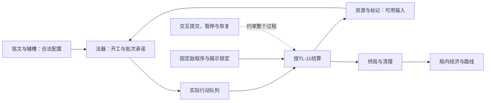

# 言咒设计系统审查：精简、人工审校与任务披露

2026-10-23 · game-002 · DocumentationReview / Proposed。本文是治理建议与派生试排，不是玩法Proposal、正式Evaluation、Draft Change或CurrentSpec；没有修改规则、资格、采纳或验收状态。

**建议先把“人审一项行为”和“开发一项任务”做成两种阅读视图，继续共用唯一规则正文。** 先证明一项真实规则能被完整、清楚地审校，再迁移其他部分。文件更少、摘要更短，都不能单独证明改造成功。

阅读顺序：[现状与诊断](#1-现状与诊断) → [目标结构](#2-目标结构) → [人工审校](#3-怎样精简并让人能审) → [真实试排](#4-试排打断当前批次) → [开发任务样例](#5-任务披露样例ex-002第13拍打断与恢复) → [落地顺序](#6-落地顺序与完成标准)。本页是本次审查的唯一入口。

## 0. 输入、覆盖与授权

用户原话：

> 你负责进入yanzhou的design系统，全量阅读目前GDD，帮我整理一下现行设计系统结构，给出下列问题的解决方案：
> 1.系统文档太长，细节很多，难以人工逐个审查，又存在臃肿的边界处理规则，需要精简，但又不能只让AI“优化GDD结构”；
> 2.和开发任务匹配不够，每次任务读全量GDD，既分散注意力，也不能转化为开发的直接指导，让模型在开发时总是注意力漂移，我需要渐进式的披露的新结构和可人工审校的方法

- 固定输入：Git提交 `e65d2c35075e52a39673cb82147f538430ea0ce8`，不是后续变化中的HEAD。
- 游戏材料模式：GDD；另含用户指定design系统的导航／摘要，以及项目开发启动包与本任务必要治理规范，组合记录为CUSTOM。GDD部分按[READ-1固定清单](../exploration/start.md)全文读取56/56份；design目录全文覆盖72/72份Markdown，没有用标题或检索代替全文。
- 56份构成：GDD／README／baseline 3份；六主系统与两子系统四类正文32份；三公共流程四类正文12份；内容3份；跨系统案例3份；parameters／validation／source-review 3份。
- 额外16份design文件：core-design、core-concept、legacy-index、systems/README、common/README，以及八系统／子系统和三公共流程各自README，共11份。没有递归打开其中的来源链接。
- 补读的项目工作材料：CONTEXT；development的README、iteration-spec、development-standard、production-plan；governance的questions、document-contract、rule-index。操作依据还包括适用AGENTS、READ-1、探索AGENTS、设计流程、模板索引、Git协作规范，以及gdd-toolkit及其project-integration。
- 未读：sources原件、decision-log历史正文、其他审查报告正文、effects、visual、探索方向正文、外部代码与历史快照。来源资格与旧技术证据仅按当前基准及入口的声明报告，没有独立重审其原件。
- 启动时只有exploration/README与DIR-040未提交改动；design无工作树差异。它们未作为本次设计证据，也不纳入本次提交。
- 本轮进行了文档阅读、字符统计、引用核对与纸面对照；未运行游戏、模拟器、玩法实验或实现检查。

以下字符数按固定提交的UTF-8文本解码为Unicode字符、换行统一LF计算，含空白；不是token数。

## 1. 现状与诊断

### 1.1 当前结构已经具备什么

规则基线为GDD 2.6 / GDD-0，TL-1＋INS-1，CORE-037—063及physical-table.2。原SYS身份与现用目录数量分开；44个现行TL身份不等于44个可独立开发的功能。

| 层面 | 当前位置与职责 | 当前局限 |
| --- | --- | --- |
| 总体理解 | core-design摘要；GDD的0—18章；CONTEXT术语 | 有整体介绍，但不能直接回答某次任务该读哪几段 |
| 版本与资格 | baseline统一解释Accepted、Qualified与案例范围 | 资格需要人或模型从文件、段落和来源关系中继续判断 |
| 六主系统 | 法器、铭文、行动卡、敌人、资源、局外成长 | 局外成长尚未开发，目录形状与成熟系统相同 |
| 两子系统 | 铭文下的辅槽；行动卡下的标记 | Qualified框架与局部Accepted接口并存 |
| 三公共流程 | 路线、局内经济、交互与保存 | 最后一项承担通用交互、恢复和多轮首场表现合同 |
| 每模块五文件 | README导航；rules行为；design理由；experience假设；examples情境 | 按陈述类型分得清，但人工审一项行为仍需跨页拼接 |
| 内容与案例 | content定义内容字段；EX-001／002保存实际配置 | 通用例、案例值、储备候选不能自动互换 |
| 参数与验收 | parameters共同域；validation验收预期 | 验收按历史增量追加，开发还需重新筛选适用输入 |
| 来源与工作 | source-review、sources、decision-log；questions；development | 权威职责已经明确，但默认阅读尚未形成任务所需的闭合输入 |

实际玩法依赖可概括为：

开发任务通常沿这条行为链穿过多个目录；现有目录按设计对象组织，两者天然不一一对应。

### 1.2 体量集中在哪里

| 对象 | 文件数 | 字符数 | 占56份GDD包 |
| --- | ---: | ---: | ---: |
| 完整GDD包 | 56 | 112,356 | 100% |
| design全部正文与导航 | 72 | 120,237 | 另含16份摘要／导航 |
| 各rules正文 | 11 | 27,987 | 24.9% |
| 各系统／公共流程examples | 11 | 17,510 | 15.6% |
| source-review | 1 | 16,804 | 15.0% |
| validation | 1 | 13,350 | 11.9% |
| 交互与保存rules（已包含在rules合计） | 1 | 9,807 | 8.7% |
| GDD主页 | 1 | 3,784 | 3.4% |

来源审查与验收计划合计26.8%。这不是“26.8%都应删除”：它说明日常开发如果载入完整包，会为取证过程和无关验收付出很大阅读成本。只压缩GDD主页，收益有限。以上没有测量语义重复比例、模型注意力或人工耗时。

### 1.3 需要解决的具体结构问题

**A. 审查单位与开发单位不一致。** 例如“打断当前批次”在法器TL-07，锁定对象在行动TL-09／12，先打断后完工在TL-11，材料归属在资源TL-15，冻结释放在标记页，恢复在TL-19，实例输入在EX-001。每处各有合理职责，读者却要自己拼成一项完整行为。

**B. 单条规则容纳了过多不同决策。** [TL-11](../design/systems/action-card-system/rules.md)同时定义五阶段、阶段内次序、复合牌、目标、逐步支付、完整事件、附属反应、死亡、疲劳、暂停恢复。共同拍序必须统一，但这些内容不必每次作为一个阅读块展开。问题不是TL身份太少，而是身份之下缺少可独立定位、仍相互约束的子段。

**C. 通用约束被各消费者复述。** 完整检查才承诺、足额支付、冻结量不可读／付、中断有效量下拍可用，在法器、辅槽、行动、标记、资源、示例和验收中反复出现。有些是必要的场景解释，有些可以改为引用。不能用文本相似度直接删：各处的读取时点、支付阶段和失败后果可能不同。

**D. 通用规则与场景表现合同绑在一起。** [交互rules](../design/common/interaction-save/rules.md)先写通用TL条款，后按CORE-060／061／062／063追加播放、声音、失焦及3D合同。逻辑任务无需默认载入所有键位、字号和空间宿主；3D任务又必须完整读取这些义务。2D尚未形成替代合同，不能靠“只读相关内容”将CORE-063视为失效。

**E. 来源时间线与当前视图混杂，产生旧Unknown。** 可直接观察到：source-review页头仍称“当前GDD-0 / 2.1”，legacy-index写“当前设计GDD 2.2”；validation早段仍称多个维护对象争料没有唯一预期，后文CORE-057已经给出次序；EX-001末段仍将自动暂停交TL-Q08，而EX-002已有CORE-060。本轮不把它们另登记为新玩法问题：历史记录保留原貌，现行派生说明需要标清适用案例和后续覆盖，避免旧语句被重新当成开放问题。

**F. 固定五文件模板产生空壳及错误复用。** 局外成长五文件没有可实施机制；交互examples竟沿用“EX-001第9—10节／路线另配”的通用说明，缺乏自己的交互情境入口。需要调整的是按成熟度披露和内容职责，不是把五文件机械合成一份更长文件。

**G. 现有任务制度已写明，但缺少实际装配结果。** [开发规范第2节](../development/development-standard.md)已经要求玩家行为、固定输入、范围和验收；8文件启动包也已禁止默认全量GDD。缺的是可直接开工、可人工检查的具体任务视图，以及它与唯一规则正文的对应关系。无需再建任务数据库。

此外，[FB-Q01／02](questions.md)是真正的玩法未决：零材料首场缺主动调度支点，积累／兑现取舍未闭合。结构改造能暴露和隔离这些问题，不能通过改写文档替用户决定新机制。

## 2. 目标结构

### 2.1 保留唯一正文，增加明确的披露顺序

建议先改变内容组织和阅读方式，保留现有六主系统、两子系统及三公共流程导航。下表是阅读角色，不是建议再建五套文件树。

| 阅读角色 | 读者需要知道什么 | 建议沿用的位置 | 何时展开 |
| --- | --- | --- | --- |
| 入口与范围 | 游戏目标、本轮能力范围、版本、任务入口 | development/README、core-design、baseline | 接手定位；日常任务只取相关范围 |
| 人可审的行为合同 | 玩家能做什么；主流程；关键代价；不能改变什么；待决 | 在对应rules中先给短主路；design保留理由 | 审一项行为时默认显示 |
| 完整规则细节 | 时序、支付、资格、失败、恢复及适用例外 | rules内有稳定定位的子段；相关examples／validation | 任务明确依赖或审校边界时 |
| 内容与观察 | 本配置数值、输入、可见结果、体验假设 | content、EX、experience、validation | 选中具体案例或体验目标时 |
| 来源与历史取证 | 为什么采纳、原话、旧失败、替代范围 | source-review、sources、decision-log、固定Git | 需要裁决来源、查历史或核验采纳时 |

**开发任务视图横向选取这些内容，而不是形成新的权威层。** 它说明“这轮执行哪些既有规则、用哪套输入、检查什么”，不能产生另一份可独立修改的规格。人工修正了任务视图，也不自动回写玩法规则。

### 2.2 系统正文如何变薄

1. 每项行为先写目的、合法入口、正常结果与最重要的约束。正常路径应能连续读完，细节用条件表逐层展开。
2. 共用规则指定唯一权威段。各系统只写自己贡献的输入／输出和适用引用，不再复述整套支付或恢复流程。
3. TL-11仍是共同总序权威，内部按“拍序／步骤与支付／完整事件与终局／稳定次序”定位。保留TL-11身份；新增章节定位不是重新分配规则ID。
4. 通用交互、EX-002播放、音画、失焦、3D宿主分别成为可定位的适用段。初期可在原页重排；以后确有必要再迁移正文，不能新旧两处同时维护。
5. design与experience继续区分理由和假设，但默认审阅页可将有关段落并列引用。未开发系统可在导航只显示状态，暂不加载空壳正文。
6. source-review及validation继续保留来源和身份。日常视图按当前行为／适用范围筛选，历史增量及累计计数不进入默认任务上下文。

这需要在采纳治理方案后同步document-contract、开发入口及受影响READ-1；目前“五文件必须保留”和8文件默认包仍有效。本报告不直接豁免或改写它们。

### 2.3 渐进披露不能只按“核心／高级”分类

阅读由任务、适用配置与实际依赖决定，不由规则看起来是否复杂决定：

- EX-002规则任务：读取固定内容、相关生产／队列／敌情／恢复语义；没有维护对象就不展开维护算法。
- 现有3D表现任务：在上述行为事实之外，必须展开CORE-060—063及physical-table.2对应段。
- 新2D任务：PRE2D-Q01尚未闭合，不能把3D条款过滤掉就宣称可实施。先完成限定替代与采纳，再装配该方向任务输入。
- 全局规则改动：需要扩大受影响内容、调用方和验收范围。任务阅读量会变大，不能用硬字数上限切掉必要依赖。

始终区分：Accepted约束、Qualified设计输入、案例限定值、说明性推导、Hypothesis／NotRun。标注应落到所选段落与内容，不能仅依赖文件头。

## 3. 怎样精简并让人能审

### 3.1 先区分四种动作

| 动作 | 可以做什么 | 人工审的重点 | 是否改变玩法 |
| --- | --- | --- | --- |
| 合并表达 | 同一义务只保留一个权威段，其他改引用 | 原适用域、时点、失败与来源是否全部保留 | 应当不变 |
| 按条件折叠 | 从默认阅读隐藏，仅在实际依赖时展开 | 触发条件明确，遗漏后能否自动发现 | 不变；隐藏不等于失效 |
| 推导情境 | 将长解释变成状态表或一个有辨识力的正反例 | 输入充分，推导符合原文，没有补默认值 | 应当不变 |
| 删除／限制机制 | 减少状态、放宽支付、去掉反应等 | 玩家能力、收益、失败或恢复是否发生变化 | 改变；必须走资格、变更及采纳 |

“低概率”不单独构成删除理由。保存失败、重复支付、同点双亡等即使少见，也影响结果可信度。相反，尚无具体内容使用的通用反应扩展，可以从首场任务中隐藏；它仍是现行规则，未来启用时要读。

### 3.2 给AI的改造任务应有明确产物

不要派“优化GDD结构”。派下面这样的限定任务：

> 只处理TL-07及列出的相邻接口。在固定版本下列出原行为义务，给一份主路＋条件表的候选表达；逐项标明保留、合并引用、条件披露或需要设计裁决。不得新增能力、默认参数或改变支付／时序。附正常、中断、资源争用、终局和恢复的相关反例。人工审完这一项，再扩到下一项。

审查对象是一项完整行为，不是每个文件，也不是一句话切成无限多条的新规则。内部核对表直接附在本轮审查记录中；不新增全局迁移映射表、问题库或规则数据库。

### 3.3 人工每次只审一张行为对照

一张对照包含：

1. **原义务及来源定位。** 谁在什么条件、哪个时点改变什么；费用、结果、失败、终止与恢复分别是什么。
2. **候选主路。** 让人能用自己的话解释行为，而不是读满屏例外。
3. **差异栏。** 保留在哪里、从默认阅读隐藏了什么、有没有新增或失去能力。不能只展示改写后的漂亮文本。
4. **最少的一组区分情境。** 一个正常输入，以及足以区分危险误读的失败／交界输入；数量由行为风险决定，不要求机械穷举所有系统组合。
5. **审阅结果。** 表达可用／退回修改／需要玩法裁决／暂缓。候选表达尚未审阅时保持Proposed。

建议每批只组合少量相互有关的行为，让用户能一次判断；批量大小由能否读懂和回答决定。人工重点判断“这是否仍是我想要的行为”“这些例外值不值得保留”，规则ID、引用、覆盖与计数由工具辅助检查。

### 3.4 两类检查缺一不可

**文档保真检查：**旧义务全部有去处；规则身份可定位；Accepted／Qualified／案例范围不变化；数值仍在唯一位置；来源固定；原反例与NotRun保留。工具可以发现缺引用、缺覆盖和失效版本，不能证明任意自然语言改写语义等价。

**人类理解检查：**审阅者只读候选主路与必要情境，解释输入、结果、代价和例外。若关键结果需要靠AI口头补充，文档仍不合格。解释不同先判断原文歧义、改写遗漏还是玩法取舍，不立即增补又一条兜底规则。

若精简涉及真正减少规则或玩家账目，必须另列行为变化和受影响情境，经原设计流程选择；不能把它夹在“无损整理”中。

### 3.5 目前哪些边界先怎么处理

| 现行内容 | 它为什么存在 | 本次建议 |
| --- | --- | --- |
| 完工、入行、生效分开；普通离队与中断回收不同拍可用 | 直接决定应对截止、产能和机会成本 | 保留为核心语义，统一成一张时序／容量表；不能作为冗余删去 |
| 读取、玩家锁定、批次冻结、待释放、未来预告的不同余额 | 防止重复消费，承载保留与支付的实际能力 | EX-002只披露实际存在的余额；若用户认为这些账目本身过重，单独审它们各自支持哪项真实选择，再决定机制简化 |
| 多目标、复合反应、定时并存、维护恢复 | 支持扩展内容，并非本首场都在使用 | 从首场默认阅读折叠；下一种内容用到时再完整展开。删掉已采纳通用能力属于另一项设计变更 |
| 暂停、单步、载入、失焦多处“不补播／不重付” | 各入口共用政策，同时又有不同状态保留要求 | 共用政策归一处；各入口只列附加条件，保留失焦草稿和单步终点等独有差异 |
| 取整后无收益仍收费、冻结量失效不补扣 | 是已选定的具体玩法取舍，不能由一般支付原则唯一推出 | 明确保留为例外；若希望减少例外，向用户展示行为和代价后裁决，AI不擅自改成“更直觉”的版本 |

这里首先区分“日常不必看”与“游戏不应有”。真正应不应该有某个机制，要由其支持的玩家选择和实际内容来判断，不能根据例外段落长短投票。本报告不预先替用户选择新的支付或状态机制。

## 4. 试排：打断当前批次

以下仅是对当前文本的派生阅读样例，尚未经用户审校；权威仍为[法器TL-07](../design/systems/artifact-system/rules.md)、[行动TL-09／11／12](../design/systems/action-card-system/rules.md)及[标记冻结](../design/systems/action-card-system/mark-system/rules.md)。

### 4.1 默认先读这段

**明示打断在到期时中断锁定法器当时的加工批次：该批不产行动，进度丢失。普通材料退回，容量和仍有效冻结标记释放，这些回收量最早下一拍可用。若还有其他本来就可用的完整材料、必要标记和独立空位，法器可在当拍末重开。已入行牌保留。普通伤害不打断，本规则不提供玩家主动撤销。**

这段保留主因果，但不能单独替代锁定、完整事件与状态生命周期合同。需要相应判断时再展开下表。

### 4.2 按触发条件展开

| 本次涉及什么 | 必须补读／保留的条件 | 来源 |
| --- | --- | --- |
| 揭示时选谁 | 选剩余R最大的加工法器，含R=0；并列沿战前法器序。锁法器，不锁原批次 | TL-09 |
| 到期时没有批次 | 无锁定、法器消失或当前无批次均落空一次，不改选、不等待、不转伤害 | TL-12 |
| 原定本拍完工 | 先行动，后幸存完工；被打断的批次不能再完工 | TL-11／07 |
| 有冻结标记 | 仅释放仍有效量；过期或合法移除的不复活，不补扣新增量；其他阶段已付费用不按本条退款 | 标记CORE-055／057、TL-07 |
| 试图当拍重开 | 回收量尚不能用；检查其他原本可用的完整输入及独立空位，不额外加整机冷却 | TL-07／05／11 |
| 有保护或普通伤害 | 普通护甲不挡单列打断，明示保护按权限；普通掉血不引发中断 | TL-12 |
| 事件后终局／暂停恢复 | 终局停止后续完工、开工；恢复保留已结清步骤、回收可用拍和原选定行动，不重复支付或结算 | TL-11／13、TL-19 |

### 4.3 人工对照：TL-07原有义务是否遗漏

| 原义务（依据本轮固定文本） | 试排承载处 | 当前纸面对照 |
| --- | --- | --- |
| 明确打断指定法器当时的批次；普通掉血不打断 | 主路；条件表锁定／伤害行 | 已保留 |
| 无行动产出、丢进度、普通材料退回 | 主路 | 已保留 |
| 解除预留，容量与退料最早下拍可用 | 主路；条件表重开行 | 已保留 |
| 只释放仍有效冻结标记，下拍可用；失效量不复活 | 主路；冻结行 | 已保留 |
| 其他阶段已支付费用不按中断退款 | 冻结行 | 已保留，不能简写成“所有投入退回” |
| 另有原本可用的完整材料、标记和独立容量可当拍重开 | 主路；重开行 | 已保留，不能简写成“一律下一拍重开” |
| 已入行牌不消失；不授予主动撤销 | 主路 | 已保留 |

结论仅为本次人工文本对照，**不是用户已确认表达等价，也不是运行通过**。TL-09／12等相邻义务已在条件表显式列出，不能因TL-07核对通过就声称整条打断链全部验收。

### 4.4 用四个问题审这张卡

- 本批t拍被打断，只有刚退回的料和容量：能否t拍重开？不能。
- 另有原本可用的完整输入与独立容量：能否t拍末重开？可以，前提是未终局且统一开工检查通过。
- 揭示时锁定的原批次已经完成，T时同法器在做新批次：新批是否会中断？会。
- 冻结2层，其中1层已自然失效：打断会返还几层？只释放仍有效1层，最早下拍可用，不复活失效量。

关联既有预期可选TL-V06／48／56／64／65／72／75／95；按具体内容是否存在该机制选择，不能把抽象预期自动当完整可运行输入。

这个样例的价值是降低默认阅读的拼接负担，并暴露危险简写，不承诺每条规则都能压缩同样比例。含完整对照与来源的审查底稿可能更长；它不进入日常开发默认上下文。

## 5. 任务披露样例：EX-002第13拍打断与恢复

本节是文档装配样例，不是新开发任务授权，不打开外部工程、不派实现或测试。它引用已经确定的配置，避免用尚未闭合的FB-Q01新能力举例。

### 5.1 任务首屏：可以人工审的一页输入

| 字段 | 本例填写 |
| --- | --- |
| 玩家可观察的结果 | 打断取消在制批次，旧队列牌保留；有独立空位可重开；中途恢复不重复加甲、记次或释放容量 |
| 设计版本 | 本报告固定提交；EX-002 complete-battle.1；它复用的EX-001内容固定在其声明的`5c542e12c53a5ba3044b6e647e6c3950e9260bc5`。本轮只读了当前GDD中的引用与内容，没有另读该旧快照 |
| 适用能力 | EX-002固定单战的打断、批次、队列与结清恢复；不是任意未来构筑 |
| 输入 | 无迅速、无锁定，第7拍改兑现；守护D2、施法D3、Q5；r8打断已锁施法，T13 |
| 范围外 | 主动启停、战中重铭、材料链、开工冻结标记、周期登记、维护、多敌及表现重做 |
| 必须守住 | 打断先于完工；回收容量t+1可用；当拍重开使用独立容量；一拍只有一个已选玩家队首；终局立即停止后续 |
| 开发前仍须绑定 | 实现仓库、代码起点、文件所有权、已有实现偏差及检查入口；本次未审代码，不能代填 |
| 设计阻塞 | 这个限定回归不需要选择FB-Q01／02；若任务扩成新首场或2D界面，原有设计闸门仍适用 |

### 5.2 固定情境与预期

沿EX-001第7节的路径，第12拍末：队列G、B；守护12→14，施法12→15；生命26、甲8、敌42、标记8。

| 检查位置 | 应有结果 | 为何值得查 |
| --- | --- | --- |
| 第13拍防护后、打断前 | G已加4甲，玩家26／12；标记仍8；G仍是本拍原选定牌，B不能补翻 | 防护与记次跨组，不把整卡当原子事件 |
| 打断后、G记次前 | 施法12→15批次取消，不产牌；其1容量待14可用；已入行B保留 | 防止追溯删旧牌或立刻复用回收量 |
| 第13拍末 | G记次完成后标记9；队列B；守护预留1、新施法13→16预留1、待复用1：1+1+1+1=4≤Q5 | 明确重开来自独立空位，不是整机冷却或释放量提前使用 |
| 第14拍开始／随后B生效 | 待复用1变可用；B付5打18再记1，标记9→4→5，敌42→24 | 防止早记次、费用错位或恢复重付 |
| 在“打断后、记次前”恢复 | 保留G已加甲、未记次、B未获本拍机会；回收量仍到14才可用；继续原步骤得到同一13拍末状态 | 一个恢复点同时区分重复支付、重做、补翻和提前释放 |

这是对现有案例的纸面装配，未执行。指定恢复点只是未来需要核对的输入位置，不宣称代码已经支持从该点恢复。

### 5.3 执行者需要的规则切片

| 用途 | 精确补读范围 |
| --- | --- |
| 本批中断与重开 | 法器rules的TL-07；TL-05有关联合检查与独立容量的段落 |
| 锁定及落空 | 行动rules的TL-09／12 |
| 步骤位置与机会 | TL-11五阶段表、玩家唯一队首、跨组同卡、完整事件与终局边界；不只读五阶段标题 |
| 恢复 | 交互rules的TL-19，及本次所用的完整事件暂停约束 |
| 内容与基准结果 | EX-001第2—7节中本套组及12—14拍行；EX-002第1节及第5节恢复约束 |
| 检查预期 | TL-V48／56；恢复参考TL-V52／58／96中本配置适用部分，结合上表明确初态；不声称这些条目覆盖整个首场 |

冻结／维护／附属反应本例没有实际内容，不要求执行者加载其完整算法；但任务首屏明确排除这些能力。若公共实现会同时改变这些行为，需要扩大影响面并补入相关规则与预期，不能仍以“EX-002没用”为由跳过。

### 5.4 三段披露与防漂移约束

**第一段：任务首屏。** 先给目标、固定范围、预期表和设计状态。执行者应能回答“这轮实现什么、怎样算对、哪些事不能顺手做”。

**第二段：必读细节。** 在开工前装配全部直接依赖及相关传递依赖，包括失败、资源可用拍、恢复与终局。不能等到实现失败才第一次披露关键约束。对依赖环先固定相关接口；依赖过大就拆任务或解释扩大阅读，不能任意截断。

**第三段：按已授权范围查证。** 只有需要核验采纳、歧义或历史原因时才读来源。范围外材料列缺口，依READ-1增补，链接本身不构成权限。

执行记录附最小来源清单：固定设计提交、路径＋章节／选中内容、适用状态；工作树来源另记哈希。任务视图摘录如被保存，须标派生及源版本。权威段变化后明确失效或重新核对，不静默更新一个仍标“已审”的包。不要为每次启动重新复述整个GDD。

设计侧维护行为、适用范围和验收定义；任务执行清单、代码位置、命令、构建与运行证据留实现仓库现有记录。development只链接范围与结果，不复制成另一套任务系统。

阅读预算可以作为提醒：任务首屏争取一屏／短页，行为细节争取只包含必要义务。先测真实任务的字符数、查阅次数和歧义，再定预算；本轮没有验证固定token阈值，也不建议硬压到某个数字。

## 6. 落地顺序与完成标准

### 第一轮：只验证一个行为的可审性

以本报告TL-07试排为起点，人审原义务、候选主路和四个反例。分别记录表达意见与玩法简化意见；前者整理正文，后者进入设计流程。本轮已经提供候选和纸面对照，尚无人审采纳。

### 第二轮：拆开最大的两个阅读团块

- TL-11：保留总序与身份，将稳定定位、步骤支付、完整事件／终局、条件性反应分开披露。先对相关TL-V83—96逐项核对，再处理其他依赖。
- interaction-save：区分通用合同与EX-002各适用合同，合并多次出现的暂停归位／不补播等表达，但明确每种入口的附加状态与例外。3D合同继续有效，2D替代单独采纳。

先在原权威页试排并审校，避免一开始移动所有文件。确认组织方式后再决定是否物理拆页；同步document-contract、rule-index和被影响的阅读清单。规则ID不复用，历史证据不重写。

### 第三轮：让任务入口真正消费新结构

用两个相互不同的限定任务检查：一个规则／恢复任务，一个已确认表现任务。为它们装配首屏、必读细节、内容参数、正常与失败预期。对比原启动方式：执行者是否仍需全文阅读；找答案需跨几处；哪些问题原文已定却被再次提出；是否出现遗漏依赖。

这可以先作为文档审阅练习，不启动玩法实验。真实开发与运行验证须有具体任务授权，沿现有阶段和设计闸门推进。

### 完成标准

| 目标 | 必须看到的结果 |
| --- | --- |
| 精简有依据 | 试点每项原义务可定位；合并／隐藏／变化分开；不能以字数下降替代保真 |
| 人能审 | 审阅者能预测关键情境，能指出规则的代价与例外；不依赖聊天补充隐含规则 |
| 开发输入闭合 | 任务的正常、失败、终局、恢复及公共实现影响已有明确依据；任务内未知不能靠实现者猜填 |
| 读取更聚焦 | 试点任务能用明确切片完成理解；确需大范围时给出依赖原因，不机械禁止全文 |
| 状态不漂移 | Qualified不晋级；案例值不全局化；新2D不继承旧3D通过；NotRun不变成Passed |
| 维护成本可控 | 沿用原权威与现有任务记录，没有第二套GDD、问题库或人工双写的长期任务规格 |

**推荐下一项具体工作：先人工审TL-07这张对照卡，再做TL-11分段试排。** 暂不批量改72份文档。需要决定的管理取舍是“先逻辑分层、后物理迁移”“按成熟度放宽空壳五文件”“将默认启动改为按任务装配”；目前均为本报告建议，尚未写成现行规范。

## 7. 本轮交付与限制

- 交付：当前结构与体量、七项具体诊断、目标阅读结构、精简分类、人工审校方法、TL-07完整义务对照、EX-002任务装配样例、分轮完成标准。
- 静态核对：56份GDD与16份额外design文件全文覆盖；字符统计按固定提交；样例与现行规则、EX数值及既有验收身份对照。
- 保留未知：未审外部实现，未测模型注意力改善、任务完成率或人工审阅耗时；未验证新结构的实际开发收益。未决玩法仍由questions维护，本报告不新建问题身份。
- 本轮只新增本治理报告；没有移动、删除或覆盖GDD、来源、模板、AGENTS、启动合同及用户未提交探索材料。提交／推送身份见本轮交付消息及Git历史，不在本文件内自引用自身提交。
