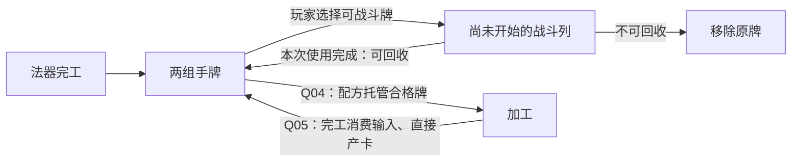

# 统一卡牌与手动上行：具体变更审阅稿

2026-10-27 · game-002 · **Draft Change / 部分取舍已确认，完整合同待审 / GDD-0**。不是已发布CurrentSpec；尚未分配新的CORE采纳编号。实现、程序模拟、玩法与体验验证均NotRun。

来源：[已确认素材M](../materials/M-2026-10-27-unified-card-model.md) → [提案P](../proposals/P-2026-10-27-unified-card-model.md)／[评估E](../evaluations/E-2026-10-27-unified-card-model.md)。共同输入版本及既有决定准确定位只在[输入摘要](../inbox/2026-10-27-unified-card-model.md#固定输入与已核实决定)登记。

## 修改目标与已确认范围

统一原资源卡与行动卡的身份、生产去向、战斗使用及配方接口；同时修正手牌、终局／保存、案例与任务包，避免一张牌同时算材料和待执行战斗牌。以下C项来自用户明确指令，不再请求确认：

| 已确认 | 结果 |
| --- | --- |
| C1／U1B | 投入战斗＝放上战斗行执行；三种权限为可战斗可回收、可战斗不可回收、不可战斗 |
| C2／U2B | 可回收牌执行后回到手牌，回到后立刻可用，不附加回收冷却 |
| C3 | 所有新产卡先进入手牌，玩家自行上战斗行；不再自动填行 |
| C4 | 手牌采用普通持牌展示，取消手牌堆 |
| C5 | 可战斗与不可战斗卡分两组持有、切换查看；可战斗组同时包含两种回收属性 |

“立刻可用”确定的是返回后没有额外等待；它与当前“结算中禁止上牌”的冲突由Q01解决。下文推荐同轮再打，不把用户决定暗改成等到下一轮。

## 正常故事与反例

**正常故事：生产与上牌。** 沿EX-004首轮输入，守护与施法共完成六张牌。改前五张自动上桌，只有第六张在手。改后六张全部先到手，玩家选择打哪几张、哪张留手；不操作就不会有己方牌自动执行。若采纳Q02／03，可等生产完再免费铺最多五列，不必为了避免H3烧牌在生产途中搬牌。这里只说明新旧规则差异，未运行战斗。

**正常故事：回收。** 再假设已有一张内容明确“可战斗可回收”的防护牌甲，以及一张“不可战斗”的材料乙，均仅作机制示意、不发行内容。甲在可战斗手牌中，乙在另一组。玩家把甲放第1列，甲的全部步骤处理结束后原实例回手；若采纳Q01，可在第1列结束窗口把它放到第2列的空位，再次执行。乙不能上战斗行，但可供合法配方取用。两组切换不改变任何卡的位置或数量。

**会改变选择的反例：把可回收牌用于合成。** 假设一个已声明配方需要消耗甲与乙，产物能帮助当前进攻。若将甲留作防护，它可以按列反复使用；若在合法生产时点让法器托管甲，甲便不在手中，也不能同时占行位。幸存完工后甲作为原料被消费，不因有回收属性再回来；玩家失去后续重复防护，换得配方产物。若只是把甲摆上行，自动配方不能从行里偷偷拿走它。打断未完工批次仍按原合同退还，和战斗使用后的立即回手是两件事。此取舍依Q04／05，实际配方与收益仍需另定。

旧规则里，“资源作为输入”和“一次性行动成品”是不同身份，已产战斗牌没有通用的再次供料权限；新方案把选择落到同一实例的去向。若最后始终是重复打甲最优，合成与继续生产反而可能失去价值，这是本案必须验证的风险。

图中生产入手、手动上行、回手为C1—C5；配方箭头及列间受理沿以下待决方案，不是现行执行证据。

## 集中待决

可按Q01—Q06逐项答复，或明确“六项全部按推荐”；只覆盖本表写明内容，不把未答项视为采纳。既有D冻结、五列、敌表／揭示、逐事件胜负、普通耗材消费、战前库存与跨战资格沿用，不重复询问。

| 编号 | 推荐方案 | 需要接受的代价／可选分支 |
| --- | --- | --- |
| Q01：回手后怎样当轮再打 | **每个非末列结清后停在列间出牌窗口**，可编辑尚未开始的己方列；确认才揭示并执行下一列。回手牌可立即用于后续空列；不回到已执行列、同列不重入，结算不推进生产 | 真正支持当轮连续使用，但增加最多四次列间停顿；放弃原“一次确认后整轮不可改”。另一分支是回手即有资格、实际出牌仍等下轮合法窗，会延后本轮复用，须用户明确选择 |
| Q02：上牌、撤回与整理 | **取消每轮3整理点；上牌到任意尚未开始的空位、撤回未使用牌、互换／调序均免费**。一次操作完成位置转移，不复制卡，卡效费用照付 | 五列可正常铺满，降低纯搬牌费用；原付费调序取舍退出。若保留收费，须给新的上牌／整理额度，不能默用3点并承诺铺满五列 |
| Q03：手牌容量 | **取消H3与超限丢新牌，当前手牌不设硬上限**；两组共享真实库存、各显示数量，跨轮保留；持牌过多可浏览，不能用隐藏／切组销毁卡 | 避免全产物入手后强制抢时搬牌；减少库存压力、可能囤积。另一分支是重新设上限和满手去向，不能把“不再手牌堆”误当用户已取消容量 |
| Q04：配方如何用同一张牌 | **两组手牌都可按身份／性质／阶级被合法配方消耗；行上、托管、锁定或尚未可供料的卡不能取用**。卡在配方幸存完工时仍会被消费，可回收属性不免料；先撤回未使用行牌才可供料。锁定继续防自动材料消费，不阻止玩家主动摆牌 | 让战斗牌与合成真正共用对象；可回收牌也可能永久失去，玩家须在反复使用与转化间选择。保留原“仅资源可供料”则统一主要停留在命名层 |
| Q05：合成是否还要中介行动 | **配方完工直接把声明产物卡放进对应手牌，不必先打一张行动才拿到材料**。保留D与材料消费；新产可战斗卡可在下个合法出牌窗口上行，作为后续配方输入最早下一生产拍可用。真实战斗卡效仍可按内容生成卡并沿同一入手／可用规则，不凭改制新增卡效 | 配方链少一层转译，也不再每道都占战斗列；CORE-049／058旧工序及预算须替换。保留中介行动则沿原“生效才取得”链，需逐用途说明，不能两套默认并存 |
| Q06：空放与回收 | **回收按卡自身权限，不以成功命中为条件**：完整处理失败／空放后，可回收牌仍回手，不可回收牌仍被用掉；无效的上牌操作不消耗。每次再次使用都重新检查目标和卡效费用，旧失败不补发、旧费用不退款 | 防止另加一层隐藏回收条件；可回收牌失败的主要损失是本列机会。若希望失败毁牌或只成功才回收，需要改成明确的内容例外 |

依赖：Q01与Q02共同决定列间操作；Q03独立于手牌视觉；Q04与Q05共同决定统一配方链，任何一项不同意需重写对应段落；Q06适用于所有新回收卡。原有三种首场卡按一次性映射，不要求用户重新选其既有行为。

## 拟替换与新增正文

以下是**C1—C5＋六项推荐均采用时**的可审文本。不是用正文替用户默认选择；如只接受部分，以答案修订依赖段落。正式采纳时写入指定权威落点，不长期同时维护两份规则。

### DC-01 统一身份、用途与两组持牌

替换行动TL-01“三类卡牌”中资源／行动二分，连同核心§3及CONTEXT对应术语：

> 卡牌以战斗使用权限分为三种：可上战斗行且使用后回手、可上战斗行且使用后不回手、不能上战斗行。材料是卡在配方中承担的用途，不另设与战斗牌互斥的“资源卡”种类；行动是卡在战斗列中的一次使用，不是另一种永久身份。
>
> 手牌分可战斗与不可战斗两组持牌查看；可战斗组标明是否回收。两组属于同一本场持有集合，切换视图不移动、复制、消费或自动使用卡，也不改变时间。战斗权限不等于配方匹配或跨战携带资格。
>
> 铭文与法器仍属配置实体，标记仍附玩家／敌人，金币独立；本次归并不授予它们普通卡牌的使用／消耗权限。敌牌沿其原程序，不进入玩家手牌或配方。

DC-01依C1／C4／C5；“行动作为一次使用”的措辞用于消除身份二分，不改卡效步骤或敌牌既有命名。

### DC-02 生产、入手及容量

替换法器TL-03／05“先桌面后手牌、满手丢新牌”，同步TL-38、核心§1／4、TL-08、参数及辅槽生产接口：

> 法器按当前批次承诺完工，结清制造费用，将声明的卡牌产物直接放入对应手牌组。任何产物都不自动填入战斗行；完工不等于卡效已经执行。产物按实际完工先后、同拍战前法器序及同批声明内部序进入持牌顺序。
>
> 手牌当前不设硬上限，不因超过3张丢新牌；浏览方式不造成库存损失。桌面仍为本场固定X位，当前X=5；手牌与桌面均不限制开工，不恢复Q、预留或完工等位。没有卡被玩家放上行时，己方该列为空。
>
> D、完整配方、托管、开工条件及顺序不变；新产卡可在本生产拍收尾后的合法出牌窗口使用，作为下一配方输入最早下一生产拍可用。未来用途不改当前批次、已有卡或已成支付。

DC-02依C3及Q03／05；取消上限不是C4的隐含结果。第0拍、生产推进及未迁移的维护范围照旧。

### DC-03 出牌、撤回、调序与操作时机

替换交互TL-18及TL-17相应受理段，核心§7、TL-08／11同步：

> 玩家从可战斗手牌选择一张，放到己方任意尚未开始的空列；也可将尚未开始使用的己方行牌撤回手牌、交换行牌，或与手牌互换。一次操作同时完成原位置移出和新位置进入，同一实例不能同时占两列或手牌与行位。桌手互换保留原手牌位置；单独撤回按实际返回顺序加入对应组，同组其他卡的相对顺序不变。
>
> 上牌、撤回、换牌和调序免费，取消整理行动点及其发放、扣费、重置；卡效费用与制造费用继续按原合同独立支付。操作对象失格、落点已占用或已经处理时整项拒绝，不吞牌、不产生卡效。点击查看、切换手牌组不构成出牌；保留点击选择／确认及键盘路径，不强制拖拽。
>
> 生产期须在第0拍就绪、生产拍收尾停稳或最终整理时编辑；运行中先收尾暂停。最终整理确认后进入第1列；每个非末列及动画结清、且未终局时，自动停在列间出牌窗口。该窗口仅开放手牌与尚未开始己方列的布置，不开放用途、供料、锁解或战中重铭；生产不推进。确认后才公开下一列敌牌并开始该列，当前列处理中及已处理列不可编辑。空列也按列序通过，不能回头填已跳过位置。

DC-03依Q01／02。布牌不改目标选择规则、卡效或来源。列间新增权限不恢复原已拒输入，不让用途／锁解等在结算中偷偷生效。

### DC-04 一次使用、立即回手与终局

新增行动TL-11使用生命周期，替换TL-08／21离队语义、核心TL-13清场说明：

> 每列最多处理一张己方牌；防护组／其余组及敌→玩家的顺序、逐步支付、依赖和完整事件判终局保留。一张跨组卡的同一次使用必须等全部可执行步骤处理完、失败依赖已跳过，才算本次结束；不能在防护步骤后提前回手再执行一遍。
>
> 本次处理结束且战斗未终局时，可回收牌的原实例立即返回可战斗手牌组，内容与来源不重生，不增加回收冷却；不可回收牌移除。空放或费用不足同样处理完本次使用，再按回收属性决定去向，不退款、不倒补。以后再次上行是新一次使用，按当时目标、条件和足额费用重检，成功步骤可再次产生其声明的效果。
>
> 原行位保留只读结果到换轮，不再持有一份可操作卡；已执行列不重用。回手可用于下一个合法列间出牌窗口，不能插回当前列。末列回手立即取得手牌资格，但本轮已无可用列；不凭回收增加第六列或推进生产。
>
> 每个完整事件后仍立即判终局。若中途终局，余步骤、列、出牌窗口及未来生产停止；不为了回手补执行尚未发生效果。按已开始使用／尚未使用及实例归属完成一次确定性清理：已使用的不可回收牌不因尚有余步骤而保留；可回收及未使用卡转入战终归属核对，仍须满足独立携带资格，不能补收益或重复生成实例。

DC-04依C2及Q01／06。由同一实例、每列一次与不可回头限制本轮次数；当前X5时单张牌本轮最多使用5次，不另加未声明的“每轮一次”限制。实际是否值得重复取决于内容，不据此采纳任何新卡强度。

### DC-05 配方与同一实例的唯一归属

替换资源TL-14／15／43、法器TL-38及行动TL-30材料引用，并同步资源设计“每道加工占行动机会”的预算说明：

> 配方从两组手牌中的合法本场卡选择输入，依已声明身份或性质＋最低阶级、数量及用途匹配；不因卡可战斗而排除，也不因可战斗就自动具备任何材料资格。未投入本场的背包卡、敌牌、已在行上、已托管、锁定或未到供料时点的量不可取用。原有最低合格阶级与供料优先序继续生效，同阶／多槽匹配不完整的内容不得猜填运行。
>
> 一份卡只归属一个位置和承诺。完整条件满足才从手牌托管，其他法器或上牌操作不能再用同一实例；幸存完工消费普通输入，直接产生配方声明的卡。输入是否可回收不改变制造消费，不留下影子原料。完工前打断退回原卡，最早下一生产拍恢复供料与使用资格；战终未完工退回后按原携带规则处理，不补产物。
>
> 玩家材料锁定继续防止自动消费，不阻止明确的主动上牌；行上牌即使未锁定也不能被配方取用。锁定随原实例保留，实例消费或失效后不转锁未来新卡。为供料而撤回尚未开始使用的行牌是明确操作；不能撤回已开始卡效、已经托管的卡或撤销支付。标记锁定、冻结及即时支付沿原合同，不由卡牌归并改变。
>
> 合成不再默认生成一张“等待执行后才取得实际材料”的中介行动。真实卡效如声明生成卡，仍须在该步骤成功时才生成，不能将预告视为已取得。新卡按来源时点入对应手牌：其战斗使用等待下一个合法出牌窗口，其制造取用最早下一生产拍；回收原卡本身不是新生产，不另标一拍待用。结算列之间没有开工，因此立即回手也不会在列间触发加工。

DC-05依Q04／05；普通退料待用保留CORE-058，与C2的战斗回收即时可用分开。直接交付仅取消中介工序，不让D归零、免费供料或同拍反复合成。

### DC-06 跨战、内容与首场迁移

经济TL-25、TL-31和内容字段拟补充：

> 战斗回收与跨战携带不同：一张可回收牌可以没有携带资格，不可战斗卡也可能可携带。战前仍从真实库存选择本场投入，未投入者本战不能取用；胜利后将实际剩余且可携带的卡、未投入库存和已取得收益按种类与容量统一选留。已消费输入、已经使用的不可回收牌、未兑现的预告不参选；同一实例即使曾多次回手也只能计一次。保留身份、数量、阶级，重置战斗运行状态，提交和恢复不重领。普通失败结束本局，不新增失败后继续携带的路线。
>
> 卡牌共同字段为身份、来源、战斗权限、配方性质／阶级（实际使用时）、携带资格与占用；有战斗能力再填类别、目标、步骤、量值、费用与回收行为，有配方再填完整输入、D、张数及产物，不为不可战斗卡编造空卡效。攻击／防御／打断／其他仍是效果类别，不等于本次三种战斗权限，也不自动决定结算组。

现有简易护盾、简易攻击、强化打击沿原一次性使用，映射“可战斗不可回收”；不新增其材料性质、配方或携带资格。两护符、铭文、三卡效果、施法次数、敌表及初态沿CORE-066来源；其产物改入手，旧自动铺牌、H3烧牌与3点路线必须重写。首场尚无真实可回收牌或材料配方，本审阅故事不混进EX-004发行内容。

### DC-07 信息、持牌与保存

交互TL-17／19／36及VISUAL-BASELINE-01的手牌部分拟替换：

> 以持牌形式逐张呈现当前查看组，可切换可战斗／不可战斗，显示各组准确数量，未查看组不自动上牌或停止供料。可战斗牌明确显示使用后回手／不回手；不可战斗牌不显示可上行落点。卡面C1—C3、详情关闭返回焦点、点击／键盘可达继续沿用。
>
> 不再以一个默认收拢的手牌堆承担全体手牌，也不让旧三资源卡堆维护另一份可消费库存。原物件位置和法器／敌我五列结构只在适用范围保留，两组持牌的详细尺寸与超多卡浏览待后续展示合同；本轮不制作HTML或美术。
>
> 保存每张卡唯一身份、来源／权限、所在手牌组及顺序、行位或托管归属、锁定／可用时点、当前使用已处理步骤与是否已回收／消费、列间窗口及下一列尚未揭示事实。一个实例不能因恢复同时在手、行或配方中。已回手后恢复不再回收一次，已支付的本次效果不重付；后续新一次使用仍有独立支付与结果。
>
> 正常暂停／退出仍完成当前生产拍或结算列及动画；异常恢复停在最近结清事件与已提交操作，不新增操作机会，不把列内恢复当成列间编辑。末列之后的疲劳及换轮只执行一次；已确定终局不再接受出牌。旧进行中存档不能静默换算新卡牌生命周期，保留原记录并标明版本不兼容。

DC-07依C4／5及Q01—04的最终答案；旧视觉原件保留固定取证，不以它继续约束已取消的手牌堆。

## 拟同步的验收预期

采纳后写入validation新的变更小节，保留旧117项ID及其原适用域；以下均为**预期／NotRun**，不提前编号成已采纳CORE验收。

| 情境／操作 | 采用推荐后的预期 |
| --- | --- |
| 首轮产六张，不上牌 | 六张均在手，己方行空，不丢第四张；敌列照常处理，不冒充旧无操作路线 |
| 两组切换、不可战斗牌尝试上行 | 切换不改库存／时间；后者整项拒绝，不失牌 |
| 同一可回收牌放两列 | 第一处已占用时第二次操作拒绝；只能回手后再上另一未开始列 |
| 防护＋其他步骤复合牌 | 防护步骤后不提前回手；全部可执行步骤处理完后才回手一次 |
| 第1列回手、再放第2空列 | 原实例立即可选，下一列重新检查费用与目标；旧第1列只读，不产生复制 |
| 第5列回手 | 牌已在手，无第6列；后续疲劳与换轮正常，不借返回插入动作 |
| 空放／费用不足／无效上牌 | 前两者按Q06回手或移除、不倒补或退旧费；无效上牌不消耗牌 |
| 结算列内、已处理列、下一暗列 | 前两者拒绝编辑；列间不提前公开下一敌牌，确认后才揭示 |
| 回收后再次使用标记费用卡 | 每次独立足额检查与支付；标记只在合法成功步骤产生，失败依赖不补记 |
| 合成争用已上行／锁定／托管牌 | 不可自动取用；手动撤回未用行牌才恢复相应资格，锁定仍防自动消费 |
| 可回收牌作为普通配方输入 | 完工消费，不同时回收；未完工打断按原待用时间退回，不产生新卡副本 |
| 合成直接产物／同拍下一台检查 | 产物已入手，配方供料最早下一生产拍；不能在同拍沿链反复制造 |
| 中途致死、未使用牌仍在行、处理中回收牌 | 停止余步骤及列间窗口；确定性清理唯一实例，无补卡效、复制或未经携带资格的跨战收益 |
| 回手后／再上行后／托管后／完工后／选留后恢复 | 保留当前归属及本次使用记录，不重回收、不重消费、不重产物／领奖 |
| 保持EX-004卡效但改为手动上牌 | 重新给出可达路线及终局预期；旧第9轮胜、第14轮败和旧3点账目不作为新版通过条件 |

对应原验收须复核：CORE-065的入区、满手、三整理、受理与恢复；CORE-066的所有操作路线；TL-V17／21／22／27／31／99—106及相关内容资格。旧连续拍的INS-V06／TL-V97等保持历史适用域，不复用其ID为新行为背书。

## 采纳后同步与未决

| 权威／派生落点 | 具体处理 |
| --- | --- |
| GDD、行动／资源／法器rules及相邻辅槽生产段 | 按DC-01—05替换；总序、退料、回收原卡和新产物时点统一；维护／期限未迁移范围不升级 |
| 交互rules、经济rules、铭文与敌人接口 | 按DC-03—07同步窗口、支付、唯一归属和跨战；只改受影响接口，原配置／敌表权限保留 |
| 内容、参数、CONTEXT、系统design／experience | 更新卡权限与输入输出字段；删除现行H3／整理3点断言及对应旧体验结论，保留其历史失败经验 |
| EX-003、EX-004、validation | 更新行为及设计预期；旧固定输入和结果可按共同提交取证，不把重写当作实现通过 |
| 回合任务包 | 改为手动上行、列间窗口、回手及无H3／整理点；保留逐列组序与疲劳 |
| 未来用途任务包 | 保留批次承诺；替换自动入区、付费换牌及可取材料说明，重新表述选择代价 |
| 打断任务包 | 在制配方退手及待用与战斗回收即时分开；已产卡不追溯打断、恢复唯一实例 |
| 首场任务包 | 不再承诺旧自动铺牌路线；卡效与敌表沿EX-004，新完整路线闭合前明确标待同步，停止以旧包作为新机制实现输入 |
| 视觉基准README、开发入口／任务索引、baseline／source-review／rule-index、decision-log | 记录已取消手牌堆与库存双份表达、当前变更范围、完整输入状态及新采纳编号。源HTML本轮不改、不作玩法实现 |

同步时复查所有上述现行页对旧自动上桌、手牌3、满手烧牌、付费整理、结算全程禁编辑及“每工序必经行动”的引用，按适用域修订；历史来源不重写。具体新可回收卡、材料配方／数值、详细手牌排布和全局经济内容仍未发行；不因框架采纳强行补卡池。

## 采纳理由与确认状态

统一身份及去向可以减少类型转换，手动使用让卡牌投入成为玩家选择，合成消耗可回收牌提供明确机会成本。代价是新增上牌与列间操作、削弱原生产吞吐及付费排序限制、可能囤牌或重复使用占优；这些风险不是文档能够证明已解决的。

- 已确认：C1—C5及U1B／U2B，不重问。
- 待判断：Q01—Q06；文本按推荐写成可审方案，不默认为Accepted。
- 待同步：完整合同闭合后的权威、验收、案例、任务包与视觉说明；本页不声称已完成。
- NotRun：实现、程序模拟、玩法测试及玩家理解；本轮仅做文件引用和文档一致性检查。
