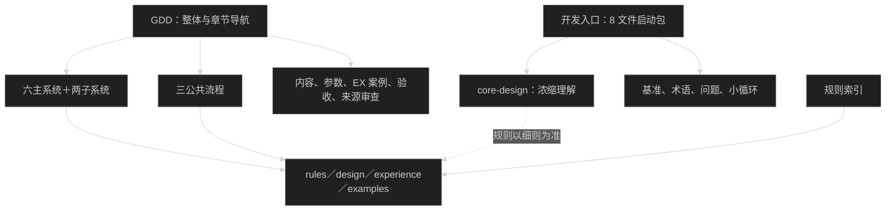
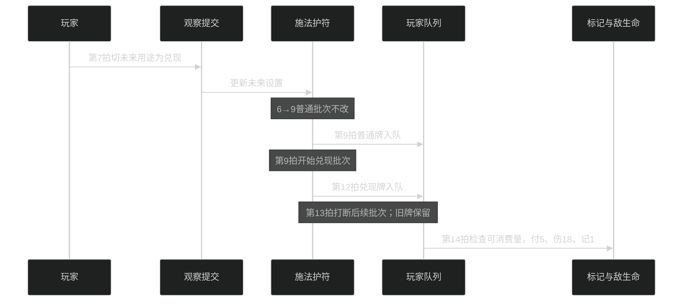
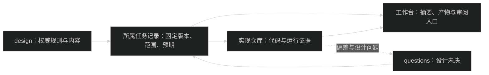
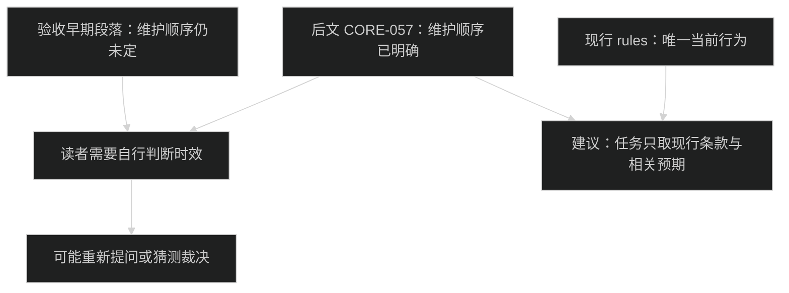
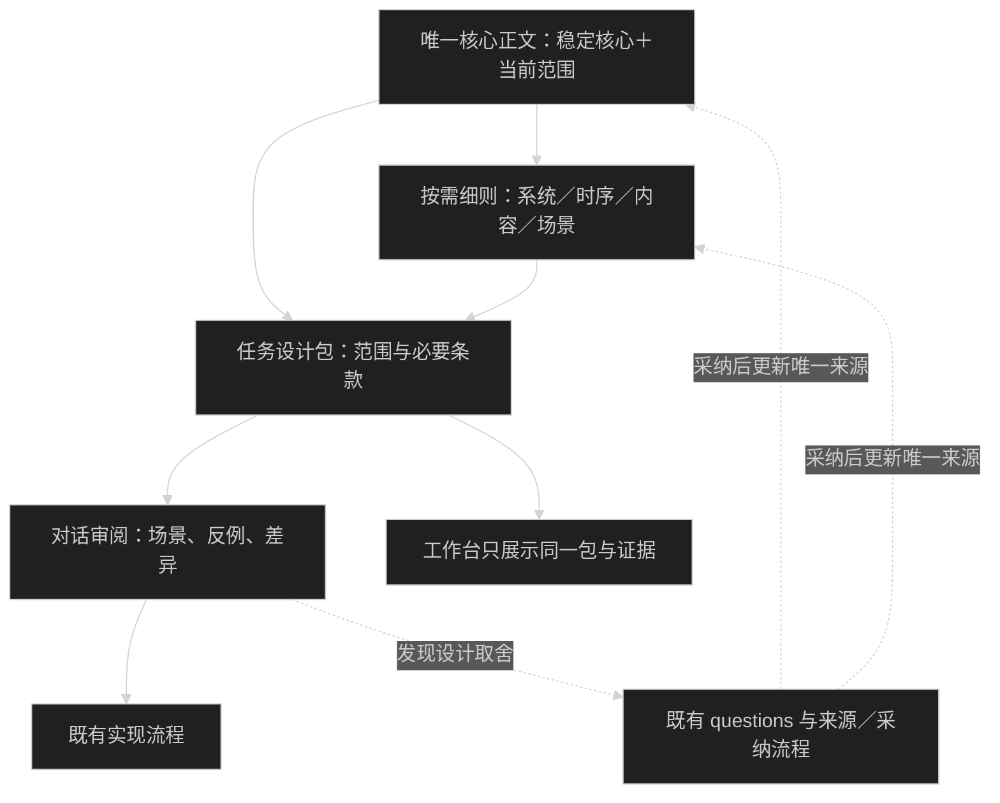

# 言咒：设计阅读、开发衔接与人工审校

2026-10-23 · game-002 · 用户原话与文档治理诊断。
方案状态：Raw Idea / Unqualified；两项偏好已确认，其余建议尚未采纳。
本文不是正式玩法 Evaluation、GDD 或开发执行合同。事实诊断、规则推导、结构建议分别标注；不改变现行规则或 GDD-0 成熟度。

**判断：建议推进“唯一核心正文＋按需细则＋任务设计包＋对话审阅”，但开发包只能派生自权威设计，不能成为另一套可独立修改的规则。精简先减少重复、查找与历史噪音；改变边界行为另作设计决定。**

## 原始输入与确认

### 用户原话

> 你负责进入yanzhou的design系统，全量阅读目前GDD，帮我整理一下现行设计系统结构，解决下列问题，评估我的思路方案：\
> 1.系统文档太长，细节很多，难以人工逐个审查，又存在臃肿的边界处理规则，需要精简，但又不能只让AI“优化GDD结构”；\
> 2.和开发任务匹配不够，每次任务读全量GDD，既分散注意力，也不能转化为开发的直接指导，让模型在开发时总是注意力漂移，我需要渐进式的披露的新结构和可人工审校的方法\
> 我的想法：\
> 1.设置唯一核心规则正文，一个文档，参考游戏GDD写作格式，清晰简单，面向开发者，保证能全量阅读和理解；2.各系统框架、细节内容、边界条件设计成渐进式展开的细则文档，包含设计中的各种细节，开发agent只在需要时查索引阅读，人则无需阅读；\
> 3.再额外做一套开发相关的文档系统，用于衔接开发和设计agent，记录开发所需的最小设计，和设计系统的文本保持一致，让开发agent在核心正文外主要阅读和操作这里的文档；\
> 4.最后再设计一套审阅规范，让agent通过对话的方式自然细致的转述系统内容，配合 [$wiki-researcher](C:/Users/Administrator/.codex/skills/wiki-researcher/SKILL.md) 中的各种示意图或者开发工作台进行讲解，避免开发者全量阅读

用户同轮直接答复：

| 编号 | 已确认偏好 | 影响 |
| --- | --- | --- |
| Q1 | “整款游戏的稳定核心，另标当前范围（推荐）” | 核心不缩成仅 EX-002 的手册；尚未闭合的全局内容明确标出 |
| Q2 | “按行为影响决定是否人工审校（推荐）” | 影响选择、成本、时机、胜负或信息公开的条款须通过场景审校；纯推导和重复核对由 agent 承担 |

这些答复不等于批准本文所有目录、字数、迁移或新规范。后续不要重问 Q1／Q2。

### 资格核对

依 grill-with-docs 先查现行材料，再集中询问上述两项；其余不从模型建议推定确认。

| 字段 | 当前信息 | 状态 |
| --- | --- | --- |
| 来源与对象 | 本轮用户原话；design、development 和人工审阅的连接方式 | Clear |
| 非玩法功能 | 降低理解与开工成本，使每项开发有准确、有限的设计输入 | Clear |
| 可见行为 | 人读核心、按场景审阅；开发按任务读取必要细则并留下依据 | Clear |
| 价值 | 减少漏规则、误读状态、重复维护和注意力漂移 | 明确目标，效果未验证 |
| 与现有设计关系 | 调整组织、派生和审阅职责；规则行为另行处理 | Clear |
| 主要未知 | 核心适宜密度、任务包最小闭合范围、人工审阅耗时、能否发现故意遗漏 | Unknown |
| 验证建议 | 用已有案例作纸面任务包对照与审阅，不先迁移全库 | 建议未采纳；本轮仅完成静态示范 |

保留在 inbox；不生成玩法 M／P／E／D，也不把目录建议写入现行文档合同。

## 阅读与证据范围

- 来源仓库：https://github.com/dsaj4/game_design；分支 codex/2026-10-23-design-system-review。
- 固定输入提交：954c17077bff7dd23d570bb4120787734fe23dee。Git origin 与本地已提交文件已核对，引用使用固定提交；没有把分支名当不可变版本。
- 模式：GDD（READ-1 的 56 文件全部全文读取）＋ CUSTOM（开发入口要求的启动包、开发正文与必要治理合同）。
- 56 文件逐一 blob 及全文覆盖见末尾。GDD 正文以 git show 固定提交读取；导航与规范初读后核对工作树差异，相关文件没有未提交修改。
- 另全文读：core-design、CONTEXT、questions，development 下 8 份 Markdown，document-contract、rule-index、systems/README、common/README，以及适用 AGENTS、READ-1、设计流程和 Git 规范。模板只用于核对对应写作要求；未把技能或模板计入 GDD 字数。
- 未读：主系统来源原件全文、effects 全库、visual 原件、其他探索方向、history、旧游戏、Godot 与工作台实现代码。未运行游戏、模拟器、玩家测试或工作台。
- 开始时已有 exploration/README 修改、governance/design-system-review-2026-10-23.md 删除及 DIR-040 未跟踪内容；不纳入本轮修改或取证。
- HIGH 表示已读文档／确定统计；MEDIUM 表示基于证据的结构判断；本轮不提供“已证明模型注意力改善”的结论。

## 迭代一：现行结构与实际负担

**发现：当前已经分层，但主要按文档类型和系统归档，没有把一次行为的必要规则组合成开工入口。** 现行摘要明确没有独立裁决权；开发入口也已规定默认 8 文件、任务确定后再补读。因此，“每次全读”是用户报告的执行问题，不能说仓库规范要求每次读全量。依据：[核心摘要职责](https://github.com/dsaj4/game_design/blob/954c17077bff7dd23d570bb4120787734fe23dee/yanzhou/governance/document-contract.md#L89)、[开发启动与任务补读](https://github.com/dsaj4/game_design/blob/954c17077bff7dd23d570bb4120787734fe23dee/yanzhou/development/README.md#L5)。

<!-- Sources: yanzhou/development/README.md:5-36; yanzhou/design/GDD.md:26-49; yanzhou/governance/document-contract.md:44-62,89-101; yanzhou/governance/rule-index.md:5-19. 固定输入见本文。 -->

| 层次 | 现有组成 | 实际意义 |
| --- | --- | --- |
| 整体理解 | GDD、core-design、baseline、CONTEXT | 两篇长短不同的整体解释，加独立状态与词义 |
| 主系统 | 法器、铭文、行动卡、敌人、资源、局外成长；辅槽／标记为子系统 | 最后一项尚未设计，不能按目录存在推断可实现 |
| 公共流程 | 路线、经济、交互与保存 | 交互页同时装入通用合同及首场表现细则 |
| 具体输入 | content、parameters、EX-001／002 | 数值分属通用约束与限定案例，不是统一发行池 |
| 核对与治理 | validation、source-review、questions、rule-index、来源链 | 预期、来源、问题、定位的职责已存在 |
| 开发与展示 | development、外部代码记录、工作台合同 | 有工作方法和记录字段，尚未形成逐行为的闭合阅读包 |

字符统计统一 UTF-8 解码、Unicode 字符、LF 换行，含空白、链接、表格与旧锚点；不是 token 或人工阅读分钟数。

| 范围 | 文件数 | 字符数 |
| --- | ---: | ---: |
| 完整 GDD 包 | 56 | 112,356 |
| 默认启动包 | 8 | 24,862 |
| GDD＋启动包去重＋READ-1／探索 AGENTS | 65 | 141,678 |
| core-design（不属于 56 文件包） | 1 | 2,106 |
| GDD 主文 | 1 | 3,784 |
| 系统及公共流程的 rules | 11 | 27,987 |
| 系统及公共流程的局部 examples | 11 | 17,510 |
| source-review＋validation | 2 | 30,154 |

两份整体说明并不特别长。仅来源审查和验收就占 GDD 包约 26.8%；11 份规则占约 24.9%。这些是不同职责的体量，不是“有 26.8% 可删除”的证据。开发入口现有“约 2.5 万／14.2 万字符”的估计与实测吻合。

置信度：结构和数字 HIGH；负担原因 MEDIUM。未知：没有任务阅读日志或模型对照实验，不能量化哪类材料导致了多少漂移。

## 迭代二：沿真实行为追踪，找出不能被摘要吃掉的接口

**发现：分系统存放不能保证分系统开发；最小正确输入必须沿行为跨系统闭合。**

以现有 EX-001 为例，第 7 拍选择“集中兑现”，第 6→9 拍正在加工的普通批次保持；9 拍才开第一批兑现，12 拍入队，14 拍才生效。第 13 拍敌打断毁掉的是后来 12→15 批次，已入队的兑现牌仍保留。依据：[EX-001 逐拍情境](https://github.com/dsaj4/game_design/blob/954c17077bff7dd23d570bb4120787734fe23dee/yanzhou/design/examples/simple-spell.md#L93)。

<!-- Sources: yanzhou/design/examples/simple-spell.md:44-78,93-117; yanzhou/design/systems/artifact-system/rules.md:43-61; yanzhou/design/systems/action-card-system/rules.md:59-75. Derived 静态说明，不是运行结果。 -->

| 行为问题 | 必需依据 | 漏读的实际后果 |
| --- | --- | --- |
| 改用途影响谁 | 法器 TL-06；交互 CORE-060 受理；EX-001 用途 | 把未来设置直接写进当前批次 |
| 何时兑现 | 法器 TL-03／05；行动 TL-08／11；案例队列 | 把完工当生效、越过队首 |
| 何时支付 | 行动 TL-30／11；标记读取；案例强化打击 | 开工预扣 5 层，或把本次后续记次算进门槛 |
| 被打断后重开 | 法器 TL-07；TL-11；资源／冻结回收 | 要么当拍复用刚释放占用，要么错误加整机冷却 |
| 暂停后继续 | TL-19；CORE-060 | 重做已支付步骤、重选队首或错误受理输入 |

**边界简化必须分三类。** 同一句“中断退料下拍可用”在多处复述可以去重；多目标反应、维护和定时登记可在任务不使用时不加载；把“中断回收下拍可用”改成“当拍可用”则改变规则，不能作为编辑优化自动执行。

较隐蔽的设计负担也应讲给人听。例如，批次冻结量可自然失效，但 D 保持、完工不补扣新层；启用付费加速即使取整后没有变快仍收费。这两条会影响玩家成本和选择，应纳入人工场景审校，不能因存入细则就免审。依据：[冻结失效](https://github.com/dsaj4/game_design/blob/954c17077bff7dd23d570bb4120787734fe23dee/yanzhou/design/systems/action-card-system/mark-system/rules.md#L25)、[D 与无收益费用](https://github.com/dsaj4/game_design/blob/954c17077bff7dd23d570bb4120787734fe23dee/yanzhou/design/systems/artifact-system/rules.md#L19)。

置信度：规则链 HIGH；将这些条款列为复审重点是 MEDIUM 的建议。未知：哪些复杂边界最终应改变，需要设计取舍；本文不把“复杂”直接判为“应删”。

## 迭代三：设计、开发和工作台的衔接

**发现：现有 development 已经承担计划、工作规范、交接和展示职责；缺的是任务级设计输入，另建平行体系会增加维护点。** 依据：[任务的规则与输入职责](https://github.com/dsaj4/game_design/blob/954c17077bff7dd23d570bb4120787734fe23dee/yanzhou/development/development-standard.md#L21)、[单轮记录归属](https://github.com/dsaj4/game_design/blob/954c17077bff7dd23d570bb4120787734fe23dee/yanzhou/development/iteration-spec.md#L41)。

<!-- Sources: yanzhou/development/development-standard.md:21-38,93-103; yanzhou/development/iteration-spec.md:41-58; yanzhou/development/workbench-spec.md:5-17,31-43. 图表示文档规定的职责，不声称检查过外部应用代码。 -->

| 衔接对象 | 现有合同 | 建议补足 |
| --- | --- | --- |
| 设计 → 开发 | 每项实现关联规则 ID、设计提交、配置和验收 | 直接提供具体条款范围、必读依赖、适用状态和遗漏检查 |
| 开发 → 设计 | 遇真正设计取舍按 DOC-024 暂停批次 | 问题附场景、冲突条款和影响，不由开发摘要改规则 |
| 设计 → 工作台 | 只读来源与摘要，缓存注明版本 | 展示任务包和场景审阅结果，不再维护规则副本 |
| 运行 → 验收 | 预期在设计，实际证据在实现仓库 | 逐场景对应预期、版本和实测，避免“文档说完＝完成” |
| 变更 → 旧任务 | 已要求版本与固定输入 | 显式标出源条款变化使哪些活动任务需要复核 |

建议把第三层称为“任务设计包”，放入现有 development 工作流；具体代码任务继续归实现仓库。设计 agent 维护范围与来源，开发 agent 维护实现与证据。双方都不能在任务包自由改写游戏规则。

任务包中的规则文本如需离线携带，应从固定版本摘录并附定位，标为派生、只读；解释与验收推导另标类型。源内容变化后不静默套用新旧混合版本：新派单先复核受影响包；已冻结历史证据继续保留原版本。

工作台规范已写明循环状态人工维护，自动筛选和自动同步尚未实现。本文没有打开工作台或检查外部代码，只能判断文档约定可承接这套信息，不能承诺已有自动生成、失效提示或对话审阅功能。[现有能力与限制](https://github.com/dsaj4/game_design/blob/954c17077bff7dd23d570bb4120787734fe23dee/yanzhou/development/workbench-spec.md#L31)

置信度：合同 HIGH；任务包降低维护风险是 MEDIUM；实际工具接入工作量 Unknown。

## 迭代四：冗余、过期和提前泛化的具体证据

**发现：优先精简对象应由“重复或过期的职责”决定，不能按字数或边界条数直接删。**

<!-- Sources: yanzhou/design/validation.md:74,208-227; yanzhou/design/systems/resource-system/rules.md:55-61. “可能重新提问”是风险推断；F 为建议，未实施。 -->

| 发现／影响级别 | 可复核证据 | 建议与边界 | 置信度／仍缺什么 |
| --- | --- | --- | --- |
| 高：现行验收夹带旧 Unknown | [validation:74](https://github.com/dsaj4/game_design/blob/954c17077bff7dd23d570bb4120787734fe23dee/yanzhou/design/validation.md#L74)称多个维护争料无唯一预期；[TL-V92／93](https://github.com/dsaj4/game_design/blob/954c17077bff7dd23d570bb4120787734fe23dee/yanzhou/design/validation.md#L223)和资源 rules 已明确 | 现用验收按行为组织，历史形成过程固定取证；不能改原历史结果 | HIGH；尚未逐条执行 117 项 |
| 高：核心意图与首场可用操作存在缺口 | [核心循环](https://github.com/dsaj4/game_design/blob/954c17077bff7dd23d570bb4120787734fe23dee/yanzhou/design/GDD.md#L20)要求应敌调整；[FB-Q01](https://github.com/dsaj4/game_design/blob/954c17077bff7dd23d570bb4120787734fe23dee/yanzhou/governance/questions.md#L28)记录零材料无法靠停供调时 | 核心显式区分体验目标、已提供行为与未闭合环节，任务包不发虚假停机能力 | HIGH；尚未选择新调度方案 |
| 高：状态和适用范围需要跨页判断 | [Accepted／Qualified](https://github.com/dsaj4/game_design/blob/954c17077bff7dd23d570bb4120787734fe23dee/yanzhou/design/baseline.md#L19)；辅槽与标记 rules 含已局部采纳接口 | 按条款／场景标状态与适用域，任务只取本范围可用部分；不把整个文件晋级 | HIGH；无全库机器化条款标注 |
| 中：主文复制开发进度后过时 | [主文仍称后续补完整单战](https://github.com/dsaj4/game_design/blob/954c17077bff7dd23d570bb4120787734fe23dee/yanzhou/design/GDD.md#L87)；[入口已有旧界面完整单战证据](https://github.com/dsaj4/game_design/blob/954c17077bff7dd23d570bb4120787734fe23dee/yanzhou/development/README.md#L40) | 规则主文只写能力与范围；实际完成情况引用唯一开发入口 | HIGH；未复跑旧包 |
| 中：来源历史被列入完整 GDD 阅读包 | [页首仍标当前 2.1](https://github.com/dsaj4/game_design/blob/954c17077bff7dd23d570bb4120787734fe23dee/yanzhou/design/source-review.md#L3)，下文延续到 CORE-063；本文件 16,804 字符 | 日常实现不读整份沿革；追因任务按对应来源取证；历史记录保留 | HIGH；不声称原始来源全文已核 |
| 中：总索引停在 117 项旧预期，后续合同在别处 | [117 项索引](https://github.com/dsaj4/game_design/blob/954c17077bff7dd23d570bb4120787734fe23dee/yanzhou/governance/rule-index.md#L19)；[EX-002 恢复预期](https://github.com/dsaj4/game_design/blob/954c17077bff7dd23d570bb4120787734fe23dee/yanzhou/design/examples/complete-battle.md#L51)；CORE-060—063 在交互页 | 补“行为→条款→内容→预期”的导航，不把 117 当全部现行合同覆盖证明 | HIGH；完整覆盖缺口仍需专项逐条核 |
| 低：机械五文件带来空页与错路由 | [局外成长尚无案例](https://github.com/dsaj4/game_design/blob/954c17077bff7dd23d570bb4120787734fe23dee/yanzhou/design/systems/meta-progression-system/examples.md#L13)；[交互示例指战后／路线](https://github.com/dsaj4/game_design/blob/954c17077bff7dd23d570bb4120787734fe23dee/yanzhou/design/common/interaction-save/examples.md#L13) | 未设计系统保持一个明确占位入口；短内容可合页，按真实内容量拆分 | HIGH；修改现行五文件规定须另行采纳 |

最后一项不是当前已获授权的结构更改。五文件职责本身有价值，问题在于要求每个成熟度不同的系统都实体化成五份文件。

## 迭代五：建议结构、任务包与可人工审校的做法

**建议把现有资料整理成一套权威设计、三种阅读入口。** 核心全文读，任务按行为读，历史按问题追溯。以下均为待采纳的结构建议；Q1／Q2 是已确认约束。

<!-- Sources: 基于 yanzhou/governance/document-contract.md:5-38,64-73,95-101; yanzhou/development/iteration-spec.md:17-26,41-58; yanzhou/development/workbench-spec.md:5-17 的建议结构。非现行实现图。 -->

| 用户方案 | 判断 | 需要的修正 | 优先级 |
| --- | --- | --- | --- |
| 1 唯一核心正文 | 支持 | 唯一连续阅读入口，同时承担明确的核心条款；其他概览不再独立维护完整复述 | 高 |
| 2 细则渐进展开 | 支持 | 用任务触发条件决定必读细则；核心与细则每项裁决各有唯一维护位置 | 高 |
| 3 开发衔接文档 | 支持任务包，不建议平行文档体系 | 复用 development 和既有单轮记录；设计摘录只读，证据回写实现仓库 | 最高 |
| 4 对话与图解审校 | 支持 | 人审行为取舍，agent 核对覆盖；讲解附具体依据和反例，不能只转述好处 | 最高 |

### 唯一核心正文应写什么

建议以现有 GDD.md 承担核心正文，把 core-design 的价值吸收进去；它原来是 CORE 阅读入口，若以后退出独立长摘要，必须同步 READ-1、AGENTS 与启动包，不能只删一个文件。这是路径方案建议，并未改动。

保留 GDD 写作的实质要求，不强求把 0—18 章都压成短标题。建议正文连续回答：

1. 玩家是谁，反复做什么，为什么需要作选择；体验仍是假设。
2. 整局与单战循环；当前先闭合首场，路线与扩展何时使用。
3. 铭文、法器、材料、行动、标记、敌情的职责和连接。
4. 不可误读的核心规则：承诺未来批次、完工／入行／生效、有限 Q、每拍行动资格、敌方公开时机和截止。
5. 一拍的共同顺序，以及终局、暂停和恢复保持什么。
6. 玩家已能做的操作与尚未提供的操作；首场真实内容与开放缺口。
7. 一个贯通场景及验收入口；具体物件值仍引用限定案例。

首轮可用约 5,000—8,000 Unicode 字符作排版预算，实际以能否一次讲清和审校为准，不为达标删条件；这是建议值，没有人工阅读实测。核心不携带完整历史、逐卡表、全部测试、具体按键和旧3D表现细节。**但“哪些信息必须公开”“何时输入生效”属于行为，不能当作纯 UI 装饰藏掉。**

核心与细则的权威关系不能靠“简短正文永远优先”解决。每条裁决只有一个维护处，细则补充前提与算法但不能暗改核心；明确例外仍按现行文档合同声明所覆盖条款与范围。TL 身份保留，复杂条款可用稳定子锚点精确引用。发生冲突进入既有裁决流程，不由开发包择一。

### 细则怎样真正按需展开

物理目录可先不大改。先改入口和读取规则，再判断哪些短页值得合并。

| 任务触发 | 必须展开的细则 | 当前任务可暂不加载的内容 |
| --- | --- | --- |
| 改未来用途 | TL-06、观察窗口、批次承诺、相关内容、保存与验收 | 整条精炼链、商店、历史采纳过程 |
| 改生产或容量 | 开工联合检查、D、预留、同拍顺序、中断与正常离队、恢复 | 未使用的多目标／周期能力 |
| 新卡使用标记支付 | 相应卡效、目标与步骤、余额资格、失败回退、终局 | 不适用的标记种类和生命周期分支 |
| 新卡登记周期效果 | 定时生命周期、并存预算、宿主失效、总序、保存 | 未使用的资源维护合同 |
| 改界面或音画 | 对应玩家操作／信息合同，加该版本表现约束 | 与任务无关的造型史与素材盘点 |
| 改公共结算机制 | 所有受影响系统、内容和验收 | 此类任务可能必须广读，不能伪装成小任务包 |

“未读”必须有不适用理由。新增消费阶段、对象种类、触发或恢复点时重新计算依赖；不能仅靠关键词命中决定最小包。条款／内容版本发生变化，重新检查受影响的活动任务。来源与历史留作追溯，不能混进正常开工正文。

### 一份可审的任务设计包样例

这是对既有规则的静态派生演示，未创建开发任务、未授权新实现。主题：**切换施法护符的未来用途，保持当前批次与旧牌不变。**

| 字段 | 本例内容 |
| --- | --- |
| 行为目标 | 玩家在合法窗口切换普通／兑现，能知道何时生效 |
| 固定版本 | 本文输入提交；EX-002 的继承输入仍依它指定的 first-example.1 固定版本，不能自动换为最新案例 |
| 本轮边界 | 用途提交、未来设置、批次承诺及对应恢复；若改完整可玩界面，另补 CORE-061—063 等必要呈现合同 |
| 必读 | 法器 TL-03／05／06；行动 TL-08／11／30；交互 TL-17／19 与 CORE-060 的播放受理、草稿、用途操作；EX-001 §2—7、§10；EX-002 §1／5；TL-V108／109 及相关恢复预期 |
| 条件读取 | 触及共享标记实现时补读取／支付；触及全局排程时补全部受影响总序／终局；新2D界面须先解决 PRE2D-Q01 |
| 不变约束 | 不增加单法器启停、战中换铭、手动出牌；零材料不能假借停供暂停 |
| 设计问题 | 现有用途切换有规则答案；FB-Q01／02仍是另外的玩法完善问题，本包不关闭它们 |
| 证据位置 | 真实实现、自动检查、截图和运行结果归实现仓库；本例只有纸面预期 |

其中源条款可以按固定章节原文组装在同一阅读视图，开发者不必来回点文件，但必须能跳到原文。不要要求实现者“自己去读有关系统”。

| 场景 | 人可核对的预期 | 来源 |
| --- | --- | --- |
| 正常：7 拍观察改兑现 | 6→9 普通批次保持，9 开兑现，12 入队，14 才生效 | [EX-001 时序](https://github.com/dsaj4/game_design/blob/954c17077bff7dd23d570bb4120787734fe23dee/yanzhou/design/examples/simple-spell.md#L95) |
| 提交晚于窗口 | 明确留下一观察窗口受理，复查真实对象；不插入本拍余步 | [CORE-060 受理](https://github.com/dsaj4/game_design/blob/954c17077bff7dd23d570bb4120787734fe23dee/yanzhou/design/common/interaction-save/rules.md#L91) |
| 只有 4 层可消费 | 兑现攻击回退 6，不先扣 4，再在非终局成功后记 1 | [支付对照](https://github.com/dsaj4/game_design/blob/954c17077bff7dd23d570bb4120787734fe23dee/yanzhou/design/examples/simple-spell.md#L68) |
| 9 层，其中锁定 5 | 可消费 4，回退 6，记次后总层 10／锁定 5；不能按总层打 18 | 同上 |
| 中途恢复 | 保留当前承诺、未来用途、待受理输入与步骤；不重付或重选 | [TL-19](https://github.com/dsaj4/game_design/blob/954c17077bff7dd23d570bb4120787734fe23dee/yanzhou/design/common/interaction-save/rules.md#L43) |
| 输入变化导致不同战况 | 按规则重新计算，不把“14 拍打 18”写成通用结果 | [固定操作前提](https://github.com/dsaj4/game_design/blob/954c17077bff7dd23d570bb4120787734fe23dee/yanzhou/design/examples/simple-spell.md#L95) |

这说明“最小设计”不是只摘一句“仅影响未来批次”，而是足以给这些场景唯一答案的输入集合。阅读包大小随任务而变，不能预先承诺固定几页覆盖所有开发。

### 人工审阅怎样进行

沿 Q2，用**场景而非文件**组织审阅。每轮一个完整行为，可把同主题的相关决定集中询问，不强制逐题等待。

| 步骤 | agent 应呈现 | 人需要判断 |
| --- | --- | --- |
| 定位 | 本次行为、适用版本、现行／候选、与上次差异 | 是否在审自己想改的事 |
| 正常故事 | 玩家看到什么、做什么、何时兑现 | 规则是否表达设计意图 |
| 反例与代价 | 缺资源、过截止、被打断、终局等适用分支 | 代价与失败是否愿意接受 |
| 图解 | 系统关系图／时序图／状态图按问题选一张 | 能否预测结果；哪个地方违背直觉 |
| 边界揭露 | 会改变选择、成本、时机、胜负、公开信息的特殊条款 | 是否保留，或提出具体更改 |
| 收口 | 明确答复、未答部分、来源与影响 | 已理解、希望修改、明确采纳分别记录 |

**示范讲解：**

> 第 7 拍你把施法护符改为集中兑现。它手头第 6 拍开始的普通攻击还要照原计划完成，所以第 10 拍仍是普通攻击。第 9 拍新开的那批才会做强化打击，12 拍进队列，前面还有护盾，因此到第 14 拍才用。
>
> 第 13 拍敌人打断的是下一批加工，已经排队的强化打击不会消失。这次选择并不能立刻救急。强化打击生效时才看能不能付 5 层；如果你锁住了足够多的层数，就会回退普通伤害。

这段应附上上面的时序图和来源。审阅随后聚焦“延迟影响是否符合预期”“锁定导致回退是否保留”等行为，不要求用户背规则编号。已采纳行为在本轮只是解释，不因重新讲解就要求重新确认；只有用户提出改变时才走变更流程。

人工不逐页阅读不代表漏掉语义：agent 在同一任务记录保留“涉及条款→展示场景→解释／未覆盖／无需人工”的覆盖栏；高影响边界未展示不能宣称审阅完整。它属于已有轮次的审阅记录，不另建全局审阅数据库。用户“听懂了”也不等于自动采纳新方案。

如需工作台承载，先展示同一个任务包、2—3个代表状态、原文定位和意见记录；后续再决定是否开发自动组包与失效提示。当前不应先建设庞大的审阅平台。

### 怎样控制精简质量，而不只是让 AI “优化结构”

先选两个试点：用途切换；打断与重开。两者都有现成条款和具体反例，不依赖新玩法补全。

| 检查 | 合格条件 | 本轮状态 |
| --- | --- | --- |
| 唯一权威 | 每条裁决有一个维护处，派生摘要不能独立改规则 | 已分析现有职责；新结构未迁移 |
| 行为保持 | 改写前后对同一输入产生同一预期；语义变化单列 | 用途切换已作静态示范，非全库等价证明 |
| 隐藏边界 | 如“预留不排队”“回收下拍可用”“取消严格早于T”不能在压缩中丢失 | 已定位高风险条款；尚未进行盲审对照 |
| 输入闭合 | 执行者只用核心与任务包能回答正常、失败、恢复和终局；答不了就补依赖 | 已给结构与样例；未进行独立接手验证 |
| 阅读负担 | 记录实际加载字符、补读次数、错误／追问及人工审阅耗时 | 仅有基线统计；未测改善幅度 |
| 变更同步 | 改一处源规则能找到受影响包与场景；不混新旧版本 | 机制建议，尚未实施自动检查 |

建议先做等义整理与过期入口修正，再单独评议复杂边界是否值得保留。不要设置“必须删掉 50%”之类会诱发语义损失的目标，也不要把减少文件数当成功标准。

下一轮如采纳结构，可先只迁移核心入口与一个试点任务包，同时更新受影响的文档合同、READ-1、启动包及索引；确认可交接后再推广。玩法行为变动仍须限定来源、必要评估／Draft Change和明确采纳。本文没有批量改写正文、删除细则或启动开发实验。

## 本轮交付与未决

产物是本文件：完整 GDD 阅读证据、五轮诊断、四点方案判断、任务包与人工讲解样例。Q1／Q2已记录；核心最终内容、具体迁移范围、文件合并和自动化仍是建议。

已完成：56 文件全文读取、固定版本／blob 核对、实际字符统计、关键行为跨文档追踪、方案与现有职责冲突核对。
未完成也未声称完成：全部条款形式化等价证明、外部代码／工作台审查、玩法与真人体验测试、新规范采纳或迁移。

## 附：GDD 全文阅读清单

全部取自 954c17077bff7dd23d570bb4120787734fe23dee；下表每份均为全文阅读，不以标题或搜索命中代替。只记录证据，不是清理去向表。

展开 56 文件及固定 blob

| 文件 | 字符 | Git blob | 覆盖 |
| --- | ---: | --- | --- |
| [GDD.md](https://github.com/dsaj4/game_design/blob/954c17077bff7dd23d570bb4120787734fe23dee/yanzhou/design/GDD.md#L1) | 3784 | 8b1df9e78c8bb06c9f7bac9ae5ed3afd1a1ba8f2 | 全文 |
| [README.md](https://github.com/dsaj4/game_design/blob/954c17077bff7dd23d570bb4120787734fe23dee/yanzhou/design/README.md#L1) | 1151 | f06d90b6d47567b39eb994ccebaf31f78217e20c | 全文 |
| [baseline.md](https://github.com/dsaj4/game_design/blob/954c17077bff7dd23d570bb4120787734fe23dee/yanzhou/design/baseline.md#L1) | 3681 | ed938c4cb95469664f4a630ad6f1465bbb07df72 | 全文 |
| [common/interaction-save/design.md](https://github.com/dsaj4/game_design/blob/954c17077bff7dd23d570bb4120787734fe23dee/yanzhou/design/common/interaction-save/design.md#L1) | 937 | e90601224fc9f112d13975c78dd2503bac9e471a | 全文 |
| [common/interaction-save/examples.md](https://github.com/dsaj4/game_design/blob/954c17077bff7dd23d570bb4120787734fe23dee/yanzhou/design/common/interaction-save/examples.md#L1) | 298 | a64fb9fae201c8f49a28f48fa5d02278376fe57a | 全文 |
| [common/interaction-save/experience.md](https://github.com/dsaj4/game_design/blob/954c17077bff7dd23d570bb4120787734fe23dee/yanzhou/design/common/interaction-save/experience.md#L1) | 607 | 81a3584b5893491e0a7329c02aa8222a5eb83d3a | 全文 |
| [common/interaction-save/rules.md](https://github.com/dsaj4/game_design/blob/954c17077bff7dd23d570bb4120787734fe23dee/yanzhou/design/common/interaction-save/rules.md#L1) | 9807 | b186d816d2d04213c979d9f5fb9ecea944bf4fa4 | 全文 |
| [common/run-economy/design.md](https://github.com/dsaj4/game_design/blob/954c17077bff7dd23d570bb4120787734fe23dee/yanzhou/design/common/run-economy/design.md#L1) | 639 | bf84cfdc0d0a3bf0e34fc1776b345de799662a4e | 全文 |
| [common/run-economy/examples.md](https://github.com/dsaj4/game_design/blob/954c17077bff7dd23d570bb4120787734fe23dee/yanzhou/design/common/run-economy/examples.md#L1) | 300 | 66a27b88bf896e88dd7dd98bae2a6f8fa225e412 | 全文 |
| [common/run-economy/experience.md](https://github.com/dsaj4/game_design/blob/954c17077bff7dd23d570bb4120787734fe23dee/yanzhou/design/common/run-economy/experience.md#L1) | 508 | 6f9fbaede8a5c12fc09e2dfce0db29fdf556a28e | 全文 |
| [common/run-economy/rules.md](https://github.com/dsaj4/game_design/blob/954c17077bff7dd23d570bb4120787734fe23dee/yanzhou/design/common/run-economy/rules.md#L1) | 1520 | 8fd1d5653755e68b4bdcd8e9549f95db5f256395 | 全文 |
| [common/run-route/design.md](https://github.com/dsaj4/game_design/blob/954c17077bff7dd23d570bb4120787734fe23dee/yanzhou/design/common/run-route/design.md#L1) | 530 | 15df408d51c8541f4aecf3e6b19bb24325265ec9 | 全文 |
| [common/run-route/examples.md](https://github.com/dsaj4/game_design/blob/954c17077bff7dd23d570bb4120787734fe23dee/yanzhou/design/common/run-route/examples.md#L1) | 297 | 3c4b50450d8a4e60e5db3ad38d5a3eb15edeb764 | 全文 |
| [common/run-route/experience.md](https://github.com/dsaj4/game_design/blob/954c17077bff7dd23d570bb4120787734fe23dee/yanzhou/design/common/run-route/experience.md#L1) | 441 | c8fe13bbaccba344ea27bdf1dbfd5afa0443d238 | 全文 |
| [common/run-route/rules.md](https://github.com/dsaj4/game_design/blob/954c17077bff7dd23d570bb4120787734fe23dee/yanzhou/design/common/run-route/rules.md#L1) | 719 | 5f956da01b8ac706aace00e74ef8a852a3ab32bf | 全文 |
| [content/cards.md](https://github.com/dsaj4/game_design/blob/954c17077bff7dd23d570bb4120787734fe23dee/yanzhou/design/content/cards.md#L1) | 1212 | 3e291340acd312426d5a4e56455ce212939b73f0 | 全文 |
| [content/enemies-encounters.md](https://github.com/dsaj4/game_design/blob/954c17077bff7dd23d570bb4120787734fe23dee/yanzhou/design/content/enemies-encounters.md#L1) | 1902 | d670795b725a208b21c1c8a78b45230e834f6498 | 全文 |
| [content/wands.md](https://github.com/dsaj4/game_design/blob/954c17077bff7dd23d570bb4120787734fe23dee/yanzhou/design/content/wands.md#L1) | 513 | bbaa594bf0e27edb9121e7d3e21cc1050df2cf1e | 全文 |
| [examples/README.md](https://github.com/dsaj4/game_design/blob/954c17077bff7dd23d570bb4120787734fe23dee/yanzhou/design/examples/README.md#L1) | 280 | ba4100c4b6d0c88c7447b3755b9e6ea4ecff563a | 全文 |
| [examples/complete-battle.md](https://github.com/dsaj4/game_design/blob/954c17077bff7dd23d570bb4120787734fe23dee/yanzhou/design/examples/complete-battle.md#L1) | 2761 | 18cdd40e0a02da207b2efa1dd1d5e907173dce2e | 全文 |
| [examples/simple-spell.md](https://github.com/dsaj4/game_design/blob/954c17077bff7dd23d570bb4120787734fe23dee/yanzhou/design/examples/simple-spell.md#L1) | 5456 | e3b8c210c2da3088dd71d0f83642aece107f8939 | 全文 |
| [parameters.md](https://github.com/dsaj4/game_design/blob/954c17077bff7dd23d570bb4120787734fe23dee/yanzhou/design/parameters.md#L1) | 1761 | 057897f58c5c74f56682f6cc5db900bae91a04c1 | 全文 |
| [source-review.md](https://github.com/dsaj4/game_design/blob/954c17077bff7dd23d570bb4120787734fe23dee/yanzhou/design/source-review.md#L1) | 16804 | c7e06321ad75bfdbca459e8082a68992fa5c2048 | 全文 |
| [systems/action-card-system/design.md](https://github.com/dsaj4/game_design/blob/954c17077bff7dd23d570bb4120787734fe23dee/yanzhou/design/systems/action-card-system/design.md#L1) | 797 | ff1c6003cffe4e9c79167811a5dfc7b5e4a36b5f | 全文 |
| [systems/action-card-system/examples.md](https://github.com/dsaj4/game_design/blob/954c17077bff7dd23d570bb4120787734fe23dee/yanzhou/design/systems/action-card-system/examples.md#L1) | 1967 | 0bf3ea6349689153b1952376c9743ff8d9212e37 | 全文 |
| [systems/action-card-system/experience.md](https://github.com/dsaj4/game_design/blob/954c17077bff7dd23d570bb4120787734fe23dee/yanzhou/design/systems/action-card-system/experience.md#L1) | 632 | 946e4ec64b345e3af915cad28d2863f334cb94dc | 全文 |
| [systems/action-card-system/mark-system/design.md](https://github.com/dsaj4/game_design/blob/954c17077bff7dd23d570bb4120787734fe23dee/yanzhou/design/systems/action-card-system/mark-system/design.md#L1) | 630 | 2b603283589091ef974d3865e01732153e18b3e0 | 全文 |
| [systems/action-card-system/mark-system/examples.md](https://github.com/dsaj4/game_design/blob/954c17077bff7dd23d570bb4120787734fe23dee/yanzhou/design/systems/action-card-system/mark-system/examples.md#L1) | 1958 | 45a0fa46138da65e1259a19504da241304c43d88 | 全文 |
| [systems/action-card-system/mark-system/experience.md](https://github.com/dsaj4/game_design/blob/954c17077bff7dd23d570bb4120787734fe23dee/yanzhou/design/systems/action-card-system/mark-system/experience.md#L1) | 512 | 8bd7123dad7add8295166046b630712425322253 | 全文 |
| [systems/action-card-system/mark-system/rules.md](https://github.com/dsaj4/game_design/blob/954c17077bff7dd23d570bb4120787734fe23dee/yanzhou/design/systems/action-card-system/mark-system/rules.md#L1) | 1599 | 87ab6515fe0c90ecfd3c68cf67fd54a8292f88cd | 全文 |
| [systems/action-card-system/rules.md](https://github.com/dsaj4/game_design/blob/954c17077bff7dd23d570bb4120787734fe23dee/yanzhou/design/systems/action-card-system/rules.md#L1) | 4596 | 6d5b7e1b7d1105ed16b8a99210f758a57933eea4 | 全文 |
| [systems/artifact-system/design.md](https://github.com/dsaj4/game_design/blob/954c17077bff7dd23d570bb4120787734fe23dee/yanzhou/design/systems/artifact-system/design.md#L1) | 871 | 95be388a9553ad6125a743518e82c33364dba052 | 全文 |
| [systems/artifact-system/examples.md](https://github.com/dsaj4/game_design/blob/954c17077bff7dd23d570bb4120787734fe23dee/yanzhou/design/systems/artifact-system/examples.md#L1) | 4195 | 6e9a252d02c7d423e0323f41887635fee6f127f2 | 全文 |
| [systems/artifact-system/experience.md](https://github.com/dsaj4/game_design/blob/954c17077bff7dd23d570bb4120787734fe23dee/yanzhou/design/systems/artifact-system/experience.md#L1) | 584 | 4ac3cf0cdc9c26a68d4d3a7e7d561dea19471ab9 | 全文 |
| [systems/artifact-system/rules.md](https://github.com/dsaj4/game_design/blob/954c17077bff7dd23d570bb4120787734fe23dee/yanzhou/design/systems/artifact-system/rules.md#L1) | 2777 | 70f9fbd22b43a499fe974192a9fe4171e1cae73d | 全文 |
| [systems/enemy-system/design.md](https://github.com/dsaj4/game_design/blob/954c17077bff7dd23d570bb4120787734fe23dee/yanzhou/design/systems/enemy-system/design.md#L1) | 832 | 982cb230719e706fb268d84358fb3adb083f3c56 | 全文 |
| [systems/enemy-system/examples.md](https://github.com/dsaj4/game_design/blob/954c17077bff7dd23d570bb4120787734fe23dee/yanzhou/design/systems/enemy-system/examples.md#L1) | 4224 | 71857b9c8b79f814e6cc2456423dbf5265bb04c4 | 全文 |
| [systems/enemy-system/experience.md](https://github.com/dsaj4/game_design/blob/954c17077bff7dd23d570bb4120787734fe23dee/yanzhou/design/systems/enemy-system/experience.md#L1) | 611 | 643850d4dad0bfba8fd1ee59f5a97c9ddf7e76b5 | 全文 |
| [systems/enemy-system/rules.md](https://github.com/dsaj4/game_design/blob/954c17077bff7dd23d570bb4120787734fe23dee/yanzhou/design/systems/enemy-system/rules.md#L1) | 1585 | a9e77fe39f0c569792c29199efbd9d41c147090f | 全文 |
| [systems/inscription-system/augment-system/design.md](https://github.com/dsaj4/game_design/blob/954c17077bff7dd23d570bb4120787734fe23dee/yanzhou/design/systems/inscription-system/augment-system/design.md#L1) | 815 | e5b92f8a14501a48aca86730af7bdf7cd0fac0d0 | 全文 |
| [systems/inscription-system/augment-system/examples.md](https://github.com/dsaj4/game_design/blob/954c17077bff7dd23d570bb4120787734fe23dee/yanzhou/design/systems/inscription-system/augment-system/examples.md#L1) | 1949 | f38ed40e1c460118fed011d4d15ec5c6445fbbad | 全文 |
| [systems/inscription-system/augment-system/experience.md](https://github.com/dsaj4/game_design/blob/954c17077bff7dd23d570bb4120787734fe23dee/yanzhou/design/systems/inscription-system/augment-system/experience.md#L1) | 635 | a555ff20d5f181f1db1c741e30c2f0f394d37582 | 全文 |
| [systems/inscription-system/augment-system/rules.md](https://github.com/dsaj4/game_design/blob/954c17077bff7dd23d570bb4120787734fe23dee/yanzhou/design/systems/inscription-system/augment-system/rules.md#L1) | 1139 | 69852011d8c8e8d5e66611cf964942a757e86a7a | 全文 |
| [systems/inscription-system/design.md](https://github.com/dsaj4/game_design/blob/954c17077bff7dd23d570bb4120787734fe23dee/yanzhou/design/systems/inscription-system/design.md#L1) | 960 | 25836481170554aec09f3254aa55bfc2606376c0 | 全文 |
| [systems/inscription-system/examples.md](https://github.com/dsaj4/game_design/blob/954c17077bff7dd23d570bb4120787734fe23dee/yanzhou/design/systems/inscription-system/examples.md#L1) | 771 | 35ae0bd6a0c51f427105f00e1065056da9428ddf | 全文 |
| [systems/inscription-system/experience.md](https://github.com/dsaj4/game_design/blob/954c17077bff7dd23d570bb4120787734fe23dee/yanzhou/design/systems/inscription-system/experience.md#L1) | 599 | 2ac0069ddfbcf4a0eb3738c6446df228410f5d22 | 全文 |
| [systems/inscription-system/rules.md](https://github.com/dsaj4/game_design/blob/954c17077bff7dd23d570bb4120787734fe23dee/yanzhou/design/systems/inscription-system/rules.md#L1) | 1596 | f20e0238d1ce5ae98ed81125a1abaef05076c611 | 全文 |
| [systems/meta-progression-system/design.md](https://github.com/dsaj4/game_design/blob/954c17077bff7dd23d570bb4120787734fe23dee/yanzhou/design/systems/meta-progression-system/design.md#L1) | 435 | 952ae2dc4cdfcc5e23211be4c1d4386cbed91887 | 全文 |
| [systems/meta-progression-system/examples.md](https://github.com/dsaj4/game_design/blob/954c17077bff7dd23d570bb4120787734fe23dee/yanzhou/design/systems/meta-progression-system/examples.md#L1) | 301 | 02e23986047afc75240504796cc9bcb2146138ed | 全文 |
| [systems/meta-progression-system/experience.md](https://github.com/dsaj4/game_design/blob/954c17077bff7dd23d570bb4120787734fe23dee/yanzhou/design/systems/meta-progression-system/experience.md#L1) | 284 | f65390b2dce07a08f0a053bb08c327d3092d5470 | 全文 |
| [systems/meta-progression-system/rules.md](https://github.com/dsaj4/game_design/blob/954c17077bff7dd23d570bb4120787734fe23dee/yanzhou/design/systems/meta-progression-system/rules.md#L1) | 327 | ebee74481281bd4838cd8261e746a6ed2d0e4524 | 全文 |
| [systems/resource-system/design.md](https://github.com/dsaj4/game_design/blob/954c17077bff7dd23d570bb4120787734fe23dee/yanzhou/design/systems/resource-system/design.md#L1) | 766 | 23dfa1e4bd8f037613abdec820bc60970ddfa26f | 全文 |
| [systems/resource-system/examples.md](https://github.com/dsaj4/game_design/blob/954c17077bff7dd23d570bb4120787734fe23dee/yanzhou/design/systems/resource-system/examples.md#L1) | 1250 | a06f26f19c37a0a642d322d70ce83b849ca4ae60 | 全文 |
| [systems/resource-system/experience.md](https://github.com/dsaj4/game_design/blob/954c17077bff7dd23d570bb4120787734fe23dee/yanzhou/design/systems/resource-system/experience.md#L1) | 579 | 23b6bcb5037a941c91f277ac7673f6e7912bdb36 | 全文 |
| [systems/resource-system/rules.md](https://github.com/dsaj4/game_design/blob/954c17077bff7dd23d570bb4120787734fe23dee/yanzhou/design/systems/resource-system/rules.md#L1) | 2322 | 77b9e6c919b764fff79b1c586a1c91b4371ffedc | 全文 |
| [validation.md](https://github.com/dsaj4/game_design/blob/954c17077bff7dd23d570bb4120787734fe23dee/yanzhou/design/validation.md#L1) | 13350 | 7443555d368f7f10cccdb92bd31136b86d2bccee | 全文 |

