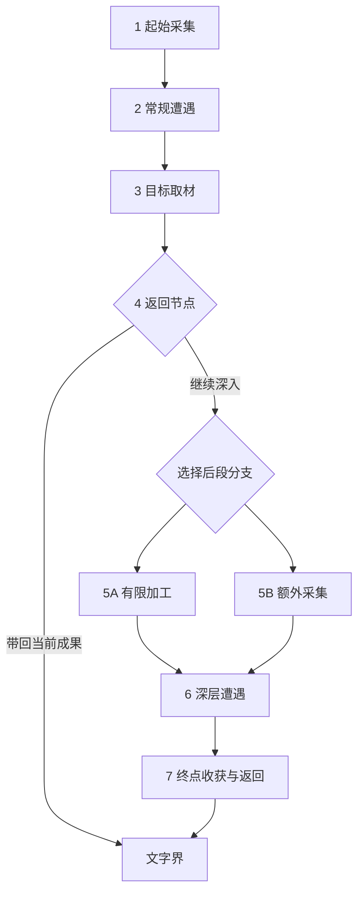

# 言咒：单局内战斗之外的堆叠经营构思

创建：2026-11-06；更新：2026-11-08。状态：Raw Idea / Unqualified；玩法假设 Hypothesis / NotRun。当前重点为“仪式飞升”；用户已通过分析建议及Q4—Q6探索规则，并确认Q7永久开路、Q9异常处理；Q8改为由物品描述、仪式预感和合成配方提示可能结果，暂不设计专门的双追索方式。未回写现行规则；前两轮模型候选仍未被选择。

范围更新：前两轮的“仅单局”不限制本轮用户明确新增的跨局知识与境界保留。早期候选保留作比较，不据此推定与仪式飞升合并。

当前工作入口：[卷入仪式主线与玩法整合](#ritual-trial-framework)，整局持续范围沿[肉鸽整局边界工作版](#roguelite-run-boundaries)，开局顺序和末段结算按最新整合修订。原[设计缺口清单与逐项推进](#gap-checklist)保留为第一轮框架记录；涉及持续范围、失败及恢复的旧条款按工作版修订对照读取，其余继续有效。决定依据维护在本页，不另建问题库或治理编号。

独立阅读入口：[言咒肉鸽式仪式系统 卷入仪式的玩法框架与设计缺口](../../system-design/2026-11-08-ritual-roguelite-overview.md)。2026-11-08按用户要求整理并按选定主线更新，集中说明当前玩法和未决内容；本页继续保留决定依据，新说明不独立改变玩法或提升素材资格。

2026-11-07当前进度：用户已确认至Q58，原11项清单第一轮框架讨论完成；Q8及神灵／生物接触入口沿对应用户修正。下一阶段按第11项细化首段内容依赖与资源账目，范围到第一次拔擢后实际使用新权限；具体内容、数值和体验证据仍未闭合。早期“尚未确认”表述是历史过程，以后续确认结果为准。用户本轮要求交接，交接文档保存在系统临时目录，不新增仓库内第二份设计正文。

交接后的定位调整：用户重申肉鸽初衷，并明确要求“按你的建议重定边界再细化内容”。本页文末已按此授权形成整局边界工作版，替换旧框架中冲突的持续范围与结算规则；三段结构及首个普通终局样例为本轮暂定工作参数，尚未验证。知识、境界跨局保留继续有效。此前临时交接文件描述旧停点，接手应先读本页最新工作入口。

## 已确认意图

用户选择范围B：单局内战斗之外的玩法，先从核心玩法发散。当前草案以固定地图与分支路线为基础；结合言咒的配方、资源收集、背包构筑，参考《堆叠大陆》《炼金之道》的卡牌堆叠经营，探索轻量化方向。此次需要几版灵感，不要求完整规格。是否保留全部既有地图规则、具体轻量化尺度及候选选择尚未确认。

上轮跨局长期体验的问题不作为本轮前提；用户未选择永久成长或跨局解锁。此次新增候选不改变现行规则，不扩展首战、世界观或实现任务。

## 阅读范围与来源

- 模式：CUSTOM；共同来源提交 `193de41be9f8c4620842016dc2ed987b16036828`，后续并行提交不自动纳入。
- 完整已读：`yanzhou/design/GDD.md`、`yanzhou/design/systems/meta-progression-system/README.md`、`yanzhou/design/common/run-economy/rules.md`、`yanzhou/design/common/run-route/rules.md`。
- 章节已读：`yanzhou/system-design/handbook.md`的全局目标、全部系统与设计安排、局外成长；`yanzhou/governance/questions.md`仅META-Q01与INS-Q07条目。操作规范按根／项目AGENTS、READ-1及设计流程执行；未扩读链接。
- 用户本轮点名参考游戏，2026-11-06核对其官方商店说明：[Stacklands](https://store.steampowered.com/app/1948280/Stacklands/)、[Ways of Alchemy](https://store.steampowered.com/app/2915380/)。只核对机制概述，未做完整游戏拆解或试玩。
- Stacklands参考点：将村民与资源卡堆叠以采集、制作及发展村庄。Ways of Alchemy参考点：炼制、经营，以及为冒险者配置药剂／物品以获取材料与配方。下列方案为原创转化，不声称是参考游戏的既有系统。

## 共同设计假设

希望玩家把同一份资源分配给战斗准备和沿途经营，通过投入改变后续机会；堆叠应表达对象间的实际作用，而不仅是菜单按钮。候选先以主动推进、有限机会为轻量化方向，不预设实时等待、人口生存或完整产业树。此为模型建议，尚非用户约束。

所有物件名与合成关系均为说明性例子，未引用或新增内容库规格。每种候选都需保留可继续前进的基础路径；经营收益是否进入战斗、怎样占格及消耗，仍需另行设计。

## 候选一：路边小工坊——有限驻留里的安排

玩家目标：用当前地点有限的工作机会，为下一段路做出最合适的补给。体验假设：就地取材、临时拼出一套能用的准备。

进入节点后摊开少量资源点和设施卡。将工具叠到资源点上采集，将材料叠到加工设施上转化；采集与加工占用同一有限驻留预算。例：面对湿木和矿石，先干燥木料获取燃料，再用燃料加工矿石；也可直接保留木料作为后续配方投入。不是每条链都能在本站完成，浅加工、留原料和深加工需有不同用途。

循环：节点资源与剩余工作机会 → 选择采集／加工 → 实际产物与剩余时间改变 → 按背包空间选留 → 下一节点与战斗消耗改变需求。地方设施与未采资源随离开退出，携带物仅在本局延续。预算耗尽只结束经营，不自动判负；不能无限等待囤料。

结构：量值资源／时间的分配与消耗，落在节点内流程；主循环采用“工具箱”。新意在同一地形与库存下安排有限工作顺序。风险是每站都重复相同最优加工，或提前制成战斗成品削弱战中生产。最低判别问题：相同节点但下一战需求不同时，玩家是否改变加工安排？未执行测试。

## 候选二：把地图当配方——产物改变地点用途

玩家目标：利用手中物件，把沿路地点转成自己需要的机会。体验假设：学会炼金后，同一张地图出现不同用途。

保留固定分支骨架，把节点做成有少量明确交互的地点卡。例：资源点可直接采集一次，也可投入一份配制品，将它转成另一类一次性采集点；把制成的工具叠到障碍上，可以开放地图上预先存在的可选连接。使用的配制品因此不能再投入战斗。转换前提示用途与代价；未知仅保留为可理解的发现，不靠盲猜组合。

循环：取得资源 → 制作可用于地点的物件 → 消耗物件改变节点身份／通行资格 → 从新机会获得不同资源 → 支持下一次制作。已转化地点有记录、机会有限；路线仍向前推进，不回访刷取。没有合适物件时保留基础通路。开启额外连接是候选对现行路线合同的增量，尚未采纳。

结构：身份结构／权限的转化与解锁，落在地图节点和连接；主循环采用“传送门”（炼金产物改变探索，探索资源回到炼金）。新意在配方成为与地图交互的能力。风险是固定钥匙锁题，或所有好路线都要求特定配方。最低判别问题：同一地点能否支持至少两种各有价值的处理，而非唯一正确答案？未执行测试。

## 候选三：背着走的小工坊——收益设备也占行李

玩家目标：在本局剩余路程里，决定携带多少未来产能、多少即时战斗能力。体验假设：一路把自己的小工坊养成独特的旅行配置。

少量便携经营设备作为候选实体与战斗配置争夺背包空间。抵达合适节点后，将设备、真实材料与地点堆叠，完成一次有限加工；收入以材料、材料压缩或可用加工方式为主。例：带干燥设备能处理沿途湿料，但其占格会挤掉一件备用战斗配置；把原料投入设备改良可能提高后续收益，也使当前战斗准备变薄弱。

循环：战果资源 → 投资设备或保留战用 → 带着设备选择能利用它的分支 → 有限加工获得补给 → 重装并决定继续投资或换回战斗配置。设备仅在本局延续，节点次数与真实投入限制产出，不按现实时间无限生产；无设备仍能沿基础路线取得基础资源。出售、拆解和放弃设备尚无具体合同，不能默认免费退还投资。

结构：空间／关系／资源的占用、连接和再投入，落在共用背包与节点加工；主循环采用“行李箱”，局部包含受路程限制的增长。新意在生产能力本身成为需要携带的构筑。风险是经济设备前期必带、后期必弃，形成单一解；设备过多也会增加整理负担。最低判别问题：在不同资源分支和剩余路程下，带与不带是否都可能合理？未执行测试。

## 推荐与未决

模型推荐以候选一作为轻量入口，吸收候选二的少量地点转化；候选三适合用户更想要经营积累和背包取舍时单独深化。不默认把三者叠成大系统。

优先待选：更喜欢临时经营、改变地图，还是随行工坊；经营与战斗的相对比重；希望保留固定路线到何种程度。后续只需挑方向和喜欢的动作，再按实际依赖补问题，不要求本轮完成资格确认。

接口候选仅在本页记录：节点预算／加工权限、路线转化、经营产物与战斗输入、便携设施占格及取得退出。现行GDD§8与TL-25／33—35／32并未授权上述新增行为，本轮不修改其正文。

## 方法来源

使用 gameplay-mechanism-designer 的Spark模式及通用状态域、机制链与循环方法；上游固定提交 `29e8c759ca26c6bd4f337744b647dc728bf322b6`。实际读取该技能SKILL、source-lock、project-integration、input-output-contract、state-domains、mechanism-families、loop-patterns，并定向检索mechanism-chains.tsv。

- 候选一：改编GMD H123“消耗→转化→生成→放置”、H128“侦测→行动者选择→分配→锁定→解锁”；与H087有限行动链交叉组合，删除多人交接，以本站预算结束代替。有限驻留与战斗准备关系为原创综合。
- 候选二：组合H133“行动者选择→消耗→合并→转化→生成”与H035“放置→连接→侦测→解锁”；将后者的建设连接改编为消耗制成品开启预设连接，增加地点身份转化分支。地图配方为原创综合。
- 候选三：组合H121“连接→延迟执行→生成→分配”、H123及H004“行动者选择→控制权转移→放置”；把周期改为有限到站机会，加入真实投入、设备占格和行程终点约束。随行经营与战斗配置竞争为原创综合。

机制图谱只用于构思，不证明玩法成立。未实现、未运行实验、未创建额外目录或正式提案。

## 第二轮：从经典玩法发散核心循环

2026-11-06追加。用户要求进一步围绕循环发散，以战斗—购物、刷装—重塑、订单—经营为表达参照。此轮仍为灵感候选，未选择前三个方案，不要求完整系统。以下各循环均限定为本局内；示意物件、采集者、设施与地图能力是原创候选，不是已有内容或世界设定。采用Loop Builder深度中的紧凑循环表达，不展开规格或制作计划。

### L1 定向狩猎与配方追逐

参考《怪物猎人：世界》的狩猎—素材—装备—更强狩猎结构；原作概述见[官方商店](https://store.steampowered.com/app/582010/Monster_Hunter_World/)。

候选循环：看到想完成的配方 → 找缺少材料及对应敌人／节点 → 为目标配置战斗与行李 → 战斗／采集获得材料 → 炼制出新的构筑组件 → 能应对新的材料来源 → 追逐下一配方。例：想补齐一条低耗材路线，就主动选择提供缺口材料的分支，胜利所得让该路线真正可用。核心取舍是追目标素材还是走更安全的通用奖励路线。进入下一轮的是新组件与新的材料需求，而非仅通用货币。轻量化为少量可追踪目标及明确来源，不引入无限重复刷取；风险是固定毕业清单与单一路线。判别问题：不同构筑目标是否会让同一张地图产生不同走法？

### L2 配给采集委托

参考《Potionomics》雇用英雄收集原料的机制，概述见[官方商店](https://store.steampowered.com/app/1874490/Potionomics/)。给委托配置不同物品、保底采集与额外收益条件是本候选的原创转化，不归因于该概述。

候选循环：获得基础材料 → 炼制采集所需工具／补给 → 配给有限委托 → 推进主路线后带回不同资源 → 支持更丰富炼制 → 再配给更合适的任务。例：给同一采集委托防护品可处理危险资源点，给采集工具可带回另一类材料；投入物因此暂时或永久不能供玩家自用，具体归属待定。核心取舍是自用强度与后续供给。进入下一轮的是材料来源与实际产物。轻量化为一个任务位、一次配置、节点到达时结算，无现实挂机与独立角色养成；预算不足可跳过并沿基础路线继续。风险是无脑满额派遣，或等待收益割裂冒险。判别问题：是否存在为了下一战而合理放弃委托的时刻？

### L3 投入产能，再用产能养战斗

参考《异星工厂》的资源—设施—自动生产及研究结构，见[官方商店](https://store.steampowered.com/app/427520/Factorio/)。

候选循环：取得原料 → 在制成战斗投入和建造经营设备间分配 → 有限经营窗口内加工出更多／不同原料 → 分配给战斗或扩充产能 → 战胜新遭遇取得新原料与设备材料。例：现在把矿料变成战斗所需物，或先用它做加工器，使后续几站的粗料能利用；设备需真实投入，不能无中生有。核心取舍是何时回本。下一轮保留设备、库存与供给瓶颈。轻量化为少量设备、短链与按节点结算；不引入流水线空间网络或免费战斗成品。风险是复利失控、经济设备必选，以及与现有战中生产重复。判别问题：剩余路程与敌压变化能否改变投资决定？

### L4 探索工具打开资源层

参考《深海迷航》的收集—制造探索装备—进入更远／更深区域—取得稀有资源结构，见[官方商店](https://store.steampowered.com/app/264710/Subnautica/)。

候选循环：探索得到样本与配方线索 → 用材料制造探索工具 → 获得新的采集／通行能力 → 进入可选资源点 → 带回新材料与线索 → 制作下一种探索工具或战斗构筑。例：工具让玩家能从高温资源点取样；该样本既能完善某条战斗路线，也能用于下一种采集工具。核心取舍是短期战力与探索能力。进入下一轮的是可达范围和可用资源种类。轻量化为每段一两种可选能力，基础通路不锁死，不要求回到旧节点；风险是单线钥匙锁与盲目囤积钥匙。判别问题：工具是否带来多处用途和不同收益，而非仅开一道门？

### L5 战利品变成后续地图

参考《循环英雄》用卡牌放置地形、建筑及敌人、平衡道路收益与危险的机制，见[官方商店](https://store.steampowered.com/app/1282730/Loop_Hero/)。不继承其跨局营地成长。

候选循环：战斗／采集取得环境素材 → 在有限槽位合成或布置前方节点 → 选择资源更丰富但有额外威胁的路线 → 从实际完成的遭遇获得新素材 → 用新素材继续塑造后续路线。例：用材料把一个未来空节点变成特定资源点，并同时附加公开遭遇代价；材料类别影响资源类型，不能任意生成所有奖励。核心取舍是自己为自己制造多大挑战。下一轮保留已布置的路线与资源机会。轻量化为仅允许改造一个尚未进入节点，生成机会不等于提前领取产物。风险是安全收益组合成为固定解，或改变地图掩盖了原有信息。判别问题：增加收益与提高风险是否都能被玩家预见并主动权衡？这比现行固定路线改动更大，保持候选。

### L6 有限深入与及时兑现

参考《渔帆暗涌》的采集、出售、装备提升以及夜间风险，见[官方商店](https://store.steampowered.com/app/1562430/DREDGE/)。以下节点内继续／收手和临时收获池为原创转化，不声称照搬原作精确损失规则。

候选循环：准备工具和携带空间 → 进入可选采集点 → 每深入一次获得资源并提高公开风险 → 选择继续或收手 → 收手后实际选留、加工 → 为下一次准备更适用的工具。例：第一次取得普通材料后，可消耗补给再深入寻找稀料，但须面对明示遭遇；已经满包时还要权衡给新收获腾空间是否值得。核心取舍是多拿一次与保全当前成果。下一轮保留兑现库存与工具。轻量化为节点内有限选项，收手直接向前、不回访旧节点；工具改善获取方式，不抹掉风险。失败如何处理临时收获与本局终止仍Unknown，不默认允许战败继续。判别问题：玩家是否会因当前收获、生命和空间不同而选择不同收手点？

### 本轮推荐、范围与方法

模型建议优先比较L1与L4：前者用明确配方目标驱动路线，后者让炼金产物创造探索能力；L2偏轻量配给经营，L3偏产能投资，L5改造幅度最大，L6提供短程风险张力。这不是用户选定的组合，不把六套并入同一系统。

六个候选都有有限节点／投入机会，库存与新增能力只在本局延续，普通终局结束循环；未知失败、回收、经营加工和新物件归属不借故事或参考游戏直接补成现行权限。正式推进前仍需选择主循环、确认核心取舍、明确与战中生产分工。

方法补充：使用同一技能固定方法版本，进一步定向读取TSV中的H035／073／087、H110—144相关交易与制作链、H169—180相关肉鸽链；原公式已核对。L1改编H133＋H143（制造与目标取得），以工具箱循环返回组件与新目标；L2组合H119＋H125＋H128（有限委托、运回与配给），以双向系统循环返回材料；L3改编H123＋H132（生产与扩产），以有终点的增长循环返回设备；L4组合H133＋H140（制造与能力开放），以工具箱循环返回探索能力；L5改编H035＋H169＋H170（路线、节点与奖励），把生成决定部分交给玩家，以双向循环返回地图状态；L6改编H175＋H178（兑现与递增压力），把跨局撤离替换为节点内收手，以风险积累／兑现循环返回实际库存。上述组合、终点与返还安排均为原创候选。

本轮外部证据于2026-11-06查询，仅将六份官方产品概述用于机制参考，未做完整案例拆解；试玩与玩法验证均NotRun。原项目CUSTOM范围与来源提交不变。

## 第三轮：仪式飞升

2026-11-06。用户提出候选主循环并要求与经典玩法比较、给出完善方向。本节只保存玩法意图及世界观接口，不维护世界观正文，不读取另一设计对话或worldbuilding目录。游戏背景沿本页原CUSTOM与共同来源提交，新世界观输入仅使用本轮用户说明。

### 用户意图与已确认选择

- 目标：收集材料和知识，在文字界举行仪式，触发变化、完成拔擢，探索更高级仪式及物质界材料，最终飞升。
- 仪式由类型／知识、等级／境界与材料共同构成，以祭坛／法阵放入物品后启动。可能产生地点变化、仪式知识、配方、惩罚、神灵或生物召唤、特殊事件及战斗入口；这些均为用户希望探索的功能，细则未确定。
- 知识包括书籍等载体、分支知识树与条件任务，承担进程指引、故事揭示及仪式支持。资源桌面包含地点、材料、知识、法器与辅助道具，承担入口、资源约束及战斗成长。
- 世界接口：文字界为主要入口和仪式场所，地点连接物质界；普通合成、加工、运转仅在物质界发生，文字界仅进行仪式。此解释不自动授予现行战斗或物件新增权限。
- 用户明确确认：知识与境界都跨死亡／新局保留；未知以可推理规则为主，附带少量有征兆的随机事件；拔擢主要开放新权限和新交互。
- 未确认：材料、法器、已开启地点和世界状态如何跨局保存；出征结束／失败条件及损失；飞升结局后的继续方式；仪式与战斗的具体阶段连接。

### 经典结构比较

2026-11-06查阅以下官方产品概述；只对照已支持的结构，不声称已完整拆解或试玩。

| 参照 | 实际参考点 | 对本候选的建议 |
| --- | --- | --- |
| 用户举例的商店循环 | 战斗收益经购买转换为战斗能力 | 仪式结果要改变下一步行动或能力；若只随机发物品，很容易退化成换名商店／抽奖 |
| [密教模拟器](https://store.steampowered.com/app/718670/Cultist_Simulator/) | 研读秘典、寻找仪式、召唤、探索神秘领域，最接近本方向的组合 | 借鉴知识参与实际行动及资源投入，但两界分工、加工战斗与永久境界应按言咒独立设计，不复制神谱、术语或生存事务 |
| [司辰之书](https://store.steampowered.com/app/1028310/BOOK_OF_HOURS/) | 调查书籍与奇物、制作神秘工具、学习及探索隐秘历史；原作无战斗 | 借鉴不同知识的关联与用途；知识应说明下一步能够推理和尝试什么，不能只作为累计点数 |
| [星际拓荒](https://store.steampowered.com/app/753640/Outer_Wilds/) | 在循环世界中解读古代记录、调查线索与受环境限制的秘密地点 | 借鉴线索带来新行动方向；本候选另有正式境界权限和物资约束，不属于纯玩家记忆通关 |
| 已核对的怪物猎人／深海迷航循环 | 定向取材制造装备；制造工具拓展资源范围 | 作为物质界部分的支架，让仪式需求决定探索目的，再由探索成果支持下一次仪式 |

### 推荐的循环分工（模型建议）

主循环：发现知识缺口／仪式目标 → 选择物质界地点与携带配置 → 战斗、采集、加工仪式所需物 → 在既定返回／兑现条件下带回 → 在文字界选择仪式与投入 → 产生知识、接触、地点变化或需处理的后果 → 改变下一次物质界目标。

进程循环：多次探索／仪式带回的知识、特定经历和凭证 → 满足关键拔擢仪式 → 永久获得一种新权限或交互 → 能进行新的仪式与探索 → 达成更高阶段 → 最终飞升。具体材料／经历条件尚为建议，不以仪式次数或统一经验自动推进。

把日常仪式与拔擢仪式分工：日常仪式用于获取信息、接触对象、开启机会和处理后果；拔擢是阶段里程碑。并非每次仪式都升境界，也不要求每次新发现都升境界。这种结构能给横向探索留空间，但体验尚未验证。

### 优先完善方向（尚未采纳）

1. **仪式提供可追踪的因果。** 启动前公开真实消耗、参与物是否保留、基本合法性和已知征兆；首次可隐藏具体回应身份或特殊后果。结束后指出哪些投入或条件造成已观察反应。已验证的重复效果变得可预测，未知转移到新类型、新条件及更高层交互。随机主要影响有边界的事件变化，不让唯一进阶知识依赖无保底抽取。
2. **类型、知识、境界各司其职。** 类型决定尝试什么行为，知识决定理解与选择哪些方法，境界决定能够承受／执行哪些交互，材料承担本次操作的具体代价或倾向。仪式等级优先表示复杂度／资格；不要把这些轴全部化成同一个强度总和。应允许不同材料路径和同阶段的横向仪式。
3. **拔擢改变动词。** 新权限可候选为：从收到回应到主动询问，从只能发现入口到能在几个入口中选择，从被动承受后果到能用新的仪式回应。以上仅为抽象交互例子，不定义神灵能力或世界事实。若已有问题每次都只能交更多高级料，境界仍会退化成数值门槛。
4. **知识树逐步显露。** 分开已确认事实、待验证线索及已知缺口；显示下一个可追查问题及相关地点，不开局展示全部终极答案。永久记录让玩家无需重新解同一谜；新局可以复用理解，但具体仪式仍需资格、投入与当前条件。书籍实体、已掌握知识与一次仪式使用的凭证分别记账：消费书不应默认抹除已知内容，拖动知识卡也不应默认耗掉知识。
5. **成功与后果可同时发生。** 每种仪式有主要意图，不把知识、物品、敌人和神灵全塞入同一无差别奖池；可有主要结果和有因果的次生后果。惩罚应产生能处理的局面或选择，并有可学习原因；避免只删资源后要求重刷。不可无代价反复触发“失败”刷知识或稀有材料，重复反馈、材料来源和结算必须受约束。
6. **两界需要真实互相依赖。** 物质界提供采集、加工与战斗，文字界仪式消耗这些投入以获得知识、接触及地点机会。仪式授予材料的具体含义需界定，避免仪式可完成一切普通加工而架空物质界；任一仪式也不能无限产出足够支付自身及所有后继材料。返回条件未知时，不推定随时无损撤出。
7. **长线成长保留后，调整重复劳动。** 知识与境界保留是本候选已确认方向，不能沿旧规则自动清空。建议新权限让旧资源获得更有效或更多样的取得路径，并让前沿内容增加决策复杂度，避免每次出征重复整套低阶仪式、也避免靠隐藏同步加难抵消成长。库存、地点和敌人进度仍待确认。

### 一个用于讨论的最短情境

以下是原创机制例子，不新增世界事实或内容库物件：玩家找到一条仪式线索，得知它能提供关于某地点的回应 → 去物质界采集并加工所需供物 → 回到文字界，观察投入后的征兆，选择按已知方法尝试或支付更多材料采用较稳妥方法 → 仪式带来新线索及一个需应对的事件 → 玩家用新线索选择下次探索 → 后续满足关键条件后拔擢 → 获得一种以前没有的询问／开启交互。稳妥方法、供物及事件均待用户选择；日常仪式不直接默认升阶。

### 必须明确的接口与未知

- “进入物质界”是一次战斗、一个多节点区域，还是一次有返回点的远征？建议优先讨论小段多节点远征，使采集、加工和背包规划有连续性，尚未确认。
- 物质界的非战斗地点能否加工？用户限定加工发生在物质界，并未等同于只能在战斗发生；建议允许部分安全地点，但明确机会和材料成本，避免提前无限生产战斗成品。现行战斗生产合同不因该建议改变。
- 仪式召敌后在哪里战斗？建议仪式产生物质界遭遇／入口，再进入现有战斗流程；若文字界直接战斗，则要另定其生产权限。神灵召唤不默认必是敌人、生物召唤也不默认成为可控制单位。
- “更新地点”具体是发现入口、刷新可进入地点，还是改变已存在地点？这些对固定路线、回访、补给刷新和难度有不同影响，尚未确定。
- 死亡后保留知识和境界已确认；带入装备、在途收获、储存材料及已提交仪式后果未确认。不能把免费仓库、安全撤离或失败不损失补为事实。

### 当前判断与下一步证据

判断：逻辑上可成立但未验证。已确认输入支持“永久认知／权限成长＋物质界探索＋文字界仪式”的方向；是否神秘、是否值得反复探索仍为Assumed，不能由参考游戏成功推出。主要风险是仪式退化为随机资源兑换、永久知识使后续只剩照表收材料、以及两界返回与损失不明确造成资源循环失控。

最低成本验证建议：先纸面写一个仪式的两种合法投入、一条可获取线索、一个有征兆的后果、一次物质界材料取得和一种拔擢后新交互；以后经用户授权再交给玩家判断与选择。观察玩家能否说明第一次结果的原因、第二次是否依据新知识改变投入、能否理解物品在战斗与仪式间的取舍。若只盲试或照提示填空，应先改反馈与规则；若预测和取舍成立再扩充内容。此处只设计验证方法，未执行测试或制作原型。

方法使用game-design-reality-check的轻量检查，读取SKILL、project-integration、reality-check-framework及source-lock；上游固定提交 `29e8c759ca26c6bd4f337744b647dc728bf322b6`。grill-with-docs集中澄清已确认三项偏好，其余建议不因落盘升格。下一批应优先确定出征单位／结束与损失、地点变化方式、仪式召敌后的阶段连接。现行GDD、META-Q01、INS-Q07及世界观正文均未修改。

## 2026-11-07：分析建议通过，确认短程多节点探索

用户明确通过上一轮答复的各项分析，并指定一次物质界探索采用推荐的一小段多节点形式。该确认推进本方向设计，不等同于采纳此前其他候选、具体示意物件、未给定参数或运行验证；世界观与现行规则正文继续由各自职责维护。前三轮的“建议／未确认”是当时记录，以下范围覆盖对应旧状态。

### 已确认的设计方向

- 一次物质界探索为一小段多节点探索，内部可承载战斗、采集及加工，保持连续的携带与资源取舍。返回规则按下文Q4；节点数、具体结构及进入条件尚未设定。
- 日常仪式循环与关键拔擢循环分开：普通仪式推进信息、接触、事件及地点机会，拔擢在阶段节点永久开放新权限、新交互；不把每次仪式都变成升级。
- 仪式以可学习的未知因果为主，启动前明确消耗／保留与已知征兆，事后提供可追查反馈；已掌握仪式能作为可靠工具，新条件与新交互继续承载探索。不以无差别随机奖励池替代规则。
- 类型决定行为目的、知识决定方法理解、境界决定权限、材料承担操作代价及倾向，各维度不合并为一个强度值。
- 知识树区分已知事实、待验证线索和已知缺口；知识要指向后续调查行动。书籍实体、永久知识和仪式凭证区分，不默认消耗载体就抹除知识。
- 两界形成往返需求：物质界采集／加工／战斗，文字界仪式改变机会。物质界可设部分非战斗安全加工地点，并限制加工机会；仪式召敌优先生成物质界遭遇／入口，再接入战斗。具体加工预算、召敌强制性和遭遇退出未定。
- 仪式可以授予材料，但须有明确条件与代价，不包办所有普通加工及供给。仪式触发地点更新的具体方式仍待选。
- 知识和境界跨局保留延续此前确认；失败代价主要落在本次投入和本次探索收益，避免反复重解旧知识。具体保留与损失按下文Q5，文字界存储容量尚未确定。
- 进阶必需知识应有可追查路径，避免盲试仪式成为唯一推进方式。验证思路已获认可，但没有因此启动玩家测试或原型制作，状态仍NotRun。

当前流程摘要：文字界确定仪式／知识目标并准备携带物 → 进入物质界短程多节点探索 → 在节点中战斗、采集与有限加工 → 在返回节点或终点带回成果，失败则按Q5结算 → 文字界仪式产生变化 → 新的探索目标；满足关键条件才进行拔擢，并继续更高阶段。同一地点可按Q6再次出征。

### Q4—Q6已确认：返回、失败损失与重复探索

用户2026-11-07针对上一轮Q4—Q6回复确认，按所列推荐整批确认以下规则。此处为本方向设计决定，未绕过正式采纳流程回写现行GDD。

| 编号 | 合同 | 已确认规则 | 作用及边界 |
| --- | --- | --- | --- |
| Q4 | 能在何时返回文字界？ | 设明确返回节点，可在到达时携已持有且装得下的成果提前返回；路线终点提供返回，战斗中不直接安全离开 | 让继续深入与保全收获成为选择，避免任意时刻撤离消除风险 |
| Q5 | 探索失败具体损失什么？ | 带入的法器／铭文／辅助保留；本次带入的消耗品剩余及本次新获实体丢失，已消耗投入不返还；已掌握知识、境界和未带入的文字界物资保留 | 保住既有构筑与长线成长，风险由探索供给和新收获承担；新获得但尚未读懂的书仍是实体，不能自动算已掌握知识。文字界存储容量等仍需另定 |
| Q6 | 同一地点能否再次出征？ | 允许重复进入；每次出征重新生成该地点主题内的短路线和普通资源机会，保留关键仪式／剧情变化与已学知识，不在本次探索内返回重刷已结算节点 | 支持定向取材和失败重整；需要后续限定入口、生成与一次性内容，防止开关地点刷取奖励 |

一致性核对：本次探索中已掌握的知识继续受永久保留约定保护；未读懂的新书属于本次新获实体，失败丢失。新获得的法器／铭文／辅助也属于本次新获实体，不能套用“出发时带入装备保留”。保留已有装备不自动授予免费复制、加工返还或无限供给。

剩余未知集中在：入口及返回节点的具体安排、地点关键变化的类型、仪式投入与结果的具体合同、有限加工预算、文字界存储容量，以及带入物经加工／转化后的失败归属。不因本次确认默认具体参数或新例外。实际只维护本文件，未扩读游戏背景、未改GDD或治理、未运行玩法测试。

## 2026-11-07：基础仪式细化——引路仪式（暂称）

用户授权细化一个基础仪式，并于2026-11-07确认Q7及Q9、修正Q8：暂不专门设计原样／澄清两种追索方式，通过物品描述、仪式预感与合成配方暗示和说明可能结果。本节按该修正更新；旧双路线构思仅保留在固定提交 `0f989ad` 中，不再作为待选或已确认方案。功能性名称和样本／供物角色不是世界观事实、正式物件或内容库配方；具体物品、数量与内容参数仍待设计。本轮继续只使用本页固定游戏背景及用户已确认设计，不新增外部研究、正式GDD或测试任务。

### 作用与可观察目标

把物质界取得的有指向性样本转为一个可出征的新地点，使玩家体验“我的发现改变了下一次可以去哪里”。仪式只在文字界进行，不进行普通加工、不直接发放探索所得、不直接拔擢。它承担当阶段的开路用途；同一方法可用于不同来源的合格样本，不要求为每次重访重复施仪。

最低情境前提（本轮候选）：玩家已有一个基础可进入地点与该仪式的初始说明，可从基础地点取得第一份样本及指定供物。不能把第一份必需样本放在尚未被它打开的地点；材料丢失后能再次进入基础地点获取，不因一次失败永久卡住。本例不规定初始叙事、地点名、境界名或具体敌人。

### 输入与祭坛职责

| 放入／选择对象 | 用途 | 启动后的处理 |
| --- | --- | --- |
| 已掌握的引路知识 | 选择该仪式方法，解释已知征兆；是知识引用，不是复制出一本书 | 永久知识保留，不消耗 |
| 合格的指向样本 | 决定要追索的来源；通过该物品的描述及摆入祭坛后的预感推测可能回应，不能任意材料开任意地点 | 本次样本消耗；身份、数量及是否存在相关加工配方待具体内容设计，不要求二选一版本 |
| 一份该仪式指定的供物 | 支付本次仪式的执行成本；具体物件身份和取得链尚未选定 | 本次供物消耗；不默认通用货币或所有仪式通用燃料 |
| 当前境界资格 | 判断是否能主持这种基础仪式，无需拖入实体 | 境界保留，不扣等级 |

合格性由该仪式的明确输入范围裁决。必要对象缺失、不兼容或指向已完成的同一开路目标时，启动前说明并拒绝，不消耗资源；不把无效组合视为需要付费试错的随机失败。准备时可撤换实际物品，未启动不消耗；最终启动才承诺本次消耗和后果。具体法阵几何、界面和内容参数未设计。

### Q8修正：通过三类信息理解可能结果

| 信息来源 | 作用 | 内容边界 |
| --- | --- | --- |
| 物品描述 | 提供来源、传闻、关联地点等线索，帮助玩家产生仪式用途的猜想 | 用户举例的意思为“据传与某个古老地点有关，但未被亲见证实”；记录为传闻，不补写该地点身份，不把传闻当已证实的世界事实 |
| 仪式预感 | 对当前放上祭坛的实际投入作出回应，暗示目标及伴随风险 | 用户举例的意思为“感到某处入口回应，同时察觉其他存在注视”；可让玩家读出地点联系与额外威胁，不预先揭露具体回应者或完整事件 |
| 合成配方 | 将物品加工关系与其可能的仪式用途／后果联系起来，提供理解和准备的线索 | 具体配方尚未设计；不默认存在净化、安全版或普遍减灾配方，也不保证每种风险都有无风险替代。普通加工仍只能在物质界进行 |

当前不设计“先选原样／澄清模式”的独立步骤，也不以新的名称暗中保留固定双路线。玩家通过具体物品、已有知识、配方信息和当前预感判断是否继续仪式；若日后某件物品确有不同加工产物，按该物件的具体来源和配方另行设计。

仪式保持可学习的因果，少量有征兆的随机事件沿已确认方向；不能把预感措辞当作掩盖准确消耗和基本合法性的理由。预感暗示的是可能结果及风险，是否必然发生、受哪些条件影响仍由具体仪式内容明确，不从用户的表达示例擅自推定概率或新增隐藏条件。

若仪式实际引来异常，按已确认Q9处理：关联新地点，在深入主要探索段前处理；出发前告知该威胁，玩家仍可暂缓出征并去其他地点。异常可能提供额外机会，但不承诺必掉稀有物、不让异常奖励成为拔擢唯一材料。具体敌人、收益和位置待定，不改现有战斗结算。

### 征兆、启动与知识反馈

1. **摆放：**显示样本身份、当前所选方法、已知境界资格和准确消耗清单；知识不足以主持或材料不合法时不开放启动。
2. **观察：**结合物品描述、已知配方及当前投入产生的仪式预感，推测地点关联与可能伴随的回应；不要求对比两种追索方式。预感要反映实际输入，不能是所有仪式通用的空泛警告；具体触发规则、文案和表现待定。
3. **承诺：**启动消费样本及供物，知识与境界不变。启动后不提供通过取消反复查看不同结果的途径；保存与恢复仍应避免重扣／重领，精确接口后续处理。
4. **产出：**桌面出现新地点入口及其当前已知情报；若触发伴随异常，则同时留下关联该地点的异常事件。这里只产生入口／机会，不将地点里的物资计入库存，不立刻在文字界打仗。
5. **理解：**知识记录保留本次投入、仪式预感和观察事实，并与原有传闻／配方线索联系；一次试验不自动揭晓全部仪式定律。区分实际验证的关系和仍待验证的猜想，不再以对照双追索路线作为必需学习条件；具体知识任务条件待定。

### 入口、事件与重复使用

本仪式按已确认Q7永久发现地点入口：发现后按已确认Q6再次进入，每次生成该主题内的新短路线和普通机会；不要求重复支付同一开路仪式。这是本方向已确认的具体设计，尚未回写现行GDD。

若仪式造成异常，它属于关键仪式变化，不能靠返回、失败、退出恢复或重新生成短路线消失；不再次复制同一异常。处理完才标记该事件解决，不随普通路线刷新复活。具体异常事件的战后收益仍按探索实体归属：取得后失败可丢失，不倒补已经消费或丢失的物资；已解决的事件不因此重复发奖。若尚未解决就失败，原异常仍待处理，知识与境界按已有规则保留。

同一来源已经完成开路后，再摆入等价样本不提供新增入口、重复知识或刷新事件，启动前提示不消耗。其余合格来源样本仍能使用该方法。后续若需要“调查已知地点”的仪式，须单独确定目的，不在此偷偷附加日常扫描费或重访税。

### 与下一次探索的连接

例：基础地点取得有来源线索的样本与供物 → 结合描述和已知配方理解其可能用途，必要且存在具体配方时在物质界加工 → 返回文字界摆上祭坛，阅读当前预感并决定是否启动 → 获得新地点及可能的伴随事件 → 按已知风险准备战斗配置，选择何时出征 → 在新地点取得后续配方线索／材料 → 返回推进另一仪式或关键拔擢条件。加工不是本仪式强制前置，后续奖励身份与拔擢需求未知，不凭本例创建物件或故事。

若带着样本在返回前失败，新获样本按Q5丢失，已学引路知识和境界保留；可从基础地点重新取得样本。若开路已完成，之后探索失败不会重复收费或抹除已确认的永久入口。

### Q7—Q9确认结果

| 编号 | 问题 | 用户决定 | 影响／边界 |
| --- | --- | --- | --- |
| Q7 | 首个基础仪式的职责与产出 | 按推荐：引路仪式通过样本定位并永久发现新地点；重访沿Q6，不重复缴纳开路成本 | 本条只确认此仪式的入口保留，不推广为所有地点变化永远不变 |
| Q8 | 玩家如何判断仪式可能结果 | 按用户修正：暂不专门设计两种追索方式，由物品描述、仪式预感和合成配方暗示与说明 | 先确立信息和推理方式；不预设净化分支、具体配方、物件身份、数量或结果概率 |
| Q9 | 仪式实际引来的异常怎样处理 | 按推荐：绑定新地点，在深入主要探索段前处理；可暂缓出征，不能靠重进消除，解决一次后不重复生成 | 不再依赖原样／澄清双路线；只约束已触发的异常，异常强度、奖励与可替代解决手段留待后续 |

检查结论仅限文字逻辑：具备外部材料来源、三类推理信息、物资消耗、地点后果及再次探索的返回链；没有证明预感可理解或神秘体验成立。尚未运行测试。后续观察应检查玩家能否从描述和当前预感作出有依据的预期，并在仪式结果后修正认知，而非检查双路线选择。下一步细化一份样本的来源线索、对应预感、实际主结果与伴随事件，以及相关配方能提供什么信息；不重复询问已确认Q4—Q9，不将表达示例写入世界观或内容库。

## 2026-11-07：设计缺口清单与逐项推进

用户要求先确认当前设计缺口、写清单并逐个深入。本清单依据本方向最新确认和原CUSTOM范围整理；不声称已审查未授权的世界观、内容库、其他对话或当前实现。此前已确认的方向视为前提，具体机制缺失与体验尚未验证分别保留。

已明确的骨架：文字界仪式／物质界采集加工战斗；短程多节点探索；指定返回节点及终点返回；Q5失败保留／损失；同地点多次出征并保留关键变化；知识与境界永久保留；拔擢以权限为主；引路永久开入口；物品描述、仪式预感和配方承载推理；已触发异常绑定地点并需在深入前处理。上述内容不列回待选清单，只有具体例外和接口继续设计。

### 清单与推荐推进顺序

序号仅为本页清单行号，不是新增项目问题ID。逐项处理时按该项依赖集中确认问题，不一次要求用户回答全表；新决定写回所属正文并更新本表。当前不自动升级资格或启动实现／测试。

| 顺序 | 设计项 | 当前真正缺少的内容 | 本项完成时应能说明 | 状态／主要依赖 |
| --- | --- | --- | --- | --- |
| 1 | 初次起步与失败后重整 | 初始已知地点／仪式知识／携带配置；第一份样本与供物的可达来源；耗材耗尽如何重新开始 | 首次出征—返回—引路—新目标的完整流程，以及失败后不永久卡住的恢复路径 | 框架已确认Q10—Q13；具体配置、材料与额度分别交3／4／7项，尚未验证 |
| 2 | 一次探索的路线与节点 | 路线长度、分支、出发前信息、采集／加工／战斗分布、返回节点位置、入口与生成时机 | 一张可走通的短路线，哪些位置可以选择、哪些风险必须承担 | 框架已确认Q14—Q17；特殊异常位置交第8项，节点具体内容交4／7／11项，尚未验证 |
| 3 | 资源持有、携带与结算 | 文字界存储及桌面卡含义、带入量／留存、满包、装备在途中加工／合成／拆分后的归属、真实物品与知识引用区别 | 同一物品跨两界、加工、成功返回及失败的去向；Q5不产生返还或复制漏洞 | 框架已确认Q18—Q22；实际占形与装载核算待内容，尚未验证 |
| 4 | 采集、非战斗加工与供给 | 每站有限机会怎样计算、材料与设施需求、是否共享预算、供物与战斗投入的争用、生命／补给恢复、重复取材收益与成本 | 一份资源从取得到使用的账目，有限加工为什么形成取舍，何时继续／返回 | 框架已确认Q23—Q27；加工暂定5拍及具体供给／收益仍待内容核算，尚未验证 |
| 5 | 知识获得与知识树推进 | 读书／调查／仪式观察的条件、何时算学会、猜想如何确认、任务如何揭示、缺口指引到哪里、永久学习何时生效 | 一条从线索到永久知识、再到新行动方法的具体链 | 框架已确认Q28—Q31；具体书目、证据条件和学习成本待6／7／11项，尚未验证 |
| 6 | 仪式通用规则与预感 | 类型范围、输入角色、知识／境界资格、物件匹配方式、预感随实际投入变化的规则、主结果与伴随结果、消耗及随机边界 | 用明确投入判断能否启动、会付出什么、能预期到哪一层以及如何学习结果 | 框架已确认Q32—Q36；具体方法匹配条件、预感内容与资源闭环待7—9／11项，尚未验证 |
| 7 | 首个引路仪式完整样例 | 一个样本与供物的功能规格／获取链、描述线索、关联配方、对应预感、确定主结果与可能伴随事件 | 一次能逐步讲清的实际施仪及下一次出征，不停留在“XXX可能回应” | 样例方向已确认Q37—Q40；正式世界身份、实际配方／占形／战斗可达性仍待内容，尚未验证 |
| 8 | 异常、召唤与持续事件 | 触发与告知、阻挡位置、解决方式、一次性收益、状态持续；神灵接触与生物召唤分别产生哪些玩家选择 | 一个已触发事件如何影响地点、如何解决、怎样避免重复领收益或无法继续 | 框架已确认Q41—Q45，并按用户补充采用异常遭遇／仪式召唤两种接触入口；具体事件与对象内容尚未验证 |
| 9 | 拔擢、境界与飞升主线 | 阶段划分、各次新权限、必要知识／经历／供物、是否分支、与旧内容的关系、最终飞升条件及之后是否继续 | 从首个基础仪式到一次具体拔擢，再到终局目标的纵向路径 | 框架已确认Q46—Q49；具体境界内容、第二次拔擢与终局条件、方法及地点覆盖仍待补齐，尚未验证 |
| 10 | 操作流程与信息组织 | 文字界桌面上如何选地点／知识／仪式、查看和摆放、物品分类与数量、明确消耗、结果追溯、离开恢复后显示什么 | 玩家能在各阶段找到下一步、理解物品归属和反馈 | 框架已确认Q50—Q54；查找效率与提示负担未验证，具体presentation／视觉／实现不在本任务写入范围 |
| 11 | 内容覆盖、节奏与验证 | 最小完整循环需要哪些功能内容、重复出征是否有新选择、知识推进速度、仪式成本、永久成长后的重复劳动、卡死和刷取风险 | 一套可审阅的最小内容关系及验证问题；明确哪些设计假设仍无体验证据 | 推进范围与验证方向已确认Q55—Q58；首段实际内容／账目待细化，实验未执行 |

顺序意图：先闭合第一圈的起步、探索、物资与仪式，再用样例暴露缺口，随后细化更长的成长和内容节奏。第9项的“最终飞升、永久权限成长”目标已确定，后排的是具体阶段与条件，不是延后定义总体目标。第5／6项允许相邻回查，不假装所有依赖都单向。

### 第1项已确认：初次起步到第一次引路

用户于2026-11-07明确将Q10—Q13均按推荐确认。初次开始指首次建立这段冒险进程，再次出征及失败重整沿已确认永久保留与损失规则；不把新角色、存档槽或更高难度模式混入本项。下列起步框架生效于本方向，具体物件与参数仍待后续项。

已确认的初始条件：一个已知基础地点、能支撑公开可运行基础战斗路线的真实配置、引路方法的最低操作知识。已有配置不在本页编造具体器具和数量；知道怎样主持引路，不等于知道样本指向哪里或额外回应是什么。首次引路所需样本及供物通过物质界取得，不开局直接发齐。

已确认的第一圈：文字界看到引路的材料缺口 → 进入已知基础地点 → 在主路线取得与地点来源相关的样本和供物，接触描述／配方线索 → 到首个返回机会，选择带回完成当前目标或继续深入获取额外资源 → 返回、摆放、观察预感、决定启动 → 永久发现一个新地点，若触发异常则留下对应告知 → 根据新地点情报准备下一次出征。第一次引路不自动拔擢，具体节点数、材料身份、额外收获和异常内容留给对应后续项。

已确认的失败后重整：保留已有配置、知识及境界；基础地点允许重新进入。若消耗品已空，基础地点前段设置有限的最低供给采集机会，不需要先支付同一种已耗尽的稀缺耗材，能支持一条后续可执行路线。资源仍需实际采集和携带；原失败损失不倒补，先前消耗不撤销。该设计只是防止恢复闭环自锁，不默认每场补满或文字界自动生成材料。

### Q10—Q13确认结果

| 编号 | 问题 | 已确认选择 | 理由／影响 |
| --- | --- | --- | --- |
| Q10 | 初次开始时玩家已经知道和拥有多少？ | 已知一个基础地点、持有可运行基础战斗配置、掌握最低引路方法；样本与供物尚需探索取得 | 能立即开始第一圈；把初次未知留给具体样本、预感与结果，而不把最基本操作藏起来 |
| Q11 | 第一圈的明确进展是什么？ | 完成一次引路，永久发现新地点并得到下一次探索目标；不直接拔擢 | 集中呈现两界循环；具体拔擢继续由关键知识／经历和专门仪式承担 |
| Q12 | 首次所需材料的取得怎样安排？ | 必需样本与供物在基础地点首个返回机会前的主路线有明确可达来源，完成相应节点即可取得，不靠稀有随机掉落；更深处提供额外机会 | 避免第一次就盲刷；取得仍需完成探索、装得下且成功带回；不保证无风险获得。具体节点内容留给第2／7项 |
| Q13 | 全部消耗品耗尽后如何继续？ | 可重入基础地点，用保留配置与前段有限采集重新取得最低运行材料，再决定是否深入；不要求先花已耗尽的稀缺材料才能取得同一种材料 | 保护失败后的继续能力，同时保留Q5的真实损失；采集额度和退出安排在第2／4项落实 |

Q10—Q13已全部确认，现转入第2项；跨项引出的数值和内容仍在其所属清单项中待定，不把框架确认等同于具体参数闭合或体验通过。

### 第2项已确认：普通地点的短程探索路线

用户2026-11-07将Q14—Q17均按推荐确认。以下为基础／普通地点的已确认路线框架；特殊仪式地点、异常阻挡、后期地区可以有专门布局，不能把本模板直接推广为所有地点的固定限制。具体节点中的物件、配方和敌人不在本页编造正式规格，不修改首战内容或实现。

#### 路线与两次返回机会

每次完整经过7个位置，前4个位置组成可提前返回的一段；第5个位置是二选一分支，每次只经过其中一个。第4／7位置包含返回功能，单纯选路不另计行动消耗。该数量作为本方向第一版普通地点框架已确认，尚未验证时长。

| 位置 | 玩家实际做什么 | 承担的设计职责／限制 |
| --- | --- | --- |
| 1 起始采集 | 在本次有限机会内取得支持最低运行的基础材料 | 落实Q13；基础地点此处不先要求稀缺耗材。所得为真实本次收获，不能在此直接安全返回、反复领料 |
| 2 常规遭遇 | 用初始或已有配置及真实材料完成一场遭遇 | 为首次带回建立风险；只保证有可执行基础路线，不保证必胜，不新增自动恢复 |
| 3 目标取材 | 完成该节点交互，取得此次明确目标材料及线索 | 首次引路所需样本／供物在此或前面节点可取得，不能因随机表缺项而拿不齐；仍需装得下并成功带回 |
| 4 返回节点 | 选择带现有成果返回，或确认继续 | 首次玩家已有完成引路的材料机会；离开返回节点进入后段，就需到下一返回位置，不能反悔瞬移回来 |
| 5A 有限加工 | 使用已有材料与此地设施，执行有限加工 | 与本次战斗准备及背包占用关联，具体预算／配方在第4项设计；无材料可略过服务，不凭空补料。不是恢复被否决的双追索方案 |
| 5B 额外采集 | 取得另一类或额外材料机会 | 增加收获与携带压力；不得放置首次开路唯一必需材料，避免名义可选、实际必选 |
| 6 深层遭遇 | 在消耗与携带状态延续下处理后段威胁 | 继续深入意味着把未兑现收获带入下一段风险；公开敌人类型与主要机制，详细强度待内容设计 |
| 7 终点收获与返回 | 处理本次终点收益及实际装载后返回文字界 | 为走完整段提供额外收益；不自动额外生成首领战，收益类别／额度及满包处理在后续项明确 |

前后段连续使用真实库存及生命状态，返回节点不自动等于回血／加工节点。允许离开前整理和选择是否合法沿后续物资合同明确；不能默认产生第二份库存。失败始终按已确认Q5，不因接近终点而补发未来收益。

#### 出发前和途中分别知道什么

出发前可查看整段路线连接、各节点类型、两个返回位置和大致资源类别；敌人公开类型与主机制，不提前公开现行规则应隐藏的敌牌。具体普通战利品、未知文本与隐藏发现抵达后揭示。地图告知“哪里有样本来源”不自动揭晓样本指向的地点或仪式回应。

在第4位置根据当前实际库存／生命选择是否深入；到分叉才选第5A或5B，不开局承诺后段路线。选择一支会放弃另一支本次机会，随后汇合；不得绕回补拿未选节点。前段必经、后段可选是当前最小模板，后续是否加入前段分支另据体验设计。

#### 地点再次进入与路线生成

同一地点本次待出征路线在首次查看准备信息时生成并保留；撤销准备、换装备、返回桌面、退出恢复都沿同一张待出征路线。确定进入后，正常返回或失败结束本次探索，下一次出征才生成新路线实例。进入后主动放弃属于失败结算，不能用“取消”绕过Q5取得安全返回。

第一版可在保持上述功能位置及材料可达约束的前提下，从该地点合格内容池更换具体遭遇、资源和节点内容，不必每次大改拓扑。未推进就退出恢复不计新出征，不刷新补给；起始采集有本次额度，失败又不能保留新获实体，因此不能反复取消准备或领料即安全离开。是否还需入口成本由后续资源循环判断，本轮不额外添加体力／钥匙货币。

引路造成的未解决异常继续绑定地点，不能因新路线实例而消失。它具体替换哪一遭遇或增加什么节点留给第8项；本例先展示无该特殊异常的基础地点，不擅自改Q9的阻挡位置。

### Q14—Q17确认结果

| 编号 | 问题 | 已确认选择 | 理由／影响 |
| --- | --- | --- | --- |
| Q14 | 第一版普通地点采用什么路线规模与结构？ | 采用上图：完整7个位置，第4处可提前返回；前段必经，后段在有限加工与额外采集间二选一后汇合 | 一圈内同时有取材目标、是否深入和后段选路，暂不做复杂迷宫；不限制所有特殊／后期地点 |
| Q15 | 返回位置怎样安排？ | 仅第4处及终点能正常带回；继续后段后不能退回第4处，进入后主动放弃按失败结算 | 落实收益与风险的承诺，避免采集后随时回城；具体生命恢复另在第4项设计 |
| Q16 | 出发前显示多少信息？ | 显示整段连接、节点类型、返回点、资源大类及敌人类型／主机制；具体普通掉落、未知故事和隐藏发现抵达后揭示 | 让玩家能据仪式目标准备，同时保留探索发现；不越过现行敌牌揭示边界 |
| Q17 | 怎样生成和刷新本次路线？ | 首次查看该地点的出征准备时生成并固定，取消准备／换装／退出恢复不重抽；实际进入并结束探索后，下次才生成新实例 | 兼顾可提前规划与重复探索；普通内容可变化，已确认关键仪式／剧情状态保持 |

Q14—Q17已确认，现进入第3项。静态核对已确认方向：必需材料可在首次返回前取得；空耗材有前段采集来源；安全带回前存在遭遇风险；选择继续不能同时占有另一支节点；未完成的未来节点不补发收益；同次路线不反复领奖。是否有意义、是否过长或固定流程重复仍为Hypothesis／NotRun；无玩法实验执行。

### 第3项已确认：资源持有、携带与结算

用户2026-11-07将Q18—Q22均按推荐确认。Q5的失败规则继续有效，本项补齐库存、物品来源及加工后的适用边界；具体占形、数量及实际装载尚需内容核算。不扩读或修改内容库、背包现行正文、展示合同或实现。

#### 文字界积累与本次出征

第一版文字界实体库存不设总量硬上限，以卡牌分类、同类数量和具体实例查看管理；出征仍受一个真实共用网格背包限制。文字界里的堆叠数量只简化显示，不使带入背包的多份实体免费压成一格；具体尺寸、占形和可携带标签继续依据内容，不在本页发明参数。

出发前从实际库存选择带入物，未带入者保留在文字界，探索中不能远程取用。取消出发准备只是将预留物回到可选库存，不生成副本、不改变Q17地图。实际进入后，装备、材料、样本和实体书籍按各自合法规则占用同一个出征背包；配置展开与手牌交接沿现有框架，备用物也不免费存包外。

已掌握知识、境界及地点入口属于永久记录／可操作入口，不是可多领的一件实体，不占携带网格。未读懂的书、实际需要献出的秘典或物件是实体，按物件占用及消耗规则处理；读懂书只新增知识，书是否消耗由阅读规则另定，不能复制出第二本。以知识引用选择仪式不会让知识变成可消耗实物。

#### 满包、节点选择与返回

提供当前节点的待选物品区：可与包内物反复比较和整理，在离开前确认选留；待选物尚未装入包，不能作为生产／战斗／仪式库存使用。离开节点时一次结清未选物，不跨节点跟随、不寄回文字界、不在下一次进入恢复。当前节点允许主动弃置持有实体为新物腾空间，最终确认前可撤回取舍，确认弃置后没有钱款或原料返还；出售另需系统规则，本项不默认存在商店出售或分解收益。

物资整理和配置装拆在节点处理／战后既有合法窗口内进行，不由本建议打开战斗中免费丢牌、改装或新增输入窗口。已经消费的物品不能通过整理取回。安全返回时仅将实际装得下、具有携带资格的剩余物带回，已有库存不受影响；新取得并成功带回的装备，在未来再次带入时才属于那一次的“原有装备”。

#### 失败保留按物品本体及来源判断

| 情境 | 已确认的失败处理 | 规则依据／边界 |
| --- | --- | --- |
| 出发时带入、仍持有且未被消耗的法器／铭文／辅助 | 保留该实体 | 延续Q5；不能连带恢复已消费材料或曾弃置物 |
| 途中取得的新法器、铭文、辅助，即使已经装上使用 | 丢失该新实体 | 延续Q5，本次使用或装配不把新收获变成出发带入物 |
| 带入的铭文装在途中新得法器上 | 保留原铭文，丢失新法器 | 装配关系不改变各实体来源，不整体保留或整体删除 |
| 途中新得铭文装在原有法器上 | 保留原法器，丢失新铭文 | 同上；失败后按剩余真实部件恢复可用配置，不复制缺失部件 |
| 材料加工成供物或成品卡 | 产物属于本次新获，失败丢失；投入不返还 | 既有“已消耗不返还”与新收获损失的延伸 |
| 用旧配置实体作原料，消耗后制成另一件物品 | 原物不复原，产物按本次新获丢失 | Q21已确认，制作前必须明确提示；不能把所有“改装”都归入消耗 |
| 只是拆装铭文、重排背包或可逆组合法器，部件本体仍存在 | 分别按每个原部件来源判断 | 不把可逆装配当制造新实体；组合解体后需要实际装载，失败返回的归位待具体背包参数核算 |

已确认Q22保护：主动弃置／消耗旧配置前，检查文字界留存配置及本次仍会在失败后保留的配置，合起来是否还有一套能配合Q13基础采集重新开始的配置。若操作会消灭最后这套恢复能力，拒绝该操作并说明缺少哪个基础条件；本次新获装备在成功带回前不能替代这份失败保障。本条为本方向设计确认，未回写现行装备规则。

知识一经按后续学习规则掌握便沿永久记录保留；尚未学会的本次新书失败丢失。已完成的仪式／地点变化仍按原确认保留，不按实体奖励丢失而倒退或再次领奖。终点奖励也须先取得并通过本次返回结算，未来预告不算库存。

### Q18—Q22确认结果

| 编号 | 问题 | 已确认选择 | 理由／影响 |
| --- | --- | --- | --- |
| Q18 | 文字界积累是否受仓储容量限制？ | 第一版不设文字界实体库存总量硬上限；通过卡牌分类和数量管理，永久知识／境界／入口另作记录 | 把主要携带取舍集中在出征；暂不增加仓库扩建和囤积维护系统，不等于自动取得资源 |
| Q19 | 出征时哪些物品占包？ | 法器、铭文、辅助、材料、样本与实体书籍按各自规格共享一个网格背包；未带入库存不能远程调用，知识引用与入口不占格 | 保留真实携带取舍，避免卡牌显示堆叠变成无限装载；几何参数及核心嵌入规则沿内容／既有接口 |
| Q20 | 满包和不要的物品怎样处理？ | 在当前节点比较／整理／选留，可确认弃置旧物换装新物；离开后未选物及已弃置物不再保留，不自动出售、分解或寄回 | 可解决满包，避免第二个免费跨节点背包；弃置会真实失去物品，受Q22最后恢复配置保护 |
| Q21 | 装拆与消耗式制造如何影响失败保留？ | 装拆按各部件原来源结算；消耗制造的原物不返还，产物为本次新获、失败丢失，操作前明确后果 | 保留旧配置并不让新物获得保留资格；该选择允许真实制造风险，不能把简单装拆误判为消耗 |
| Q22 | 能否主动丢弃／消耗失败后重启必需的最后配置？ | 操作后须仍有一套失败后可用的基础配置（可来自文字界留存及本次原有保留物）；否则拒绝。新获物未成功带回前不计入这份保障 | 防止“换成新装备后失败，新旧都没了”造成永久卡死；具体检查要结合Q13最低运行材料与实际配置条件 |

Q18—Q22已确认，现进入第4项。只进行了文字一致性检查，没有验证装载容量、耗材预算或真实构筑可达性。具体占形／数量依赖允许内容及后续范围，不能声称背包参数已闭合；新物制造后是否可重装的具体时点沿对应流程另定。

### 第4项已确认：采集、非战斗加工与供给

用户2026-11-07将Q23—Q27均按推荐确认。目标是让已确认5A加工／5B额外采集的分支，以及第4返回点的收手／深入，获得实际资源取舍；不新增完整城镇经营、仓库扩建或另一套加工配方体系，不恢复双追索模式。本轮不扩读物件或代码，所有额度均待实际内容核算。以下原推荐说明按本次确认成立于本方向，未回写现行规则。

#### 材料来源与去向

| 来源 | 本轮推荐职责 | 边界 |
| --- | --- | --- |
| 起始采集 | 本次一次有限基础供给，固定包含公开基础路线所需的最低材料 | 先满足已确认Q13的空耗材恢复路径；具体额度未核算，不能声称足以应对所有构筑或必胜 |
| 目标取材 | 该地点的明确目标资源及线索；首次引路样本／供物按Q12保证可达 | 首次必需取得不押稀有随机；取得、装载和成功带回仍需分别完成 |
| 5B额外采集 | 在现场有限候选／储量中取得额外或不同材料 | 显示实际可取内容，选留沿Q20；本次不能靠等待或反复拖动刷新，不预设特殊工具门槛 |
| 遭遇及终点收益 | 按该节点明确内容提供额外物资机会 | 不默认每场都掉装备，不更改当前首战收益合同，也不预发未完成节点的收益 |

采集候选采用一次节点交互产生有限收获，不按现实时间持续长出资源；如果节点有选择，完成选择后不能重抽。采集额度与加工拍数不共用一个全局行动点池，各自受节点限制。具体拾取、选择与风险仍按节点功能设计，不把所有采集做成额外战斗。

资源主要去向为战斗生产与效果支付、物质界加工、文字界仪式献出，以及放弃／失败损失。推荐一部分基础原料在战斗配方与仪式供物制作中共用，让同一实体有不同实际去向；样本、特定秘典和关键凭证可有专门用途。不把所有材料都强制双用，也不将金币、铭文或法器凭空变成普通原料。具体配方及相互关系仍需内容设计。

#### 非战斗加工：沿用法器，以生产拍限制本次作业

推荐5A节点提供有限作业条件，玩家部署实际带入的合法法器及配置，使用实际已掌握／允许的配方和持有材料。节点不免费提供万能机器或缺失铭文。局部设施承担允许在此作业的功能，具体世界解释待世界观，不把设施当可带走的新资产。

第一版暂定预算为每个加工节点5个生产拍；已确认为起始设计值，尚未做配方可达性或平衡核算。加工沿现有配方的材料、P、D和实际配置约束，各器并行占用同一段拍数，不按每台器具分别赠送5拍。例：两台兼容法器各做一批D=2的合法工作，并行完成只前进2拍；D=3产物到手后，再做D=2的合法后继批次可正好用满5拍。例子仅说明时序，不声明具体配方。

整理、查看详情、放置未来计划和现实等待都不消耗节点拍数；只有玩家开始作业后才推进。非战斗作业没有敌行、战斗轮尾或疲劳结算，不累积到下一场战斗时钟。新批次须能在剩余拍数内完整结束才可启动，不能把未完工进度带去下一节点或靠退出重置额度；玩家可提前停止后续开工，已经承诺的批次完成后再离开。每个节点额度用过即记账，不因重进画面重新发放。

加工不改变材料的携带资格，不自动让所有战中成品都能带离节点；配方应先告知产物用途、耗时及可携带信息。待选奖励须先沿Q20取得才可投入，未来产出不当现有库存；完工产物为真实新获物，按Q21归属，离开前按真实背包选留。具体节点工作台与背包展开接口需要随后核对，不能把待选区当免费生产库存或跨节点仓库。

#### 生命、补给与重复探索

推荐每次实际开始新出征时，玩家生命为预设满值；同一次探索内生命连续，不因战斗胜利、经过节点或到达第4返回点而自动恢复。只有在明确内容允许的实际治疗效果发生时才恢复，不新增普遍药水或免费疗伤动作。正常返回及失败重整后，下次出征均满生命；这属于出征状态初始化候选，不新增文字界加工／休息玩法或世界解释。未来若仪式能直接改变下一次生命起点，需另行明确，本轮不假定有这种例外。

新出征满生命不补满消耗品：物资仍来自文字界真实库存及本次有限采集。当前战斗内容明示的战内补给独立沿其规则，不因节点重绘、暂停恢复或本轮采集方案重复发放；这里不修改战内生产规则。

推荐已开放普通地点不另收每次进入的门票、体力或钥匙。允许重复取材，成本由实际材料消耗、战斗失败风险、背包取舍及完成一段探索承担；新一次普通资源机会沿Q6生成，关键知识及事件收益保持一次性／既定状态，不重复开路领奖。不用现实等待限制重访，也不以隐藏削减旧地点收益抵消成长。浅层供给满足重新起步与基础用途，更深阶段所需的独特材料／知识来源仍由对应地点及仪式确定，避免所有目标都只靠重复最简单地点兑现。

此建议不证明经济已平衡。永久库存不设硬上限而普通资源可重复取得，意味着玩家可以积累常用料；要观察重复是否变成无聊的必要刷取，不能仅靠“有战斗风险”声称已排除单一最优路线。深层奖励、加工预算和目标成本需在第7／9／11项用具体内容核算。

### Q23—Q27确认结果

| 编号 | 问题 | 已确认选择 | 理由／影响 |
| --- | --- | --- | --- |
| Q23 | 采集怎样限制数量与重复？ | 每个采集节点本次提供一次有限收获；起始基础供给明确可得，其余节点按显示候选／储量选留；等待、重复拖动和重开界面不刷新 | 保留资源取舍，避免挂机与反复领料；具体种类数量后续核算，不共享全局行动点池 |
| Q24 | 非战斗加工用什么规则与预算？ | 用自己合法部署的法器和现有配方，节点给共享生产拍预算；首版暂定5拍，不能在剩余拍数内完工的批次不启动 | 复用已学生产关系，比较现在加工与保留原料；只有实际作业推进拍数，无敌方结算或现实等待损耗。5拍尚未验证 |
| Q25 | 生命什么时候恢复？ | 每次新出征满预设生命；同次探索内连续消耗，普通胜利／经过节点／中途返回点不自动回血；实际治疗沿明确内容 | 给每次出征清楚的风险起点，失败后能重新开始；满生命不等于免费补满材料 |
| Q26 | 战斗与仪式是否争用材料？ | 一部分基础原料共用，具体配方决定可用于战斗或加工仪式供物；少量样本／凭证等保留专用 | 为取材和加工提供实际取舍，同时保留独特目标；不强制所有物件多用途 |
| Q27 | 普通地点重复进入是否另收费？ | 已开放普通地点不另收门票／体力／钥匙，允许重复取材；更深目标由相应材料和知识渠道驱动，关键进展不重复领奖 | 避免失败恢复与稀缺入场费互相卡住；仍需核算浅层积累和重复刷取是否过强／枯燥 |

Q23—Q27已确认，现进入第5项。当前仅检查来源—去向与已确认规则的文字关系；尚未证实5拍预算覆盖必要加工、起始供给足够启动、深层收益值得冒险或两种分支选择均合理。未执行测试、未新增具体配方或疗伤内容。

### 第5项已确认：知识获得与知识树推进

用户2026-11-07将Q28—Q31整批确认。沿用已确认的知识永久保留、已知／线索／缺口分层，以及通过物品描述、仪式预感和配方推理的方向。本项明确知识怎样取得和生效，不另设文字界普通加工，不增加完整学科／具体书目或世界设定。以下推荐按本次确认成立于本方向，未回写现行规则。

#### 从实物、线索到掌握方法

推荐把知识取得分为两类过程：探索中可以直接理解的见闻，在完成相应调查／观察条件时记入；书籍承载的深层方法与秘义，在带回后通过基础“求知仪式”（功能暂名）解读。查看物品描述、已知文字与线索本身免费，不要求每次看书都施仪。求知仪式承担取得新知识的动作，不能代替必须在物质界发生的采集、制造或亲历。

起始操作知识在Q10既有引路方法之外增加最基础求知方法，避免“必须先学会求知才能学习求知”的闭锁；这是Q28已确认的起步增量。高级书籍仍可要求先修知识或境界。具体投入、是否需要供物、消耗、预感及耗时在第6项统筹，不默认每本书都额外交通用货币或等待倒计时。

| 对象／状态 | 玩家可以做什么 | 不自动获得什么 |
| --- | --- | --- |
| 未解读的实体书 | 查看可见描述，按实际携带规则带回，作为满足条件后的求知对象 | 书中全部知识及仪式资格；新书未带回而失败时仍丢失 |
| 已记录的见闻／线索 | 回看来源、追踪已揭露目标，据此推测可能关系 | 线索指向的方法必然正确或已经掌握 |
| 已掌握的知识／方法 | 永久查询；在满足其他条件时作为仪式知识引用或已知配方使用 | 免费材料、自动制造、跳过境界门槛或全部相关谜底 |
| 已完成的知识条件 | 推进依赖该条件的节点，并显示已揭露的下一缺口 | 任意其他学科的通用点数或未发生的观察结果 |

配方知识只记录与解释生产关系，实际加工仍须物质界、合法法器、真实原料和相应条件。取得仪式方法只满足知识一项；相应境界权限、输入和地点状态仍分别检查。玩家在现实中猜中答案不等于游戏角色已满足操作资格。本项不新增任意材料盲配、配方试错消耗或生产许可规则。

推荐书籍完成解读后默认保留实体，知识单独永久记录；只有明确标成献祭输入的仪式才消耗书。书里可以有尚待更高条件解读的部分，但不强制每本都分层。重复读已掌握部分不再发知识奖励，重复副本也不自动兑换知识点、金钱或材料；若有后续供物用途，必须由相应内容说明。失去已读书不抹除已掌握知识，未读部分仍需实际书或其他明确来源，不能用知识记录复制原书。

#### 用具体条件推动分支

推荐知识节点依条件解锁，不设置全局知识经验／加点货币。条件可为解读特定文本、在指定情境调查、亲历某种仪式结果、提交实际凭证，允许少量组合条件；不默认每条都要凑齐同一套“书＋材料＋战斗”手续。具体节点若支持多个来源，明示可替代关系；不默认任何来源都可替代。

已揭示的知识缺口应至少给出一条能行动的线索，例如已知地点、某类样本来源或当前缺少的前置方法；可以隐去目标真实身份，但不能只显示无法追查的问号。仍沿已有方向逐步揭露相邻分支，不提前展示整张真相树。各分支可并行推进，第一版不增加选了某学派便永久封死其他学派的限制；拔擢的具体分支另在第9项决定。

满足学习条件时立即记入永久记录，沿已确认规则跨失败保留。条件如果是“亲眼观察”，在物质界完成观察即可；条件若是“带回／献出实体”，必须实际带回／支付后才完成，不能用看到掉落或拿到后死亡替代。可在失败前获得知识是既有永久保留的结果，后续需关注是否导致以失败快速兑现知识的单一路径；本项不暗中改成全部成功撤离才算学习。

#### 仪式结果怎样成为知识

推荐区分事件事实与规律结论：一次仪式后可永久记录实际投入、预感、发生的结果及相关地点状态；“这次发生了回应”不自动升级为“该材料总会引来回应”。观察记录引用当时真实投入，不生成可再次消费的材料副本。

需要验证的规律节点有内容明确的证据条件，例如找到能相互印证的记载，或在具备区分条件的仪式中观察到对应反馈；不统一要求反复做同一仪式若干次。完成条件后确认该知识及其适用范围。证据不足则保留线索与记录，后续结果可以修正推测；不能借知识树确认状态提前泄露尚未理解的随机规则。矛盾文本可作为线索并列，不将所有书中说法标成客观真理。

示例链仅用功能占位：新地点取得一本未解读的书 → 选择占包带回 → 求知后掌握一种仪式方法，同时得知它需要某类供物 → 追踪已揭示的原料来源，在物质界收集／加工 → 回到文字界按方法施仪 → 记录本次回应 → 当证据条件满足时确认一条关系，开启后续知识缺口。该例不规定新神灵、具体书名、配方或回应概率；首次引路仍可用初始知识完成，不额外插入一本强制前置书。

### Q28—Q31确认结果

| 编号 | 问题 | 已确认选择 | 理由／影响 |
| --- | --- | --- | --- |
| Q28 | 书籍和探索见闻怎样转成知识？ | 能直接理解的调查／见闻在现场记入；书中深层知识带回后通过基础求知仪式解读，起始就掌握最低求知方法；查看已有描述和知识免费 | 让找书、带回与仪式互相衔接，保留文字界只做仪式的边界；具体仪式成本交第6项，初始方法为本次已确认增量 |
| Q29 | 解读是否消耗书籍？ | 默认保留原书，知识单独永久记录；只有明确要求献祭的用法消耗实体，重复读／重复副本不自动兑换奖励 | 支持书籍后续解读或作为特殊供物，同时防止重复学习套利；囤书整理需求留第10项 |
| Q30 | 知识树如何推进和引导？ | 用具体学习／经历条件解锁，逐步揭示相邻且可追查的缺口，不设通用知识点；分支可并行，暂不加学派互斥 | 玩家为理解与掌握具体方法而行动；需逐条检查前置来源可达，避免知识与所需仪式互相锁死 |
| Q31 | 一次仪式结果能确认多少知识？ | 自动记录本次实际事实；规律结论按对应证据条件确认，允许线索尚未证实，不统一要求重复刷次数 | 保护未知规则的推理过程，避免一次随机结果被当成普遍规律；需要内容提供可辨别、可追查的反馈 |

Q28—Q31已确认，现进入第6项。当前只核对知识／实物／权限的区分及其与失败结算、两界边界的关系；未验证玩家能否理解线索、求知是否多余、知识条件是否形成机械跑腿。第6项仍需补齐求知与其他仪式的共同投入、消耗及反馈规则；本轮未执行玩法测试。

### 第6项已确认：仪式通用规则与预感

用户2026-11-07将Q32—Q36均按推荐确认。沿用已确认的类型／知识／境界分工、启动前准确消耗、可学习因果、少量有征兆随机及Q8三类信息。本项把引路、求知和后续拔擢接入一套操作流程；以下推荐按本次确认成立于本方向，未回写现行规则。召唤、持续事件与境界的具体内容仍分别留第8／9项。

#### 输入：选方法，放对象，核对各自用途

推荐先选择已掌握的方法，再按该方法的角色要求放入实际物品。方法说明该仪式要做什么、接受哪些对象以及需要什么权限；不把所有投入折算为一个总仪式强度。仪式等级只标识该方法的阶段／资格要求，尚不规定等级数，也不默认材料堆得更多就能越阶。

| 输入角色 | 作用 | 消耗边界 |
| --- | --- | --- |
| 方法／相关知识 | 选择仪式及引用已掌握内容 | 永久记录，不消耗，不复制实体书 |
| 对象 | 指向本次要解读、追索或作用的目标 | 依具体方法明示：引路样本消耗，求知书默认保留；角色名本身不决定是否消耗 |
| 供物 | 支付该方法明确要求的代价 | 只消耗规定实体及数量，不默认所有仪式都要求供物 |
| 其他参与物 | 仅在具体方法明确允许时提供指定作用 | 逐件显示保留或消耗；不默认存在通用幸运物、减灾物或额外栏位 |
| 境界及相关状态 | 判定操作资格、目标是否仍可作用 | 不是实体投入，不扣境界；已知缺项启动前说明 |

推荐对象匹配以可理解的类别／属性／来源条件为主，特殊仪式可以明确要求唯一物件。类别合格不代表效果等价：同类样本可能指向不同目标，物品描述、配方与预感负责帮助推理这种差别。不能任意物件替代任意供物，也不增加未告知的摆放像素位置、拖动顺序或法阵旋转谜题；首版摆放只表达参与关系。所谓放入是预留该件实物，不在仓库与祭坛各生成一份；同一实体不能同时填两个需要独立实体的角色。

欠缺方法／资格、数量不足、不兼容、已完成且没有新作用的目标，均在启动前拒绝且不扣料。合格性检查只说明能否执行及可公开原因，不因此揭露所有隐秘关联。已确认引路对重复目标的拒绝继续有效；对已完全学会且无待解读部分的书，普通求知也不提供重复收益。

#### 成本：基础求知不额外收通用学习费

推荐基础求知在具备书籍、先修知识及权限后即可执行，默认不额外消耗供物，书按Q29保留。玩家此前已付出寻找、携带及成功带回的代价；不再为了每次基本解读重复刷同一种燃料。查看与求知都不推进物质界路线、采集机会或加工拍数。

特殊／高级求知可以由具体方法要求明确供物或经历；复杂度提升不自动意味着必有额外费用，也不默认消耗原书。引路继续沿既有“样本＋指定供物”消耗。拔擢成本留第9项，其他仪式各自定义输入与产出，不增加全仪式通用的货币或能量槽。仪式若授予实体材料，按该方法的真实产出记录；不能借此免费执行普通配方，也不能在未核算前假定可用同一仪式产物无限支付自身。具体资源闭环在内容阶段核对。

#### 预感：精确操作信息与有依据的征兆同时出现

推荐一次准备提供两层信息。第一层明确：当前方法、基本用途、是否能启动、缺什么、哪些实物会失去及保留；第二层随当前投入给出征兆，表达目标联系与伴随变化。基本用途可以是“发现一个来源入口”，而不先告诉入口的真实名称；不能把“会消耗两件物品”写成玩家无法辨认的隐喻。

征兆区分已能确定的变化、可能发生的伴随事件，以及尚不能辨明的部分。第一版不显示统一成功率或虚构的精确百分比。涉及风险时，至少能辨认影响对象和性质，例如“关联地点可能出现阻碍”，具体存在的身份及解决方式仍可未知。已知明确后果与未知身份可以同时呈现；不以一句所有仪式通用的“不祥之感”覆盖一切惩罚。

同样投入、方法、知识及相关世界状态下，反复拿起放下、关闭再开不会刷新预感。投入或相关状态变动时才据规则更新；新知识可以帮助解释旧征兆，但不凭空消除危险。暂不要求展示完整隐藏条件表或保证有安全替代配方，继续遵守Q8对固定双追索模式的否决。

示意表达：“门扉正在回应”提供开路方向；“另有目光追随”提示伴随后果；明确的信息补充“可能影响新地点的通行”。这是功能示例，不是正式文案或世界事实。实际事件若只在某条件下可能发生，无该条件时不能照抄相同警告，使预感保留区分作用。

#### 结果：基本用途可靠，具体回应仍待探索

推荐合法启动后不再抽一次通用成功率：引路兑现入口发现，求知兑现当前条件对应的可解读知识。真实目标由投入和相关状态决定，未必是玩家从传闻猜到的目标；不会因为抽到“失败”而无事发生、只扣材料。操作可执行不代表无危险，也不保证玩家对神秘对象的猜测正确。

主要结果由该方法、实际投入及相关状态决定；条件未变时应可复现。伴随后果可以由规则确定，也可包含少量有征兆的随机变化，不能任意从全部神灵／物资／灾祸里抽取。必要进展不依赖随机抽到唯一答案。新的随机结果仍要留下可回查记录；一次结果仅确认相应事实，沿Q31不自动判定普遍规律。

结果不能越过预告的影响范围，暗中清空未参与的仓库或撤销永久知识／境界；如后续确需其他损失方式，须在该具体方法中另行设计并清楚告知。惩罚优先生成需要应对的局面。引路异常继续按Q9绑定地点且在深入前处理；其他仪式不自动照抄这一阻挡形式，留第8项设计。召敌仍先形成物质界机会／遭遇，不直接在文字界开战。

#### 时序：准备可撤换，启动后结清一次

推荐第一版仅有一个正在执行的仪式，主动启动后直接完成本次规则结算；表现可有短演出，无现实倒计时、离线产出或多祭坛并行。开始前可以反复查看／替换／撤回预留物且不付费。最终启动时承诺本次明确消耗，结算结果、事件状态和记录；启动后不能取消以返还已消费物或重抽结果。观看结果不额外收费，也不按观看时长推进其他事件。

退出恢复应回到同一笔已承诺结果，不重新扣料／领奖／抽取；这里只确定玩法恢复要求，不设计保存实现。结算结束后才可主持下一个仪式或实际出征。后果可以持续存在，祭坛无需一直占住等待解决；能否再次作用同一目标由具体方法及当前事件状态判断，不默认为换一个物件就能复制旧事件。

本项统一流程：选择已掌握方法 → 放入实际对象及所需供物 → 校验与观察预感 → 撤回或启动 → 结清主要结果与伴随事件 → 更新实物、知识和地点状态 → 准备下一次行动。循环的新变化由这些状态承载，不靠等待本身产出资源。

### Q32—Q36确认结果

| 编号 | 问题 | 已确认选择 | 理由／影响 |
| --- | --- | --- | --- |
| Q32 | 物件怎样匹配仪式，摆放是否有额外谜题？ | 先选已掌握方法，按对象／供物等角色放入；主要按类别、属性和来源匹配，特殊要求单独注明；首版无摆放位置／顺序谜题 | 让推理集中在物件关系与实际用途；同类物可有不同指向，不把所有材料化成总强度 |
| Q33 | 基础求知是否另收学习成本？ | 满足书籍、知识及权限即可进行基础求知，默认不加供物且保留书；特殊求知按方法明示代价，引路保持已有消耗 | 找到并带回书已承担成本，减少每本书都要补燃料的重复；高级知识仍可有明确条件 |
| Q34 | 预感明确到什么程度？ | 精确显示合法性与消耗；用随投入变化的征兆表达目标联系、风险对象及性质，区分确定／可能／尚未知；暂不显示统一成功率 | 玩家知道自己承诺什么，又能保留身份和具体事件的神秘；不要求穷举隐藏规则或提供安全版本 |
| Q35 | 合法仪式还能随机失败吗？ | 不设通用随机失败；基本用途可靠兑现，具体目标按投入与状态决定，伴随后果按规则及少量有征兆随机产生 | 避免花费稀缺材料却只抽到空结果；保留猜错目标与应对意外的空间，关键进展不靠抽奖 |
| Q36 | 仪式如何耗时、并行与中止？ | 首版单个执行，主动启动后直接结算，无现实等待／并行经营；准备可撤回，启动后消耗和结果一并确定、不可取消重抽 | 核心决策在准备与承担后果；持续事件另记状态，退出恢复不重复扣料或领奖 |

Q32—Q36已确认，现进入第7项。当前只检查本方向规则与已确认知识、引路、资源归属及两界规则的文字关系；未验证预感可读性、确定主结果是否削弱惊喜或免费基础求知是否显得多余。未扩读内容库／世界观，未新增正式物件或运行实验。

### 第7项已确认：第一次引路的完整流程样例

用户2026-11-07将Q37—Q40均按推荐确认。目标是把前六项连成能审阅的玩家经历，优先检查文字逻辑和信息接续。以下推荐按本次确认成立于本方向，未回写现行规则。所用“门纹残片”“引路供物”“封闭遗址”“门外注视”均为功能示意称呼，不是正式世界身份、内容库物件或已采纳配方。不会从这些名称推导额外世界权限；具体器具、原料身份、占形及战斗数值仍为Unknown。本节不声称已完成可运行内容规格。

#### 前段取材：首份供物直接取得，配方说明后续来源

玩家初始已掌握引路及基础求知，已有基础地点和可恢复配置。引路准备告知缺少一份合格来源样本和一份供物，相关线索指向基础地点目标取材节点。本例把两者安排在第3位置：完成第1起始采集、第2遭遇后，在第3位置取得门纹残片一份、已制成引路供物一份，并调查一段能直接读懂的配制说明。

推荐首份供物为物质界取得的现成物，不要求玩家先走第5A加工。第4位置即可选择带回并完成引路，保持Q12／Q14已确认的首段可达性。第3位置的调查记录供物配方及其说明，不新增一张必须带回求知的实体书；这是Q28现场可理解知识的应用，不推广为所有秘典都现场学会。

| 本例对象 | 功能及投入数量 | 来源／去向 |
| --- | --- | --- |
| 门纹残片 | 一份合格样本，带有指向封闭遗址的来源特征 | 基础地点第3位置取得；本次引路消耗1份，不另设澄清／净化版 |
| 引路供物 | 一份供物，为已选样本建立联系提供代价 | 首份在第3位置直接取得；本次引路消耗1份；后续也可按配方在物质界制备 |
| 共用原料 | 可用于明确战斗配方，也可投入供物制备 | 来自基础地点有限采集；具体采集额度必须另核算，不能默认战斗用完还有剩余 |
| 定向辅料 | 供物配方的另一项实物投入 | 来自基础地点的有限材料来源；后续补取不依赖尚未打开的遗址 |
| 配制说明 | 永久记录供物的制作关系和用途提示 | 第3位置调查后获得；失去样本／供物不抹除已掌握配方 |

已确认示意配方为“1份共用原料＋1份定向辅料 → 1份引路供物”，暂定D=2拍，由玩家实际合法法器执行，不配发免费万能设施。D=2为本例已确认的起始设计参数；具体P、可执行法器／铭文、产物占形及携带资格必须在内容阶段落实，未据真实配方验证。5拍节点中一次该批次完成后剩3拍；剩余拍数只可用于其他合法且能完工的工作，不默认有合适后继配方。

配方通过材料关系表达“供物促成联系，具体指向由样本承担”；供物不是通用保护物，不自动排除别的回应。该原料的战斗用途与供物用途形成后续取舍，首次由于已有成品不强制玩家额外生产。进入5A可在具有实际材料与合法配置时制作备用供物，也可做其他已允许的生产；选择5B或第4处返回均不影响首个引路资格。备用供物用于未来其他合格目标，不能重复给同一遗址开路领奖。

#### 三类线索及祭坛预感

以下功能文案样例的信息分工随Q37—Q40确认，具体措辞仍为示意；物品传闻不直接升级为客观真相。

| 接触顺序 | 玩家看到的信息 | 可以据此判断的范围 |
| --- | --- | --- |
| 残片描述 | “旧记录称，这枚残片来自一处封闭遗址。纹路边缘留有另一种痕迹，记录者没有解释。” | 存在可追索来源，也存在未解释关联；尚不知地点真名或痕迹主人 |
| 配方说明 | “供物使联系能够建立；决定联系去向的是样本。它不会替你筛掉一同回应的存在。” | 供物用于开路，制作同种供物不会自动消除样本关联；不暗示必有安全版本 |
| 摆入合格样本与供物 | “一道封闭门扉正在回应。另一个回应也已附在门外，通往深处的路将受其阻挡。” | 入口可被发现，且本例存在确定的通行阻碍；具体存在及应对方式仍未知 |
| 明确操作信息 | “消耗：残片×1、供物×1。获得：新的地点入口；伴随：入口异常，深入前需处理。” | 精确承诺的成本和后果，不从诗性文案猜数量；玩家可在启动前撤回 |

推荐本例伴随事件固定触发，不混入首次随机抽取。触发条件是以这一带有额外关联的样本首次发现该遗址，供物只完成联系，不充当免灾开关。预感使用确定措辞，不能明知必然发生却只提示“可能”。其他样本与仪式仍可以使用已确认的少量有征兆随机，不把本例推广为每次引路必出异常。

#### 启动后：入口成立，异常留下，下一步明确

实际启动后消耗本次两份实体，永久发现封闭遗址入口，同时登记“门外注视”这一地点异常。知识／境界及未参与库存不变，不直接发新地点的物资或提升境界。结果记录回指残片上未解释的痕迹、祭坛上的第二个回应和实际入口阻碍；只确认本次关联，不宣布所有相似痕迹都服从同一规律。

此后可以先去别处准备，也可以进入新地点。异常必须在深入主要探索段前处理，退出或失败不能洗掉；解决后不因普通路线刷新重生。异常的具体节点位置、战斗／其他应对方式和失败后的现场状态留第8项，本例不预先指定必打首领，也不承诺异常有额外掉落。

推荐新地点的首个明确目标为一本尚未解读的书：在处理通行障碍后的主路线、第一个正常返回机会前有可达来源，不挂在异常随机掉落或可选深层奖励上。出发情报给出“可寻找后续仪式记载”的方向，不提前公布全部书中内容。玩家仍须实际取得、占包并带回，才能通过基础求知掌握当前可解读内容。第一次解读推荐揭示一种后续仪式方法及可追查的材料缺口，方法具体用途交第8／9项衔接，不凭本例发放新境界权限。

这本书的来源在未成功带回前应能在后续探索重新取得；成功带回后记录这一保证来源已兑现，不每次重访再发一份。若玩家后来主动丢弃未解读原书，主线仍需有明确的补取途径，沿一般取材成本与实际携带处理；不免费远程补书。具体补取方式随知识内容确定，第11项检查可达性。本例不把“出现过掉落”或“已解决异常”当作已取得书籍，也不让事件结算与书籍来源共用一次性领取状态。

#### 账目、失败与尚未闭合的内容

| 结束情境 | 保留及损失 | 下一步 |
| --- | --- | --- |
| 第4处带回，尚未施仪 | 实际带回的样本与供物在文字界库存；配方知识永久记录 | 可立即准备引路，也可暂缓；不存在额外加工前置 |
| 继续后段但带回前失败 | 本次新获样本、供物及制造产物丢失；已学配方保留，带入配置沿Q5 | 基础地点可重取样本／供物，不因已看过它们就撤掉恢复来源 |
| 引路启动完成 | 样本与供物各减1；新入口及异常各记录一次 | 去新地点处理异常或先在已知地点准备；同目标不可重复开路 |
| 新地点异常解决，但带书返回前失败 | 异常保持已解决；本次新书丢失，未解读内容未学会 | 重访沿书籍来源再取得，不复活异常或重复事件奖励 |
| 新书成功带回并完成基础求知 | 原书保留，新增知识永久记录 | 沿新方法与材料线索选择下一次行动；不自动拔擢 |

数量关系可在当前层面说明：首个仪式支出为样本1份＋供物1份，首次材料不依赖后段加工，备用供物每批消耗两种实物各1份。尚未证明这些物件实际装得下、共用原料战斗后有余量、生产配置可用或异常可被基础构筑处理；这些是内容与第8／11项的未决依赖，不能把本例文字连通写成玩法验证通过。

### Q37—Q40确认结果

| 编号 | 问题 | 已确认选择 | 理由／影响 |
| --- | --- | --- | --- |
| Q37 | 首份供物采用成品还是必须现制？ | 基础地点第3位置取得样本1份与现成供物1份，第4处即可带回施仪；配制说明同时作为可直接理解的调查知识取得 | 避免把第5A加工变成首次引路隐藏必经点；首次学习重点集中在取回、预感及后果 |
| Q38 | 供物制作怎样接入后续循环？ | 示例采用共用原料1份＋定向辅料1份制成供物1份，暂定D=2；用自有合法配置在物质界加工，供物不自带免灾效果 | 让战斗与仪式争用部分原料，并提供后续补充来源；真实P、法器、占形和额度尚待内容核算 |
| Q39 | 首次样例的异常是否随机出现？ | 本样本首次开路固定伴随一次通行异常，启动前明确提示会发生；触发原因与样本额外关联相连，不设样本净化双版本 | 第一圈稳定展示“成功开路也会留下后果”；不代表所有仪式必出异常，具体解决流程留第8项 |
| Q40 | 开路后的第一个新目标是什么？ | 新地点主路线提供一本后续仪式书，正常返回前可取得；带回求知揭示下一方法与材料缺口，未带回丢失时来源可重取 | 把引路、事件、探索和求知接成第二圈；书不作为异常随机掉落，不自动升境界，补取与一次性事件分别记账 |

Q37—Q40已确认，现进入第8项。本节只完成流程及文字账目检查，尚不是正式内容规格；未扩读世界观／内容库、未运行玩法测试。

### 第8项已确认：异常、召唤与持续事件

用户2026-11-07将Q41—Q45均按推荐确认，并补充神灵、生物既可能在异常中遭遇，也可以在仪式中召唤。以下推荐按本次确认成立于本方向，接触入口按该补充修正，未回写现行规则。先闭合已确认“门外注视”的阻挡与解决，再规定其他召唤如何产生不同交互。仍只使用本方向用户提供的两界边界及已确认玩法，不新增神灵身份、教派、世界历史、敌人卡或召唤单位规格。

#### 入口异常落在第2位置，保留起步供给

推荐异常未解决时，替换新地点第2位置的普通遭遇，不额外追加一场战斗。第1位置是入口外围的起始采集，可先取得本次有限基础供给；第2位置是通向主要探索段的阻挡；处理后才能去第3位置取书。这里的“外围”只表示路线功能，不定义正式地理。

本例路线为：1有限起始采集 → 2入口异常遭遇 → 3目标书籍来源 → 4返回选择 → 5A加工／5B采集 → 6深层遭遇 → 7终点返回。没有在异常之前新增安全返回点；实际进入后主动放弃仍按Q15失败结算。玩家可在出发前暂缓，回基础地点准备，不需为确认有异常先付一次失败代价。

出发准备沿Q16显示该位置已被异常替换、敌人类型和主要机制，以及它阻挡后续取书的关系；具体隐藏敌牌仍按原合同。若已有待出征路线，仅更新受该持久事件影响的位置与说明，不把仪式当作重抽全路线的手段。实际探索期间不在文字界并行施仪，不引入途中远程改路。

#### 首次用战斗驱离，其他应对由后续内容开放

推荐首个异常通过一场战斗解决，不要求先在未知菜单猜交涉用物，也不在首例同时设置献祭与净化路线。内容要求是初始权限、可恢复配置和已开放地点可取得的材料能支撑一条可执行应对路线；不能要求使用被异常挡住的书中方法或材料。不保证每套配置无准备都能胜利，具体敌人能力及强度仍待内容验证。

玩家当前的选择是：根据公开机制调整配置、决定何时挑战，以及战胜后在第4位置返回还是继续。战斗胜利立即登记异常解决，并永久记录实际观察到的知识事实；正常生命与耗材消耗延续到本次后续节点，不额外全恢复。首例不添加独立稀有掉落或额外奖励轮；若该遭遇沿现有合同有一般战利品，仍按实际取得及返回结算。本次关键收益为开放通行与后续取书机会，书仍在第3位置，不塞入敌人随机掉落。

解决后，未来该地点路线第2位置恢复为主题内普通遭遇，不再复活同一异常或重复发一次性解决收益。异常解决不会把以后整段取材路线变成无遭遇通道。后续特定事件可以通过新知识开放交涉、供物交换或仪式处理，但须明确其方法来源和条件；不默认所有异常都支持同样的两套解法。

#### 失败保留事件进度，未完成战斗不保留削血

推荐事件状态按实际里程碑记录：待处理 → 已解决。挑战失败且未完成胜利条件时仍待处理；下一次挑战从该事件预定的完整战斗初态开始，不保留上次敌方残血、临时削弱或战中生产进度。实际学会的知识／观察记录继续永久保留，失败损失沿Q5，不能通过自杀多次磨掉同一敌人。

若已经取胜，随后在深层失败，异常仍已解决，丢失的是本次尚未兑现的实体收获；书籍来源沿Q40可重取。战斗完成时的状态记录与物品带回分别结算，不能把书丢失解释成事件也没完成。特殊事件若以后设计多个独立阶段，可只保存明确完成的阶段，不凭本例默认所有战斗都有跨局伤害保留。

#### 持续事件不靠现实时间恶化，同目标不叠多层阻挡

推荐首版每个地点最多有一个尚未解决的主要通行阻挡事件；不同地点可以各自存在事件，不设置全局“一件没处理就不能做别的”的锁。若新仪式会向已被占用的目标再添加不兼容阻挡，在启动前说明并拒绝，不扣材料、不覆盖旧事件，也不排进看不见的等待队列。普通信息线索可以并存，具体兼容效果仍由方法说明。

暂缓处理、现实等待或去别处探索，不使本例异常自行升级、扩散、复制或扣仓库物资；它持续阻挡对应地点。基础恢复地点及其必要供给不允许被新增事件封死。未来若设计会推进的事件，要另行明确推进动作、可观察阶段及退出办法，不从神秘措辞推定倒计时。

事件已解决后，同一已完成的引路仍不能再次触发它。以后如有其他仪式能改变该地点，必须是明确的新作用，不借恢复空闲状态无限重刷旧异常。事件记录需说明来源仪式、关联目标、当前影响、已知处理方向和是否已完成；具体显示形式留第10项。

#### 召唤生物与接触神灵分别提供什么行动

按用户补充，神灵和生物均可通过异常遭遇或仪式召唤进入玩家经历。接触来源与互动形态分别描述：异常中可以遭遇能交涉的存在，仪式召来的存在也可能要求进入物质界面对；不把神灵固定分给文字界、生物固定分给物质界，也不以对象类别直接决定敌友。以下表格区分交互结果，不限制来源。

| 结果形态 | 下一步玩家行为 | 约束 |
| --- | --- | --- |
| 物质界出现可遭遇的存在 | 在明确地点准备并接触；内容决定战斗、交涉或其他事件 | 召来不等于成为可控制单位；首版不额外建立随从培养与自动采集系统。是否阻路须在预感与结果中说明 |
| 异常遭遇或仪式召唤建立可再次联系的对象记录 | 满足对应识别及联系条件后，查看当前可提出的请求、条件及已知回应，选择继续请求、接受条件、拒绝或暂缓 | 记录是联系资格，不是已获得神灵／生物实体，不占出征背包，也不绕过境界或实际仪式成本；仅遇见不自动掌握召唤方法 |
| 仪式产生地点／物件相关持续影响 | 按该事件说明调查或处理，完成后更新持久状态 | 影响范围、解除条件及重复限制由事件明示，不能套用所有事件都必须战斗的规则 |

第一版联系互动推荐采用“明确请求—明确条件—完成后回应”。例如可请求一条缺失仪式线索，对方提出献出某类物件或取得一项证据；玩家可以接受、拒绝或暂缓。请求是否本身有仪式消耗，在启动前沿Q34告知；拒绝后续条件不会退还已经完成的接触成本，但不会自动承诺后续代价。已接受也不默认存在违约惩罚或现实截止时间；这些若以后需要，须单独设计。

仅在实际满足条件时发放该次约定回应；承诺的知识类别或作用应可判断，答案细节可以未知。献出实体必须实际持有并按明示消耗，不能只凭看到掉落或曾有过物件；若条件是已掌握知识／完成经历，则引用记录，不暗中烧书。物质界取得的凭证仍需带回，文字界交付以仪式完成，不增加普通制造权限。

第一版每个联系对象只保留一个进行中的条件请求；暂缓后恢复同一请求，重复打开不重抽条件／奖励。履约后标记该请求完成，不靠再次点击重复领知识或物资，后续请求需明确的新内容及资格。暂不引入通用好感经验、无限订单或随机恩赐池。新地点所得书可以在后续内容中承接这种接触方法，但本轮不指定它必然联系某神灵，也不预定第9项的境界权限分配。

#### 用户补充：两种入口的衔接

已确认的入口是“异常中遭遇”和“仪式中召唤”，两者都适用于神灵、生物；不要求每个对象必有两种可用入口，也不要求一律先遭遇才能召唤。具体方法可能根据文本／信物指向尚未亲见的对象，也可能根据先前遭遇获得的线索支持后续召唤。是否合格沿Q32的知识、物件与权限判断，不能只凭现实中猜到名称绕过条件。

沿已确认Q45的同一对象请求限制，同一已识别个体经另一入口再次接触时，共用进行中的请求及已完成状态，不能换入口重复领奖；同类不同个体不自动合并。身份尚未确认时只记录可观察线索，不提前揭示其实是同一存在。异常解除与对象此后可否接触是两件事：驱离不自动等于永久消灭，也不默认胜利就解锁可随时召唤；如具体内容规定对象已不可再出现，召唤不能无条件复活它。具体身份与出现条件留对象内容设计。

首次入口异常仍按Q42战斗驱离；用户补充扩大了神灵／生物的接触来源，不自动把此样例改成交涉事件或指定它必为某个神灵。召唤所引出的战斗继续发生在物质界，文字界只进行相应仪式和反馈。

### Q41—Q45确认结果

| 编号 | 问题 | 已确认选择 | 理由／影响 |
| --- | --- | --- | --- |
| Q41 | 首个异常放在哪，是否额外加战斗？ | 替换新地点第2位置的普通遭遇，保留第1起始采集；通过后到第3位置取书，路线与返回点不变 | 保留空耗材起步及短探索长度，异常实际阻挡主要目标；出发前可看见替换与主要机制 |
| Q42 | 首次异常怎样解决、怎样奖励？ | 首例用一场战斗驱离，要求现有权限及已开放来源能应对；主要收益为永久通行与后续取书，不额外添加稀有奖励轮；以后重访该位置恢复普通遭遇 | 先让仪式后果接入已有构筑与战斗；其他事件的交涉／仪式处理随内容另开，不强制每件都有双解 |
| Q43 | 挑战失败保留多少进展？ | 事件解决状态及真正学会的知识保留；未获胜时下次敌方从完整初态开始，不留残血；已胜后再失败不复活异常，未带回书可重取 | 保留认知和完成进度，避免靠连续失败磨血或重新刷一次性解决奖励 |
| Q44 | 异常怎样积累、是否会自动恶化？ | 每个地点最多一个未解决的主要阻挡，冲突仪式启动前拒绝；可暂缓，无现实计时恶化，基础恢复地点不被封死 | 防止连续仪式堆出无法处理的门槛；事件仍持续影响对应地点，去别处不会替玩家自动解决 |
| Q45 | 神灵／生物接触提供哪些玩法？ | 按推荐并补充：两类对象均可在异常中遭遇或在仪式中召唤；具体显现承接遭遇，联系可采用明确请求与条件交换，可接受、拒绝或暂缓，每个对象先限一个进行中请求；首版不自动授予可控随从 | 接触入口不决定敌友或互动形态；同一对象换入口不重置请求和奖励；保留战斗、求知与交涉的不同作用 |

Q41—Q45已按上述补充确认，现进入第9项。当前只检查路线替换、条件来源、事件／实体分开结算及重复使用的文字关系；未证明首异常可战胜、交涉有趣或事件数量易管理。未新增敌人／神灵内容、未执行玩法测试。

### 第9项已确认：拔擢、境界与飞升主线

用户2026-11-07将Q46—Q49均按推荐确认。以下推荐按本次确认成立于本方向，未回写现行规则。知识和境界跨失败永久保留、拔擢以新权限为主、普通仪式不自动升阶均沿既有确认。本项使用功能阶段名组织首版纵向结构，不定义正式境界名称、飞升的世界解释、神灵身份或最终结局文本。

#### 三个权限阶段，两次拔擢，最后完成飞升

推荐首版先做初始阶段、两次拔擢后的两个阶段，再以专门飞升仪式结束主线。每阶段必须有不同的可操作对象或选择，阶段数不是用同一配方换更贵材料凑出。

| 功能阶段 | 主要操作资格 | 可观察的新选择与边界 |
| --- | --- | --- |
| 初始：发现与接触 | 已确认的引路、求知，以及学到方法后可进行的基础召唤／联系 | 能在异常中遇见对象，也能按方法主动召唤；已有请求交互和重复联系不被收回。具体召唤作用地点沿方法给定，尚不能任意选落点 |
| 第一次拔擢：干预既有异常 | 把符合方法条件的、已经存在的异常作为仪式作用对象 | 例如在出征前支付规定供物解除某个可处理的阻挡，再去取材；也可以保留物资、按已有方式在物质界应对。只对有明确适配方法的异常生效，不普遍取消战斗或抹掉所有后果 |
| 第二次拔擢：安排显现地点 | 主持允许选择落点的召唤，在已开放的兼容地点中选择一个 | 根据地点资源、后续路线与风险选择在哪里接触／应对对象。仍支付召唤成本，受地点兼容和未解决阻挡限制；不改变普通路线拓扑或增加安全返回点 |
| 飞升 | 完成独立终局仪式，达成本轮主线目标 | 使用已掌握的知识与此前能力完成终局准备；飞升后的世界身份及叙事结果另定，不暗含永久关闭存档或自动新周目 |

第一次拔擢的仪式干预是处理已经发生的特定事件，不恢复Q8否决的引路样本“原样／净化”固定双模式。不能假定每个异常都有仪式解法；若方法仅解除阻挡，便不算亲自战胜敌人的经历，不领取战斗胜利专属掉落。原事件解决状态和后续书籍来源继续分别记账。基础召唤不是第一次拔擢的奖励，保留用户明确提出的两种接触入口。

第二次拔擢选择的是本次允许显现的地点，不自动复制对象、转移已存在的阻挡或覆盖别处未完成请求。同一对象的状态沿第8项共享；不兼容落点启动前拒绝。此项成立需要至少两个实际可选且各有区别的兼容地点，基础恢复路径仍受保护；若内容只提供一个合法落点，该权限没有形成选择，应回改内容或能力设计，不能仅靠界面可点证明成长有价值。

每次拔擢应同时给出至少一种已知可用的方法及其可追查目标，使新权限有立即可规划的用途。不是自动学会所有同阶配方；其他方法仍靠求知、调查或接触获得。第一次干预的具体供物、适配异常，第二次显现的兼容地点与节点占用均需内容覆盖；本轮未确定或验证这些内容。

#### 第一次拔擢的准备链

推荐拔擢条件由“掌握的方法／知识＋完成的相关经历＋真实供物”组成。永久知识和已完成经历只做资格检查，不被消耗；物件按启动清单实际献出。缺项明确指向可追查来源，不设通用境界经验或重复施仪次数门槛，符合条件后也需玩家主动进行拔擢仪式，不自动升级。

第一段建议接续已确认样例：引路发现遗址 → 驱离入口异常 → 带回书籍并求知 → 学会当前阶段可执行的基础召请方法及准备线索 → 按该方法接触一个对象、完成一项条件请求 → 获得首次拔擢方法／知识，并记录这项实际经历 → 在已开放地点准备供物 → 主动施行拔擢 → 开放干预既有异常的资格及首个可用方法。

其中书籍给出的召请和请求条件必须在当前境界可完成；拔擢供物的材料、加工设施及所需配置不能位于等待该次拔擢才能打开的内容后面。该主线接触来源应明确可达，不依赖随机遇到唯一对象。若玩家此前已通过异常接触了对应对象，可以沿既有记录推进兼容的请求；已完成的同一条件不能要求换入口再做一遍，也不再次发奖。首次入口异常本身仍不强行指定为该对象。

主线要求的知识／经历需明确是否可替代：例如要求“完成某项请求”不能仅凭任意打赢一个敌人满足。允许替代时由内容列出关系，不把所有遭遇统一折算为进阶点。具体请求以及拔擢供物尚待设计；这条链只说明依赖方向，不视为真实材料和敌人已经合格。

拔擢本身沿Q35合法即兑现主要结果，不另抽失败率、扣境界或清空既有知识；完成前的探索和处理事件承担相应风险。后续阶段不要求重新解锁旧入口、重读旧知识，也不自动提升旧敌人强度抵消成长；旧地点仍可作为真实材料来源。新权限能减少哪些重复取材／处理步骤应由实际方法证明，不默认免费远程采集或普通加工。

#### 共同境界主干，准备路径可以分支

推荐首版共用一条境界权限主干。不同知识分支、接触对象和供物来源可以形成准备路线；不要求学完全部知识、联系全部存在或清空所有地点异常才能拔擢。正式世界身份尚未确定，当前不添加永久互斥的神灵阵营或不可逆职业选择。

可替代的路线必须兑现同一必要资格，并有实际成本、机会或认知差异；第一条已展开的请求路径可以先作为明确主线，不凭本建议假称已有多条完整内容。某条主线若可能因主动行为断绝，必须提供可追查的替代来源或事前说明其影响；不能让未预告的随机事件永久封死飞升。

#### 飞升条件与完成后的继续游玩

推荐飞升需要一组明确的关键知识、一次体现前阶段权限运用的终局事件完成记录，以及实际准备的终局供物，再由玩家主动启动专门仪式。终局事件在物质界按既定探索／结算规则完成，最终仪式在文字界；不预设必打某神灵、不要求刷满全图、不把终局写成最后再抽一次成功率。具体关键知识与事件内容为Unknown，后续需能说明为什么前面获得的能力在这里有用途。

完成后记录一次飞升达成并呈现结局，首版允许回到当前进度继续探索未完成内容；知识、境界、实际库存及地点状态不因此重置，不自动开启新周目或无限等级。终局仪式不反复消费／领奖，后续查看结局使用记录。这里是产品流程推荐，不定义角色在世界中如何同时飞升与继续活动；相关叙事表达留世界观设计。

### Q46—Q49确认结果

| 编号 | 问题 | 已确认选择 | 理由／影响 |
| --- | --- | --- | --- |
| Q46 | 首版划分几个阶段，各次拔擢开放什么？ | 初始发现／接触 → 首次拔擢可仪式干预适配的既有异常 → 第二次拔擢可为召唤选择兼容显现地点 → 飞升；基础主动召唤可在初始阶段学会 | 用新的作用对象及地点选择表现权限成长；不重复发放已具备的联系能力，不预定正式境界名 |
| Q47 | 第一次拔擢怎样取得资格？ | 以知识、相关经历及真实供物为条件；样例接续为取书学基础召请、完成一项可达请求、取得拔擢方法并备齐供物后主动施仪 | 接上两界、接触与长期成长，不靠重复次数；已有同对象经历可引用，全部前置须在当前阶段可达 |
| Q48 | 境界是否分互斥路线？ | 首版共同权限主干，知识／对象／材料准备路线可分支；不要求全部收集，不先设置永久阵营互斥 | 集中制作能改变操作的成长，保留不同准备方式；可替代资格须由具体内容明确 |
| Q49 | 怎样达成飞升，之后是否还能玩？ | 关键知识＋终局事件完成记录＋终局供物，主动完成飞升仪式；记录一次主线达成，允许按当前进度继续探索，不自动重置或进入新周目 | 给长期循环明确终点，也保留未完成内容；结局世界解释和具体终局内容仍待设计 |

Q46—Q49已确认，现进入第10项。当前只检查基础召唤不被误锁、权限有不同操作对象、进阶前置不自锁及一次性结算边界；未证明两项权限足够有趣、存在足够兼容地点或主线时长合理。第二次拔擢的具体知识／经历／供物、终局事件以及支撑新权限的实际方法与地点仍属内容缺口，不能因框架确认视为完整进阶规格。未新增正式境界／神灵／配方，未运行实验。

### 第10项已确认：操作流程与信息组织

用户2026-11-07将Q50—Q54均按推荐确认。以下推荐按本次确认成立于本方向，未回写现行规则。目标是让玩家找到当前可做之事、比较投入及后果，并能回溯学习；只确定玩法操作与信息要求，不绘制界面、不指定视觉布局、不修改presentation／视觉／实现文件，也不引入桌面摆放位置谜题。

#### 桌面承载当前工作，积累内容可以收拢

推荐文字界桌面保留卡牌操作，但只展开当前准备、追查和比较的对象。全部物资、已知地点、知识方法及接触对象各有可检索的分类入口，可把需要的卡展开到桌面，再收拢或自动归类。收拢、移动和整理不消耗资源、不推进事件，不要求玩家先整理完桌面才能出征或施仪。

| 卡牌／记录 | 必须让玩家辨认的信息 | 拖动／展开的含义 |
| --- | --- | --- |
| 实体物品 | 实际数量、可用数量、当前预留数量、参与时保留／消耗；不同状态实例可分别查看 | 选择真实物件进入当前准备；分类数量显示不改变出征实际占格 |
| 地点 | 是否开放、当前主要异常、已知资源方向；进入准备后展示既定路线和返回点 | 展开地点记录或开始出征准备，不直接消耗入口卡、不直接进入探索 |
| 知识／仪式方法 | 已掌握内容、尚未验证线索、已揭示缺口；方法的已知资格与用途 | 引用知识或选择方法，不复制／消耗实体书 |
| 接触对象 | 已知身份／线索、已发生接触、进行中的请求及已完成记录 | 查看或准备合法联系；异常遭遇与仪式召唤不各建一份可领奖对象 |
| 事件 | 来源、关联目标、影响范围、已知处理方向及完成状态 | 追查或按已知方法准备处理，不因关闭记录而消失 |

未读书仍是实体，学会的知识是记录；“桌面上收起这本书”与“丢弃这本书”必须是不同操作。永久入口、知识或对象记录可以取消展开，但不会被当作实体消耗。已知方法中的合法匹配按Q32说明；筛选和提示不能凭后台真相提前列出未知配方、隐藏身份或尚未揭示的关联。

#### 一次只预留一套实物准备，计划与持有分开

推荐文字界同一时刻只启用一种实物准备：仪式准备或出征装载。前者预留投入，后者预留带入物；只是查看知识、物品或地图详情不切换准备，也不撤销已有选择。切换到另一种实物准备时，清楚提示旧预留将释放，保留其选择为可回看的计划；不消耗、不丢弃物资。恢复计划时重新按当前库存、境界及事件状态校验，不自动补齐缺项或替换消耗物。

此限制只用于避免同一实体被祭坛和行李同时承诺，不限制玩家查看多个目标或记录多个方案。未启动仪式／未实际出征前，物品仍属于文字界库存；真实行动完成后按实际结算更新。数量提示须能解释“共有多少、当前可用多少、哪些已预留”，不能把计划中缺少的物品画成已持有物。

#### 目标追踪沿已知线索展开

推荐默认展示一个主追踪目标，可额外固定两个关注目标；这是信息展示上限，不是同时拥有的知识任务／地点事件／请求总量上限。玩家可以随时更换，暂缓原目标不会丢进度。目标来源可为仪式准备、知识缺口、对象请求、拔擢条件或已知异常。

追踪内容分清：已满足的永久资格、尚缺的实体及数量、已知取得／加工来源、当前受阻条件。点击材料缺口可查看已掌握配方和已知来源，点击来源可进入对应地点准备；不自动出征、制作或启动仪式，也不保证选择唯一最优路线。需要加工时明确它只能在物质界的合法窗口完成，文字界的配方卡只是说明。

未知来源保留真实不确定性：显示已得到的调查线索或前置缺口，不提前揭晓隐藏地点／对象。若一个主线缺口既无来源又无线索可追，说明内容指引尚未设计好，不能用永远显示问号掩盖。仪式预感沿Q34区分确定、可能和未知；取材导航不把传闻自动标成真相。

#### 最终承诺集中在行动入口

推荐查看、拖放和比较可反复进行；最终启动仪式或实际出征前，各有一次明确承诺。仪式启动前汇总方法、实际参与物、准确消耗／保留、当前预感及已知影响范围；出征前汇总目标地点、固定路线及返回点、当前异常和实际带入配置，失败规则可直接查看。不因玩家打开一张卡就启动行为，不为每次普通拖动增加重复确认。

关键条件不足时在对应位置给出具体原因，如缺实物、未掌握方法、境界不足、落点不兼容或冲突阻挡，不统一显示“失败”。基础合法性提示只解释可公开原因，不泄露隐藏结果。实际弃置、消耗原配置制造及探索中主动放弃，沿已确认Q20／Q21／Q22／Q15说明后果并执行相应限制；本项不增加绕过战斗窗口的整理操作。

#### 结果先显示变化，再提供可回查的依据

推荐仪式后优先呈现本次真正改变的内容：消费了什么、保留了什么、新增知识／入口／联系是什么、哪些事件状态发生变化。当前能接着做的行动可以直接进入准备，但不自动连发仪式或进入战斗。详细记录保存实际投入、当时预感、观察事实与后来确认的关系；以后学到新知识时可以回查旧记录，同时保留“当时知道什么”和“后来理解什么”的区别。

探索返回／失败分别列明实际带回或丢失的实体，以及仍保留的知识、境界和已完成事件。例如“异常已解除，但书籍丢失；来源仍可重新探索”，避免玩家误以为必须重打异常。界面只报告真实发生的结果，不把预告奖励或未取得物计入库存。

退出恢复后保留当前追踪目标、可恢复的未承诺准备及持续状态；已承诺仪式恢复同一结果，不重复扣料／领奖，已固定路线不重抽。无变化的旧事件不每次弹出重新确认；新增结果与被玩家暂缓的事项可区分。具体保存实现、动效、排版及提示频率留后续交互实现与验证。

### Q50—Q54确认结果

| 编号 | 问题 | 已确认选择 | 理由／影响 |
| --- | --- | --- | --- |
| Q50 | 文字界是否把全部卡永久摊开？ | 保留卡牌桌面，只展开当前工作对象；其余按物资、地点、知识与联系等入口收拢／检索，可自由展开与归类 | 支持积累后仍能找到东西；整理不收费、不改变状态，不把实物和知识引用混为一类 |
| Q51 | 祭坛与出征能否同时占用物品？ | 一次只启用一种实物准备；切换时释放旧预留、保留计划，恢复时按真实库存重校验；查看信息不取消准备 | 避免一份材料被两处同时承诺；计划缺项清楚显示，不生成副本或自动消费 |
| Q52 | 怎样指引下一步又保留探索？ | 一个主追踪目标＋两个可固定关注目标，展示已知条件、缺料、来源及阻碍；沿已掌握线索可进入准备，不自动执行或揭露未知答案 | 减少来回记材料的负担，仍由玩家选择方向；追踪数量不限制实际任务数量 |
| Q53 | 什么时候要求玩家作出最终承诺？ | 普通查看／摆放自由操作；仪式启动与实际出征各汇总一次成本、配置和已知风险，再明确执行；非法条件就地说明 | 将注意力放在真正有后果的行动，避免反复弹窗；弃置与失败放弃仍沿原有后果确认 |
| Q54 | 结果与历史怎样组织？ | 先看本次实物／知识／地点／事件变化，再展开投入、预感与事实记录；失败明确区分实体损失和永久进展，退出恢复不重抽／重领 | 支持玩家理解仪式并修正判断，减少“究竟保留了什么”的困惑；旧事件不反复当新事件提示 |

Q50—Q54已确认，现进入第11项。当前仅核对玩法信息与实际状态、承诺时点和已知／未知边界，未绘制或运行界面，未验证查找效率和提示负担。

### 第11项已确认：内容覆盖、节奏与验证

用户2026-11-07将Q55—Q58均按推荐确认，并要求交接下一阶段工作。以下推荐按本次确认成为下一阶段推进方向。本轮对既有设计做轻量逻辑检查并提出验证方向，不输出正式评估，不扩读物件／世界观／代码，不执行实验。框架确认是设计取舍，不是实际内容合格、平衡或体验通过的证据；本页继续为Raw / Unqualified，体验假设为Hypothesis / NotRun。

#### 当前判断与最重要的缺口

两界分工、实体结算、知识永久保留、仪式前后反馈及阶段权限已有可描述的关系；具体内容仍不足以证明这些关系会产生有价值的选择。最需检验的假设是：玩家从描述、配方和预感中学到关系后，会主动调整准备或行动，而不是始终照缺料清单收齐后按按钮。只演示第一次固定引路及异常，并不能区分这两种体验。

| 层次 | 已有依据 | 尚不能据此断言 |
| --- | --- | --- |
| 已确认方向 | Q1—Q54及用户对Q8、神灵／生物接触入口的补充 | 已被正式采纳进现行GDD，或所有内容都能实现 |
| 规则推导 | 首份供物前段可得，无需强制进入5A；已解决事件与未带回书籍分开记录，可避免这一类进度自锁 | 实际背包装得下、战斗有可行策略、资源额度足够 |
| 体验假设 | 未知因果、资源共用、继续深入及新权限预计能带来推理与取舍 | 玩家实际会推理、会改变选择、觉得神秘或愿意重复探索 |
| 当前Unknown | 真实物件、法器配置、配方P及占形、各节点额度、敌人强度、请求与进阶条件、完整预感内容、时间成本 | 内容数量、平衡、主线时长及制作成本已经确定 |

#### 优先细化到第一次拔擢后的实际运用

推荐下一阶段集中完成一段内容关系：起步 → 首次引路 → 异常／取书 → 基础召请或已有遭遇联系 → 完成请求 → 第一次拔擢 → 用新方法实际干预一个适配异常。最后一步必须保留，否则只能说明玩家拿到了权限，不能说明权限改变了行动。

第二次拔擢、可选显现地点和飞升主线仍是已确认的整体设计，不因暂缓细化而删除；先保留明确依赖与用途要求，待第一段内容关系闭合后继续填充。当前优先范围是内容设计顺序，不是实验任务或制作授权，也不以减少首段范围替代最终完整主线。

| 首段建议覆盖 | 用来支撑的决策／学习 | 仍需补齐的具体内容 |
| --- | --- | --- |
| 3个功能不同的地点：基础来源、首个遗址、后续目标地点 | 起步恢复、首次开路／取书、后续取材或权限运用；让同一方法有第二个实际目标 | 入口依赖、完整节点内容、有限供给及目标奖励；第三地点不能把首次拔擢必需品锁在其新权限之后 |
| 同一引路方法对应2种不同来源样本 | 在第二次应用时判断已学关系是否能迁移，观察样本指向与预感变化 | 两份独立来源描述、实际指向和各自后果；不是同一样本的原样／净化版本，不预设一安全一危险 |
| 1条已确认的供物制作链及真实战斗共用原料 | 比较保留战斗原料与准备供物，验证D=2在5拍预算中的实际作用 | 真实法器、P、材料额度、携带占形、产物资格及后继作业；不凭示意式认定可执行 |
| 1本后续方法书、1项条件请求及首次拔擢方法／供物 | 完成永久知识—接触—履约—新权限的依赖链 | 解读条件、对象来源、履约证据、是否消耗、拔擢投入；所有前置在当前权限可达 |
| 至少1个可经异常及仪式两种入口接触的同一对象 | 使两种入口确实相互关联，共享请求及已完成状态 | 两种入口条件、身份被识别的证据、响应内容；不把第一只阻路敌人强行指定成该对象，不代表每个对象都有双入口 |
| 已确认的首次战斗异常，以及1个拔擢后可干预的不同事件实例 | 对比亲自处理与使用新仪式的投入、后果及后续路线 | 新方法、供物、适配条件、事件来源和可追查目标；不可复活首个已解决异常充当新内容 |
| 第4位置返回、5A／5B分支及真实装载取舍 | 判断继续深入、加工与采集是否随目标和库存改变 | 后段收益、风险、背包余量及可用配方，不仅给两支换文案 |

覆盖项是待设计功能，不是新增正式物件名单或已生成的内容资产。具体实现若能让同一内容承担多个功能而无状态冲突，可复用；若新增地点只重复同样材料和遭遇，应改功能或收缩，而非为凑数量保留。

#### 节奏先以成功探索次数作设计预算

推荐首次引路可由第1次成功探索取得所需物资并完成，延续Q12／Q37。首次拔擢以从起步累计3—5次有目标的成功探索作为待核算的内容预算，包含首次探索；失败、主动额外刷取、不同分支及阅读停留不计为保证时长。这个数字不限制玩家更早完成，也不能通过隐藏次数门槛强制凑足；若真实依赖需要更长，应减少重复手续或明确修订预算。

拔擢后立即给出新方法及可追查目标，使玩家能够规划首次运用，不安排一段只为解锁说明再跑的重复前置。每次必要出征应有当前明确目的；同一主线材料缺口的最低所需量，首段优先按一次合理装载的定向成功探索可取得来设计，避免必须连续多次跑相同内容只涨一点数量。若要同时兼顾多个目标、额外储备或冒险深入，可以增加取舍，不保证所有需求一趟全拿。

这项节奏预算要求逐项核算材料被战斗消费后的余量、实际占形、5拍作业和成功返回条件；“节点掉了足够材料”不等于玩家能带回最低所需量。失败后的恢复沿Q13，必需样本和书籍按已确认规则可重取；不按本预算承诺任何后期失败都能一趟补回全部稀缺物资。整段分钟数、战斗时长及两界操作比例目前Unknown，不给无依据的精确时长。

#### 补内容时按依赖逐项核算

建议先补以下内容账目，再讨论数值微调：

1. 起步配置、最低耗材、真实占形和前段恢复供给，确认有可执行战斗及装载空间。
2. 两种样本、供物原料和制作配置；列明取得、消耗、可携带和失败去向，检查共用料是否仍有真实竞争。
3. 书籍、基础召请、同对象两种入口与一项请求；区分观察条件、持有条件、带回条件和实际献出条件。
4. 首次拔擢知识／经历／供物及新方法的首次目标；沿依赖检查不存在“需要新权限才能取得新权限材料”的环。
5. 加工／采集分支、异常处理前后及库存积累后的重复价值；之后再补第二次拔擢、两个兼容显现地点与终局条件。

每份账目仍须区分功能候选与正式内容，不为填空自动读取固定CUSTOM范围之外的内容或世界材料。没有实际规格时保留Unknown，不以示意卡名假装核算已完成。

#### 验证顺序与判断依据（仅方案，未执行）

先做具备实际内容后的静态依赖、装载和数量核对，之后再考虑经授权进行小范围玩法验证。玩家对象暂以愿意接触短程探索、卡牌管理和推理且未读过本设计的人为候选；具体参与者、样本量及实验任务均未确定。检验时先观察行为和依据，再询问偏好，不凭设计者自述认定体验成立。

| 需要验证的假设 | 最小观察情境 | 支持／应修订的信号与后续决定 |
| --- | --- | --- |
| 三类线索支持可迁移的推理 | 先接触一个样本及结果，再面对不同来源的第二个样本；不由主持人提前解释答案 | 能指出具体线索、区分确定与未知并修正预期，才支持扩大仪式内容；若只靠合法提示盲填或无法解释差别，先改线索与反馈 |
| 资源与路线选择随目标改变 | 在可比较的路线中给出不同实际库存／任务需求，观察返回、加工与采集选择 | 能说清当前收益与代价，且选择对条件有反应，才支持扩充资源链；若所有条件下某支都严格更优，先改成本／收益；少数玩家同选本身不证明无选择 |
| 拔擢改变行动方法 | 同类适配事件在拥有新权限前后分别呈现可执行选项与真实成本 | 玩家理解何时值得用仪式干预、何时愿意亲自处理，才支持继续细化后续权限；若只是固定多按一次按钮，先改能力用途和情境 |
| 两种接触入口保持连贯 | 对同一已识别对象先经一种入口接触并推进请求，再经另一入口接触 | 能理解请求延续、不期待重复奖励，才支持添加对象内容；若误认成两份独立对象，先改身份线索和记录组织 |
| 失败有恢复路径且玩家理解损失 | 覆盖带回前失败、异常解决后丢书、耗材耗尽、制造时消耗旧配置等情境 | 账目正确且玩家能指出保留与下一步，才说明这批情境可用；任何永久断路、复制或错误结算先修规则／内容，不用提示文案掩盖 |

上述均为未来判断方法，不设未经依据的成功率阈值，不把计划写成已执行测试。静态可达不能证明有趣；少量观察也不能外推完整游戏的平衡、留存或时长。主要风险仍为仪式退化成配方兑换、深层取舍单一、供物刷取重复、免费求知只多一步操作，以及新权限缺少值得使用的目标。

### Q55—Q58确认结果

| 编号 | 问题 | 已确认选择 | 理由／影响 |
| --- | --- | --- | --- |
| Q55 | 下一阶段内容先细化到哪里？ | 优先完成从起步到第一次拔擢，并实际使用一次新权限的纵向内容关系；第二次拔擢及飞升继续保留整体设计，随后补齐 | 能检查循环和成长是否改变行动，避免只做出领到权限的终点；这是内容设计范围，不是制作／实验授权 |
| Q56 | 首段至少覆盖哪些差异？ | 先按3个不同功能地点、2种来源样本、1条供物链、1本方法书、1项请求及拔擢链设计；至少1个对象可经两入口接触，另有1个拔擢后可干预事件 | 用同方法的第二次应用和状态延续暴露问题；数量是覆盖建议，实际内容合格性及装载仍待核算 |
| Q57 | 初期推进节奏怎么控制？ | 首次引路1次成功探索可完成；首次拔擢暂按累计3—5次有目标的成功探索安排，首段避免同一最低材料缺口强制连续重复刷取 | 作为待核算预算，不是硬门槛或时长承诺；实际数量须连同战斗消耗、加工和背包一起核算 |
| Q58 | 优先验证什么、按什么顺序？ | 先补实际内容并查依赖／账目，再分别检验线索推理、目标变化下的资源选择、权限运用、双入口联系及失败恢复；不足时先改对应关系 | 优先检验仪式为何值得反复使用；本轮只定方案，不自动运行测试、制作原型或迁移现行规则 |

Q55—Q58已确认，原11项清单的第一轮框架讨论结束；具体内容、参数、世界身份及体验证据仍保留未决。下一步优先沿上述顺序补首段内容依赖与资源账目，并将第二次拔擢／飞升的具体条件继续列为后续内容工作，不另开一套问题编号或误报完整设计已验证。本轮到交接为止，不启动下一阶段内容制作或实验。

## 定位复核：整局肉鸽体验与长期成长

2026-11-07，交接后用户提出新的核心问题：初衷为肉鸽，希望拥有明确的单节点和整局核心循环，而当前方案似乎更偏长期经营／建设，要求分析如何平衡。本节保留当时的候选分析；用户随后明确采用推荐方向，实际工作边界见后续“肉鸽整局边界工作版”，不以本节旧候选状态判断当前进度。不新增外部游戏研究或实验。

### 当前结构为何偏向长期经营

依据本页规则，玩家主要进度承载在跨出征持续的库存、配置、知识、境界和地点状态上（Q5、Q18、Q21、Q27、Q43）。短探索具有取材和撤回边界，但成功返回主要充实同一份持续成长进度；失败后仍可基于既有配置、永久变化和储备继续补齐下一目标。Q49飞升是长线终点，普通出征尚没有独立于这条长线的整局胜负目标。

因此，当前规则更容易支持“去一趟、带回、再准备、逐步完成长期目标”的体验。卡牌经营、知识永久保留或神灵接触本身不排斥肉鸽；真正未闭合的是：哪一段算一整局，本局要赢什么、会失去什么，以及下一局重新做哪些有差异的决定。此前逐项补齐了短探索与永久状态，却未单独定义整局边界，这一尺度问题应先于下一轮内容数量细化解决。

以上是规则激励的推导，不是玩家实测或对游戏类型的排他定义。单纯提高掉落随机性，或增加一个倒计时，不足以自动形成用户期待的整局成长体验。

### 三种结构取向

| 结构候选 | 主要体验 | 对现有设计的影响 |
| --- | --- | --- |
| 保持长期成长，以每次短探索为主要挑战 | 积累与逐步探索，失败主要损失本次物资 | 改动较小，但整局构筑的起落与重开差异仍弱，更适合持续冒险定位 |
| 每局从低境界开始，飞升就是本局终点 | 每局完整从弱到强，重置幅度大 | 需要改动用户已明确的境界永久保留，且容易反复重演知识／晋阶流程；当前不优先推荐 |
| 推荐：一整局包含若干短探索与中间仪式阶段 | 局内有限资源经营、构筑发展和终局挑战；局外长期认知及权限扩展 | 保留知识与境界跨局，重划物资、构筑、生命和地点事件的持续范围；属于实质结构调整，需用户选择 |

### 推荐的三个循环尺度

节点：观察当前情境 → 决定战斗／采集／加工及资源用途 → 状态改变 → 下一节点。

整局：选择有限起始配置及本局目标 → 短程探索取得材料与机会 → 返回文字界完成仪式、调整本局构筑 → 进入后续区域段 → 面对本局终局目标 → 成功或失败结算。可以先用3个区域段作为结构示例，实际数量与时长待定；原7位置短路线是区域段，不直接等同完整一局。

跨局：保留已学知识、境界权限、图鉴和适用的解锁／主线记录 → 下局获得更多可选起始或交互方法 → 在新的资源、遭遇和机会下重新构筑。掌握方法不保证每局开局就有全部材料或完整装备；长期奖励如何转化为有限起始选择仍需专门定义。

文字界仍可为同一个世界空间，阶段划分不需要复制两套世界观。操作意义上区分“本局进行中的仪式／库存”和“整局结算后的永久记录”；区域间回文字界不是结束一局，更不是把一切转为跨局资产。仪式经营直接影响下一段怎样战斗、找谁、去哪里，作为局内成长过程。

### 需要明确重议的规则，不能默认为已修改

| 内容 | 推荐调整方向 | 受影响的既有约定 |
| --- | --- | --- |
| 实体库存与构筑 | 本局取得的材料、装备、临时神灵作用和事件状态原则上在整局内持续，整局结束后清理；跨局改以固定起始保障及明确解锁为主 | Q5／Q18／Q21等现有存储与保留合同；需另分永久实物例外，不能把返回一区就当永久保留 |
| 失败边界 | 默认关键探索失败结束本整局；永久知识与境界保留，局内构筑损失。基础起始配置保障下一局可开始 | 现有短探索失败后保留配置并继续积累的恢复结构；原“带入”需明确是整局起点还是区域入口 |
| 生命与供给 | 风险在区域间延续；返回文字界不默认满血，恢复来自有条件的明确机制；新整局开始再初始化 | Q25每次新出征满生命必须重议，不能只是改名后照搬 |
| 重访与机会 | 一局的区域／探索机会有限；第4位置提前返回消耗本段机会，不能无限回同一安全区域刷取后再打终局 | Q6／Q27普通地点持续重访及资源积累；限额用结构约束，不必引入现实等待或体力货币 |
| 地点、异常和对象请求 | 本局生成的入口、异常及请求进度按本局记账；已学事实与明确长线成就可跨局。跨入口同对象去重仍保留 | Q7／Q9／Q43及Q45持久状态需区分整局与存档尺度；首次教学及主线一次性例外需明示 |
| 拔擢与飞升 | 境界仍永久开放新权限；每局的成长主要由实际构筑、材料配置和本局仪式关系承担。普通整局有独立终点，飞升保留为跨局主线最终目标、在特定终局中达成 | Q46—Q49不能继续承担全部单局节奏；普通整局目标以及后续挑战尚需设计 |

推荐避免让成熟存档用无限储备直接配齐本局毕业构筑，也避免每局重复学习旧知识、原样重演首次开路／拔擢剧情。未知规则逐渐被掌握后，重复价值应来自当前材料、对象、路线及投入机会的不同组合；内容必须提供可比较、可适应的选择，不能只给同一流程换随机名称。

### 玩家体验上的平衡方向

本局经营应不断改变马上面对的选择，例如把有限材料用于战斗补给、处理当前异常或完成一次联系请求，并承担相应机会成本。它可以带来掌控和积累感，但这一份具体经营成果有本局的终点。跨局成长则让玩家更理解世界、可以尝试新的方法，不必把全部世界重新经营一次。

建议下一步优先选择三项结构：一整局是否由多个短探索组成；跨局是否保留知识／境界而重置主要本局实体与构筑；普通整局胜负与长期飞升分别承担什么目标。此处未新增Q确认表，先回应用户的定位讨论，待方向明确再整体修订受影响规则。第11项的首段内容范围仍保留为旧结构下的已确认方案，但探索次数预算需在整局边界确定后重新映射。

最低限度的后续判断问题是：用同一份已掌握知识与境界连续开始两局，玩家能否得到不同但可推理的准备与成长路线，且一局结束时能说清这局成败与构筑的关系？只靠库存更多使下一次更轻松，仍不足以支持这里期待的肉鸽体验。本轮未执行测试，未采纳上述重构，也未修改现行GDD。

## 肉鸽整局边界工作版

2026-11-07。用户明确要求采用前述建议重定边界再细化内容。本方向现按“整局包含多个短探索及中间仪式阶段；知识／境界跨局，主要物资／构筑局内；普通整局有胜负，飞升是长期终点”继续。下列将已选择的结构落实为工作规则，不再把这些边界当待选方向；具体三段数量、终局样例等标明暂定，均无体验验证。仍只维护本来源文件，不构成现行GDD／正式内容库采纳。

### 三个尺度与用词

- 节点：一次战斗、采集、加工或事件处理机会。
- 区域段：原Q14的一小段多节点探索，普通模板仍为7位置，第4或第7返回文字界。
- 整局：从起始准备的最终确认开始，经过有限区域段和仪式准备，直到本局终局目标达成、失败或主动结束。区域返回不等于整局结束。

“文字界／物质界”仍是空间与行动边界；“局内／跨局”是进度持续边界。文字界大部分仪式经营发生在整局内，不能再用“回到文字界”自动推导为跨局存档收益。普通加工继续只在物质界，文字界仍只做仪式及准备／信息管理。

### 边界一：怎样开始一整局

开局先选择当前已解锁的本局目标及起始配置，查看目标主要要求、已知危险和首段准备信息，再明确开始。首版暂用一套免费且可恢复的基础起始配置；后续解锁可增加可选配置，但每局只从限定起始方案中选取，不从永久实体仓库自由拿齐装备。具体方案中的器具／铭文／基础耗材需按允许内容核算，不凭本边界发明物件。

新局生命按预设满值初始化，发放该起始方案规定的本局实例及最低起步供给；一局结束不把它们存回永久库存。已学知识、当前境界、适用的图鉴／起始选择及主线完成记录带入。永久记录是资格和信息，不自动生成未取得材料或全部同阶方法。

首版暂定每局3个区域段，每段最多实际进入一次；取消尚未出发的准备不会消耗机会，也不刷新Q17已经生成的路线。进入后即使用本段机会。界面层面须能看出当前第几段、还剩多少段、普通终局如何达成；不添加现实倒计时或通用体力货币。

### 边界二：区域返回保住什么、失去什么机会

区域第4或第7返回时，实际装载并带出的物品进入本局文字界库存；可继续用于后续仪式、加工或出征配置。没有携带的本局库存留在文字界，区域中不能远程调用。文字界库存首版仍不设总量硬上限，出征继续受真实网格背包限制；这个仓库只持续到本局结束。

第4提前返回即关闭本段未走的后续节点，并推进到下一段准备，不能重新进入刚才区域补拿5A／5B或终点奖励，也不增加一段补刷机会。第7返回同样结束本段。本局不提供无限反复进入低风险地点积累材料的路径；有限机会由区域结构承担，无需再收重复门票。

生命、剩余耗材和本局有效状态跨区域延续，回文字界以及进入下一段都不自动满血。恢复只按明确的已有效果或之后合格设计的仪式发生；本工作版不另发免费休息或补满材料。各段起始采集是本段有限物资来源，不等于恢复上一段损失或清除已有代价。实际恢复来源及连续战斗预算列入后续内容核算。

中间文字界阶段可查看知识、制作仪式计划、使用库存施仪、调整合法配置及选下一段地点；保持单个仪式主动结算。区域已结束的事实不会因解除事件或再次召唤而撤销，换个入口也不能重开本段资源点。

### 地点知识与本局入口分别记录

首次发现地点可永久记录其已知信息；每一整局是否能去、何时能去、当前有什么异常，由本局路线和入口状态决定。普通新局生成有限的基础可达路线，须能支持本局基本目标；不会把所有已知地点全免费开放，也不会强制每局重复同一首次开路教学。

引路在初次教学样例中仍用于发现遗址；后续可根据实际样本开放本局下一段的另一个兼容候选地点，替换本来准备去的区域，不增加区域段总数。选择前可按Q16比较已知资源、敌人主机制及异常。地点已经作为本段开放入口时，不收重复开路费；永久已知但本局尚未开放的地点，若需仪式建立本局入口，应说明是在建立本局通路，而非重复发现世界知识。

新局的基本目标不能依赖抽到唯一稀有样本。第一教学局的样本／供物保证来源沿Q37，正常局的基础路线及仪式候选也需分别核算可达性。主线一次性知识不反复领奖；本局开路的实际投入与当前收益则按本局记账。原Q7的“永久入口、永久免费重访”由这里替换为“永久认知、本局访问条件”。

### 边界三：整局怎样获胜或失败

每局开始即有明确的普通终局目标，不能只追踪“离永久飞升更近一点”。首个工作样例暂定为“解决末段的指定终局事件，并从终点返回”。末段仍可采用7位置，但第6位置承担终局遭遇、第7是完成目标后的返回；具体事件／敌人和奖励未定义。终局要求可以因已解锁目标不同而变化，不自动将全部终局设为同一种首领。

前两段第4返回只是在本局内收手。末段若在第4返回，则属于主动结束本局、未完成终局目标，不算胜利，也不把实体收入永久仓库。它保留已经学会的知识和实际取得的永久进度；不能通过提前撤退携走整套构筑，让后续新局继承毕业装备。末段第4选择需明确说明这一差别。

首版不设额外复活次数。探索战斗失败，或进入区域后主动放弃，直接结束本整局；不回到同一局无限重试该异常。关闭应用／暂停后恢复同一未结束整局，不计失败，也不重抽路线、敌人或已承诺仪式结果。主动结束与失败都不发未完成目标奖励；已实际完成的永久学习／拔擢不撤销。

普通胜利立即记入本次目标完成及相应明确的永久解锁，随后结束本局；本局实体不再供结算后补做仪式或跨局兑换未预告的收益。若某目标要求带回物件并主持终局仪式，必须在目标定义中明确那一段才是局末，不能在已显示胜利后临时增加步骤。当前首个普通样例不额外要求结算后再支付一套仪式材料。

### 边界四：整局结束后保留什么

| 内容 | 区域间 | 整局结束后 |
| --- | --- | --- |
| 已掌握知识、已完成学习条件、可追查的事实记录 | 保留 | 保留；事件事实注明所属经历，不等于新局相同事件已解决 |
| 境界、已完成拔擢、明确永久权限／起始选择解锁 | 保留 | 保留；新权限的实际使用仍检查当前方法、材料与目标 |
| 起始配置、本局取得装备／铭文／材料、未学会的实体书、本局库存 | 实际持有或带回者保留，已消耗／弃置不返还 | 清理；新局按起始方案重新提供基础实例，不恢复上一局所有实物 |
| 本局构筑、临时作用、神灵／生物给予的本局效果 | 按效果规定持续 | 清理；若某奖励明确为永久解锁，记录其解锁资格，不默认保留本局效果 |
| 已知地点、对象身份及规则理解 | 保留 | 保留已学信息；当前入口、区域机会和在场对象状态另按新局生成 |
| 本局异常、局内请求的活动状态与一次性领取状态 | 保留，同一对象不同入口共享 | 本局状态结束；新局相应实例重新建立。明确主线一次性完成记录保留，不重复发永久奖励 |
| 未交付的实体凭证、仅看到但未取得的奖励 | 不按已提交条件处理 | 不保留实物，不自动变成已履约或已学知识 |

普通局内条件请求可以在新局作为新实例出现并提供本局收益；主线唯一请求的完成记录及永久奖励不能靠重开重复领取。已知同一对象在当前局中的两种接触入口仍共享状态，不通过召唤复制同局请求。对象是否跨局再次出现的具体世界解释留世界观设计，不以重置规则自动写出神灵复活或故事事实。

每次成功和失败都明确结算新增永久记录与本局结束时清理的内容。未解读书籍仍是实体，需在整局结束前沿规则学习才得到永久知识；只是带回中间文字界不等于永久掌握。普通胜利是否开放其他起始选择由目标内容明示，不增设全物资自动换经验或货币。

### 拔擢与飞升如何嵌入

境界继续跨局保留，已完成的拔擢不再重复。一次尚未完成的拔擢，其永久知识／经历条件可以逐局积累，但需要献出的实体必须在当前局实际凑齐并施仪；不能利用旧局物件数量完成支付。合法拔擢仍沿Q35可靠兑现，可在本局中间阶段进行，新权限立即对适配目标生效。

每一局的成长主要由装备组合、材料安排、实际仪式作用和接触选择承担，不要求每局都拔擢。后续较高境界下的整局仍须从限定起始方案构筑，不能单凭所有权限已开就免费获得对应效果。首个内容范围需展示一次权限实际运用，但它可以跨两局观察，不再把“首个完整局”与“首次拔擢全过程”强制设成同一个边界。

飞升保留为长期主线最终目标。达到对应知识／境界条件后可进入明确的飞升目标局；终局事件、真实供物和最终仪式共同定义其胜利条件。未达飞升条件时，普通目标局依然有自己的完整胜负。飞升达成后可继续开启其他已开放目标局、查看结局记录，保留永久进度；不保留已经结束的那一局实体或无限延长其区域。此项替换旧Q49“结局后按原实体库存继续探索”的含义。

### 与旧条款的修订对照

| 旧条款范围 | 本工作版处理 |
| --- | --- |
| Q4／Q14—Q17返回、节点结构与准备固定 | 保留节点模板与返回位置；返回改为局内区域结算，提前返回消耗本段机会，最后一段区分未胜退出 |
| Q5／Q21原有装备在探索失败后保留 | 替换：失败结束整局，本局新旧实体均清理；合法装拆不复制、消耗不返还继续有效。无需按每次区域入口重新赋予装备跨局保留资格 |
| Q6／Q27普通地点无限重复取材 | 替换：本局区域次数有限，不能重新进入已结束区域刷取；以后新局可重新生成该地点的适用内容 |
| Q7／Q9／Q43地点及异常持久状态 | 永久认知与主线记录保留；入口、异常活动与解决状态按当前局持续，不自动跨局打开或清除全部事件 |
| Q13／Q22基础恢复保障 | 改为新局有确定可运行起始方案及最低供给；不保障本局可以随时回基础地点刷料救场。主动消耗最后可继续配置需有本局剩余可达的合法恢复路径，未证明存在时首版禁止该操作；当前新获可用配置可参与判断 |
| Q18—Q20实体仓库／背包／待选区 | 仓库改为本局仓库，其余实际占格、无远程调用和离节点丢弃继续有效；界面收拢不改变实体归属 |
| Q25每次出征满生命 | 替换为仅新整局初始化满生命；区域间连续，恢复靠明确效果 |
| Q28—Q36知识及仪式通用规则 | 原则保留；准备使用本局实物，永久知识／境界是资格，已承诺结果不重抽；书与已学记录仍分开 |
| Q37—Q45首次样例／事件／接触 | 保留初次教学及功能分工，事件／请求按上表划定局内与永久部分；两种接触入口保持同对象一致性 |
| Q46—Q49阶段成长与飞升 | 保留权限成长主干；普通胜负与长期飞升分开，整局结算后的继续游玩改为开启新局 |
| Q50—Q54桌面／追踪／结果反馈 | 保留操作原则；新增明确的当前区域、剩余机会、当前目标及本局／永久归属提示 |
| Q55—Q58首段范围与节奏预算 | 保留覆盖与验证意图，优先补一个有始有终的整局及权限使用情境；旧3—5次成功探索预算不再直接用作本局长度，需重新计算 |

未列出的已确认细节在不与本节冲突时继续有效。此前各节保留原讨论过程，不要单独引用旧Q5或Q25实现当前方向；本对照与状态表为本方向最新依据。

### 下一步内容细化按整局组织

首个待细化整局暂按以下功能骨架推进，不指定正式物件／世界身份：

1. 第一段建立基本构筑与材料来源，初次教学含已确认样本／供物；返回后进行第一次有实际作用的仪式。
2. 第二段承接已选地点和仪式后果，取得不同的构筑／接触机会；返回时比较剩余生命、材料与终局需要，准备最后一段。
3. 第三段检验本局准备，完成公开终局条件并从终点返回；第4提前收手结束本局但未胜，不能把它变成无风险跨局搬运。

接下来的内容账目应逐段列起始状态、已知目标、有限来源、战斗／仪式消耗、可带回量、恢复条件、可选构筑变化及终局最低要求。必须保证前两段提前返回后仍有明确可执行的继续路线；不能把唯一必需材料藏在此前标成可选的5A／5B或第7位置，再让玩家到了末段才发现必败。可选深入提供额外资源和方案，基础通关所需路径需在预算内可达，仍不保证玩家无论怎样花费都能成功。

同一永久知识和境界下，再做一份不同机会组合的整局方案作纸面比较：两局应在材料分配、构筑或仪式选择上有实质差别。当前只计划和细化文档，不运行玩法测试；实际法器、配方、占形、敌人及连续生命预算仍为Unknown，按原材料范围处理。先闭合整局目标与资源依赖，再展开更多永久成长或世界内容。

## 2026-11-08 三个区域段的叙事与命名候选

后续状态：用户要求进一步简化为单一目标、单一主线，并以阶段性多结局组织整局；本节“未竟之仪”及三个区域名不作为当前推荐主线，也未被采纳。最新要求与方向比较见后文“简单主线与阶段性多结局”。

用户要求为当前区域段构建清晰主线并分别命名。本节是基于当前两界与整局框架提出的新叙事候选，Raw / Unqualified，尚未确认；不恢复旧世界观，不把命名或故事解释直接变成玩法权限。本轮只参考本方向记录及独立说明在提交 `060a8ae0b303cc9fb8d8dca2f16f2f8a267d911c` 的内容，未读取该提交中的其他研究。worldbuilding技能仅用于检查叙事与既定边界的关系。

### 推荐主线 一场未竟之仪

每局围绕一桩尚未解决的仪式事件展开。文字界出现一份残缺的事件记录，玩家选择接下其中一件事：进入物质界追查遗留痕迹，找出回应者及事件原因，最后抵达核心现场，完成开局已经说明的处理目标并返回。首个样例目标可表述为“平息一处失控召请”，具体完成条件仍沿终局事件设计。

“未竟之仪”是对这条叙事思路的暂称，不是已确认的新仪式类型。开局就说明玩家需要解决什么性质的问题和何时获胜；中途保留未知的是谁在回应、事件为何形成、线索怎样相互关联，不到第三段才突然告诉玩家本局目标。

三段分别承担“追迹—问源—赴仪”：第一段从现象取得可追索的证据，第二段从证据理解具体对象及因果，第三段用已经形成的构筑与准备解决源头。区域间回文字界的仪式负责把上一段发现转成下一段入口、方法或接触机会。

### 首个主线的区域名

| 区域名候选 | 通用叙事阶段 | 这一段回答什么 | 主要经历与情绪变化 |
| --- | --- | --- | --- |
| 遗痕边地 | 追迹 | 异常从哪里来，我能沿什么追下去？ | 在受事件影响的外围寻找遗物和供物，辨认来源，先形成可用配置；从好奇进入有方向的调查 |
| 回声遗址 | 问源 | 谁在回应，这场召请为什么还没有结束？ | 应对入口异常，调查残存记载，取得书籍和联系线索；对最初解释产生疑问，逐步形成判断 |
| 临界祭场 | 赴仪 | 我是否已准备好处理这次回应的源头？ | 抵达异常集中显现的物质现场，面对终局事件，承担前两段准备的结果；从判断进入行动与收束 |

这些名称用于首个主线的具体区域，不要求以后每局都重复同一片边地、同一座遗址与同一个祭场。“追迹—问源—赴仪”可以作为通用章段职责，具体地点可以替换；新地点仍受本局三段机会和当前入口规则限制。

### 第一段 遗痕边地

这里是异常留下痕迹的外围。玩家先看见后果，例如被遗弃的供物、相似的门纹、彼此矛盾的求援残句；尚不直接说明核心存在的身份。所有形象均为候选场景提示，不新增正式物件或自动生成来源。

本段通过普通采集和遭遇建立最初的物资与构筑，在第3位置取得能指向下一处地点的样本和首份供物。第4位置的选择仍是现在返回，或带着线索继续冒险争取更多准备。主线必需线索不能只放在可选后段。

返回文字界后，玩家用样本举行引路。遗留之物产生实际回应，下一段入口成立，预感同时提示可能或确定的伴随危险。第一段的叙事进展是“这条线索确实通往某处”，不要求立刻解开全部真相。

### 第二段 回声遗址

这里保存着最初仪式发生前后的记载。第2位置的入口异常是第一段仪式后果的延续，处理后才能在第3位置取得关键书籍和调查材料。玩家开始发现：最早的传闻只解释了部分事实，有些记录是在求救，有些记录是在试图限制回应。

本段至少提供一条可理解、可验证的因果线索，并把它连接到终局准备，例如回应与哪类物件有关、哪一种已知征兆指向危险。具体知识内容需要随实际敌人／仪式设计填写，不能只增加故事文字而不影响后续判断。

神灵或生物可以在本段异常中被遇见，也可以在返回文字界并解读书籍后通过已学方法召唤。其回应可以提供额外解释或条件请求，但主线所需的最低信息必须有可达来源，不能依赖随机遇到唯一对象。请求若要在本局完成，其条件必须落在剩余区域机会内。

第二次回到文字界时，玩家带着对事件的理解准备最后一段：分配战斗材料与供物，决定是否完成一次接触或使用适配方法。这里是理解转化为行动计划的时点，不自动发放未解锁境界或新的万能解决办法。

### 第三段 临界祭场

这里是召请的物质依托与异常集中显现处。“祭场”是候选地点名称和环境身份；玩家施行仪式仍在文字界，不因为到达这个地方就获得物质界施仪权限。进入前应已理解本局的最低目标和主要风险，末段负责检验准备，不临时追加未知硬门槛。

首个样例可将第6位置的终局遭遇写成处理维持异常的核心存在；完成后从第7位置返回，整局获胜。具体是否涉及破坏某个物质依托，必须作为事件条件另行设计，不凭叙事授予新战斗能力。若未来采用带回凭证后在文字界收束的另一种目标，必须事先更改该目标的结算窗口；本例不在普通胜利后追加付费仪式。

末段第4位置提前返回，叙事上是决定不再接近核心，玩法上仍为未胜结束，不能携带实体进入下一局。玩家可以永久记住已经理解的事实，但这件事并未因此完成。

### 一条示意故事线

开局记录说明：一处召请仍在发出回应，需要有人使它停止。玩家在遗痕边地找到带有门纹的残片，依它引路进入回声遗址；伴随而来的入口阻碍表明，遗物关联的不只有一处地点。

遗址的记载逐步揭示：这次仪式最初为了寻求庇护，后来出现了无法结束的回应。书中给出进一步识别与联系的方法，玩家可通过实际接触了解部分缘由，并据此准备终局。原因、对象立场与更深真相仍有可扩展空间，不预先判定所有回应者都是敌人。

最后玩家来到临界祭场，处理维持异常的核心事件，从终点返回。一局收束了一件具体事件，同时留下可用于后续局的新知识或主线线索。下一局可以追查另一份未结事件；重复游玩复用叙事结构，不默认复活同一已完成的唯一故事。

### 与长线飞升的关系及未决项

长期主线可围绕玩家逐渐理解不同仪式事件之间的联系展开。早期主要追查和回应，第一次拔擢后能主动干预适配异常，第二次拔擢后能安排显现地点，最终进入飞升目标局。这是与已确认权限成长相接的叙事方向；不在本轮确定飞升的世界本质或完整幕后真相。

需后续确认的是三个具体区域名与“未竟之仪”主线方向，再补首个事件为何发生、回应者的意图、两次区域返回分别获得什么可用信息，以及终局事件的具体行为条件。普通局与主线唯一事件如何分别复用、哪部分文字可依据永久知识简化，也需内容设计。以上均未确认为世界事实或正式关卡，未运行测试。

## 2026-11-08 简单主线与阶段性多结局

后续状态：用户已选择本节方向一“卷入仪式”，并要求据此更新仪式系统文档、组织玩法内容。下文保留选定前的比较过程；当前状态与整合结果见[卷入仪式主线与玩法整合](#ritual-trial-framework)。

用户本轮明确两项方向要求：主线以一个简单、可重复的行动目标组织，叙事深度主要由跨局仪式特殊事件、神灵回应和知识成长承担；每局形成一个阶段性故事，起始配置、选择和遭遇可以导向不同开放结局。用户提供“卷入仪式”和“身份探索”两种种子，本轮要求完善并补充其他方向，尚未选定唯一主线。以下具体条件与新增方向为候选，Raw / Unqualified；不新增正式世界事实或测试授权。

### 共同结构与叙事责任

一局结构可简化为：文字界醒来／进入本局 → 观察基础配置中的线索 → 发起首次仪式 → 完成一项明确任务并带回 → 仪式汇报或核对 → 再进行一轮任务 → 最终任务及结局。可沿当前3个区域段安排两轮任务与一轮最终任务；不另加区域外远征次数。第一次醒来作为介绍，后续可直接进入已知准备，不要求重读同一段独白。

单局负责回答“这一次我要做什么、怎样完成、最后选择承担什么结果”。跨局事件逐渐解释为何醒来、神灵如何看待此前选择、某件起始物究竟意味着什么。每局不必都调查一个完整谜案，也不要求每局都有同等规模的反转。已获得知识继续保留，不靠把玩家每次重新失忆来重复同一发现。

结局候选采用“起始倾向＋局内关键行为／遭遇＋终局承诺”形成。起始配置提供暗示与机会，不直接锁死归属；终点选择只在实际条件满足时成立，不把所有结局变成最后无条件三选一。可先记录少量关键行为，不为此新增通用信仰值、记忆值或神性经验条。对关键代价和已经满足的条件给出适当提示，不泄露全部隐藏剧情。

### 方向一 卷入仪式

用户种子：在文字界醒来，通过基础配置暗示召来神灵，反复接受考验、汇报，最后面对最终任务。主线一句话：完成召来之神的考验，决定自己与祂的关系。

推荐把三个区域阶段称为“初试—再试—终试”，暂不锁定具体地理名。首次仪式依据当前物件与已知规则产生不同神灵的回应；后续去处由该次任务给出，返回后的仪式既交付结果，也让神灵对玩家的实际做法作出回应。同一任务可有不同处理，但需要具体内容支持，不默认每个任务都制作善恶两套分支。

玩家能逐渐察觉神灵要求与自身利益的关系。主线始终是这一轮考验；为何是这位神灵、起始物为何与祂有关等解释可以跨局积累。神灵回应可引用永久结局记录，但本局活动请求仍按当前实例记账。

| 结局 | 候选形成条件 | 开放去向与奖励方向 |
| --- | --- | --- |
| 追忆 | 在试炼中保留关键记忆或记录，掌握离开本次仪式的途径，并在最终阶段实际完成脱离 | 离开仪式后开始流浪，带着未解答的问题继续寻找；解锁知识与后续剧情线索 |
| 忤逆 | 发现并实际利用可以夺取力量的机会，在最终阶段完成窃取后承担反抗的后果 | 可按用户设想被神明杀死，但窃得力量形成永久进展；改善或解锁基础配置 |
| 信仰 | 在过程中回应神灵的要求、完成相应考验，并在最终阶段主动接受追随关系 | 获得赐福，故事继续进入该神灵的后续关系；改善相应仪式回报 |

被杀是用户指定的忤逆叙事结果之一；“已经完成关键窃取行为后的终局死亡”应计为达成特殊结局，普通战斗死亡仍是失败，不能靠开局挑衅送死领取奖励。若需战斗，仍发生在物质界的对应遭遇，不在文字界凭剧情开启常规战斗。

优势是神灵、仪式与任务天然构成同一循环。风险是所有任务都像换名字的跑腿单，需要让神灵要求影响材料用途、遭遇选择或仪式结果。主线清晰，不要求先写出完整神谱。

### 方向二 身份探索

用户种子：在文字界醒来，基础配置暗示过去身份，以线索施仪，找到下一线索，最后决定如何面对自己的身份。主线一句话：找到一个能够回答“我是谁”的答案，并决定是否接受。

区域阶段可称“寻迹—印证—认定”。起始物只是一条可解释的证据；它既可能支持一个身份，也可能在后续事件中被重新理解。每次仪式将本轮证据归纳成一个可以行动的方向，玩家前往对应地点印证。无需每局揭露世界级真相，一局可以只处理一种身份解释。

| 结局 | 候选形成条件 | 开放去向与奖励方向 |
| --- | --- | --- |
| 追忆 | 带回足以继续追查的证据，并在最终阶段保留记忆、选择继续寻找 | 不接受仓促定论，开始流浪；解锁新知识和后续身份线索 |
| 归属 | 收集支持某一身份的证据，完成与它对应的关键行动，最终主动认领该身份 | 玩家认为找到了归属，但仍给后续故事留余地；获得过去身份相关的力量与基础配置变化 |
| 遗忘 | 与某个神灵形成接触，满足对应条件，并在最终阶段交出对原身份的执念或相关记忆 | 投身神明并获得赐福；改善相应仪式回报 |

推荐“遗忘”首先作为角色对身份的叙事选择处理，已经解锁的玩家知识记录继续保留，不因该结局重新锁回读过的配方。若用户希望真实删除部分永久知识，需要另行明确，不能与原知识永久保留规则混用。

重复游玩的重点是新身份解释、旧证据的新联系和选择后的回应；下一局不把已经证实的同一条信息重新包装成首次发现。风险是追求唯一真相会使其他结局显得只是错误答案，建议归属提供可成立的自我认定，深层真相留在跨局线索中逐步推进。

### 方向三 送还遗物

新增方向。玩家醒来时身边有一件明显不属于自己的遗物。主线一句话：把这件遗物送还给它的主人。

基础配置暗示玩家为何能够携带它、它与哪类存在相连。仪式指出下一处接触或查证地点，区域探索取得归属线索与交付条件；中途可能出现认领者、交换请求或能利用遗物的机会。最终来到可以完成交付的地点或联系到可受领者。携带与使用关系需单独定义，不自动把遗物变为免费战斗能力或随从。

区域阶段可称“携行—寻主—交付”。故事变量围绕物品归属与利益，而不是必须服从一个发任务的神明。玩家可能越来越了解它，却始终只有一个清楚的任务。

| 结局 | 候选形成条件 | 开放去向与奖励方向 |
| --- | --- | --- |
| 归还 | 保全实际遗物，完成归属查证与最终交付 | 从受领者处得到关于来历的回应，解锁知识、对象关系或后续线索 |
| 据有 | 取得理解与承接遗物的必要条件，并在终局承担留下它的后果 | 成为新的持有者，解锁与其相关的起始器具／配置；不把本局所有实体一起带到下一局 |
| 转献 | 接受另一个存在有明示条件的请求，并实际完成改换受领者的交付 | 获得该存在的支持或相应仪式赐福，原主的后续反应留作跨局事件 |

这个方向的选择围绕“为了完成交付保留什么、为了现在的利益动用什么”。简单弄丢遗物不算据有结局；若允许途中消耗或改造它，必须提前提供明确的新任务／结局路径，不能让玩家直到终点才发现软锁。

### 方向四 偿还祭债

新增方向。玩家醒来时发现自己得到过某个存在的帮助，而一笔约定尚未完成。主线一句话：还清这笔债，结束这次约束。

基础配置既能帮助当前探索，也暗示是谁提供了这份帮助。仪式读取本次要履行的具体条件；每段任务完成后汇报，接近最后一项清偿。债可以是一项物件交付、一次有条件的行动或一种明确经历，不必增加一套通用欠款货币。第一段就应说明正常清偿的终点，不能靠临时加债无限拖延。

区域阶段可称“问债—偿付—清账”。主动接受额外援助可以带来当前收益及清楚的条件变化，但不设置现实时间利息、等待扣款或不可见的自动负债。

| 结局 | 候选形成条件 | 开放去向与奖励方向 |
| --- | --- | --- |
| 清偿 | 完成规定的清偿条件，并在最后仪式中结束本次约定 | 获得自由及新的去向线索；记录独立完成这件事的知识／经历 |
| 夺契 | 找到约定中的可利用条件或反抗途径，完成对应终局行动 | 脱离束缚并保留一部分所得能力，改善或解锁基础配置；后续关系发生变化 |
| 续约 | 主动接受明示的新关系，以继续履约换取稳定支持 | 获得偏向相关神灵或方法的仪式回报，进入新的关系故事；本局仍在该次承诺完成时结束 |

它与方向一的区别是玩家有明确的脱身目标，会衡量“眼前帮助是否值得附加条件”。风险是过多记账或隐藏费用掩盖主线，应坚持少量、可理解的具体约定。

### 多结局的永久收益与结算窗口

用户提出基础配置成长和仪式回报提升，意味着永久奖励不只限于新知识。本轮保留这项意图，具体强度、叠加与启用方式仍待设计。推荐按结局方向形成知识／剧情、起始能力、仪式支持三类侧重，但不强制每个故事都套同样三个结局。

每种结局都应先是一个可理解的故事结果，再对应收益。可用独特结局或阶段里程碑解锁有限的起始方案和赐福选择，允许一定明确的能力提升；不默认反复刷同一结局就无限增加开局强度、全仪式产出或所有神灵赐福叠加。具体可启用数量和重复结局奖励未定。已解锁的结局与知识可共存，本局某种信仰不自动永久封死其他方向。

采用用户的“返回后仪式汇报”结构时，最后的汇报／决定是整局结束前的一步：终局任务完成 → 带回本局凭证 → 进行已预告的最终仪式或决定 → 记录结局与明确永久收益 → 清理本局实体。不能沿旧普通样例先清空库存，再要求玩家支付结局仪式材料。需要哪些物件、是否消耗、何时允许退离必须提前明确；剧情中特殊终局死亡可直接走对应结局结算，不要求死者再完成普通返回。

用户种子把首次仪式安排在第一次探索前，起始方案需提供足够且明示的仪式条件，或定义它使用保留型对象；不能要求先拥有尚未探索才能拿到的供物，也不默认献掉唯一作战配置。这里对早期“先取材再首次引路”教学顺序构成候选改排，随最终选定主线统一调整。

### 推荐取舍

如果需要选一条最贴合当前核心玩法的主线，推荐方向一“卷入仪式”：每局目标清楚，首次召神、区域任务、汇报和最终关系抉择能够连成一条线。方向二更适合以认同和记忆为核心的体验；方向三突出遗物与携带取舍；方向四突出援助、代价和脱身。

若采用方向一，身份探索可以作为跨局特殊事件中的悬念，玩家不用在每局同时承担“完成考验”和“查明完整身世”两个主线目标。这是组合建议，不表示两条主线已被选择或合并。

当前只明确用户要求的简单目标与多结局方向；四个具体方案仍待选择。下一步应先选一个单局目标和一组结局，再写少量关键选择、遭遇及终局条件，不继续扩写全世界历史、神谱或大型数值系统。

## 2026-11-08 卷入仪式主线与玩法整合

用户已选择“卷入仪式”设计，要求更新仪式系统文档，并让玩法逻辑中的具体内容按该叙事框架组织。本轮直接整合[当前方案与设计缺口](../../system-design/2026-11-08-ritual-roguelite-overview.md)，不再把四个方向列为并列待选主线。该选择明确叙事方向，不使整体来源自动晋级，不构成现行GDD、正式物件或测试采纳；状态仍为Raw / Unqualified，Hypothesis / NotRun。

### 输入与适用范围

本轮共同输入版本为 `c002599c36bac639be6f4697e8f219b084bd244d`。续作材料为本来源的当前边界、简单主线候选及独立说明稿；必要入口和操作规范沿项目要求读取。重新查阅系统设计手册用于文档定位，其非本方向章节不作为玩法变更依据；没有扩大原固定背景到新的GDD、内容库、其他研究、旧世界观或实现仓库。

### 选定的主线及整合后的流程

单局目标为完成一场由初次召来之神提出的考验，并以追忆、忤逆、信仰等不同关系结果收束。当前三段工作骨架按“初试—再试—终试”组织；这三个名称表达区域职责，具体地点名称和神灵身份尚未确定。身份探索可作为跨局线索的建议继续保留，不自动成为第二条必做主线；另两个方向保留历史构思。

整局顺序为：确认起始配置 → 首次仪式召神并获知初试 → 第一段探索与仪式汇报 → 第二段探索与仪式汇报 → 获知最终任务并准备 → 第三段落实关键行动 → 常规返回后完成最终仪式 → 记录结局和永久收益 → 清理本局实体。前两次汇报核验真实行动或凭证，开启下一阶段；不把任务未完成自动视为已完成，不用无限回访补救。

初试负责建立基本构筑与清楚的履约循环；再试负责让神灵要求与材料用途、构筑和其他接触发生取舍；终试负责检验准备并落实关系选择。具体任务必须交代提出者、目标／来源、必要物件或经历、完成动作、带回要求、消耗、汇报与推进条件。正文中的任务对象均为功能示意，尚无真实物件、配方、敌人和供给预算。

### 对旧顺序与接口的具体修订

| 旧内容或接口 | 本轮整合后的工作安排 |
| --- | --- |
| 先首段取材，再进行玩家第一次仪式 | 首次仪式移到第一次探索前；起始方案提供可用方法和足够投入。原首段样本、现成供物及制作关系可继续服务后续引路，不再是首次施仪的门槛。具体物件和数量待核算。 |
| 首个普通终局样例为末段事件完成并返回即结算 | 本方向常规路径在返回后保留本局库存，进行已预告的最终仪式、确定结局，再清理实体；不开放第四段。特殊终局死亡按明示条件直接结算，不要求返回。 |
| 神灵接触与主线考验可能各自记账 | 主线考验沿同一对象的条件请求机制，占用其当前请求位置；完成本次汇报再开启下一项。异常与仪式两种入口共享真实进度，不重复发任务或奖励。 |
| 开路与任务指定地点的关系 | 基础任务提供可达去处及其取得路径；引路可以替换下一段为兼容考验的地点，不增加区域次数，已开放入口不重复收费。汇报不默认另收一份通用供物。 |
| 前两段提前返回的保障 | 正常汇报必需来源放在第3位置及前置可达路径覆盖；可选后段可以承载额外结局机会，但不能阻断基础继续路径。提前返回不保证所有结局仍可达。 |
| 普通失败与忤逆被杀 | 只有已完成具体窃取等关键行为且被定义为该路径收场的死亡计入特殊结局。普通战败、主动放弃、末段第4返回均不能自动变成忤逆或追忆。 |
| 章节末尾才补叙事候选 | 主文已从开局、三次考验、节点职责、仪式用途、资源、接触、成长、桌面、整局示意到结局和缺口整体重排；旧并列候选移出当前说明。 |

最终仪式前可以按既有权限使用当前持有的知识和物资，但具体允许方法、必需投入及凭证保护仍需内容闭合；结算后的实体不再供求知或拔擢。拒绝主线要求不自动产生可用反抗路径，需要实际可达的替代条件。若主动使用物件会破坏最后可继续的配置，仍沿既有恢复保障判断。

### 结局、长期叙事与保留边界

追忆以保留关键记录、掌握并实际完成脱离途径为工作框架，留下知识与剧情线索；忤逆以有准备地完成窃取并承担后果为框架，留下起始力量或方案；信仰以完成考验并主动追随为框架，留下赐福与仪式支持。具体条件、互斥、奖励强度及重复收益均待设计，不把三个结局做成终点无条件选择。

跨局特殊仪式事件、神灵对既往结局的回应及知识联系承担深层叙事。永久经历不能替代本局交付，已学知识不能被反复包装为首次发现。本局信仰不自动永久锁死其他结局，永久奖励不默认无限叠加。“流浪”是追忆后的开放故事去向，不表示在已结算整局里无限追加探索；三个考验阶段也不等于三个境界。

### 后续优先级与检查边界

下一步按一位神灵的一套完整考验补齐内容：首先明确三次任务与汇报，再为三种结局确定少量关键行为和终局条件，随后核算起始仪式、连续战斗、恢复、供物、背包及最终仪式的资源依赖。在同一永久权限下比较两种机会组合，检查是否改变构筑或仪式安排。永久奖励、跨局事件和飞升内容在此基础上展开。

本轮仅检查文档衔接、范围、引用和差异，未运行玩法测试。三段、七位置、加工5拍、供物示意D=2等继续作为工作参数；神灵名、地点名、正式物件、具体恢复效果和奖励数值为Unknown。新增任务容错、最终仪式可用方法、不同结局的实际可达性在说明稿缺口中保留，不用自动发物或增加区域次数掩盖。
