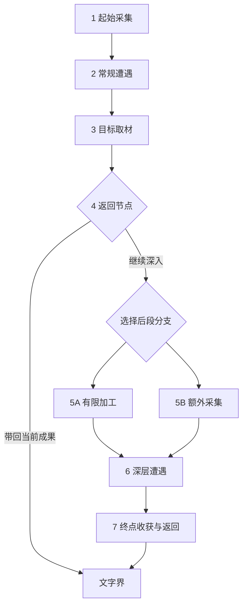

# 言咒：单局内战斗之外的堆叠经营构思

创建：2026-11-06；更新：2026-11-07。状态：Raw Idea / Unqualified；玩法假设 Hypothesis / NotRun。当前重点为“仪式飞升”；用户已通过分析建议及Q4—Q6探索规则，并确认Q7永久开路、Q9异常处理；Q8改为由物品描述、仪式预感和合成配方提示可能结果，暂不设计专门的双追索方式。未回写现行规则；前两轮模型候选仍未被选择。

范围更新：前两轮的“仅单局”不限制本轮用户明确新增的跨局知识与境界保留。早期候选保留作比较，不据此推定与仪式飞升合并。

当前工作入口：[设计缺口清单与逐项推进](#gap-checklist)。按2026-11-07用户要求，先明确缺口，再逐项深入；已确认Q1—Q9不重复征询，Q8沿用户修正。清单只维护在本页，不另建问题库或治理编号。

## 已确认意图

用户选择范围B：单局内战斗之外的玩法，先从核心玩法发散。当前草案以固定地图与分支路线为基础；结合言咒的配方、资源收集、背包构筑，参考《堆叠大陆》《炼金之道》的卡牌堆叠经营，探索轻量化方向。此次需要几版灵感，不要求完整规格。是否保留全部既有地图规则、具体轻量化尺度及候选选择尚未确认。

上轮跨局长期体验的问题不作为本轮前提；用户未选择永久成长或跨局解锁。此次新增候选不改变现行规则，不扩展首战、世界观或实现任务。

## 阅读范围与来源

- 模式：CUSTOM；共同来源提交 `193de41be9f8c4620842016dc2ed987b16036828`，后续并行提交不自动纳入。
- 完整已读：`yanzhou/design/GDD.md`、`yanzhou/design/systems/meta-progression-system/README.md`、`yanzhou/design/common/run-economy/rules.md`、`yanzhou/design/common/run-route/rules.md`。
- 章节已读：`yanzhou/system-design/handbook.md`的全局目标、全部系统与设计安排、局外成长；`yanzhou/governance/questions.md`仅META-Q01与INS-Q07条目。操作规范按根／项目AGENTS、READ-1及设计流程执行；未扩读链接。
- 用户本轮点名参考游戏，2026-11-06核对其官方商店说明：[Stacklands](https://store.steampowered.com/app/1948280/Stacklands/)、[Ways of Alchemy](https://store.steampowered.com/app/2915380/)。只核对机制概述，未做完整游戏拆解或试玩。
- Stacklands参考点：将村民与资源卡堆叠以采集、制作及发展村庄。Ways of Alchemy参考点：炼制、经营，以及为冒险者配置药剂／物品以获取材料与配方。下列方案为原创转化，不声称是参考游戏的既有系统。

## 共同设计假设

希望玩家把同一份资源分配给战斗准备和沿途经营，通过投入改变后续机会；堆叠应表达对象间的实际作用，而不仅是菜单按钮。候选先以主动推进、有限机会为轻量化方向，不预设实时等待、人口生存或完整产业树。此为模型建议，尚非用户约束。

所有物件名与合成关系均为说明性例子，未引用或新增内容库规格。每种候选都需保留可继续前进的基础路径；经营收益是否进入战斗、怎样占格及消耗，仍需另行设计。

## 候选一：路边小工坊——有限驻留里的安排

玩家目标：用当前地点有限的工作机会，为下一段路做出最合适的补给。体验假设：就地取材、临时拼出一套能用的准备。

进入节点后摊开少量资源点和设施卡。将工具叠到资源点上采集，将材料叠到加工设施上转化；采集与加工占用同一有限驻留预算。例：面对湿木和矿石，先干燥木料获取燃料，再用燃料加工矿石；也可直接保留木料作为后续配方投入。不是每条链都能在本站完成，浅加工、留原料和深加工需有不同用途。

循环：节点资源与剩余工作机会 → 选择采集／加工 → 实际产物与剩余时间改变 → 按背包空间选留 → 下一节点与战斗消耗改变需求。地方设施与未采资源随离开退出，携带物仅在本局延续。预算耗尽只结束经营，不自动判负；不能无限等待囤料。

结构：量值资源／时间的分配与消耗，落在节点内流程；主循环采用“工具箱”。新意在同一地形与库存下安排有限工作顺序。风险是每站都重复相同最优加工，或提前制成战斗成品削弱战中生产。最低判别问题：相同节点但下一战需求不同时，玩家是否改变加工安排？未执行测试。

## 候选二：把地图当配方——产物改变地点用途

玩家目标：利用手中物件，把沿路地点转成自己需要的机会。体验假设：学会炼金后，同一张地图出现不同用途。

保留固定分支骨架，把节点做成有少量明确交互的地点卡。例：资源点可直接采集一次，也可投入一份配制品，将它转成另一类一次性采集点；把制成的工具叠到障碍上，可以开放地图上预先存在的可选连接。使用的配制品因此不能再投入战斗。转换前提示用途与代价；未知仅保留为可理解的发现，不靠盲猜组合。

循环：取得资源 → 制作可用于地点的物件 → 消耗物件改变节点身份／通行资格 → 从新机会获得不同资源 → 支持下一次制作。已转化地点有记录、机会有限；路线仍向前推进，不回访刷取。没有合适物件时保留基础通路。开启额外连接是候选对现行路线合同的增量，尚未采纳。

结构：身份结构／权限的转化与解锁，落在地图节点和连接；主循环采用“传送门”（炼金产物改变探索，探索资源回到炼金）。新意在配方成为与地图交互的能力。风险是固定钥匙锁题，或所有好路线都要求特定配方。最低判别问题：同一地点能否支持至少两种各有价值的处理，而非唯一正确答案？未执行测试。

## 候选三：背着走的小工坊——收益设备也占行李

玩家目标：在本局剩余路程里，决定携带多少未来产能、多少即时战斗能力。体验假设：一路把自己的小工坊养成独特的旅行配置。

少量便携经营设备作为候选实体与战斗配置争夺背包空间。抵达合适节点后，将设备、真实材料与地点堆叠，完成一次有限加工；收入以材料、材料压缩或可用加工方式为主。例：带干燥设备能处理沿途湿料，但其占格会挤掉一件备用战斗配置；把原料投入设备改良可能提高后续收益，也使当前战斗准备变薄弱。

循环：战果资源 → 投资设备或保留战用 → 带着设备选择能利用它的分支 → 有限加工获得补给 → 重装并决定继续投资或换回战斗配置。设备仅在本局延续，节点次数与真实投入限制产出，不按现实时间无限生产；无设备仍能沿基础路线取得基础资源。出售、拆解和放弃设备尚无具体合同，不能默认免费退还投资。

结构：空间／关系／资源的占用、连接和再投入，落在共用背包与节点加工；主循环采用“行李箱”，局部包含受路程限制的增长。新意在生产能力本身成为需要携带的构筑。风险是经济设备前期必带、后期必弃，形成单一解；设备过多也会增加整理负担。最低判别问题：在不同资源分支和剩余路程下，带与不带是否都可能合理？未执行测试。

## 推荐与未决

模型推荐以候选一作为轻量入口，吸收候选二的少量地点转化；候选三适合用户更想要经营积累和背包取舍时单独深化。不默认把三者叠成大系统。

优先待选：更喜欢临时经营、改变地图，还是随行工坊；经营与战斗的相对比重；希望保留固定路线到何种程度。后续只需挑方向和喜欢的动作，再按实际依赖补问题，不要求本轮完成资格确认。

接口候选仅在本页记录：节点预算／加工权限、路线转化、经营产物与战斗输入、便携设施占格及取得退出。现行GDD§8与TL-25／33—35／32并未授权上述新增行为，本轮不修改其正文。

## 方法来源

使用 gameplay-mechanism-designer 的Spark模式及通用状态域、机制链与循环方法；上游固定提交 `29e8c759ca26c6bd4f337744b647dc728bf322b6`。实际读取该技能SKILL、source-lock、project-integration、input-output-contract、state-domains、mechanism-families、loop-patterns，并定向检索mechanism-chains.tsv。

- 候选一：改编GMD H123“消耗→转化→生成→放置”、H128“侦测→行动者选择→分配→锁定→解锁”；与H087有限行动链交叉组合，删除多人交接，以本站预算结束代替。有限驻留与战斗准备关系为原创综合。
- 候选二：组合H133“行动者选择→消耗→合并→转化→生成”与H035“放置→连接→侦测→解锁”；将后者的建设连接改编为消耗制成品开启预设连接，增加地点身份转化分支。地图配方为原创综合。
- 候选三：组合H121“连接→延迟执行→生成→分配”、H123及H004“行动者选择→控制权转移→放置”；把周期改为有限到站机会，加入真实投入、设备占格和行程终点约束。随行经营与战斗配置竞争为原创综合。

机制图谱只用于构思，不证明玩法成立。未实现、未运行实验、未创建额外目录或正式提案。

## 第二轮：从经典玩法发散核心循环

2026-11-06追加。用户要求进一步围绕循环发散，以战斗—购物、刷装—重塑、订单—经营为表达参照。此轮仍为灵感候选，未选择前三个方案，不要求完整系统。以下各循环均限定为本局内；示意物件、采集者、设施与地图能力是原创候选，不是已有内容或世界设定。采用Loop Builder深度中的紧凑循环表达，不展开规格或制作计划。

### L1 定向狩猎与配方追逐

参考《怪物猎人：世界》的狩猎—素材—装备—更强狩猎结构；原作概述见[官方商店](https://store.steampowered.com/app/582010/Monster_Hunter_World/)。

候选循环：看到想完成的配方 → 找缺少材料及对应敌人／节点 → 为目标配置战斗与行李 → 战斗／采集获得材料 → 炼制出新的构筑组件 → 能应对新的材料来源 → 追逐下一配方。例：想补齐一条低耗材路线，就主动选择提供缺口材料的分支，胜利所得让该路线真正可用。核心取舍是追目标素材还是走更安全的通用奖励路线。进入下一轮的是新组件与新的材料需求，而非仅通用货币。轻量化为少量可追踪目标及明确来源，不引入无限重复刷取；风险是固定毕业清单与单一路线。判别问题：不同构筑目标是否会让同一张地图产生不同走法？

### L2 配给采集委托

参考《Potionomics》雇用英雄收集原料的机制，概述见[官方商店](https://store.steampowered.com/app/1874490/Potionomics/)。给委托配置不同物品、保底采集与额外收益条件是本候选的原创转化，不归因于该概述。

候选循环：获得基础材料 → 炼制采集所需工具／补给 → 配给有限委托 → 推进主路线后带回不同资源 → 支持更丰富炼制 → 再配给更合适的任务。例：给同一采集委托防护品可处理危险资源点，给采集工具可带回另一类材料；投入物因此暂时或永久不能供玩家自用，具体归属待定。核心取舍是自用强度与后续供给。进入下一轮的是材料来源与实际产物。轻量化为一个任务位、一次配置、节点到达时结算，无现实挂机与独立角色养成；预算不足可跳过并沿基础路线继续。风险是无脑满额派遣，或等待收益割裂冒险。判别问题：是否存在为了下一战而合理放弃委托的时刻？

### L3 投入产能，再用产能养战斗

参考《异星工厂》的资源—设施—自动生产及研究结构，见[官方商店](https://store.steampowered.com/app/427520/Factorio/)。

候选循环：取得原料 → 在制成战斗投入和建造经营设备间分配 → 有限经营窗口内加工出更多／不同原料 → 分配给战斗或扩充产能 → 战胜新遭遇取得新原料与设备材料。例：现在把矿料变成战斗所需物，或先用它做加工器，使后续几站的粗料能利用；设备需真实投入，不能无中生有。核心取舍是何时回本。下一轮保留设备、库存与供给瓶颈。轻量化为少量设备、短链与按节点结算；不引入流水线空间网络或免费战斗成品。风险是复利失控、经济设备必选，以及与现有战中生产重复。判别问题：剩余路程与敌压变化能否改变投资决定？

### L4 探索工具打开资源层

参考《深海迷航》的收集—制造探索装备—进入更远／更深区域—取得稀有资源结构，见[官方商店](https://store.steampowered.com/app/264710/Subnautica/)。

候选循环：探索得到样本与配方线索 → 用材料制造探索工具 → 获得新的采集／通行能力 → 进入可选资源点 → 带回新材料与线索 → 制作下一种探索工具或战斗构筑。例：工具让玩家能从高温资源点取样；该样本既能完善某条战斗路线，也能用于下一种采集工具。核心取舍是短期战力与探索能力。进入下一轮的是可达范围和可用资源种类。轻量化为每段一两种可选能力，基础通路不锁死，不要求回到旧节点；风险是单线钥匙锁与盲目囤积钥匙。判别问题：工具是否带来多处用途和不同收益，而非仅开一道门？

### L5 战利品变成后续地图

参考《循环英雄》用卡牌放置地形、建筑及敌人、平衡道路收益与危险的机制，见[官方商店](https://store.steampowered.com/app/1282730/Loop_Hero/)。不继承其跨局营地成长。

候选循环：战斗／采集取得环境素材 → 在有限槽位合成或布置前方节点 → 选择资源更丰富但有额外威胁的路线 → 从实际完成的遭遇获得新素材 → 用新素材继续塑造后续路线。例：用材料把一个未来空节点变成特定资源点，并同时附加公开遭遇代价；材料类别影响资源类型，不能任意生成所有奖励。核心取舍是自己为自己制造多大挑战。下一轮保留已布置的路线与资源机会。轻量化为仅允许改造一个尚未进入节点，生成机会不等于提前领取产物。风险是安全收益组合成为固定解，或改变地图掩盖了原有信息。判别问题：增加收益与提高风险是否都能被玩家预见并主动权衡？这比现行固定路线改动更大，保持候选。

### L6 有限深入与及时兑现

参考《渔帆暗涌》的采集、出售、装备提升以及夜间风险，见[官方商店](https://store.steampowered.com/app/1562430/DREDGE/)。以下节点内继续／收手和临时收获池为原创转化，不声称照搬原作精确损失规则。

候选循环：准备工具和携带空间 → 进入可选采集点 → 每深入一次获得资源并提高公开风险 → 选择继续或收手 → 收手后实际选留、加工 → 为下一次准备更适用的工具。例：第一次取得普通材料后，可消耗补给再深入寻找稀料，但须面对明示遭遇；已经满包时还要权衡给新收获腾空间是否值得。核心取舍是多拿一次与保全当前成果。下一轮保留兑现库存与工具。轻量化为节点内有限选项，收手直接向前、不回访旧节点；工具改善获取方式，不抹掉风险。失败如何处理临时收获与本局终止仍Unknown，不默认允许战败继续。判别问题：玩家是否会因当前收获、生命和空间不同而选择不同收手点？

### 本轮推荐、范围与方法

模型建议优先比较L1与L4：前者用明确配方目标驱动路线，后者让炼金产物创造探索能力；L2偏轻量配给经营，L3偏产能投资，L5改造幅度最大，L6提供短程风险张力。这不是用户选定的组合，不把六套并入同一系统。

六个候选都有有限节点／投入机会，库存与新增能力只在本局延续，普通终局结束循环；未知失败、回收、经营加工和新物件归属不借故事或参考游戏直接补成现行权限。正式推进前仍需选择主循环、确认核心取舍、明确与战中生产分工。

方法补充：使用同一技能固定方法版本，进一步定向读取TSV中的H035／073／087、H110—144相关交易与制作链、H169—180相关肉鸽链；原公式已核对。L1改编H133＋H143（制造与目标取得），以工具箱循环返回组件与新目标；L2组合H119＋H125＋H128（有限委托、运回与配给），以双向系统循环返回材料；L3改编H123＋H132（生产与扩产），以有终点的增长循环返回设备；L4组合H133＋H140（制造与能力开放），以工具箱循环返回探索能力；L5改编H035＋H169＋H170（路线、节点与奖励），把生成决定部分交给玩家，以双向循环返回地图状态；L6改编H175＋H178（兑现与递增压力），把跨局撤离替换为节点内收手，以风险积累／兑现循环返回实际库存。上述组合、终点与返还安排均为原创候选。

本轮外部证据于2026-11-06查询，仅将六份官方产品概述用于机制参考，未做完整案例拆解；试玩与玩法验证均NotRun。原项目CUSTOM范围与来源提交不变。

## 第三轮：仪式飞升

2026-11-06。用户提出候选主循环并要求与经典玩法比较、给出完善方向。本节只保存玩法意图及世界观接口，不维护世界观正文，不读取另一设计对话或worldbuilding目录。游戏背景沿本页原CUSTOM与共同来源提交，新世界观输入仅使用本轮用户说明。

### 用户意图与已确认选择

- 目标：收集材料和知识，在文字界举行仪式，触发变化、完成拔擢，探索更高级仪式及物质界材料，最终飞升。
- 仪式由类型／知识、等级／境界与材料共同构成，以祭坛／法阵放入物品后启动。可能产生地点变化、仪式知识、配方、惩罚、神灵或生物召唤、特殊事件及战斗入口；这些均为用户希望探索的功能，细则未确定。
- 知识包括书籍等载体、分支知识树与条件任务，承担进程指引、故事揭示及仪式支持。资源桌面包含地点、材料、知识、法器与辅助道具，承担入口、资源约束及战斗成长。
- 世界接口：文字界为主要入口和仪式场所，地点连接物质界；普通合成、加工、运转仅在物质界发生，文字界仅进行仪式。此解释不自动授予现行战斗或物件新增权限。
- 用户明确确认：知识与境界都跨死亡／新局保留；未知以可推理规则为主，附带少量有征兆的随机事件；拔擢主要开放新权限和新交互。
- 未确认：材料、法器、已开启地点和世界状态如何跨局保存；出征结束／失败条件及损失；飞升结局后的继续方式；仪式与战斗的具体阶段连接。

### 经典结构比较

2026-11-06查阅以下官方产品概述；只对照已支持的结构，不声称已完整拆解或试玩。

| 参照 | 实际参考点 | 对本候选的建议 |
| --- | --- | --- |
| 用户举例的商店循环 | 战斗收益经购买转换为战斗能力 | 仪式结果要改变下一步行动或能力；若只随机发物品，很容易退化成换名商店／抽奖 |
| [密教模拟器](https://store.steampowered.com/app/718670/Cultist_Simulator/) | 研读秘典、寻找仪式、召唤、探索神秘领域，最接近本方向的组合 | 借鉴知识参与实际行动及资源投入，但两界分工、加工战斗与永久境界应按言咒独立设计，不复制神谱、术语或生存事务 |
| [司辰之书](https://store.steampowered.com/app/1028310/BOOK_OF_HOURS/) | 调查书籍与奇物、制作神秘工具、学习及探索隐秘历史；原作无战斗 | 借鉴不同知识的关联与用途；知识应说明下一步能够推理和尝试什么，不能只作为累计点数 |
| [星际拓荒](https://store.steampowered.com/app/753640/Outer_Wilds/) | 在循环世界中解读古代记录、调查线索与受环境限制的秘密地点 | 借鉴线索带来新行动方向；本候选另有正式境界权限和物资约束，不属于纯玩家记忆通关 |
| 已核对的怪物猎人／深海迷航循环 | 定向取材制造装备；制造工具拓展资源范围 | 作为物质界部分的支架，让仪式需求决定探索目的，再由探索成果支持下一次仪式 |

### 推荐的循环分工（模型建议）

主循环：发现知识缺口／仪式目标 → 选择物质界地点与携带配置 → 战斗、采集、加工仪式所需物 → 在既定返回／兑现条件下带回 → 在文字界选择仪式与投入 → 产生知识、接触、地点变化或需处理的后果 → 改变下一次物质界目标。

进程循环：多次探索／仪式带回的知识、特定经历和凭证 → 满足关键拔擢仪式 → 永久获得一种新权限或交互 → 能进行新的仪式与探索 → 达成更高阶段 → 最终飞升。具体材料／经历条件尚为建议，不以仪式次数或统一经验自动推进。

把日常仪式与拔擢仪式分工：日常仪式用于获取信息、接触对象、开启机会和处理后果；拔擢是阶段里程碑。并非每次仪式都升境界，也不要求每次新发现都升境界。这种结构能给横向探索留空间，但体验尚未验证。

### 优先完善方向（尚未采纳）

1. **仪式提供可追踪的因果。** 启动前公开真实消耗、参与物是否保留、基本合法性和已知征兆；首次可隐藏具体回应身份或特殊后果。结束后指出哪些投入或条件造成已观察反应。已验证的重复效果变得可预测，未知转移到新类型、新条件及更高层交互。随机主要影响有边界的事件变化，不让唯一进阶知识依赖无保底抽取。
2. **类型、知识、境界各司其职。** 类型决定尝试什么行为，知识决定理解与选择哪些方法，境界决定能够承受／执行哪些交互，材料承担本次操作的具体代价或倾向。仪式等级优先表示复杂度／资格；不要把这些轴全部化成同一个强度总和。应允许不同材料路径和同阶段的横向仪式。
3. **拔擢改变动词。** 新权限可候选为：从收到回应到主动询问，从只能发现入口到能在几个入口中选择，从被动承受后果到能用新的仪式回应。以上仅为抽象交互例子，不定义神灵能力或世界事实。若已有问题每次都只能交更多高级料，境界仍会退化成数值门槛。
4. **知识树逐步显露。** 分开已确认事实、待验证线索及已知缺口；显示下一个可追查问题及相关地点，不开局展示全部终极答案。永久记录让玩家无需重新解同一谜；新局可以复用理解，但具体仪式仍需资格、投入与当前条件。书籍实体、已掌握知识与一次仪式使用的凭证分别记账：消费书不应默认抹除已知内容，拖动知识卡也不应默认耗掉知识。
5. **成功与后果可同时发生。** 每种仪式有主要意图，不把知识、物品、敌人和神灵全塞入同一无差别奖池；可有主要结果和有因果的次生后果。惩罚应产生能处理的局面或选择，并有可学习原因；避免只删资源后要求重刷。不可无代价反复触发“失败”刷知识或稀有材料，重复反馈、材料来源和结算必须受约束。
6. **两界需要真实互相依赖。** 物质界提供采集、加工与战斗，文字界仪式消耗这些投入以获得知识、接触及地点机会。仪式授予材料的具体含义需界定，避免仪式可完成一切普通加工而架空物质界；任一仪式也不能无限产出足够支付自身及所有后继材料。返回条件未知时，不推定随时无损撤出。
7. **长线成长保留后，调整重复劳动。** 知识与境界保留是本候选已确认方向，不能沿旧规则自动清空。建议新权限让旧资源获得更有效或更多样的取得路径，并让前沿内容增加决策复杂度，避免每次出征重复整套低阶仪式、也避免靠隐藏同步加难抵消成长。库存、地点和敌人进度仍待确认。

### 一个用于讨论的最短情境

以下是原创机制例子，不新增世界事实或内容库物件：玩家找到一条仪式线索，得知它能提供关于某地点的回应 → 去物质界采集并加工所需供物 → 回到文字界，观察投入后的征兆，选择按已知方法尝试或支付更多材料采用较稳妥方法 → 仪式带来新线索及一个需应对的事件 → 玩家用新线索选择下次探索 → 后续满足关键条件后拔擢 → 获得一种以前没有的询问／开启交互。稳妥方法、供物及事件均待用户选择；日常仪式不直接默认升阶。

### 必须明确的接口与未知

- “进入物质界”是一次战斗、一个多节点区域，还是一次有返回点的远征？建议优先讨论小段多节点远征，使采集、加工和背包规划有连续性，尚未确认。
- 物质界的非战斗地点能否加工？用户限定加工发生在物质界，并未等同于只能在战斗发生；建议允许部分安全地点，但明确机会和材料成本，避免提前无限生产战斗成品。现行战斗生产合同不因该建议改变。
- 仪式召敌后在哪里战斗？建议仪式产生物质界遭遇／入口，再进入现有战斗流程；若文字界直接战斗，则要另定其生产权限。神灵召唤不默认必是敌人、生物召唤也不默认成为可控制单位。
- “更新地点”具体是发现入口、刷新可进入地点，还是改变已存在地点？这些对固定路线、回访、补给刷新和难度有不同影响，尚未确定。
- 死亡后保留知识和境界已确认；带入装备、在途收获、储存材料及已提交仪式后果未确认。不能把免费仓库、安全撤离或失败不损失补为事实。

### 当前判断与下一步证据

判断：逻辑上可成立但未验证。已确认输入支持“永久认知／权限成长＋物质界探索＋文字界仪式”的方向；是否神秘、是否值得反复探索仍为Assumed，不能由参考游戏成功推出。主要风险是仪式退化为随机资源兑换、永久知识使后续只剩照表收材料、以及两界返回与损失不明确造成资源循环失控。

最低成本验证建议：先纸面写一个仪式的两种合法投入、一条可获取线索、一个有征兆的后果、一次物质界材料取得和一种拔擢后新交互；以后经用户授权再交给玩家判断与选择。观察玩家能否说明第一次结果的原因、第二次是否依据新知识改变投入、能否理解物品在战斗与仪式间的取舍。若只盲试或照提示填空，应先改反馈与规则；若预测和取舍成立再扩充内容。此处只设计验证方法，未执行测试或制作原型。

方法使用game-design-reality-check的轻量检查，读取SKILL、project-integration、reality-check-framework及source-lock；上游固定提交 `29e8c759ca26c6bd4f337744b647dc728bf322b6`。grill-with-docs集中澄清已确认三项偏好，其余建议不因落盘升格。下一批应优先确定出征单位／结束与损失、地点变化方式、仪式召敌后的阶段连接。现行GDD、META-Q01、INS-Q07及世界观正文均未修改。

## 2026-11-07：分析建议通过，确认短程多节点探索

用户明确通过上一轮答复的各项分析，并指定一次物质界探索采用推荐的一小段多节点形式。该确认推进本方向设计，不等同于采纳此前其他候选、具体示意物件、未给定参数或运行验证；世界观与现行规则正文继续由各自职责维护。前三轮的“建议／未确认”是当时记录，以下范围覆盖对应旧状态。

### 已确认的设计方向

- 一次物质界探索为一小段多节点探索，内部可承载战斗、采集及加工，保持连续的携带与资源取舍。返回规则按下文Q4；节点数、具体结构及进入条件尚未设定。
- 日常仪式循环与关键拔擢循环分开：普通仪式推进信息、接触、事件及地点机会，拔擢在阶段节点永久开放新权限、新交互；不把每次仪式都变成升级。
- 仪式以可学习的未知因果为主，启动前明确消耗／保留与已知征兆，事后提供可追查反馈；已掌握仪式能作为可靠工具，新条件与新交互继续承载探索。不以无差别随机奖励池替代规则。
- 类型决定行为目的、知识决定方法理解、境界决定权限、材料承担操作代价及倾向，各维度不合并为一个强度值。
- 知识树区分已知事实、待验证线索和已知缺口；知识要指向后续调查行动。书籍实体、永久知识和仪式凭证区分，不默认消耗载体就抹除知识。
- 两界形成往返需求：物质界采集／加工／战斗，文字界仪式改变机会。物质界可设部分非战斗安全加工地点，并限制加工机会；仪式召敌优先生成物质界遭遇／入口，再接入战斗。具体加工预算、召敌强制性和遭遇退出未定。
- 仪式可以授予材料，但须有明确条件与代价，不包办所有普通加工及供给。仪式触发地点更新的具体方式仍待选。
- 知识和境界跨局保留延续此前确认；失败代价主要落在本次投入和本次探索收益，避免反复重解旧知识。具体保留与损失按下文Q5，文字界存储容量尚未确定。
- 进阶必需知识应有可追查路径，避免盲试仪式成为唯一推进方式。验证思路已获认可，但没有因此启动玩家测试或原型制作，状态仍NotRun。

当前流程摘要：文字界确定仪式／知识目标并准备携带物 → 进入物质界短程多节点探索 → 在节点中战斗、采集与有限加工 → 在返回节点或终点带回成果，失败则按Q5结算 → 文字界仪式产生变化 → 新的探索目标；满足关键条件才进行拔擢，并继续更高阶段。同一地点可按Q6再次出征。

### Q4—Q6已确认：返回、失败损失与重复探索

用户2026-11-07针对上一轮Q4—Q6回复确认，按所列推荐整批确认以下规则。此处为本方向设计决定，未绕过正式采纳流程回写现行GDD。

| 编号 | 合同 | 已确认规则 | 作用及边界 |
| --- | --- | --- | --- |
| Q4 | 能在何时返回文字界？ | 设明确返回节点，可在到达时携已持有且装得下的成果提前返回；路线终点提供返回，战斗中不直接安全离开 | 让继续深入与保全收获成为选择，避免任意时刻撤离消除风险 |
| Q5 | 探索失败具体损失什么？ | 带入的法器／铭文／辅助保留；本次带入的消耗品剩余及本次新获实体丢失，已消耗投入不返还；已掌握知识、境界和未带入的文字界物资保留 | 保住既有构筑与长线成长，风险由探索供给和新收获承担；新获得但尚未读懂的书仍是实体，不能自动算已掌握知识。文字界存储容量等仍需另定 |
| Q6 | 同一地点能否再次出征？ | 允许重复进入；每次出征重新生成该地点主题内的短路线和普通资源机会，保留关键仪式／剧情变化与已学知识，不在本次探索内返回重刷已结算节点 | 支持定向取材和失败重整；需要后续限定入口、生成与一次性内容，防止开关地点刷取奖励 |

一致性核对：本次探索中已掌握的知识继续受永久保留约定保护；未读懂的新书属于本次新获实体，失败丢失。新获得的法器／铭文／辅助也属于本次新获实体，不能套用“出发时带入装备保留”。保留已有装备不自动授予免费复制、加工返还或无限供给。

剩余未知集中在：入口及返回节点的具体安排、地点关键变化的类型、仪式投入与结果的具体合同、有限加工预算、文字界存储容量，以及带入物经加工／转化后的失败归属。不因本次确认默认具体参数或新例外。实际只维护本文件，未扩读游戏背景、未改GDD或治理、未运行玩法测试。

## 2026-11-07：基础仪式细化——引路仪式（暂称）

用户授权细化一个基础仪式，并于2026-11-07确认Q7及Q9、修正Q8：暂不专门设计原样／澄清两种追索方式，通过物品描述、仪式预感与合成配方暗示和说明可能结果。本节按该修正更新；旧双路线构思仅保留在固定提交 `0f989ad` 中，不再作为待选或已确认方案。功能性名称和样本／供物角色不是世界观事实、正式物件或内容库配方；具体物品、数量与内容参数仍待设计。本轮继续只使用本页固定游戏背景及用户已确认设计，不新增外部研究、正式GDD或测试任务。

### 作用与可观察目标

把物质界取得的有指向性样本转为一个可出征的新地点，使玩家体验“我的发现改变了下一次可以去哪里”。仪式只在文字界进行，不进行普通加工、不直接发放探索所得、不直接拔擢。它承担当阶段的开路用途；同一方法可用于不同来源的合格样本，不要求为每次重访重复施仪。

最低情境前提（本轮候选）：玩家已有一个基础可进入地点与该仪式的初始说明，可从基础地点取得第一份样本及指定供物。不能把第一份必需样本放在尚未被它打开的地点；材料丢失后能再次进入基础地点获取，不因一次失败永久卡住。本例不规定初始叙事、地点名、境界名或具体敌人。

### 输入与祭坛职责

| 放入／选择对象 | 用途 | 启动后的处理 |
| --- | --- | --- |
| 已掌握的引路知识 | 选择该仪式方法，解释已知征兆；是知识引用，不是复制出一本书 | 永久知识保留，不消耗 |
| 合格的指向样本 | 决定要追索的来源；通过该物品的描述及摆入祭坛后的预感推测可能回应，不能任意材料开任意地点 | 本次样本消耗；身份、数量及是否存在相关加工配方待具体内容设计，不要求二选一版本 |
| 一份该仪式指定的供物 | 支付本次仪式的执行成本；具体物件身份和取得链尚未选定 | 本次供物消耗；不默认通用货币或所有仪式通用燃料 |
| 当前境界资格 | 判断是否能主持这种基础仪式，无需拖入实体 | 境界保留，不扣等级 |

合格性由该仪式的明确输入范围裁决。必要对象缺失、不兼容或指向已完成的同一开路目标时，启动前说明并拒绝，不消耗资源；不把无效组合视为需要付费试错的随机失败。准备时可撤换实际物品，未启动不消耗；最终启动才承诺本次消耗和后果。具体法阵几何、界面和内容参数未设计。

### Q8修正：通过三类信息理解可能结果

| 信息来源 | 作用 | 内容边界 |
| --- | --- | --- |
| 物品描述 | 提供来源、传闻、关联地点等线索，帮助玩家产生仪式用途的猜想 | 用户举例的意思为“据传与某个古老地点有关，但未被亲见证实”；记录为传闻，不补写该地点身份，不把传闻当已证实的世界事实 |
| 仪式预感 | 对当前放上祭坛的实际投入作出回应，暗示目标及伴随风险 | 用户举例的意思为“感到某处入口回应，同时察觉其他存在注视”；可让玩家读出地点联系与额外威胁，不预先揭露具体回应者或完整事件 |
| 合成配方 | 将物品加工关系与其可能的仪式用途／后果联系起来，提供理解和准备的线索 | 具体配方尚未设计；不默认存在净化、安全版或普遍减灾配方，也不保证每种风险都有无风险替代。普通加工仍只能在物质界进行 |

当前不设计“先选原样／澄清模式”的独立步骤，也不以新的名称暗中保留固定双路线。玩家通过具体物品、已有知识、配方信息和当前预感判断是否继续仪式；若日后某件物品确有不同加工产物，按该物件的具体来源和配方另行设计。

仪式保持可学习的因果，少量有征兆的随机事件沿已确认方向；不能把预感措辞当作掩盖准确消耗和基本合法性的理由。预感暗示的是可能结果及风险，是否必然发生、受哪些条件影响仍由具体仪式内容明确，不从用户的表达示例擅自推定概率或新增隐藏条件。

若仪式实际引来异常，按已确认Q9处理：关联新地点，在深入主要探索段前处理；出发前告知该威胁，玩家仍可暂缓出征并去其他地点。异常可能提供额外机会，但不承诺必掉稀有物、不让异常奖励成为拔擢唯一材料。具体敌人、收益和位置待定，不改现有战斗结算。

### 征兆、启动与知识反馈

1. **摆放：**显示样本身份、当前所选方法、已知境界资格和准确消耗清单；知识不足以主持或材料不合法时不开放启动。
2. **观察：**结合物品描述、已知配方及当前投入产生的仪式预感，推测地点关联与可能伴随的回应；不要求对比两种追索方式。预感要反映实际输入，不能是所有仪式通用的空泛警告；具体触发规则、文案和表现待定。
3. **承诺：**启动消费样本及供物，知识与境界不变。启动后不提供通过取消反复查看不同结果的途径；保存与恢复仍应避免重扣／重领，精确接口后续处理。
4. **产出：**桌面出现新地点入口及其当前已知情报；若触发伴随异常，则同时留下关联该地点的异常事件。这里只产生入口／机会，不将地点里的物资计入库存，不立刻在文字界打仗。
5. **理解：**知识记录保留本次投入、仪式预感和观察事实，并与原有传闻／配方线索联系；一次试验不自动揭晓全部仪式定律。区分实际验证的关系和仍待验证的猜想，不再以对照双追索路线作为必需学习条件；具体知识任务条件待定。

### 入口、事件与重复使用

本仪式按已确认Q7永久发现地点入口：发现后按已确认Q6再次进入，每次生成该主题内的新短路线和普通机会；不要求重复支付同一开路仪式。这是本方向已确认的具体设计，尚未回写现行GDD。

若仪式造成异常，它属于关键仪式变化，不能靠返回、失败、退出恢复或重新生成短路线消失；不再次复制同一异常。处理完才标记该事件解决，不随普通路线刷新复活。具体异常事件的战后收益仍按探索实体归属：取得后失败可丢失，不倒补已经消费或丢失的物资；已解决的事件不因此重复发奖。若尚未解决就失败，原异常仍待处理，知识与境界按已有规则保留。

同一来源已经完成开路后，再摆入等价样本不提供新增入口、重复知识或刷新事件，启动前提示不消耗。其余合格来源样本仍能使用该方法。后续若需要“调查已知地点”的仪式，须单独确定目的，不在此偷偷附加日常扫描费或重访税。

### 与下一次探索的连接

例：基础地点取得有来源线索的样本与供物 → 结合描述和已知配方理解其可能用途，必要且存在具体配方时在物质界加工 → 返回文字界摆上祭坛，阅读当前预感并决定是否启动 → 获得新地点及可能的伴随事件 → 按已知风险准备战斗配置，选择何时出征 → 在新地点取得后续配方线索／材料 → 返回推进另一仪式或关键拔擢条件。加工不是本仪式强制前置，后续奖励身份与拔擢需求未知，不凭本例创建物件或故事。

若带着样本在返回前失败，新获样本按Q5丢失，已学引路知识和境界保留；可从基础地点重新取得样本。若开路已完成，之后探索失败不会重复收费或抹除已确认的永久入口。

### Q7—Q9确认结果

| 编号 | 问题 | 用户决定 | 影响／边界 |
| --- | --- | --- | --- |
| Q7 | 首个基础仪式的职责与产出 | 按推荐：引路仪式通过样本定位并永久发现新地点；重访沿Q6，不重复缴纳开路成本 | 本条只确认此仪式的入口保留，不推广为所有地点变化永远不变 |
| Q8 | 玩家如何判断仪式可能结果 | 按用户修正：暂不专门设计两种追索方式，由物品描述、仪式预感和合成配方暗示与说明 | 先确立信息和推理方式；不预设净化分支、具体配方、物件身份、数量或结果概率 |
| Q9 | 仪式实际引来的异常怎样处理 | 按推荐：绑定新地点，在深入主要探索段前处理；可暂缓出征，不能靠重进消除，解决一次后不重复生成 | 不再依赖原样／澄清双路线；只约束已触发的异常，异常强度、奖励与可替代解决手段留待后续 |

检查结论仅限文字逻辑：具备外部材料来源、三类推理信息、物资消耗、地点后果及再次探索的返回链；没有证明预感可理解或神秘体验成立。尚未运行测试。后续观察应检查玩家能否从描述和当前预感作出有依据的预期，并在仪式结果后修正认知，而非检查双路线选择。下一步细化一份样本的来源线索、对应预感、实际主结果与伴随事件，以及相关配方能提供什么信息；不重复询问已确认Q4—Q9，不将表达示例写入世界观或内容库。

## 2026-11-07：设计缺口清单与逐项推进

用户要求先确认当前设计缺口、写清单并逐个深入。本清单依据本方向最新确认和原CUSTOM范围整理；不声称已审查未授权的世界观、内容库、其他对话或当前实现。此前已确认的方向视为前提，具体机制缺失与体验尚未验证分别保留。

已明确的骨架：文字界仪式／物质界采集加工战斗；短程多节点探索；指定返回节点及终点返回；Q5失败保留／损失；同地点多次出征并保留关键变化；知识与境界永久保留；拔擢以权限为主；引路永久开入口；物品描述、仪式预感和配方承载推理；已触发异常绑定地点并需在深入前处理。上述内容不列回待选清单，只有具体例外和接口继续设计。

### 清单与推荐推进顺序

序号仅为本页清单行号，不是新增项目问题ID。逐项处理时按该项依赖集中确认问题，不一次要求用户回答全表；新决定写回所属正文并更新本表。当前不自动升级资格或启动实现／测试。

| 顺序 | 设计项 | 当前真正缺少的内容 | 本项完成时应能说明 | 状态／主要依赖 |
| --- | --- | --- | --- | --- |
| 1 | 初次起步与失败后重整 | 初始已知地点／仪式知识／携带配置；第一份样本与供物的可达来源；耗材耗尽如何重新开始 | 首次出征—返回—引路—新目标的完整流程，以及失败后不永久卡住的恢复路径 | 框架已确认Q10—Q13；具体配置、材料与额度分别交3／4／7项，尚未验证 |
| 2 | 一次探索的路线与节点 | 路线长度、分支、出发前信息、采集／加工／战斗分布、返回节点位置、入口与生成时机 | 一张可走通的短路线，哪些位置可以选择、哪些风险必须承担 | 框架已确认Q14—Q17；特殊异常位置交第8项，节点具体内容交4／7／11项，尚未验证 |
| 3 | 资源持有、携带与结算 | 文字界存储及桌面卡含义、带入量／留存、满包、装备在途中加工／合成／拆分后的归属、真实物品与知识引用区别 | 同一物品跨两界、加工、成功返回及失败的去向；Q5不产生返还或复制漏洞 | 框架已确认Q18—Q22；实际占形与装载核算待内容，尚未验证 |
| 4 | 采集、非战斗加工与供给 | 每站有限机会怎样计算、材料与设施需求、是否共享预算、供物与战斗投入的争用、生命／补给恢复、重复取材收益与成本 | 一份资源从取得到使用的账目，有限加工为什么形成取舍，何时继续／返回 | 框架已确认Q23—Q27；加工暂定5拍及具体供给／收益仍待内容核算，尚未验证 |
| 5 | 知识获得与知识树推进 | 读书／调查／仪式观察的条件、何时算学会、猜想如何确认、任务如何揭示、缺口指引到哪里、永久学习何时生效 | 一条从线索到永久知识、再到新行动方法的具体链 | 框架已确认Q28—Q31；具体书目、证据条件和学习成本待6／7／11项，尚未验证 |
| 6 | 仪式通用规则与预感 | 类型范围、输入角色、知识／境界资格、物件匹配方式、预感随实际投入变化的规则、主结果与伴随结果、消耗及随机边界 | 用明确投入判断能否启动、会付出什么、能预期到哪一层以及如何学习结果 | 框架已确认Q32—Q36；具体方法匹配条件、预感内容与资源闭环待7—9／11项，尚未验证 |
| 7 | 首个引路仪式完整样例 | 一个样本与供物的功能规格／获取链、描述线索、关联配方、对应预感、确定主结果与可能伴随事件 | 一次能逐步讲清的实际施仪及下一次出征，不停留在“XXX可能回应” | 样例方向已确认Q37—Q40；正式世界身份、实际配方／占形／战斗可达性仍待内容，尚未验证 |
| 8 | 异常、召唤与持续事件 | 触发与告知、阻挡位置、解决方式、一次性收益、状态持续；神灵接触与生物召唤分别产生哪些玩家选择 | 一个已触发事件如何影响地点、如何解决、怎样避免重复领收益或无法继续 | 当前展开；依赖6／7，Q9沿用；不默认所有召唤都战斗或可控制 |
| 9 | 拔擢、境界与飞升主线 | 阶段划分、各次新权限、必要知识／经历／供物、是否分支、与旧内容的关系、最终飞升条件及之后是否继续 | 从首个基础仪式到一次具体拔擢，再到终局目标的纵向路径 | 待设计；依赖5／6及最小样例；不预设等级数或伤害加成 |
| 10 | 操作流程与信息组织 | 文字界桌面上如何选地点／知识／仪式、查看和摆放、物品分类与数量、明确消耗、结果追溯、离开恢复后显示什么 | 玩家能在各阶段找到下一步、理解物品归属和反馈 | 待设计；依赖3／5—8；只定玩法信息需求，具体presentation／视觉／实现不在本任务写入范围 |
| 11 | 内容覆盖、节奏与验证 | 最小完整循环需要哪些功能内容、重复出征是否有新选择、知识推进速度、仪式成本、永久成长后的重复劳动、卡死和刷取风险 | 一套可审阅的最小内容关系及验证问题；明确哪些设计假设仍无体验证据 | 待设计；依赖前述最小闭环，不先铺完整内容库或制作排程；验证执行另需授权 |

顺序意图：先闭合第一圈的起步、探索、物资与仪式，再用样例暴露缺口，随后细化更长的成长和内容节奏。第9项的“最终飞升、永久权限成长”目标已确定，后排的是具体阶段与条件，不是延后定义总体目标。第5／6项允许相邻回查，不假装所有依赖都单向。

### 第1项已确认：初次起步到第一次引路

用户于2026-11-07明确将Q10—Q13均按推荐确认。初次开始指首次建立这段冒险进程，再次出征及失败重整沿已确认永久保留与损失规则；不把新角色、存档槽或更高难度模式混入本项。下列起步框架生效于本方向，具体物件与参数仍待后续项。

已确认的初始条件：一个已知基础地点、能支撑公开可运行基础战斗路线的真实配置、引路方法的最低操作知识。已有配置不在本页编造具体器具和数量；知道怎样主持引路，不等于知道样本指向哪里或额外回应是什么。首次引路所需样本及供物通过物质界取得，不开局直接发齐。

已确认的第一圈：文字界看到引路的材料缺口 → 进入已知基础地点 → 在主路线取得与地点来源相关的样本和供物，接触描述／配方线索 → 到首个返回机会，选择带回完成当前目标或继续深入获取额外资源 → 返回、摆放、观察预感、决定启动 → 永久发现一个新地点，若触发异常则留下对应告知 → 根据新地点情报准备下一次出征。第一次引路不自动拔擢，具体节点数、材料身份、额外收获和异常内容留给对应后续项。

已确认的失败后重整：保留已有配置、知识及境界；基础地点允许重新进入。若消耗品已空，基础地点前段设置有限的最低供给采集机会，不需要先支付同一种已耗尽的稀缺耗材，能支持一条后续可执行路线。资源仍需实际采集和携带；原失败损失不倒补，先前消耗不撤销。该设计只是防止恢复闭环自锁，不默认每场补满或文字界自动生成材料。

### Q10—Q13确认结果

| 编号 | 问题 | 已确认选择 | 理由／影响 |
| --- | --- | --- | --- |
| Q10 | 初次开始时玩家已经知道和拥有多少？ | 已知一个基础地点、持有可运行基础战斗配置、掌握最低引路方法；样本与供物尚需探索取得 | 能立即开始第一圈；把初次未知留给具体样本、预感与结果，而不把最基本操作藏起来 |
| Q11 | 第一圈的明确进展是什么？ | 完成一次引路，永久发现新地点并得到下一次探索目标；不直接拔擢 | 集中呈现两界循环；具体拔擢继续由关键知识／经历和专门仪式承担 |
| Q12 | 首次所需材料的取得怎样安排？ | 必需样本与供物在基础地点首个返回机会前的主路线有明确可达来源，完成相应节点即可取得，不靠稀有随机掉落；更深处提供额外机会 | 避免第一次就盲刷；取得仍需完成探索、装得下且成功带回；不保证无风险获得。具体节点内容留给第2／7项 |
| Q13 | 全部消耗品耗尽后如何继续？ | 可重入基础地点，用保留配置与前段有限采集重新取得最低运行材料，再决定是否深入；不要求先花已耗尽的稀缺材料才能取得同一种材料 | 保护失败后的继续能力，同时保留Q5的真实损失；采集额度和退出安排在第2／4项落实 |

Q10—Q13已全部确认，现转入第2项；跨项引出的数值和内容仍在其所属清单项中待定，不把框架确认等同于具体参数闭合或体验通过。

### 第2项已确认：普通地点的短程探索路线

用户2026-11-07将Q14—Q17均按推荐确认。以下为基础／普通地点的已确认路线框架；特殊仪式地点、异常阻挡、后期地区可以有专门布局，不能把本模板直接推广为所有地点的固定限制。具体节点中的物件、配方和敌人不在本页编造正式规格，不修改首战内容或实现。

#### 路线与两次返回机会

每次完整经过7个位置，前4个位置组成可提前返回的一段；第5个位置是二选一分支，每次只经过其中一个。第4／7位置包含返回功能，单纯选路不另计行动消耗。该数量作为本方向第一版普通地点框架已确认，尚未验证时长。

| 位置 | 玩家实际做什么 | 承担的设计职责／限制 |
| --- | --- | --- |
| 1 起始采集 | 在本次有限机会内取得支持最低运行的基础材料 | 落实Q13；基础地点此处不先要求稀缺耗材。所得为真实本次收获，不能在此直接安全返回、反复领料 |
| 2 常规遭遇 | 用初始或已有配置及真实材料完成一场遭遇 | 为首次带回建立风险；只保证有可执行基础路线，不保证必胜，不新增自动恢复 |
| 3 目标取材 | 完成该节点交互，取得此次明确目标材料及线索 | 首次引路所需样本／供物在此或前面节点可取得，不能因随机表缺项而拿不齐；仍需装得下并成功带回 |
| 4 返回节点 | 选择带现有成果返回，或确认继续 | 首次玩家已有完成引路的材料机会；离开返回节点进入后段，就需到下一返回位置，不能反悔瞬移回来 |
| 5A 有限加工 | 使用已有材料与此地设施，执行有限加工 | 与本次战斗准备及背包占用关联，具体预算／配方在第4项设计；无材料可略过服务，不凭空补料。不是恢复被否决的双追索方案 |
| 5B 额外采集 | 取得另一类或额外材料机会 | 增加收获与携带压力；不得放置首次开路唯一必需材料，避免名义可选、实际必选 |
| 6 深层遭遇 | 在消耗与携带状态延续下处理后段威胁 | 继续深入意味着把未兑现收获带入下一段风险；公开敌人类型与主要机制，详细强度待内容设计 |
| 7 终点收获与返回 | 处理本次终点收益及实际装载后返回文字界 | 为走完整段提供额外收益；不自动额外生成首领战，收益类别／额度及满包处理在后续项明确 |

前后段连续使用真实库存及生命状态，返回节点不自动等于回血／加工节点。允许离开前整理和选择是否合法沿后续物资合同明确；不能默认产生第二份库存。失败始终按已确认Q5，不因接近终点而补发未来收益。

#### 出发前和途中分别知道什么

出发前可查看整段路线连接、各节点类型、两个返回位置和大致资源类别；敌人公开类型与主机制，不提前公开现行规则应隐藏的敌牌。具体普通战利品、未知文本与隐藏发现抵达后揭示。地图告知“哪里有样本来源”不自动揭晓样本指向的地点或仪式回应。

在第4位置根据当前实际库存／生命选择是否深入；到分叉才选第5A或5B，不开局承诺后段路线。选择一支会放弃另一支本次机会，随后汇合；不得绕回补拿未选节点。前段必经、后段可选是当前最小模板，后续是否加入前段分支另据体验设计。

#### 地点再次进入与路线生成

同一地点本次待出征路线在首次查看准备信息时生成并保留；撤销准备、换装备、返回桌面、退出恢复都沿同一张待出征路线。确定进入后，正常返回或失败结束本次探索，下一次出征才生成新路线实例。进入后主动放弃属于失败结算，不能用“取消”绕过Q5取得安全返回。

第一版可在保持上述功能位置及材料可达约束的前提下，从该地点合格内容池更换具体遭遇、资源和节点内容，不必每次大改拓扑。未推进就退出恢复不计新出征，不刷新补给；起始采集有本次额度，失败又不能保留新获实体，因此不能反复取消准备或领料即安全离开。是否还需入口成本由后续资源循环判断，本轮不额外添加体力／钥匙货币。

引路造成的未解决异常继续绑定地点，不能因新路线实例而消失。它具体替换哪一遭遇或增加什么节点留给第8项；本例先展示无该特殊异常的基础地点，不擅自改Q9的阻挡位置。

### Q14—Q17确认结果

| 编号 | 问题 | 已确认选择 | 理由／影响 |
| --- | --- | --- | --- |
| Q14 | 第一版普通地点采用什么路线规模与结构？ | 采用上图：完整7个位置，第4处可提前返回；前段必经，后段在有限加工与额外采集间二选一后汇合 | 一圈内同时有取材目标、是否深入和后段选路，暂不做复杂迷宫；不限制所有特殊／后期地点 |
| Q15 | 返回位置怎样安排？ | 仅第4处及终点能正常带回；继续后段后不能退回第4处，进入后主动放弃按失败结算 | 落实收益与风险的承诺，避免采集后随时回城；具体生命恢复另在第4项设计 |
| Q16 | 出发前显示多少信息？ | 显示整段连接、节点类型、返回点、资源大类及敌人类型／主机制；具体普通掉落、未知故事和隐藏发现抵达后揭示 | 让玩家能据仪式目标准备，同时保留探索发现；不越过现行敌牌揭示边界 |
| Q17 | 怎样生成和刷新本次路线？ | 首次查看该地点的出征准备时生成并固定，取消准备／换装／退出恢复不重抽；实际进入并结束探索后，下次才生成新实例 | 兼顾可提前规划与重复探索；普通内容可变化，已确认关键仪式／剧情状态保持 |

Q14—Q17已确认，现进入第3项。静态核对已确认方向：必需材料可在首次返回前取得；空耗材有前段采集来源；安全带回前存在遭遇风险；选择继续不能同时占有另一支节点；未完成的未来节点不补发收益；同次路线不反复领奖。是否有意义、是否过长或固定流程重复仍为Hypothesis／NotRun；无玩法实验执行。

### 第3项已确认：资源持有、携带与结算

用户2026-11-07将Q18—Q22均按推荐确认。Q5的失败规则继续有效，本项补齐库存、物品来源及加工后的适用边界；具体占形、数量及实际装载尚需内容核算。不扩读或修改内容库、背包现行正文、展示合同或实现。

#### 文字界积累与本次出征

第一版文字界实体库存不设总量硬上限，以卡牌分类、同类数量和具体实例查看管理；出征仍受一个真实共用网格背包限制。文字界里的堆叠数量只简化显示，不使带入背包的多份实体免费压成一格；具体尺寸、占形和可携带标签继续依据内容，不在本页发明参数。

出发前从实际库存选择带入物，未带入者保留在文字界，探索中不能远程取用。取消出发准备只是将预留物回到可选库存，不生成副本、不改变Q17地图。实际进入后，装备、材料、样本和实体书籍按各自合法规则占用同一个出征背包；配置展开与手牌交接沿现有框架，备用物也不免费存包外。

已掌握知识、境界及地点入口属于永久记录／可操作入口，不是可多领的一件实体，不占携带网格。未读懂的书、实际需要献出的秘典或物件是实体，按物件占用及消耗规则处理；读懂书只新增知识，书是否消耗由阅读规则另定，不能复制出第二本。以知识引用选择仪式不会让知识变成可消耗实物。

#### 满包、节点选择与返回

提供当前节点的待选物品区：可与包内物反复比较和整理，在离开前确认选留；待选物尚未装入包，不能作为生产／战斗／仪式库存使用。离开节点时一次结清未选物，不跨节点跟随、不寄回文字界、不在下一次进入恢复。当前节点允许主动弃置持有实体为新物腾空间，最终确认前可撤回取舍，确认弃置后没有钱款或原料返还；出售另需系统规则，本项不默认存在商店出售或分解收益。

物资整理和配置装拆在节点处理／战后既有合法窗口内进行，不由本建议打开战斗中免费丢牌、改装或新增输入窗口。已经消费的物品不能通过整理取回。安全返回时仅将实际装得下、具有携带资格的剩余物带回，已有库存不受影响；新取得并成功带回的装备，在未来再次带入时才属于那一次的“原有装备”。

#### 失败保留按物品本体及来源判断

| 情境 | 已确认的失败处理 | 规则依据／边界 |
| --- | --- | --- |
| 出发时带入、仍持有且未被消耗的法器／铭文／辅助 | 保留该实体 | 延续Q5；不能连带恢复已消费材料或曾弃置物 |
| 途中取得的新法器、铭文、辅助，即使已经装上使用 | 丢失该新实体 | 延续Q5，本次使用或装配不把新收获变成出发带入物 |
| 带入的铭文装在途中新得法器上 | 保留原铭文，丢失新法器 | 装配关系不改变各实体来源，不整体保留或整体删除 |
| 途中新得铭文装在原有法器上 | 保留原法器，丢失新铭文 | 同上；失败后按剩余真实部件恢复可用配置，不复制缺失部件 |
| 材料加工成供物或成品卡 | 产物属于本次新获，失败丢失；投入不返还 | 既有“已消耗不返还”与新收获损失的延伸 |
| 用旧配置实体作原料，消耗后制成另一件物品 | 原物不复原，产物按本次新获丢失 | Q21已确认，制作前必须明确提示；不能把所有“改装”都归入消耗 |
| 只是拆装铭文、重排背包或可逆组合法器，部件本体仍存在 | 分别按每个原部件来源判断 | 不把可逆装配当制造新实体；组合解体后需要实际装载，失败返回的归位待具体背包参数核算 |

已确认Q22保护：主动弃置／消耗旧配置前，检查文字界留存配置及本次仍会在失败后保留的配置，合起来是否还有一套能配合Q13基础采集重新开始的配置。若操作会消灭最后这套恢复能力，拒绝该操作并说明缺少哪个基础条件；本次新获装备在成功带回前不能替代这份失败保障。本条为本方向设计确认，未回写现行装备规则。

知识一经按后续学习规则掌握便沿永久记录保留；尚未学会的本次新书失败丢失。已完成的仪式／地点变化仍按原确认保留，不按实体奖励丢失而倒退或再次领奖。终点奖励也须先取得并通过本次返回结算，未来预告不算库存。

### Q18—Q22确认结果

| 编号 | 问题 | 已确认选择 | 理由／影响 |
| --- | --- | --- | --- |
| Q18 | 文字界积累是否受仓储容量限制？ | 第一版不设文字界实体库存总量硬上限；通过卡牌分类和数量管理，永久知识／境界／入口另作记录 | 把主要携带取舍集中在出征；暂不增加仓库扩建和囤积维护系统，不等于自动取得资源 |
| Q19 | 出征时哪些物品占包？ | 法器、铭文、辅助、材料、样本与实体书籍按各自规格共享一个网格背包；未带入库存不能远程调用，知识引用与入口不占格 | 保留真实携带取舍，避免卡牌显示堆叠变成无限装载；几何参数及核心嵌入规则沿内容／既有接口 |
| Q20 | 满包和不要的物品怎样处理？ | 在当前节点比较／整理／选留，可确认弃置旧物换装新物；离开后未选物及已弃置物不再保留，不自动出售、分解或寄回 | 可解决满包，避免第二个免费跨节点背包；弃置会真实失去物品，受Q22最后恢复配置保护 |
| Q21 | 装拆与消耗式制造如何影响失败保留？ | 装拆按各部件原来源结算；消耗制造的原物不返还，产物为本次新获、失败丢失，操作前明确后果 | 保留旧配置并不让新物获得保留资格；该选择允许真实制造风险，不能把简单装拆误判为消耗 |
| Q22 | 能否主动丢弃／消耗失败后重启必需的最后配置？ | 操作后须仍有一套失败后可用的基础配置（可来自文字界留存及本次原有保留物）；否则拒绝。新获物未成功带回前不计入这份保障 | 防止“换成新装备后失败，新旧都没了”造成永久卡死；具体检查要结合Q13最低运行材料与实际配置条件 |

Q18—Q22已确认，现进入第4项。只进行了文字一致性检查，没有验证装载容量、耗材预算或真实构筑可达性。具体占形／数量依赖允许内容及后续范围，不能声称背包参数已闭合；新物制造后是否可重装的具体时点沿对应流程另定。

### 第4项已确认：采集、非战斗加工与供给

用户2026-11-07将Q23—Q27均按推荐确认。目标是让已确认5A加工／5B额外采集的分支，以及第4返回点的收手／深入，获得实际资源取舍；不新增完整城镇经营、仓库扩建或另一套加工配方体系，不恢复双追索模式。本轮不扩读物件或代码，所有额度均待实际内容核算。以下原推荐说明按本次确认成立于本方向，未回写现行规则。

#### 材料来源与去向

| 来源 | 本轮推荐职责 | 边界 |
| --- | --- | --- |
| 起始采集 | 本次一次有限基础供给，固定包含公开基础路线所需的最低材料 | 先满足已确认Q13的空耗材恢复路径；具体额度未核算，不能声称足以应对所有构筑或必胜 |
| 目标取材 | 该地点的明确目标资源及线索；首次引路样本／供物按Q12保证可达 | 首次必需取得不押稀有随机；取得、装载和成功带回仍需分别完成 |
| 5B额外采集 | 在现场有限候选／储量中取得额外或不同材料 | 显示实际可取内容，选留沿Q20；本次不能靠等待或反复拖动刷新，不预设特殊工具门槛 |
| 遭遇及终点收益 | 按该节点明确内容提供额外物资机会 | 不默认每场都掉装备，不更改当前首战收益合同，也不预发未完成节点的收益 |

采集候选采用一次节点交互产生有限收获，不按现实时间持续长出资源；如果节点有选择，完成选择后不能重抽。采集额度与加工拍数不共用一个全局行动点池，各自受节点限制。具体拾取、选择与风险仍按节点功能设计，不把所有采集做成额外战斗。

资源主要去向为战斗生产与效果支付、物质界加工、文字界仪式献出，以及放弃／失败损失。推荐一部分基础原料在战斗配方与仪式供物制作中共用，让同一实体有不同实际去向；样本、特定秘典和关键凭证可有专门用途。不把所有材料都强制双用，也不将金币、铭文或法器凭空变成普通原料。具体配方及相互关系仍需内容设计。

#### 非战斗加工：沿用法器，以生产拍限制本次作业

推荐5A节点提供有限作业条件，玩家部署实际带入的合法法器及配置，使用实际已掌握／允许的配方和持有材料。节点不免费提供万能机器或缺失铭文。局部设施承担允许在此作业的功能，具体世界解释待世界观，不把设施当可带走的新资产。

第一版暂定预算为每个加工节点5个生产拍；已确认为起始设计值，尚未做配方可达性或平衡核算。加工沿现有配方的材料、P、D和实际配置约束，各器并行占用同一段拍数，不按每台器具分别赠送5拍。例：两台兼容法器各做一批D=2的合法工作，并行完成只前进2拍；D=3产物到手后，再做D=2的合法后继批次可正好用满5拍。例子仅说明时序，不声明具体配方。

整理、查看详情、放置未来计划和现实等待都不消耗节点拍数；只有玩家开始作业后才推进。非战斗作业没有敌行、战斗轮尾或疲劳结算，不累积到下一场战斗时钟。新批次须能在剩余拍数内完整结束才可启动，不能把未完工进度带去下一节点或靠退出重置额度；玩家可提前停止后续开工，已经承诺的批次完成后再离开。每个节点额度用过即记账，不因重进画面重新发放。

加工不改变材料的携带资格，不自动让所有战中成品都能带离节点；配方应先告知产物用途、耗时及可携带信息。待选奖励须先沿Q20取得才可投入，未来产出不当现有库存；完工产物为真实新获物，按Q21归属，离开前按真实背包选留。具体节点工作台与背包展开接口需要随后核对，不能把待选区当免费生产库存或跨节点仓库。

#### 生命、补给与重复探索

推荐每次实际开始新出征时，玩家生命为预设满值；同一次探索内生命连续，不因战斗胜利、经过节点或到达第4返回点而自动恢复。只有在明确内容允许的实际治疗效果发生时才恢复，不新增普遍药水或免费疗伤动作。正常返回及失败重整后，下次出征均满生命；这属于出征状态初始化候选，不新增文字界加工／休息玩法或世界解释。未来若仪式能直接改变下一次生命起点，需另行明确，本轮不假定有这种例外。

新出征满生命不补满消耗品：物资仍来自文字界真实库存及本次有限采集。当前战斗内容明示的战内补给独立沿其规则，不因节点重绘、暂停恢复或本轮采集方案重复发放；这里不修改战内生产规则。

推荐已开放普通地点不另收每次进入的门票、体力或钥匙。允许重复取材，成本由实际材料消耗、战斗失败风险、背包取舍及完成一段探索承担；新一次普通资源机会沿Q6生成，关键知识及事件收益保持一次性／既定状态，不重复开路领奖。不用现实等待限制重访，也不以隐藏削减旧地点收益抵消成长。浅层供给满足重新起步与基础用途，更深阶段所需的独特材料／知识来源仍由对应地点及仪式确定，避免所有目标都只靠重复最简单地点兑现。

此建议不证明经济已平衡。永久库存不设硬上限而普通资源可重复取得，意味着玩家可以积累常用料；要观察重复是否变成无聊的必要刷取，不能仅靠“有战斗风险”声称已排除单一最优路线。深层奖励、加工预算和目标成本需在第7／9／11项用具体内容核算。

### Q23—Q27确认结果

| 编号 | 问题 | 已确认选择 | 理由／影响 |
| --- | --- | --- | --- |
| Q23 | 采集怎样限制数量与重复？ | 每个采集节点本次提供一次有限收获；起始基础供给明确可得，其余节点按显示候选／储量选留；等待、重复拖动和重开界面不刷新 | 保留资源取舍，避免挂机与反复领料；具体种类数量后续核算，不共享全局行动点池 |
| Q24 | 非战斗加工用什么规则与预算？ | 用自己合法部署的法器和现有配方，节点给共享生产拍预算；首版暂定5拍，不能在剩余拍数内完工的批次不启动 | 复用已学生产关系，比较现在加工与保留原料；只有实际作业推进拍数，无敌方结算或现实等待损耗。5拍尚未验证 |
| Q25 | 生命什么时候恢复？ | 每次新出征满预设生命；同次探索内连续消耗，普通胜利／经过节点／中途返回点不自动回血；实际治疗沿明确内容 | 给每次出征清楚的风险起点，失败后能重新开始；满生命不等于免费补满材料 |
| Q26 | 战斗与仪式是否争用材料？ | 一部分基础原料共用，具体配方决定可用于战斗或加工仪式供物；少量样本／凭证等保留专用 | 为取材和加工提供实际取舍，同时保留独特目标；不强制所有物件多用途 |
| Q27 | 普通地点重复进入是否另收费？ | 已开放普通地点不另收门票／体力／钥匙，允许重复取材；更深目标由相应材料和知识渠道驱动，关键进展不重复领奖 | 避免失败恢复与稀缺入场费互相卡住；仍需核算浅层积累和重复刷取是否过强／枯燥 |

Q23—Q27已确认，现进入第5项。当前仅检查来源—去向与已确认规则的文字关系；尚未证实5拍预算覆盖必要加工、起始供给足够启动、深层收益值得冒险或两种分支选择均合理。未执行测试、未新增具体配方或疗伤内容。

### 第5项已确认：知识获得与知识树推进

用户2026-11-07将Q28—Q31整批确认。沿用已确认的知识永久保留、已知／线索／缺口分层，以及通过物品描述、仪式预感和配方推理的方向。本项明确知识怎样取得和生效，不另设文字界普通加工，不增加完整学科／具体书目或世界设定。以下推荐按本次确认成立于本方向，未回写现行规则。

#### 从实物、线索到掌握方法

推荐把知识取得分为两类过程：探索中可以直接理解的见闻，在完成相应调查／观察条件时记入；书籍承载的深层方法与秘义，在带回后通过基础“求知仪式”（功能暂名）解读。查看物品描述、已知文字与线索本身免费，不要求每次看书都施仪。求知仪式承担取得新知识的动作，不能代替必须在物质界发生的采集、制造或亲历。

起始操作知识在Q10既有引路方法之外增加最基础求知方法，避免“必须先学会求知才能学习求知”的闭锁；这是Q28已确认的起步增量。高级书籍仍可要求先修知识或境界。具体投入、是否需要供物、消耗、预感及耗时在第6项统筹，不默认每本书都额外交通用货币或等待倒计时。

| 对象／状态 | 玩家可以做什么 | 不自动获得什么 |
| --- | --- | --- |
| 未解读的实体书 | 查看可见描述，按实际携带规则带回，作为满足条件后的求知对象 | 书中全部知识及仪式资格；新书未带回而失败时仍丢失 |
| 已记录的见闻／线索 | 回看来源、追踪已揭露目标，据此推测可能关系 | 线索指向的方法必然正确或已经掌握 |
| 已掌握的知识／方法 | 永久查询；在满足其他条件时作为仪式知识引用或已知配方使用 | 免费材料、自动制造、跳过境界门槛或全部相关谜底 |
| 已完成的知识条件 | 推进依赖该条件的节点，并显示已揭露的下一缺口 | 任意其他学科的通用点数或未发生的观察结果 |

配方知识只记录与解释生产关系，实际加工仍须物质界、合法法器、真实原料和相应条件。取得仪式方法只满足知识一项；相应境界权限、输入和地点状态仍分别检查。玩家在现实中猜中答案不等于游戏角色已满足操作资格。本项不新增任意材料盲配、配方试错消耗或生产许可规则。

推荐书籍完成解读后默认保留实体，知识单独永久记录；只有明确标成献祭输入的仪式才消耗书。书里可以有尚待更高条件解读的部分，但不强制每本都分层。重复读已掌握部分不再发知识奖励，重复副本也不自动兑换知识点、金钱或材料；若有后续供物用途，必须由相应内容说明。失去已读书不抹除已掌握知识，未读部分仍需实际书或其他明确来源，不能用知识记录复制原书。

#### 用具体条件推动分支

推荐知识节点依条件解锁，不设置全局知识经验／加点货币。条件可为解读特定文本、在指定情境调查、亲历某种仪式结果、提交实际凭证，允许少量组合条件；不默认每条都要凑齐同一套“书＋材料＋战斗”手续。具体节点若支持多个来源，明示可替代关系；不默认任何来源都可替代。

已揭示的知识缺口应至少给出一条能行动的线索，例如已知地点、某类样本来源或当前缺少的前置方法；可以隐去目标真实身份，但不能只显示无法追查的问号。仍沿已有方向逐步揭露相邻分支，不提前展示整张真相树。各分支可并行推进，第一版不增加选了某学派便永久封死其他学派的限制；拔擢的具体分支另在第9项决定。

满足学习条件时立即记入永久记录，沿已确认规则跨失败保留。条件如果是“亲眼观察”，在物质界完成观察即可；条件若是“带回／献出实体”，必须实际带回／支付后才完成，不能用看到掉落或拿到后死亡替代。可在失败前获得知识是既有永久保留的结果，后续需关注是否导致以失败快速兑现知识的单一路径；本项不暗中改成全部成功撤离才算学习。

#### 仪式结果怎样成为知识

推荐区分事件事实与规律结论：一次仪式后可永久记录实际投入、预感、发生的结果及相关地点状态；“这次发生了回应”不自动升级为“该材料总会引来回应”。观察记录引用当时真实投入，不生成可再次消费的材料副本。

需要验证的规律节点有内容明确的证据条件，例如找到能相互印证的记载，或在具备区分条件的仪式中观察到对应反馈；不统一要求反复做同一仪式若干次。完成条件后确认该知识及其适用范围。证据不足则保留线索与记录，后续结果可以修正推测；不能借知识树确认状态提前泄露尚未理解的随机规则。矛盾文本可作为线索并列，不将所有书中说法标成客观真理。

示例链仅用功能占位：新地点取得一本未解读的书 → 选择占包带回 → 求知后掌握一种仪式方法，同时得知它需要某类供物 → 追踪已揭示的原料来源，在物质界收集／加工 → 回到文字界按方法施仪 → 记录本次回应 → 当证据条件满足时确认一条关系，开启后续知识缺口。该例不规定新神灵、具体书名、配方或回应概率；首次引路仍可用初始知识完成，不额外插入一本强制前置书。

### Q28—Q31确认结果

| 编号 | 问题 | 已确认选择 | 理由／影响 |
| --- | --- | --- | --- |
| Q28 | 书籍和探索见闻怎样转成知识？ | 能直接理解的调查／见闻在现场记入；书中深层知识带回后通过基础求知仪式解读，起始就掌握最低求知方法；查看已有描述和知识免费 | 让找书、带回与仪式互相衔接，保留文字界只做仪式的边界；具体仪式成本交第6项，初始方法为本次已确认增量 |
| Q29 | 解读是否消耗书籍？ | 默认保留原书，知识单独永久记录；只有明确要求献祭的用法消耗实体，重复读／重复副本不自动兑换奖励 | 支持书籍后续解读或作为特殊供物，同时防止重复学习套利；囤书整理需求留第10项 |
| Q30 | 知识树如何推进和引导？ | 用具体学习／经历条件解锁，逐步揭示相邻且可追查的缺口，不设通用知识点；分支可并行，暂不加学派互斥 | 玩家为理解与掌握具体方法而行动；需逐条检查前置来源可达，避免知识与所需仪式互相锁死 |
| Q31 | 一次仪式结果能确认多少知识？ | 自动记录本次实际事实；规律结论按对应证据条件确认，允许线索尚未证实，不统一要求重复刷次数 | 保护未知规则的推理过程，避免一次随机结果被当成普遍规律；需要内容提供可辨别、可追查的反馈 |

Q28—Q31已确认，现进入第6项。当前只核对知识／实物／权限的区分及其与失败结算、两界边界的关系；未验证玩家能否理解线索、求知是否多余、知识条件是否形成机械跑腿。第6项仍需补齐求知与其他仪式的共同投入、消耗及反馈规则；本轮未执行玩法测试。

### 第6项已确认：仪式通用规则与预感

用户2026-11-07将Q32—Q36均按推荐确认。沿用已确认的类型／知识／境界分工、启动前准确消耗、可学习因果、少量有征兆随机及Q8三类信息。本项把引路、求知和后续拔擢接入一套操作流程；以下推荐按本次确认成立于本方向，未回写现行规则。召唤、持续事件与境界的具体内容仍分别留第8／9项。

#### 输入：选方法，放对象，核对各自用途

推荐先选择已掌握的方法，再按该方法的角色要求放入实际物品。方法说明该仪式要做什么、接受哪些对象以及需要什么权限；不把所有投入折算为一个总仪式强度。仪式等级只标识该方法的阶段／资格要求，尚不规定等级数，也不默认材料堆得更多就能越阶。

| 输入角色 | 作用 | 消耗边界 |
| --- | --- | --- |
| 方法／相关知识 | 选择仪式及引用已掌握内容 | 永久记录，不消耗，不复制实体书 |
| 对象 | 指向本次要解读、追索或作用的目标 | 依具体方法明示：引路样本消耗，求知书默认保留；角色名本身不决定是否消耗 |
| 供物 | 支付该方法明确要求的代价 | 只消耗规定实体及数量，不默认所有仪式都要求供物 |
| 其他参与物 | 仅在具体方法明确允许时提供指定作用 | 逐件显示保留或消耗；不默认存在通用幸运物、减灾物或额外栏位 |
| 境界及相关状态 | 判定操作资格、目标是否仍可作用 | 不是实体投入，不扣境界；已知缺项启动前说明 |

推荐对象匹配以可理解的类别／属性／来源条件为主，特殊仪式可以明确要求唯一物件。类别合格不代表效果等价：同类样本可能指向不同目标，物品描述、配方与预感负责帮助推理这种差别。不能任意物件替代任意供物，也不增加未告知的摆放像素位置、拖动顺序或法阵旋转谜题；首版摆放只表达参与关系。所谓放入是预留该件实物，不在仓库与祭坛各生成一份；同一实体不能同时填两个需要独立实体的角色。

欠缺方法／资格、数量不足、不兼容、已完成且没有新作用的目标，均在启动前拒绝且不扣料。合格性检查只说明能否执行及可公开原因，不因此揭露所有隐秘关联。已确认引路对重复目标的拒绝继续有效；对已完全学会且无待解读部分的书，普通求知也不提供重复收益。

#### 成本：基础求知不额外收通用学习费

推荐基础求知在具备书籍、先修知识及权限后即可执行，默认不额外消耗供物，书按Q29保留。玩家此前已付出寻找、携带及成功带回的代价；不再为了每次基本解读重复刷同一种燃料。查看与求知都不推进物质界路线、采集机会或加工拍数。

特殊／高级求知可以由具体方法要求明确供物或经历；复杂度提升不自动意味着必有额外费用，也不默认消耗原书。引路继续沿既有“样本＋指定供物”消耗。拔擢成本留第9项，其他仪式各自定义输入与产出，不增加全仪式通用的货币或能量槽。仪式若授予实体材料，按该方法的真实产出记录；不能借此免费执行普通配方，也不能在未核算前假定可用同一仪式产物无限支付自身。具体资源闭环在内容阶段核对。

#### 预感：精确操作信息与有依据的征兆同时出现

推荐一次准备提供两层信息。第一层明确：当前方法、基本用途、是否能启动、缺什么、哪些实物会失去及保留；第二层随当前投入给出征兆，表达目标联系与伴随变化。基本用途可以是“发现一个来源入口”，而不先告诉入口的真实名称；不能把“会消耗两件物品”写成玩家无法辨认的隐喻。

征兆区分已能确定的变化、可能发生的伴随事件，以及尚不能辨明的部分。第一版不显示统一成功率或虚构的精确百分比。涉及风险时，至少能辨认影响对象和性质，例如“关联地点可能出现阻碍”，具体存在的身份及解决方式仍可未知。已知明确后果与未知身份可以同时呈现；不以一句所有仪式通用的“不祥之感”覆盖一切惩罚。

同样投入、方法、知识及相关世界状态下，反复拿起放下、关闭再开不会刷新预感。投入或相关状态变动时才据规则更新；新知识可以帮助解释旧征兆，但不凭空消除危险。暂不要求展示完整隐藏条件表或保证有安全替代配方，继续遵守Q8对固定双追索模式的否决。

示意表达：“门扉正在回应”提供开路方向；“另有目光追随”提示伴随后果；明确的信息补充“可能影响新地点的通行”。这是功能示例，不是正式文案或世界事实。实际事件若只在某条件下可能发生，无该条件时不能照抄相同警告，使预感保留区分作用。

#### 结果：基本用途可靠，具体回应仍待探索

推荐合法启动后不再抽一次通用成功率：引路兑现入口发现，求知兑现当前条件对应的可解读知识。真实目标由投入和相关状态决定，未必是玩家从传闻猜到的目标；不会因为抽到“失败”而无事发生、只扣材料。操作可执行不代表无危险，也不保证玩家对神秘对象的猜测正确。

主要结果由该方法、实际投入及相关状态决定；条件未变时应可复现。伴随后果可以由规则确定，也可包含少量有征兆的随机变化，不能任意从全部神灵／物资／灾祸里抽取。必要进展不依赖随机抽到唯一答案。新的随机结果仍要留下可回查记录；一次结果仅确认相应事实，沿Q31不自动判定普遍规律。

结果不能越过预告的影响范围，暗中清空未参与的仓库或撤销永久知识／境界；如后续确需其他损失方式，须在该具体方法中另行设计并清楚告知。惩罚优先生成需要应对的局面。引路异常继续按Q9绑定地点且在深入前处理；其他仪式不自动照抄这一阻挡形式，留第8项设计。召敌仍先形成物质界机会／遭遇，不直接在文字界开战。

#### 时序：准备可撤换，启动后结清一次

推荐第一版仅有一个正在执行的仪式，主动启动后直接完成本次规则结算；表现可有短演出，无现实倒计时、离线产出或多祭坛并行。开始前可以反复查看／替换／撤回预留物且不付费。最终启动时承诺本次明确消耗，结算结果、事件状态和记录；启动后不能取消以返还已消费物或重抽结果。观看结果不额外收费，也不按观看时长推进其他事件。

退出恢复应回到同一笔已承诺结果，不重新扣料／领奖／抽取；这里只确定玩法恢复要求，不设计保存实现。结算结束后才可主持下一个仪式或实际出征。后果可以持续存在，祭坛无需一直占住等待解决；能否再次作用同一目标由具体方法及当前事件状态判断，不默认为换一个物件就能复制旧事件。

本项统一流程：选择已掌握方法 → 放入实际对象及所需供物 → 校验与观察预感 → 撤回或启动 → 结清主要结果与伴随事件 → 更新实物、知识和地点状态 → 准备下一次行动。循环的新变化由这些状态承载，不靠等待本身产出资源。

### Q32—Q36确认结果

| 编号 | 问题 | 已确认选择 | 理由／影响 |
| --- | --- | --- | --- |
| Q32 | 物件怎样匹配仪式，摆放是否有额外谜题？ | 先选已掌握方法，按对象／供物等角色放入；主要按类别、属性和来源匹配，特殊要求单独注明；首版无摆放位置／顺序谜题 | 让推理集中在物件关系与实际用途；同类物可有不同指向，不把所有材料化成总强度 |
| Q33 | 基础求知是否另收学习成本？ | 满足书籍、知识及权限即可进行基础求知，默认不加供物且保留书；特殊求知按方法明示代价，引路保持已有消耗 | 找到并带回书已承担成本，减少每本书都要补燃料的重复；高级知识仍可有明确条件 |
| Q34 | 预感明确到什么程度？ | 精确显示合法性与消耗；用随投入变化的征兆表达目标联系、风险对象及性质，区分确定／可能／尚未知；暂不显示统一成功率 | 玩家知道自己承诺什么，又能保留身份和具体事件的神秘；不要求穷举隐藏规则或提供安全版本 |
| Q35 | 合法仪式还能随机失败吗？ | 不设通用随机失败；基本用途可靠兑现，具体目标按投入与状态决定，伴随后果按规则及少量有征兆随机产生 | 避免花费稀缺材料却只抽到空结果；保留猜错目标与应对意外的空间，关键进展不靠抽奖 |
| Q36 | 仪式如何耗时、并行与中止？ | 首版单个执行，主动启动后直接结算，无现实等待／并行经营；准备可撤回，启动后消耗和结果一并确定、不可取消重抽 | 核心决策在准备与承担后果；持续事件另记状态，退出恢复不重复扣料或领奖 |

Q32—Q36已确认，现进入第7项。当前只检查本方向规则与已确认知识、引路、资源归属及两界规则的文字关系；未验证预感可读性、确定主结果是否削弱惊喜或免费基础求知是否显得多余。未扩读内容库／世界观，未新增正式物件或运行实验。

### 第7项已确认：第一次引路的完整流程样例

用户2026-11-07将Q37—Q40均按推荐确认。目标是把前六项连成能审阅的玩家经历，优先检查文字逻辑和信息接续。以下推荐按本次确认成立于本方向，未回写现行规则。所用“门纹残片”“引路供物”“封闭遗址”“门外注视”均为功能示意称呼，不是正式世界身份、内容库物件或已采纳配方。不会从这些名称推导额外世界权限；具体器具、原料身份、占形及战斗数值仍为Unknown。本节不声称已完成可运行内容规格。

#### 前段取材：首份供物直接取得，配方说明后续来源

玩家初始已掌握引路及基础求知，已有基础地点和可恢复配置。引路准备告知缺少一份合格来源样本和一份供物，相关线索指向基础地点目标取材节点。本例把两者安排在第3位置：完成第1起始采集、第2遭遇后，在第3位置取得门纹残片一份、已制成引路供物一份，并调查一段能直接读懂的配制说明。

推荐首份供物为物质界取得的现成物，不要求玩家先走第5A加工。第4位置即可选择带回并完成引路，保持Q12／Q14已确认的首段可达性。第3位置的调查记录供物配方及其说明，不新增一张必须带回求知的实体书；这是Q28现场可理解知识的应用，不推广为所有秘典都现场学会。

| 本例对象 | 功能及投入数量 | 来源／去向 |
| --- | --- | --- |
| 门纹残片 | 一份合格样本，带有指向封闭遗址的来源特征 | 基础地点第3位置取得；本次引路消耗1份，不另设澄清／净化版 |
| 引路供物 | 一份供物，为已选样本建立联系提供代价 | 首份在第3位置直接取得；本次引路消耗1份；后续也可按配方在物质界制备 |
| 共用原料 | 可用于明确战斗配方，也可投入供物制备 | 来自基础地点有限采集；具体采集额度必须另核算，不能默认战斗用完还有剩余 |
| 定向辅料 | 供物配方的另一项实物投入 | 来自基础地点的有限材料来源；后续补取不依赖尚未打开的遗址 |
| 配制说明 | 永久记录供物的制作关系和用途提示 | 第3位置调查后获得；失去样本／供物不抹除已掌握配方 |

已确认示意配方为“1份共用原料＋1份定向辅料 → 1份引路供物”，暂定D=2拍，由玩家实际合法法器执行，不配发免费万能设施。D=2为本例已确认的起始设计参数；具体P、可执行法器／铭文、产物占形及携带资格必须在内容阶段落实，未据真实配方验证。5拍节点中一次该批次完成后剩3拍；剩余拍数只可用于其他合法且能完工的工作，不默认有合适后继配方。

配方通过材料关系表达“供物促成联系，具体指向由样本承担”；供物不是通用保护物，不自动排除别的回应。该原料的战斗用途与供物用途形成后续取舍，首次由于已有成品不强制玩家额外生产。进入5A可在具有实际材料与合法配置时制作备用供物，也可做其他已允许的生产；选择5B或第4处返回均不影响首个引路资格。备用供物用于未来其他合格目标，不能重复给同一遗址开路领奖。

#### 三类线索及祭坛预感

以下功能文案样例的信息分工随Q37—Q40确认，具体措辞仍为示意；物品传闻不直接升级为客观真相。

| 接触顺序 | 玩家看到的信息 | 可以据此判断的范围 |
| --- | --- | --- |
| 残片描述 | “旧记录称，这枚残片来自一处封闭遗址。纹路边缘留有另一种痕迹，记录者没有解释。” | 存在可追索来源，也存在未解释关联；尚不知地点真名或痕迹主人 |
| 配方说明 | “供物使联系能够建立；决定联系去向的是样本。它不会替你筛掉一同回应的存在。” | 供物用于开路，制作同种供物不会自动消除样本关联；不暗示必有安全版本 |
| 摆入合格样本与供物 | “一道封闭门扉正在回应。另一个回应也已附在门外，通往深处的路将受其阻挡。” | 入口可被发现，且本例存在确定的通行阻碍；具体存在及应对方式仍未知 |
| 明确操作信息 | “消耗：残片×1、供物×1。获得：新的地点入口；伴随：入口异常，深入前需处理。” | 精确承诺的成本和后果，不从诗性文案猜数量；玩家可在启动前撤回 |

推荐本例伴随事件固定触发，不混入首次随机抽取。触发条件是以这一带有额外关联的样本首次发现该遗址，供物只完成联系，不充当免灾开关。预感使用确定措辞，不能明知必然发生却只提示“可能”。其他样本与仪式仍可以使用已确认的少量有征兆随机，不把本例推广为每次引路必出异常。

#### 启动后：入口成立，异常留下，下一步明确

实际启动后消耗本次两份实体，永久发现封闭遗址入口，同时登记“门外注视”这一地点异常。知识／境界及未参与库存不变，不直接发新地点的物资或提升境界。结果记录回指残片上未解释的痕迹、祭坛上的第二个回应和实际入口阻碍；只确认本次关联，不宣布所有相似痕迹都服从同一规律。

此后可以先去别处准备，也可以进入新地点。异常必须在深入主要探索段前处理，退出或失败不能洗掉；解决后不因普通路线刷新重生。异常的具体节点位置、战斗／其他应对方式和失败后的现场状态留第8项，本例不预先指定必打首领，也不承诺异常有额外掉落。

推荐新地点的首个明确目标为一本尚未解读的书：在处理通行障碍后的主路线、第一个正常返回机会前有可达来源，不挂在异常随机掉落或可选深层奖励上。出发情报给出“可寻找后续仪式记载”的方向，不提前公布全部书中内容。玩家仍须实际取得、占包并带回，才能通过基础求知掌握当前可解读内容。第一次解读推荐揭示一种后续仪式方法及可追查的材料缺口，方法具体用途交第8／9项衔接，不凭本例发放新境界权限。

这本书的来源在未成功带回前应能在后续探索重新取得；成功带回后记录这一保证来源已兑现，不每次重访再发一份。若玩家后来主动丢弃未解读原书，主线仍需有明确的补取途径，沿一般取材成本与实际携带处理；不免费远程补书。具体补取方式随知识内容确定，第11项检查可达性。本例不把“出现过掉落”或“已解决异常”当作已取得书籍，也不让事件结算与书籍来源共用一次性领取状态。

#### 账目、失败与尚未闭合的内容

| 结束情境 | 保留及损失 | 下一步 |
| --- | --- | --- |
| 第4处带回，尚未施仪 | 实际带回的样本与供物在文字界库存；配方知识永久记录 | 可立即准备引路，也可暂缓；不存在额外加工前置 |
| 继续后段但带回前失败 | 本次新获样本、供物及制造产物丢失；已学配方保留，带入配置沿Q5 | 基础地点可重取样本／供物，不因已看过它们就撤掉恢复来源 |
| 引路启动完成 | 样本与供物各减1；新入口及异常各记录一次 | 去新地点处理异常或先在已知地点准备；同目标不可重复开路 |
| 新地点异常解决，但带书返回前失败 | 异常保持已解决；本次新书丢失，未解读内容未学会 | 重访沿书籍来源再取得，不复活异常或重复事件奖励 |
| 新书成功带回并完成基础求知 | 原书保留，新增知识永久记录 | 沿新方法与材料线索选择下一次行动；不自动拔擢 |

数量关系可在当前层面说明：首个仪式支出为样本1份＋供物1份，首次材料不依赖后段加工，备用供物每批消耗两种实物各1份。尚未证明这些物件实际装得下、共用原料战斗后有余量、生产配置可用或异常可被基础构筑处理；这些是内容与第8／11项的未决依赖，不能把本例文字连通写成玩法验证通过。

### Q37—Q40确认结果

| 编号 | 问题 | 已确认选择 | 理由／影响 |
| --- | --- | --- | --- |
| Q37 | 首份供物采用成品还是必须现制？ | 基础地点第3位置取得样本1份与现成供物1份，第4处即可带回施仪；配制说明同时作为可直接理解的调查知识取得 | 避免把第5A加工变成首次引路隐藏必经点；首次学习重点集中在取回、预感及后果 |
| Q38 | 供物制作怎样接入后续循环？ | 示例采用共用原料1份＋定向辅料1份制成供物1份，暂定D=2；用自有合法配置在物质界加工，供物不自带免灾效果 | 让战斗与仪式争用部分原料，并提供后续补充来源；真实P、法器、占形和额度尚待内容核算 |
| Q39 | 首次样例的异常是否随机出现？ | 本样本首次开路固定伴随一次通行异常，启动前明确提示会发生；触发原因与样本额外关联相连，不设样本净化双版本 | 第一圈稳定展示“成功开路也会留下后果”；不代表所有仪式必出异常，具体解决流程留第8项 |
| Q40 | 开路后的第一个新目标是什么？ | 新地点主路线提供一本后续仪式书，正常返回前可取得；带回求知揭示下一方法与材料缺口，未带回丢失时来源可重取 | 把引路、事件、探索和求知接成第二圈；书不作为异常随机掉落，不自动升境界，补取与一次性事件分别记账 |

Q37—Q40已确认，现进入第8项。本节只完成流程及文字账目检查，尚不是正式内容规格；未扩读世界观／内容库、未运行玩法测试。

### 第8项初稿：异常、召唤与持续事件

以下Q41—Q45为新增候选，尚未确认。先闭合已确认“门外注视”的阻挡与解决，再规定其他召唤如何产生不同交互。仍只使用本方向用户提供的两界边界及已确认玩法，不新增神灵身份、教派、世界历史、敌人卡或召唤单位规格。

#### 入口异常落在第2位置，保留起步供给

推荐异常未解决时，替换新地点第2位置的普通遭遇，不额外追加一场战斗。第1位置是入口外围的起始采集，可先取得本次有限基础供给；第2位置是通向主要探索段的阻挡；处理后才能去第3位置取书。这里的“外围”只表示路线功能，不定义正式地理。

本例路线为：1有限起始采集 → 2入口异常遭遇 → 3目标书籍来源 → 4返回选择 → 5A加工／5B采集 → 6深层遭遇 → 7终点返回。没有在异常之前新增安全返回点；实际进入后主动放弃仍按Q15失败结算。玩家可在出发前暂缓，回基础地点准备，不需为确认有异常先付一次失败代价。

出发准备沿Q16显示该位置已被异常替换、敌人类型和主要机制，以及它阻挡后续取书的关系；具体隐藏敌牌仍按原合同。若已有待出征路线，仅更新受该持久事件影响的位置与说明，不把仪式当作重抽全路线的手段。实际探索期间不在文字界并行施仪，不引入途中远程改路。

#### 首次用战斗驱离，其他应对由后续内容开放

推荐首个异常通过一场战斗解决，不要求先在未知菜单猜交涉用物，也不在首例同时设置献祭与净化路线。内容要求是初始权限、可恢复配置和已开放地点可取得的材料能支撑一条可执行应对路线；不能要求使用被异常挡住的书中方法或材料。不保证每套配置无准备都能胜利，具体敌人能力及强度仍待内容验证。

玩家当前的选择是：根据公开机制调整配置、决定何时挑战，以及战胜后在第4位置返回还是继续。战斗胜利立即登记异常解决，并永久记录实际观察到的知识事实；正常生命与耗材消耗延续到本次后续节点，不额外全恢复。首例不添加独立稀有掉落或额外奖励轮；若该遭遇沿现有合同有一般战利品，仍按实际取得及返回结算。本次关键收益为开放通行与后续取书机会，书仍在第3位置，不塞入敌人随机掉落。

解决后，未来该地点路线第2位置恢复为主题内普通遭遇，不再复活同一异常或重复发一次性解决收益。异常解决不会把以后整段取材路线变成无遭遇通道。后续特定事件可以通过新知识开放交涉、供物交换或仪式处理，但须明确其方法来源和条件；不默认所有异常都支持同样的两套解法。

#### 失败保留事件进度，未完成战斗不保留削血

推荐事件状态按实际里程碑记录：待处理 → 已解决。挑战失败且未完成胜利条件时仍待处理；下一次挑战从该事件预定的完整战斗初态开始，不保留上次敌方残血、临时削弱或战中生产进度。实际学会的知识／观察记录继续永久保留，失败损失沿Q5，不能通过自杀多次磨掉同一敌人。

若已经取胜，随后在深层失败，异常仍已解决，丢失的是本次尚未兑现的实体收获；书籍来源沿Q40可重取。战斗完成时的状态记录与物品带回分别结算，不能把书丢失解释成事件也没完成。特殊事件若以后设计多个独立阶段，可只保存明确完成的阶段，不凭本例默认所有战斗都有跨局伤害保留。

#### 持续事件不靠现实时间恶化，同目标不叠多层阻挡

推荐首版每个地点最多有一个尚未解决的主要通行阻挡事件；不同地点可以各自存在事件，不设置全局“一件没处理就不能做别的”的锁。若新仪式会向已被占用的目标再添加不兼容阻挡，在启动前说明并拒绝，不扣材料、不覆盖旧事件，也不排进看不见的等待队列。普通信息线索可以并存，具体兼容效果仍由方法说明。

暂缓处理、现实等待或去别处探索，不使本例异常自行升级、扩散、复制或扣仓库物资；它持续阻挡对应地点。基础恢复地点及其必要供给不允许被新增事件封死。未来若设计会推进的事件，要另行明确推进动作、可观察阶段及退出办法，不从神秘措辞推定倒计时。

事件已解决后，同一已完成的引路仍不能再次触发它。以后如有其他仪式能改变该地点，必须是明确的新作用，不借恢复空闲状态无限重刷旧异常。事件记录需说明来源仪式、关联目标、当前影响、已知处理方向和是否已完成；具体显示形式留第10项。

#### 召唤生物与接触神灵分别提供什么行动

推荐按玩家实际得到的交互区分结果，不以对象是神还是生物直接决定敌友。

| 结果形态 | 下一步玩家行为 | 约束 |
| --- | --- | --- |
| 物质界出现可遭遇的存在 | 在明确地点准备并接触；内容决定战斗、交涉或其他事件 | 召来不等于成为可控制单位；首版不额外建立随从培养与自动采集系统。是否阻路须在预感与结果中说明 |
| 仪式建立可再次联系的对象记录 | 查看当前可提出的请求、条件及已知回应，选择继续请求、接受条件、拒绝或暂缓 | 记录是联系资格，不是已获得神灵／生物实体，不占出征背包，也不绕过境界或实际仪式成本 |
| 仪式产生地点／物件相关持续影响 | 按该事件说明调查或处理，完成后更新持久状态 | 影响范围、解除条件及重复限制由事件明示，不能套用所有事件都必须战斗的规则 |

第一版联系互动推荐采用“明确请求—明确条件—完成后回应”。例如可请求一条缺失仪式线索，对方提出献出某类物件或取得一项证据；玩家可以接受、拒绝或暂缓。请求是否本身有仪式消耗，在启动前沿Q34告知；拒绝后续条件不会退还已经完成的接触成本，但不会自动承诺后续代价。已接受也不默认存在违约惩罚或现实截止时间；这些若以后需要，须单独设计。

仅在实际满足条件时发放该次约定回应；承诺的知识类别或作用应可判断，答案细节可以未知。献出实体必须实际持有并按明示消耗，不能只凭看到掉落或曾有过物件；若条件是已掌握知识／完成经历，则引用记录，不暗中烧书。物质界取得的凭证仍需带回，文字界交付以仪式完成，不增加普通制造权限。

第一版每个联系对象只保留一个进行中的条件请求；暂缓后恢复同一请求，重复打开不重抽条件／奖励。履约后标记该请求完成，不靠再次点击重复领知识或物资，后续请求需明确的新内容及资格。暂不引入通用好感经验、无限订单或随机恩赐池。新地点所得书可以在后续内容中承接这种接触方法，但本轮不指定它必然联系某神灵，也不预定第9项的境界权限分配。

### 第8项集中确认

| 编号 | 待定问题 | 推荐 | 理由／影响 |
| --- | --- | --- | --- |
| Q41 | 首个异常放在哪，是否额外加战斗？ | 替换新地点第2位置的普通遭遇，保留第1起始采集；通过后到第3位置取书，路线与返回点不变 | 保留空耗材起步及短探索长度，异常实际阻挡主要目标；出发前可看见替换与主要机制 |
| Q42 | 首次异常怎样解决、怎样奖励？ | 首例用一场战斗驱离，要求现有权限及已开放来源能应对；主要收益为永久通行与后续取书，不额外添加稀有奖励轮；以后重访该位置恢复普通遭遇 | 先让仪式后果接入已有构筑与战斗；其他事件的交涉／仪式处理随内容另开，不强制每件都有双解 |
| Q43 | 挑战失败保留多少进展？ | 事件解决状态及真正学会的知识保留；未获胜时下次敌方从完整初态开始，不留残血；已胜后再失败不复活异常，未带回书可重取 | 保留认知和完成进度，避免靠连续失败磨血或重新刷一次性解决奖励 |
| Q44 | 异常怎样积累、是否会自动恶化？ | 每个地点最多一个未解决的主要阻挡，冲突仪式启动前拒绝；可暂缓，无现实计时恶化，基础恢复地点不被封死 | 防止连续仪式堆出无法处理的门槛；事件仍持续影响对应地点，去别处不会替玩家自动解决 |
| Q45 | 神灵／生物接触提供哪些玩法？ | 物质界显现承接具体遭遇；文字界联系采用明确请求与条件交换，可接受、拒绝或暂缓，每个对象先限一个进行中请求；首版不自动授予可控随从 | 保留战斗、求知和交涉的不同作用，回应可神秘而承诺清楚；防重复领收益，不先铺完整好感或养成系统 |

Q41—Q45尚未确认。当前只检查路线替换、条件来源、事件／实体分开结算及重复使用的文字关系；未证明首异常可战胜、交涉有趣或事件数量易管理。未新增敌人／神灵内容、未执行玩法测试。确认本批后进入第9项：拔擢、境界与飞升主线；事件具体数值、请求内容与可达性留内容覆盖及后续验证。
