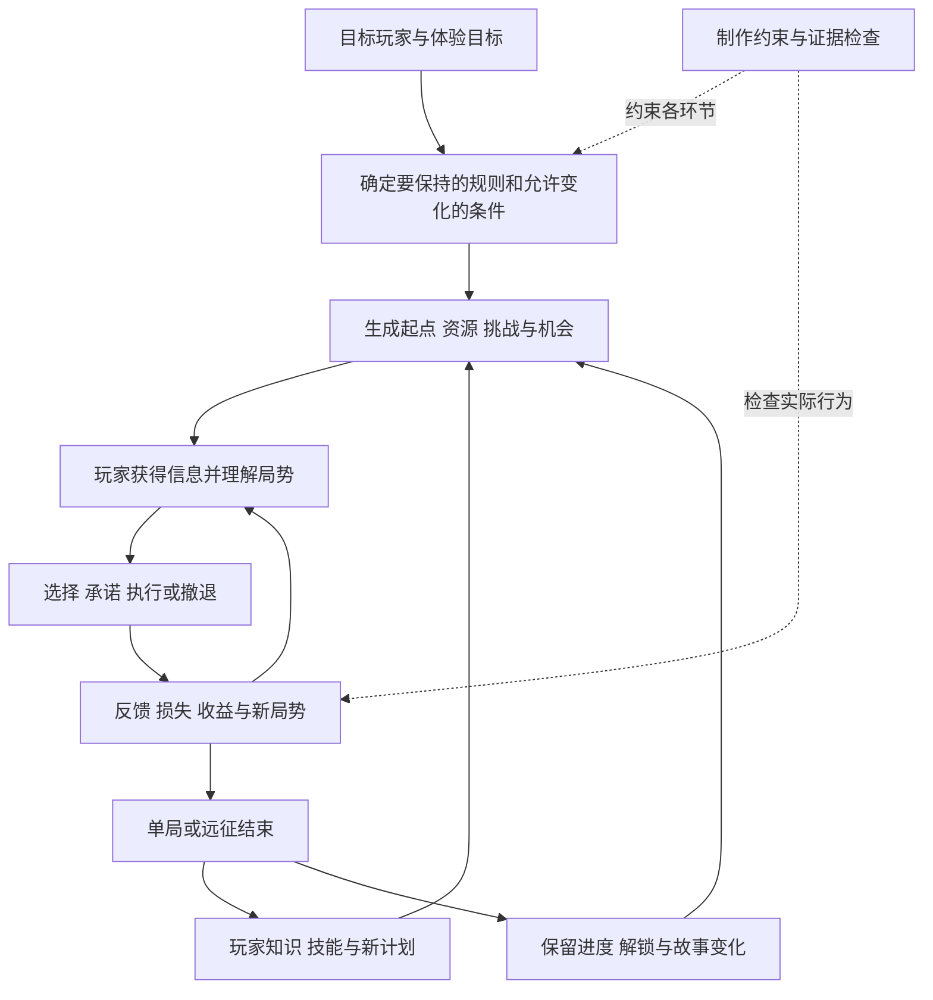

# 肉鸽游戏设计理论框架

2026-11-08 / 研究框架 v1。状态：**Raw / Unqualified，通用学习与设计研究候选**。

用户意图：阅读交接资料，综合相关研究，建立能够解释、构思和审查肉鸽游戏的理论框架。本框架基于原资料包中25项资料相关章节的定向阅读；它是分析者的跨来源综合，不是任何作者提出的完整理论，也不是行业标准。尚未映射《言咒》，没有改变项目规则或执行玩法实验。

**核心命题：肉鸽设计的研究对象，是玩家如何在反复开始、条件变化和部分成果重置的过程中，形成不同的行动方案，并获得继续尝试的理由。** 随机地图、永久死亡和大量道具分别是可能的工具；它们是否有用，要看它们如何影响选择、学习、成长、发现及单局节奏。

全文按三个时间尺度、八个相互作用的系统展开，最后给出设计顺序、冲突处理和验证方法。需要逐项检查具体方案时，使用同目录的[设计准则候选](RULE-CANDIDATES.md)。出处与原件路径继续以[原始目录](CATALOG.md)和[sources.json](sources.json)为唯一书目；文内 `Snnn` 对应 `RLR-20261108-nnn`，均链接原站。

## 1 研究对象与证据边界

### 1.1 类型定义不能代替质量判断

《Berlin Interpretation》旨在帮助社区理解研究对象，本身明确表示不用于约束开发者。它列出的传统肉鸽特征，不等于“加入这些要素就会更好玩”。本框架采用宽口径，覆盖传统肉鸽及受其影响的动作、构筑和战术游戏；同时保留各自的设计条件。[S001，General Principles，提取文本L54–66][S001]

| 研究对象 | 优先分析的能力与选择 | 不能直接套用的结论 |
| --- | --- | --- |
| 传统回合制肉鸽 | 规则理解、资源管理、探索路线、长期风险 | 不把复杂度或严厉死亡当质量保证；不同作品的信息哲学仍有差异 |
| 动作肉鸽 | 操作、站位、反馈识别与构筑的结合 | 不能仅用纸面解题难度解释失败，也不能把更快操作当更深策略 |
| 卡牌与骰子构筑肉鸽 | 提供选项、选择与拒绝、组合可靠性、资源转化 | 不预设所有游戏都应缩小牌组或采用固定流派；本轮骰子专题证据不足 |
| 小规模战术肉鸽 | 信息预测、行动顺序、空间关系、目标冲突 | 不能把确定性理解为没有变化，也不能将更多敌人视为平滑加难 |
| 含肉鸽元素的持久战役RPG | 远征与战役的双重损失、角色依恋、补员成本 | 角色死亡、远征失败与整场战役结束必须分开；《Darkest Dungeon》按此处理 |

这是分析分类，不是互斥的类型裁决。同一作品可以同时落在多个类别。

### 1.2 资料分别能说明什么

| 证据性质 | 本包代表 | 可以支持 | 不能据此推出 |
| --- | --- | --- | --- |
| 社区定义、项目准则 | S001、S002 | 研究边界、明确设计目标及偏好 | 通用质量标准 |
| 开发者讲义、文章、原创采访 | S003、S005、S007、S008、S010、S011等 | 机制结构、作者理由、单项目得失 | 某机制必然导致乐趣或商业成功 |
| 玩家遥测的开发者分析 | S030 | 特定版本、提交样本中发生的行为 | 无选择偏差的全体玩家表现，或机制变化的独立因果效果 |
| 玩家研究 | S041 | 特定原型、样本与条件中的体验差异 | 所有肉鸽的长期重玩或局外成长规律 |
| 方法论文与教材 | S039、S045、S046 | 评价方法、指标局限、研究设计思路 | 地图多样等于决策多样或玩家喜欢 |
| 本文综合与推演 | 三个时间尺度、八系统、诊断流程 | 帮助组织问题、识别依赖、提出可检验命题 | 已经验证的统一心理模型 |

文中的“作者认为”“开发者报告”均为外部来源证据；本轮没有直接观察玩家。由多个案例提炼出的关系仍需检验，同团队材料不算独立重复验证。

## 2 总模型与三个时间尺度

### 2.1 先区分三种目标

**玩家目标**是要在规则内完成什么，例如脱出、守住设施、完成远征或提高分数。**体验目标**是希望玩家经历什么，例如谨慎求生、临场应变、组合爆发、发现秘密或关心角色。**制作目标**是团队希望用何种成本做出什么范围的产品。

三者之间要有明确联系。例如“小团队采用程序生成”能解释制作选择，却不能直接证明玩家觉得每局不同；“玩家终于通关”也不能说明他认为是自己学会了，还是重复积累的永久属性足够高。S007从可读性、团队规模等约束推导机制，S008则明确解释了预算如何改变游戏方向。[S007，PDF p.4、8、37][S007]；[S008，PDF p.6–9][S008]

图中的箭头表示需要解释的关系，不表示必然成立的因果。一次失败可以只留下困惑；一次奖励也可能没有改变任何行动。

### 2.2 三个循环分别承担什么

| 时间尺度 | 循环 | 核心设计问题 | 典型失效 |
| --- | --- | --- | --- |
| 单次决策或遭遇 | 读局势 → 选方案 → 执行 → 反馈 | 玩家能看出可行选项及后果吗？执行能力如何参与？ | 看不见危险；有选择按钮却永远选同一个；操作负担遮住策略 |
| 单局或远征 | 起点 → 获得能力 → 承担风险 → 形成与调整方案 → 结算 | 前面的选择如何改变后面的局势？何时转向、补救或收尾？ | 开局冗长；构筑过早锁死；中期已胜或已败却还要耗很久 |
| 跨局或战役 | 结果解释 → 学习或保留成果 → 产生新计划 → 再次进入 | 下一次为什么值得开始？保留什么、重置什么？ | 只有数值账单；重试没有新问题；故事推进与玩法脱节 |

Cadwell的讲义将掌握与挑战、失败、学习、成功联系起来，并区分操作、判断和知识。本框架据此扩展时间尺度，但不采用其讲义中对团队合作的排除作为现代肉鸽通则。[S003，PDF p.14–20][S003]

### 2.3 将游戏状态和玩家状态分开

为便于审查，可以把某一时刻写成以下结构记录，而不把它当成可预测乐趣的数学公式：

> 当前局势 = 已有能力 + 可用资源 + 遭遇与路线 + 可见信息 + 过去选择形成的约束。
>
> 下一局起点 = 本轮重置规则 + 永久保留规则 + 新的生成条件。
>
> 玩家下一局的状态 = 已学知识 + 操作熟练度 + 对风险的理解 + 新计划与继续意愿。

最后一行不会自动随游戏进度上升。设计应分别检查“角色更强”“可选内容更多”“玩家做得更好”“玩家仍想玩”，不能用一个总等级代替。

## 3 八个设计系统

### 3.1 决策与信息

一个值得分析的选择至少涉及：玩家追求什么、知道什么、能做什么、各选项付出什么，以及结果如何影响后续。**决策深度可以从“情境改变是否会改变合理选择”入手观察。** 这是分析者提出的诊断方法，不是统一评分公式。

DCSS反对不需思考的选择，重视透明规则及减少机械劳动；《Into the Breach》则以敌人攻击预告、玩家回合内的确定性为核心，进一步约束攻击方向、武器和界面。信息表达因此会影响机制本身的可用范围。[S002，N. Philosophy，L1367–1425][S002]；[S007，PDF p.14、27–37][S007]

信息可分为三层：

- **行动所需信息**：当前威胁、可操作对象、即时成本。缺失时可能使选择失去依据。
- **预测所需信息**：下一场挑战、资源稀缺性、路线承诺。可以部分公开，以形成判断空间。
- **发现所需未知**：隐藏事件、互动规律、故事秘密。可以保留，但应明确探索代价。

公开多少取决于体验目标。《Darkest Dungeon》主动采用部分不透明和角色失控，但讲义特意将压力值与压力伤害排除在模糊处理之外；《Isaac》作者则追求尝试物品、与朋友交流发现的神秘感。两者都不能推出“关键机制越隐蔽越好”。[S011，PDF p.13、19][S011]；[S015，PDF p.31、33][S015]

**审查重点**：玩家选错，是判断失误、规则误解、未注意到信息，还是根本没有可行选项？这四种情况需要不同处理。

### 3.2 随机性与程序生成

随机首先要定位，不能只用“随机程度高低”描述。下面是本文采用的分析坐标。

| 坐标 | 要记录的内容 | 对设计判断的作用 |
| --- | --- | --- |
| 对象 | 起点、地图、奖励、敌人、行动结果、故事事件 | 判断变化落在哪个循环 |
| 揭示时点 | 选择前已知、选择后揭示、行动后结算 | 判断玩家是在适应已知条件，还是承担未知结果 |
| 分布和关联 | 权重、互斥、保底、连续出现、组合条件 | 平均值不能说明极端局与连续坏结果 |
| 玩家控制 | 拒绝、重抽、探查、绕路、保留资源、撤退 | 判断随机是否留下应对空间 |
| 不变量 | 必要路径、目标、基本规则、最低可用能力 | 判断变化是否破坏可理解性和可完成性 |

《Dead Cells》开发者描述的混合生成把固定结构、手工房间和放置约束结合起来；价值在于用约束安排变化。开发者对体验改善的判断属于项目经验，并非玩家对照实验。[S017，六步生成流程，L64–105][S017]

本文把多样性分成四层：**外观变化、配置变化、应对策略变化、目标与叙事意义变化**。前两层不会自动产生后两层。检验“每局不同”时，应看玩家是否改变路线、资源使用、构筑和行动顺序。Cadwell直接强调了多样性与随机性的区别；ERA指标研究进一步说明，观察到的生成空间取决于所选指标，且与玩家感知的关系仍需研究。[S003，PDF p.40–44][S003]；[S046，PDF p.1、10，§7][S046]

**审查重点**：换一个种子后，如果同一套行为仍然始终最好，变化可能主要停留在表现或配置层。

### 3.3 构筑与组合

构筑是随时间形成的能力安排。它可能表现为牌组、装备、技能、角色队伍或可用工具，并不要求每个游戏都存在清晰命名的流派。

分析一个构筑，可以先标记六种功能：主要行动、触发条件、收益转换、资源供给、放大与保护、退出或转型方式。这是本文的通用拆解工具，各项目可以删去不适用的部分。

例如，**虚构示例**“受伤获得能量，能量支付反击，反击击杀回血”形成资源回路。加入一个“伤害提高”的道具主要改强度；加入“溢出治疗变护盾”则可能改变承伤时机与资源用途。但后者也可能消除原先风险，让整套玩法变成单一重复。组合存在不等于组合值得玩。

评价构筑要同时问四件事：

1. **到得了**：核心组件以何种概率、成本和时点出现？缺一件时能否继续？
2. **用得出**：组合会改变哪些实际动作？玩家是否看得懂触发和结算？
3. **调得动**：遇到新威胁时能否补短板、替换部件或改变打法？
4. **有代价**：强项是否占用槽位、资源、时间、安全或其他机会？

《Slay the Spire》讲义的平衡目标是让每张牌有使用场景，同时避免扭曲整个环境；Cogmind作者同样强调情境、不同玩家风格，以及物品外部的取得成本和损耗。两者支持“情境价值”这一比较方向，但不要求所有道具拥有相同强度。[S005，PDF p.7][S005]；[S024，Balance，L84–119][S024]

《Returnal》开发者说明，单武器携带限制、可叠加特性和带正负效果的寄生物共同形成取舍。这可作为结构案例，不能仅凭武器组合总数宣称体验深度。[S049，L22–34][S049]

**审查重点**：奖励池扩大后，旧流派获得核心支持的机会是否被稀释？如果有更多卡，却只能靠少数组合过关，内容数量增加可能降低可用选择。此为分析推演，需结合实际分布检验。

### 3.4 资源经济与风险

资源系统决定玩家如何在当下安全、未来能力和探索收益之间转换。生命可以同时承担失败阈值和冒险预算；金币可以在治疗、能力和信息之间分配；时间、槽位、负重和行动机会也能形成稀缺性。

可以用一张“资源从哪里来、花到哪里去、如何互相转换、在哪里重置”的图检查经济。重点不是资源越多越好，而是它们是否形成不同的约束。两个资源若总按固定比例一起获得和消耗，就可能只是在重复同一限制。

DCSS的反刷取准则指出，低风险、耗时且有收益的行为会诱导玩家反复执行；《Rogue Legacy》复盘则展示了经济规则如何意外鼓励平均加点，以及低成本修正又怎样伤害休闲玩家感受。这些案例共同提醒：设计者应检查最优行为是否符合目标体验。[S002，Anti-grinding，L1383–1399][S002]；[S008，PDF p.27–33][S008]

风险不能只看期望收益。相同平均收益下，“缓慢稳定进步”和“多数失败、偶尔暴涨”会产生不同经历；失败是否能恢复、损失的是几分钟还是几十小时，也会改变选择。本文据此建议同时记录：损失范围、结果波动、可预见程度、补救机会及恢复时间。

**审查重点**：玩家是否被迫清空每个房间、保留所有消耗品、反复刷安全区或不断重开来筛选好开局？这些可能是合理策略，也可能暴露了奖励结构与节奏目标的冲突。

### 3.5 遭遇编排与单局节奏

遭遇是当前能力接受检验的地方。设计者需要说明它要求玩家做什么：识别预兆、改变站位、重新分配资源、控制多目标，还是检验伤害是否达到门槛。若所有遭遇只检查同一项能力，构筑的其他差异就很难发挥作用。

本文提出一种可修改的单局编排：**展示起点差异 → 提供可行方向 → 引入承诺成本 → 检验短板 → 提供调整机会 → 形成终局检验或兑现**。这是一种设计语法，不是所有作品都应遵循的固定关卡顺序。求生游戏可以始终强调重建，爆发型构筑游戏可以让后段成为成果展示。

《Rogue Legacy》把差异放到开局，并压缩短命角色之间的菜单时间；《Into the Breach》通过回合上限和可变流程长度约束体验。这些做法支持一个可用问题：**多久才出现第一次有意义的差异，多久才能重新尝试刚才失败的问题？**[S008，PDF p.14–17][S008]；[S007，PDF p.22、45–47][S007]

《暖雪》采访提供了反向案例：开发者报告部分玩家堆防御，形成长时间低输出的战斗；高难度又要求较早规划伤害成长。这里暴露的是不同构筑行为与挑战曲线的关系，不能由开发者自己能速通推导目标玩家能自然理解这条曲线。[S052，L56–60][S052]

**审查重点**：难度过渡是否给过信息与准备机会？强构筑成型后，剩余时间是在兑现成果，还是缺乏新判断的拖延？弱构筑是否早已失去合理胜机，却还被迫走完流程？

### 3.6 失败与重置

“死亡惩罚重不重”需要拆成至少五项：失败条件、损失对象、退回位置、恢复成本、结果解释。另要区分主动撤退、放弃重开、局部失败与整局失败。

| 损失或保留对象 | 设计意义 | 可能的代价 |
| --- | --- | --- |
| 局内装备和能力 | 重新开放组合空间，让本局选择具有期限 | 心爱组合丢失；重新获得所需时间过长 |
| 地图与路线进度 | 再次面对不同局势或重新证明能力 | 已掌握的前段成为重复劳动 |
| 永久角色 | 提高角色关系和决策的分量 | 补员和恢复成本可能压过继续意愿 |
| 知识与操作能力 | 让玩家自身形成连续性 | 信息不清时，失败未必产生可迁移学习 |
| 永久货币、解锁或故事 | 让结束之后仍有进展 | 可能掩盖局内决策无效或使重复变成劳动 |

S008把死亡后的成长作为再开动力；S011既主动追求永久后果，也承认高等级队伍损失和漫长流程会削弱动机。这不是谁对谁错，而是损失、恢复时间和目标体验的组合不同。[S008，PDF p.11、17][S008]；[S011，PDF p.20、49][S011]

**失败形成学习的候选条件**是：结果能解释；存在可以改变的行为；下次能有机会运用；重试成本可接受。它们能帮助设计验证，不能保证每次失败都令人愿意继续。

相关玩家研究也不支持把“永久死亡”直接等同于“掌握感更强”。Cuerdo的硕士论文使用五关平台原型Jumpy，在线招募72名18–44岁参与者，随机分配到“游戏开头、关卡开头、检查点、手动存档点”四种重生条件，每组18人、最多游玩15分钟。研究结合玩家偏好问卷、游戏记录和游玩后的PXI，未事先告知各版本的重生机制。[S041，PDF p.36–42][S041]

| 研究结果 | 原文报告 | 可以支持的判断 |
| --- | --- | --- |
| 自主感存在组间差异 | Kruskal–Wallis检验p=0.021，作者报告效应量η²=0.112；Bonferroni校正后，游戏开头组和手动存档组分别高于检查点组，p=0.037、0.046 | 这个原型中，更宽松的检查点没有自动带来更高自主感 |
| 好奇心存在组间差异 | 总体p=0.011，η²=0.134；游戏开头组高于检查点组，校正后p=0.005 | 重生位置可能改变玩家接触内容及产生好奇的方式，具体解释仍需进一步检验 |
| 掌握、沉浸和挑战感 | 未发现显著组间差异 | 不能由本研究宣称永久死亡提高这三项体验；未显著也不证明没有影响 |

上述结果采用原文报告，未重新分析数据。研究样本小、线上自愿参加、只覆盖一个短时平台原型，主要体验指标来自问卷；论文也建议增加实时反应和行为资料。它不能外推长期肉鸽构筑、局外成长或重玩意愿，死亡次数与体验的相关性也不能解释为死亡次数的独立因果效果。[S041，PDF p.44–45、56–57][S041]

### 3.7 成长与难度

跨局成长至少要分开记录：

| 成长形式 | 玩家得到什么 | 主要设计问题 |
| --- | --- | --- |
| 玩家掌握 | 理解规则、判断更准、操作更熟 | 同等条件下是否出现更好的预测与行动？ |
| 永久数值成长 | 更高容错、伤害或资源效率 | 是降低进入门槛、支撑角色养成，还是强迫重复积累？ |
| 横向解锁 | 新角色、工具、路线与起点 | 是否增加真正不同的方案？会否稀释原有奖励池？ |
| 叙事与世界进展 | 人物变化、故事、记录与新目标 | 是否回应经历？能否支撑不同进度和失败频率？ |
| 挑战扩展 | 更高难度、限制条件、特殊目标 | 增加的是新问题、执行压力还是单纯耗时？ |

S015展示了随进度扩展内容与挑战的设计；S032说明《Hades》把永久进展和难度选项组合使用。它们都不能给出局外成长的通用最优比例。[S015，PDF p.31][S015]；[S032，难度问答][S032]

难度同样是多维的：操作精度、判断复杂度、信息不确定、资源紧缺、犯错容忍和失败恢复成本可以分别调整。S007指出其谜题式战斗的难度会出现“从困难到无解”的陡变；不能指望简单加敌人数量获得连续体验。[S007，PDF p.47][S007]

难度选项还涉及呈现。《Cogmind》从默认最高难度、在选项中隐藏其他模式，改为开局明确选择，并调整命名。随后开发者在Beta 9提交数据中观察到更多玩家使用其他难度。但展示、默认与命名同时变化，样本也是自行提交；不能单独归因于改名。[S029，L51–68][S029]；[S030，L45–81][S030]

**审查重点**：胜率上升来自玩家掌握、数值成长、内容熟悉、筛选种子，还是难度变化？若不分开，就很难判断成长系统是否实现原目标。

### 3.8 叙事与感知反馈

肉鸽叙事可以承担不同功能：解释重复、回应上次经历、延续角色关系、提示新目标，或者使系统事件形成可讲述的经历。它不必每次都推进主线，也不必采用大量文字。

《Hades》团队把死亡后的故事进展与角色反应纳入目标，并在讲义中把“强叙事能缓解挫败”写成开发时的判断；同时明确指出语音情境扩张和本地化成本。《Darkest Dungeon》通过角色压力与失控产生事件，并主动排除部分传统RPG内容。两种方案分别展示了编写反应和系统事件的不同路径。[S010，PDF p.4、11–12、32、41–46][S010]；[S011，PDF p.8、10–13、19][S011]

动作游戏还需要感知反馈把机制送达玩家。《Returnal》UX文章说明了准星附近的信息优先级、声音与触觉提示，以及可预览的自定义设置。这些属于操作环境中的信息设计，不能用回合制表格的可读性替代。[S050，L16–25、35–42][S050]

**审查重点**：玩家是否注意到机制已经发生？叙事反应有没有承认真实经历？重复失败时内容是否枯竭，快速成功时是否堵塞？表现成本必须算入系统预算。

## 4 跨系统关系与关键取舍

### 4.1 需要一起设计的依赖

| 改动 | 应同步检查 | 原因 |
| --- | --- | --- |
| 扩大奖励池 | 核心组件可得性、奖励拒绝与重抽、解锁节奏 | 新内容改变旧内容被遇见的机会 |
| 增加组合倍率 | 敌人耐久、反馈速度、剩余选择、弱构筑补救 | 数值增长可能绕过原本需要判断的环节 |
| 提高死亡损失 | 预警、补救、复盘信息、重试时间 | 同样的错误会带来不同的接受成本 |
| 增加永久属性 | 新手曲线、高手挑战、学习评价、刷取动机 | 游戏难度与玩家能力同时变化，易产生误判 |
| 隐藏更多规则 | 可发现线索、探索风险、记录、社区依赖 | 未知可能带来发现，也可能只增加外部查表 |
| 延长单局 | 早期差异、保存与中断、阶段转折、失败恢复 | 时长会放大重复与损失，也可能增加投入 |
| 增加系统交互 | 信息表达、例外规则、生成边界、验证范围 | 新互动同时扩大表达空间和维护成本 |

以上为结构推演，不是已经测得的玩家效应。S056的 `.QUIT` 案例尤其说明：一个局部能力的机会成本会被新系统改变，其地图约束又可能与进入条件组合，产生无路可走和难以解释的例外。审查不能停在单个道具上。[S056，L13–29][S056]

### 4.2 不宜强行合并的观点

| 分歧 | 一端的目标与来源 | 另一端的目标与来源 | 选择时应回答 |
| --- | --- | --- | --- |
| 透明与发现 | DCSS重视透明规则下的重复判断，S002 | Isaac重视未知与共同发现，S015；霓虹深渊2访谈提出隐藏规则，[S054][S054] | 隐藏的是决策基础，还是可以主动探索的内容？ |
| 保持威胁与力量爆发 | DCSS反对可达无敌状态，S002 | Cadwell提出极强力量幻想，S003；霓虹系列强调叠加成长，[S054][S054] | 成型之后还要持续求生，还是允许短期展示成果？ |
| 掌握与永久养成 | Cadwell提醒谨慎混合局内外成长，S003 | Rogue Legacy主动把成长放在死亡之后，S008 | 目标玩家为何回来？如何分辨学习和数值收益？ |
| 控制与失控 | Into the Breach围绕攻击预告组织战术，S007 | Darkest Dungeon主动减少部分角色控制，S011 | 玩家应为精确解题负责，还是接受不可完全控制的角色？ |
| 快速反馈与维护愿景 | Slay the Spire、Monster Train强调高频反馈，S005、S047 | Darkest Dungeon复盘重大机制变更的社区冲突，S011 | 反馈说明了什么问题？是否必须接受玩家提出的解决方案？ |

出处：S002的Clarity、Replayability；S003 PDF p.29、33、39；S005 p.10–18；S007 p.14；S008 p.11、17；S011 p.13、19、39–49；S015 p.31、33；S047 p.12–13、21、28；S054 L38–55。S054是2025年发售前访谈，支持设计意图，不支持最终效果。

裁决顺序是：**明确主要体验 → 识别目标玩家和时间尺度 → 选择机制组合 → 写出愿意接受的代价 → 定义可能推翻判断的观察**。不把不同目标的案例平均成一条含糊规则。

## 5 把框架用于构思与审查

### 5.1 从零构思的顺序

1. **写出玩家情境和主要承诺。** 谁在什么设备上、用多长时间，想体验哪一种判断、操作或成长？先确定最重要的一项，其余作为支持。
2. **固定两三个设计约束。** 例如“玩家回合内结果可预测”“失败后能迅速进入新局”“每局必须重新组织主要能力”。约束是取舍，不必照搬参考产品。
3. **画出三个循环。** 分别标出选择、反馈、承诺、结束和再开理由；检查是否只画了领奖流程。
4. **填清变化与保留。** 哪些内容生成、什么时候揭示、玩家能否干预？失败后哪些成果消失？
5. **构造少量完整情境。** 包含顺利成型、支持不足、受到克制、资源失衡和主动撤退；先看能否形成不同应对。
6. **检查八系统依赖和制作成本。** 优先删掉没有改变行为、又增加学习和维护成本的部分；有审美或叙事功能的内容则按其目标判断。
7. **确定最关键的未知与最小验证。** 写出观察什么、怎样可能失败、结果会改变哪项决定；获得任务授权后再执行。

试错本身也是设计方法，但方向需要记录。LocalThunk在原始访谈中把Balatro的形成描述为不断尝试方向；这只能支持迭代式创作的案例，不能从采访推导出未说明的经济或概率模型。[S020，前两个设计相关问答][S020]

### 5.2 同一原理的不同实现

以下均为本文构造的教学情境，不是已发行游戏规则，也不是项目提案。

| 目标 | 回合制构筑实现 | 动作肉鸽实现 | 共同需要验证 |
| --- | --- | --- | --- |
| 让奖励引发临场适应 | 给出资源效率、单次爆发和防御三类选择，显示下一场威胁的一部分 | 给出不同攻击距离与闪避节奏的武器，安排可观察的敌人组合 | 玩家会依据当下能力和威胁改变选择，还是始终选固定答案？ |
| 让失败产生可迁移学习 | 重现关键回合，展示资源透支从何处开始 | 允许重新练习某种预兆，保留清楚的受击信息 | 下次是否提前预测并改行动？只背答案是否能应付变化？ |
| 让强构筑有短暂兑现 | 成型后安排可快速处理的遭遇，再给不同目标的终局 | 允许短段连锁清场，再用空间或时机要求保持参与 | 玩家是在展示自己形成的能力，还是已经无事可做？ |

不同实现共享问题，不共享固定参数。伤害倍率、单局时长、奖励频率、首通率和失败次数都需要目标玩家与实际机制提供依据。

### 5.3 常见症状的诊断入口

| 症状 | 优先区分的原因 | 最小可用证据 |
| --- | --- | --- |
| 每局都有随机，但感觉一样 | 只变表现；挑战不变；通用强策略压过其他方案 | 对照不同起点下的实际行动与选择理由 |
| 道具很多，但构筑很少 | 支持到达率低；奖励稀释；替换代价过高；挑战只承认一种输出 | 奖励候选、选择、拒绝及之后遇到的挑战 |
| 玩家只存消耗品 | 对未来需求不确定；使用价值不可见；补给过少；实际无需使用 | 消耗前的情境、预期与最终死亡时库存 |
| 玩家不断重开 | 起点差距过大；前段无变化；失败恢复慢；主动追求特殊挑战 | 放弃发生的时点、种子和玩家当时目标 |
| 高胜率但很无聊 | 决策过早消失；成长超过挑战；大量无风险耗时 | 成型后的行动变化及自愿继续行为 |
| 死亡很多但没有学会 | 信息不足；归因错误；重试太慢；执行要求超过能力 | 玩家事前预测、事后解释与下一次行动 |
| 玩家抱怨“不公平” | 概率认知、突发后果、控制丧失、错误提示或真实不可解 | 已知信息、可选行动、随机轨迹与恢复机会 |

这些是待区分的解释，不能看到一个统计结果就自动选其中一个原因。

## 6 验证体系与制作约束

### 6.1 分开检验四类命题

| 层次 | 可以怎样检查 | 通过说明什么 | 仍不说明什么 |
| --- | --- | --- | --- |
| 规则成立 | 检查流程、资源闭环、终止条件、目标可达性 | 机制在规定条件下能工作 | 玩家理解、深度、乐趣 |
| 生成成立 | 检查分布、边界组合、必要资源、断路和异常种子 | 生成内容符合约束，变化发生在指定维度 | 变化被玩家感知或具有价值 |
| 行为成立 | 观察预测、选择、转型、资源使用、失败后的改变 | 机制诱发了预期行为或暴露偏差 | 长期兴趣、全体玩家或商业表现 |
| 体验成立 | 结合行为、事后访谈及多次游玩记录 | 在特定玩家与情境下支持体验判断 | 跨子类型普适因果或市场成功 |

PCG评价综述把数据取得方式、指标、比较基准和游戏领域分开；作者也说明其86篇样本并不穷尽整个领域。ERA研究检验的是指标选择，不能替代玩家体验验证。[S039，PDF p.8–9，§6、§8][S039]；[S046，PDF p.1、10][S046]

S045的体验驱动生成章节提醒，挑战只是体验的一部分。本框架因此不把“难度与能力相当”当成足以解释发现、叙事、表达和力量感的单一答案。[S045，公开Chapter 10，PDF p.1–3][S045]

### 6.2 指标要有情境和分母

| 想研究什么 | 可用记录 | 必须控制或说明 |
| --- | --- | --- |
| 选项是否有情境价值 | 被提供、被选择、被跳过的次数；当时构筑和后续挑战 | 出现机会不同；稀有度；角色、版本、难度与玩家经验 |
| 变化是否带来适应 | 同一玩家面对不同条件时的策略变化 | 玩家目标改变、学习顺序、起点强弱 |
| 失败是否支持学习 | 事前预测、死因解释、下次改变、迁移表现 | 永久成长、重复记忆、试错提示和执行熟练度 |
| 单局节奏是否合理 | 第一次关键选择、构筑成型、失去胜机、结束的时点 | 主动休息与被迫等待；叙事阅读与无意义操作 |
| 再开动机是什么 | 自愿再开行为及理由，数次游玩后变化 | 奖励驱动、研究者要求、新鲜感与沉没成本 |

Cogmind的Beta 9报告说明，数据来自9,743次提交，经筛选保留7,931局、920名具名玩家；读取旧存档后的后续进度不会继续上传。因此低难度的表面胜率不能直接与最高难度比较。它还提醒，记录最后一击不等于找到导致失败的长期原因。[S030，L45–81、118–124][S030]

《Slay the Spire》的讲义将数据视为证据而非结论，并结合测试者、难度分层和其他反馈；这支持多渠道解释，不支持“只按胜率调平所有内容”。[S005，PDF p.10–18][S005]

### 6.3 一份最小验证计划

**待检验命题**：对已理解基础规则的目标玩家，提供部分未来威胁信息，能让奖励选择更依赖当前局势。

**计划**：准备两种已有能力、若干不同威胁和相同奖励组，比较有无预告时的预测与选择。可以先用桌面情境，再视问题进入可玩原型。若要估计因果效果，需控制或随机化顺序，避免同一答案被第二次作答记住。

**观察**：玩家是否识别短板、改变选择并说明对应后果；记录选择后实际行动，而不只问是否觉得“有策略”。

**支持或修改方向**：若不同局势稳定触发不同、有合理后果的选择，可继续完善；若玩家始终选择同一项，先区分该项统治、信息未被理解或威胁差异无效；若预告使选择变成显而易见的配对题，应减少确定性或调整机会成本。

**限制**：此计划只能初步检验奖励选择关系，不能证明整局乐趣与长期重玩。样本量、量化阈值和执行条件待具体项目确定；状态 **NotRun**。

### 6.4 制作能力也是理论的一部分

内容成本不只包括制作一个物件，还包括解释、组合维护、生成约束、反馈表现和迭代验证。Isaac复盘将相互作用的组合规模列为测试困难；Hades讲义展示了增加情境如何扩张语音和本地化任务；Into the Breach则让界面可表达范围反过来约束内容。[S015，PDF p.35，Testing][S015]；[S010，PDF p.42][S010]；[S007，PDF p.31–37][S007]

因此，新增系统前应问：它改善哪个重复问题？能否用已有机制组合实现？成本会扩散到哪些系统？没有行为价值的复杂度应优先缩减；承担氛围、辨识度或叙事功能的部分，应按相应目标而非纯策略深度判断。

反馈通道也有成本。Monster Train复盘描述了带截图、日志和存档的反馈工具及定期整理流程；通用可借鉴点是让问题可重现、能回到具体情境，而非照搬某个团队的更新频率。[S047，PDF p.12–13、17、21、28][S047]

## 7 阅读覆盖与尚未解决的问题

### 7.1 本轮实质采用的25项资料

下表只登记本轮结论的阅读边界，不复制书目。PDF页码为物理页；文本行号按本地提取文件一基计数，含SOURCE等头部。详细文件名和哈希见原目录。

| 来源ID | 本轮采用范围 | 使用方式与边界 |
| --- | --- | --- |
| RLR-20261108-001 | General Principles及高权重因素，L54–122 | 类型边界；不是质量标准 |
| RLR-20261108-002 | N. Philosophy，L1308–1486 | DCSS项目目标与取舍；未通读整本操作手册 |
| RLR-20261108-003 | 讲义p.14–20、29、33、39–44 | 作者掌握循环与设计模式；无完整演讲转录 |
| RLR-20261108-005 | 22页讲义，重点p.7、10–18 | 平衡目标与反馈流程；不从图像空白页补出讲述 |
| RLR-20261108-007 | 讲义文字，重点p.4、8、14、22、27–47 | 约束如何传导；关键关系图已视读 |
| RLR-20261108-008 | 讲义及嵌入备注，重点p.6–17、27–33 | 死亡成长、节奏与预算；备注不等于现场逐字稿 |
| RLR-20261108-010 | 讲义文字，重点p.4、11–12、32、41–46 | 叙事意图与生产成本；不证明挫败缓解因果 |
| RLR-20261108-011 | 讲义文字，重点p.8–13、19–26、39–55 | 失控目标、永久后果、失败经验；战役RPG边界 |
| RLR-20261108-015 | 杂志中该文，重点p.31、33、35 | 成长、发现与测试成本；对应印刷页29、31、33 |
| RLR-20261108-017 | 02-fulltext正文，重点L64–105 | 混合生成结构；未以远程示意图支持细节结论 |
| RLR-20261108-020 | 原创采访问答正文 | 迭代创作的自述；不含足以推导平衡模型的细节 |
| RLR-20261108-024 | Difficulty、Balance、Criteria，重点L42–119、123–161 | 作者项目哲学；不把自述体验当本轮观察 |
| RLR-20261108-029 | Expectations and Rebranding，L51–68 | 命名、默认及可见性共同变化 |
| RLR-20261108-030 | The Stats are Back、Difficulty、Wins、Deaths，L38–124 | 特定版本提交样本；非随机对照 |
| RLR-20261108-032 | FAQ类型与难度问答，并在线复核 | 官方目标和功能说明；与S010同团队 |
| RLR-20261108-039 | 摘要、检索方法、§6、§8，p.1–3、8–9 | 方法综述；未对全部86篇二次精读 |
| RLR-20261108-041 | §3.3、3.5–3.8.2及第4章，p.36–45、56–57 | 72人短时平台实验；非肉鸽长期实证 |
| RLR-20261108-045 | 05-chapter，即Chapter 10，p.1–3相关段落 | 体验维度的方法背景；未通读全书或七章 |
| RLR-20261108-046 | 摘要、引言与§7，p.1、9–10 | 指标选择及外推边界；未复现算法 |
| RLR-20261108-047 | 讲义文字，重点p.12–13、17、21、28 | 生产与反馈经验；不作为构筑平衡规格 |
| RLR-20261108-049 | 开发者正文，L21–34 | 武器限制、特性、风险与保留；发售前设计说明 |
| RLR-20261108-050 | UX正文，L15–42 | 动作情境的信息与可访问性目标 |
| RLR-20261108-052 | 采访L28–60，重点L56–60 | 区分开发者原话与记者转述；版本限采访时 |
| RLR-20261108-054 | 采访L30–57 | 发售前设计意图；与S053同团队，不算独立验证 |
| RLR-20261108-056 | 正文L12–29 | 能力与地图规则的依赖；采用本地快照，在线复核失败 |

关键视觉复核覆盖S003、005、007、008、010、011、015、039、041、046的引用相关页面；并非所有PDF逐页视读。S017、S032原站可读复核通过。讲义中的视频未播放，未引用未经核对的视频内容。

其余31项未作为本文论证依据。其中S004只是商业书节选；S006、009、012、018、019、021–023、033、035–037、040、042–044、053等存在全文、字幕或获取范围缺口；S013、014、025–028、031、034、038、048、051可作后续专题补充。本轮曾检索或浏览部分定位，不代表完成相应专题研究。

### 7.2 同源与反证处理

- S024、029、030均来自Cogmind作者，分别承担理念、改动意图和遥测解释，不能相加为三个独立团队支持。
- S010、032均来自Supergiant；S049、050均来自Housemarque；S039、046有重叠作者与研究方向。教材不同章节也不作为独立重复实验。
- S002与S015在信息目标上不同；S003与S008对永久成长的态度不同；S007与S011对控制和确定性的要求不同。分歧保留在第4节。
- S011的恢复成本问题、S052的保守构筑案例和S056的能力边界问题用于限制成功案例外推。它们仍是开发者报告，而非独立复现实验。

### 7.3 当前不能给出的通用答案

尚不能确定跨子类型通用的最佳局长、死亡频率、首次成型时间、永久成长比例、最优奖励池规模、保底概率或目标胜率。现有材料也不足以建立多人肉鸽、骰子构筑、移动端短局及长期运营的完整子框架。

“随机引发适应”“损失提高投入”“组合带来表达”“故事促进再开”都应在具体玩家与情境中检验。本框架的作用，是把这些命题变成可以解释和检查的问题，并指出每项设计选择会影响哪些其他系统。

阅读基准：`7e7e7f23de3302f2291e23e16290333ffc6fcfb5`。本轮输入为原资料包、用户提供的交接与必要仓库操作规范；未加载言咒核心GDD、探索方向或世界设定。本文引用快照沿用2026-11-08采集身份；书目中的“待精读”是采集阶段记录，本轮覆盖以本节为准。

[S001]: https://www.roguebasin.com/?title=Berlin_Interpretation
[S002]: https://raw.githubusercontent.com/crawl/crawl/master/crawl-ref/docs/crawl_manual.rst
[S003]: https://media.gdcvault.com/gdc2015/presentations/CADWELL_THOMAS_LEVEL%20UP%20YOUR%20GAME.pdf
[S005]: https://media.gdcvault.com/gdc2019/presentations/Giovannetti_Anthony_SlayTheSpire.pdf
[S007]: https://media.gdcvault.com/gdc2019/presentations/Into%20the%20Breach%20Postmortem%20Final.pdf
[S008]: https://media.gdcvault.com/GDC2014/Presentations/Lee_Teddy_Rogue_Legacy_Design.pdf
[S010]: https://media.gdcvault.com/GDC+2021/33103_Korb.pdf
[S011]: https://media.gdcvault.com/gdc2016/Presentations/Sigman_Tyler_Darkest_Dungeon_a.pdf
[S015]: https://media.gdcvault.com/GD_Mag_Archives/GDM_November_2012.pdf
[S017]: https://deepnight.net/tutorial/the-level-design-of-dead-cells-a-hybrid-approach/
[S020]: https://playday.one/2024/03/09/there-is-a-lot-more-design-to-explore-within-balatro/
[S024]: https://www.gridsagegames.com/blog/2022/05/kyzratis-game-design-philosophy/
[S029]: https://www.gridsagegames.com/blog/2019/09/rebranding-difficulty-modes/
[S030]: https://www.gridsagegames.com/blog/2021/01/cogmind-beta-9-player-stats/
[S032]: https://www.supergiantgames.com/blog/hades-faq/
[S039]: https://arxiv.org/pdf/2404.18657
[S041]: https://escholarship.org/content/qt58z477g6/qt58z477g6_noSplash_474ac9f98f9174fa3d0700b506d6819e.pdf
[S045]: https://www.pcgbook.com/chapter10.pdf
[S046]: https://arxiv.org/pdf/2304.02366
[S047]: https://media.gdcvault.com/GDC+2021/GDC21+-+Monster+Train+Postmortem.pdf
[S049]: https://blog.playstation.com/2021/01/13/returnal-combat-details-upgradable-weapons-otherworldly-tools-and-risky-buffs/
[S050]: https://blog.playstation.com/2021/05/11/unpacking-returnals-ux-design-gameplay-first-ui-retro-futuristic-tech-and-accessibility/
[S052]: https://www.gcores.com/articles/146899
[S054]: https://www.gcores.com/articles/194468
[S056]: https://mightyvision.blogspot.com/2026/06/868-back-quit.html
