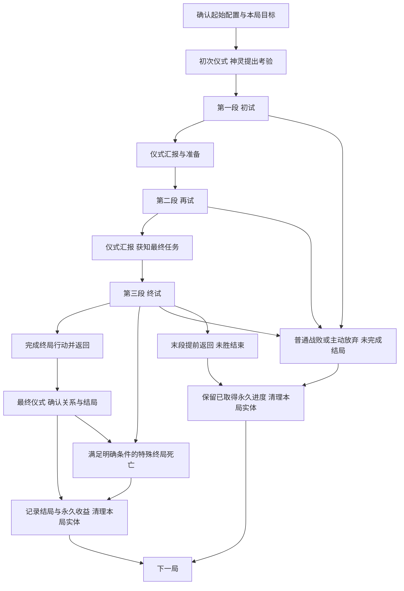

# 言咒肉鸽式仪式系统 卷入仪式的玩法框架与设计缺口

更新：2026-11-08。状态：当前探索方向的说明稿，Raw / Unqualified。用户已选定“卷入仪式”为单局叙事方向，并要求玩法内容按该框架组织；以下为据此整理的工作设计。具体神灵、物件、条件、数值及示意考验尚待设计，玩法体验 Hypothesis / NotRun；本文未替换项目现行GDD。

本轮已依据肉鸽理论完成框架审查，完善内容从[第15节](#framework-improvement)进入。用户已确认信仰基础路径，并补充强调：主线召神仪式必须进行，其必要投入为一部分通用材料／金币＋一个核心材料；探索返回后还可用余量进行其他仪式。提前返回的正常推进前提是已取得最低必要投入。具体材料、基础费用数值与功能样例仍待细化。

## 1 这是一套什么玩法

**玩家在文字界醒来，通过初次仪式召来神灵，接受并完成一场考验，最终决定如何结束自己与祂的这次关系。** 这是每局都能直接理解的目标。主线按“初次召神—初试—再试—终试—结局”展开；当前用三个内容体量大致相同的完整区域单元承载三次任务，区域之间返回文字界汇报和准备。

玩家从有限的起始配置出发，在物质界战斗、收集和加工材料，再通过仪式求知、取得回应、改变下一段机会，逐渐形成这一局的构筑。有限资源既要支持战斗，也可能用来准备供物、完成考验或回应其他存在。神灵的要求、玩家的实际行动和最终决定共同形成追忆、忤逆或信仰等阶段性结局。

一局负责把这次考验讲完，世界的深层故事主要通过跨局特殊仪式事件、神灵回应和知识成长展示。玩家不需要每局解决完整身世或世界谜案。知识、境界与明确永久解锁持续保留，主要实体物资和构筑随整局结束清理，下一局重新面对有限资源与机会。

长期飞升仍是更远的目标，普通局也有自己的完整结果。当前希望验证的体验是：玩家能依据神灵要求和已有理解安排构筑，并在途中改变自己的打算；具体内容尚不能证明这一体验已经成立。

## 2 两个世界与三个循环尺度

文字界和物质界决定玩家在哪里做事；节点、区域段和整局决定一次行动影响多长的进程。

| 概念 | 当前含义 |
| --- | --- |
| 物质界 | 进行战斗、采集、普通加工和现场调查的地方。玩家按区域路线推进，承担生命、耗材和携带压力。 |
| 文字界 | 以卡牌管理当前物资、地点、知识、联系对象和事件；准备出征、主持仪式、查看结果。普通加工不能在这里完成。 |
| 节点 | 一次战斗、采集、加工、事件或返回选择。节点处理结果进入下一节点。 |
| 区域段 | 一个有固定推进方向和返回位置的完整探索单元；三段规划体量相近。返回文字界后，这个区域段结束，整局可以继续。 |
| 整局 | 从确认起始配置开始，经过初次召神、有限区域考验及仪式汇报，到达成阶段性结局、普通战斗失败或主动结束为止。 |

因此，回到文字界并不等于完成一局，也不等于把收获变成永久资产。文字界中的大部分经营发生在局内，使用的也是本局物资。

三个循环分别是：

- **节点循环：**观察情境 → 决定战斗、取材或加工方式 → 承担消耗、取得结果 → 进入下一节点。
- **整局循环：**限定起始配置 → 初次召神 → 接受考验 → 探索与构筑 → 仪式汇报及下一次考验 → 最终任务 → 分歧结局或失败 → 结算。
- **跨局循环：**保留知识、境界、结局记录和明确解锁 → 特殊仪式事件与神灵回应产生新的理解 → 下局从限定起始配置重新构筑、探索其他关系与结局。

## 3 开局：醒来、观察基础配置、初次召神

玩家查看已解锁的起始方案、已知线索和本局通用目标后确认开始。首版仍暂用一套免费且可恢复的基础方案，后续解锁增加可选方案；不从永久仓库拿齐上一局装备。新局生命按预设满值初始化，发放本局装备实例、最低起步供给，以及足以启动首次仪式的方法和投入。

起始物通过描述、用途和祭坛预感暗示可能回应的神灵。玩家在第一次物质界探索前就能执行这场仪式，不需要先取得尚未探索才能找到的材料，也不默认献掉唯一的战斗配置。具体信物、供物是否消耗及其数量尚待设计，首次仪式不豁免通用的费用提示和一次性结算规则。

启动后，神灵给出第一项可理解的考验：去哪里、做什么、带回什么或证明什么。身份可以暂时神秘，执行要求与已能判断的代价必须清楚。玩家据此准备第一段；起始配置只影响召来对象和初期机会，不预先锁死结局。

首份完整局以完成考验后主动选择信仰为基础可达路径。基础路径不依赖偶然稀有掉落，仍要求玩家支付费用、完成任务并活着到达相应结算；不是保证任意消费都能成功。追忆、忤逆需要额外发现及本局行动。主线召神及所选路径要求的推进仪式必须进行，其他仪式不能替代它们。必要投入按“通用材料／金币等基础消耗＋一个符合要求的核心材料”核算；任务条件另行核验，任务对象若同时充当核心材料，只记同一实体，不重复收两份。当前功能账目见第15节。

首次醒来的介绍在后续局可缩短，已学知识和境界直接可用，已知的仪式规则不要求重复解谜。每局的初次接触仍负责建立当前任务实例，不能把上次完成记录当成这次已交付。

当前暂定三段，每段最多实际进入一次。查看、换装或取消尚未出发的准备不消耗区域机会，也不刷新已经生成的路线。返回文字界不自动满血、不补齐耗材；生命与物资压力连续，恢复必须来自明确的实际效果。

## 4 初试、再试、终试分别做什么

“初试、再试、终试”是阶段称呼，不是已经确定的地理名称，也不代表三次境界提升。不同神灵可以沿用同一结构，配以不同要求、材料用途、遭遇和回应。

### 三段体量相近，剧情重点后移

用户已明确三段在关卡和内容设计上保持大致相同的规模，每段都作为一个完整游玩单元。每段都提供战斗、资源取得、加工或取材选择、构筑调整机会、后段挑战和返回后的仪式；初试保留完整内容，终试也有完整的探索与成长过程。

| 设计维度 | 三段共同的安排 | 可以随阶段变化的部分 |
| --- | --- | --- |
| 路线与节点 | 使用同一规模的区域骨架，分支和推进机会数量相近 | 地点主题、具体节点内容、兼容替代路线 |
| 战斗与事件 | 遭遇数量、内容种类覆盖及完整路线的游玩量相近 | 敌人机制、难度、异常和事件身份 |
| 资源与构筑 | 都有取材、加工取舍、奖励与调整构筑的机会 | 材料等级、配方用途、构筑所需资源和收益强度 |
| 仪式衔接 | 每段结束均有汇报或最终仪式，承接本段结果 | 前两段开启下一项考验，末段确定结局 |
| 剧情分量 | 任务始终清楚，早期提供必要线索与征兆 | 重要回应、关系转折和结局行动主要安排在后半程 |

这里的“大致相同”指规划的关卡内容量和机会规模，不要求敌人强度、资源价值或实际耗时相等。教学通过初试中的提示和较易理解的内容完成，不因此缩短首段。后续难度和资源层级可以递进，具体节奏仍需核算。

当前将剧情重点放在再试后段、终试及对应的仪式回应中；早期仍要留下足够线索，支持玩家理解后续选择。关键剧情优先嵌入既有调查、事件、深层遭遇和汇报位置，不因终试承担结局就额外追加一整段地图或一串必打战斗。叙事分量的增加不扩大末段的基础关卡体量。

| 阶段 | 玩家眼前的任务 | 区域内容需要承担什么 | 返回后的仪式 |
| --- | --- | --- | --- |
| 初试 | 完成神灵提出的第一项具体要求 | 建立基本构筑，提供可带回的任务对象或可核验经历，以及有限材料来源 | 核验完成情况、表达神灵态度，给出下一项任务及其可达去处 |
| 再试 | 在已有关系中完成进一步要求 | 发展构筑，呈现神灵要求与玩家利益之间的取舍，提供可选结局的线索或机会 | 根据实际做法回应，说明最终任务及已能理解的条件与代价 |
| 终试 | 执行最终任务，落实所准备的选择 | 检验当前构筑和资源安排，完成交付、脱离或窃取等对应路径的关键行动 | 带回结果后完成最终仪式，确认关系、记录阶段性结局并结算 |

### 初试：让玩家知道怎样完成一次考验

第一次任务应当表达简明，玩家能从任务对象、地点和仪式预感判断下一步；初试的关卡内容量与后两段大致相同。基础所需物件或经历放在明确可达的主路径上；在前段完成任务条件并取得返回后主线仪式的最低投入后，可以提前返回，也可以继续深入争取更多核心材料和通用资源，供返回后进行其他仪式。神灵回应既说明任务是否完成，也评价玩家已实际做过的事。

首段仍可取得来源样本、现成供物与制作关系，用于返回后的引路或其他方法。这些投入服务本次考验和下一段机会，不再承担“玩家第一次能否施仪”的开局门槛。

### 再试：让要求影响玩家的安排

第二项任务应当让神灵要求与资源、构筑或遭遇发生联系。例如，同一件收获既能用于履约，也能帮助理解其来源或准备另一个结局；具体是否消耗以及可选用途必须明示。这里是内容组织要求，尚未指定正式物件或配方。

玩家可通过异常遭遇或仪式接触其他存在，取得线索或额外请求；这些机会不自动新增必做主线。不同处理应让神灵的回应有所依据，而不是只换一句赞扬后发放相同任务。正常推进不要求偶然抽到唯一稀有事件。

### 终试：把前面的打算变成实际行动

终局目标在出发前说明已知要求。追随、脱离或窃取力量需要各自的先行条件与最终行动，不能到终点无条件三选一。最终区域的第6位置承载对应关键事件，第7位置承担返回；常规路径返回文字界后尚未结束整局，还要完成最终仪式。

最终仪式在本局库存仍存在时核验凭证、支付已预告费用并确定结果，之后才清理实体。该准备窗口可以沿既有权限处理持有的知识和物资，不再开启第四段探索；具体可用方法与结局必需投入须在内容核算时明确。若某条忤逆路径以完成窃取后的死亡收束，则直接进入该特殊结局，不要求死者再返回交付。

### 每项考验都必须说明的内容

每项具体考验写清：提出者、目标地点或可达来源、必要物件／经历、实际完成动作、是否需要带回交付、汇报消耗、下一阶段的开启条件及提前返回的影响。最终任务再说明结局条件和结算时点。实物凭证与经历记录分开，不把“见过”“持有过”“已献上”视为同一件事。

任务未完成不能被汇报自动算作完成。若允许改换做法，必须提供事先可理解且仍可达的替代路径；不能依靠无尽回访补救，也不能拒绝一切要求就自动取得追忆或忤逆。当前没有定义具体神灵的失败容错分支，列入后续缺口。

## 5 考验在区域节点中怎样展开

初试、再试、终试分别占用一个体量相近的区域单元。当前共同工作模板采用七个推进位置，用于说明功能与接口；最终节点数和单元时长仍待内容设计，不因“一层”的比喻直接确定新数量。后续若调整规模，应共同规划三段的内容预算。其中第5位置是二选一，所以玩家不会同时走过加工与额外采集两支。

| 位置 | 节点职责 | 玩家主要考虑什么 |
| --- | --- | --- |
| 1 | 有限起始采集 | 取得本段基础材料，安排实际携带。 |
| 2 | 普通遭遇，或被一个明确的入口异常替换 | 根据已知主机制使用当前构筑，承担战斗消耗。 |
| 3 | 目标取材或调查，覆盖最低仪式投入 | 完成当前任务要求，取得必要基础消耗与一个合格核心材料；同一收获中也可能有额外核心材料。任务对象与核心材料重合时不重复计数。 |
| 4 | 返回选择 | 保住当前收获并结束本段，或继续承担后段风险。 |
| 5A／5B | 有限加工／额外采集二选一 | 将现有材料加工成更有用的东西，或取得更多、不同的原料。 |
| 6 | 深层遭遇；末段可承担终局事件 | 检验前面准备，继续消耗当前生命和物资。 |
| 7 | 终点收获与返回 | 处理实际装载并结束本段；末段带回终局结果，随后进入最终仪式，尚未结算整局。 |

前两段在第4位置返回，会放弃该段后续节点并推进到下一段准备，不能稍后回来补拿。最后一段在第4位置返回，则会直接结束本局且不算获胜。两种返回的后果需要在选择时清楚说明。

本次体量要求比较三段各自完整路线所提供的内容。提前返回可能使玩家实际走过的前两段较短，这属于主动取舍；仍需为每段后半部提供值得继续的收益。是否进一步调整提前返回与阶段完成的关系，可在节奏核算时复核，本次不改变上述退出规则。

玩家出发前可以查看路线连接、节点类型、返回位置、资源大类以及敌人类型和主要机制。具体普通掉落、尚未知晓的故事和隐藏发现抵达后揭示。首次查看出征准备时生成的路线会固定，换装、关闭准备或恢复游戏都不会重抽。

可选后段提供额外收益和更多方案。基础目标的唯一必需材料不能藏在某个可选分支里，使玩家合理提前返回后才发现无法继续。这里保证的是存在可执行路径，不保证任意消费和选择都能通关。

初试、再试中正常推进必需的任务与最低仪式投入，应在第3位置及其前置可达路径覆盖。提前返回后仍能推进，以玩家实际取得并保留这份最低投入、满足任务条件为前提；仅见过掉落、缺少基础消耗或已花掉核心材料都不算满足。可选后段提供更多仪式材料、不同结局的线索或力量机会，不保证提前返回后仍能达成所有结局。没有最低投入时应显示无法正常推进的缺口，不把一次返回自动当作任务完成；不因此新增禁止一切撤退的规则。终试第6位置承担所选路径的关键终局行动，第7位置承担实际带出结果；即使已有材料，末段第4返回也不是获胜。

## 6 仪式围绕考验承担什么作用

仪式是玩家在文字界主动投入物品、运用已学方法来改变状态的主要手段。它可以改变信息、地点、接触机会和事件；普通制造仍通过物质界的法器与配方完成。

**主线必要仪式与其他可选仪式并存。** 一轮探索结束并返回文字界后，玩家必须完成主线要求的召神／推进仪式，也可以在既有方法、权限与目标允许时进行其他仪式。主线最低投入以外的承载物、供物、核心材料和通用资源，是这些额外机会的实际来源；不是只有推进主线的一次用途。这里不新增“必须先做主线才能做其他仪式”的固定顺序，但准备其他仪式时要看清是否占用了主线所需材料；最终结算后的库存清理不变。

“召神、汇报、最终表态”是叙事中的使用阶段；求知、引路、召唤与联系等是方法的实际功能。汇报沿用接触对象和条件请求，不额外增加一套独立经验或任务货币。

| 仪式用途 | 玩家投入和操作 | 主要结果 |
| --- | --- | --- |
| 求知 | 对书籍等对象使用已掌握方法，满足先修条件 | 掌握当前可理解的知识或方法。基础求知默认不额外消耗供物，书籍保留；特殊方法另有明确条件。 |
| 引路 | 投入合格来源样本与规定供物 | 初次可以发现地点；后续可以建立本局下一段的替代入口，不增加区域总数。 |
| 召唤与联系 | 初次使用起始仪式条件建立联系；之后通过已知方法、信物或考验凭证回应对象 | 初次获知考验；中间汇报实际行动并取得下一阶段要求；最终确认关系与结局。其他召唤仍可形成物质界遭遇。 |
| 异常干预 | 具备相应境界和方法后，以适配的既有异常为对象 | 按方法处理该事件，例如解除阻挡；不普遍清除所有异常。 |
| 拔擢 | 满足知识、经历与真实供物条件，主动施仪 | 永久取得下一阶段权限。 |
| 飞升 | 在相应目标局中完成终局准备及最终仪式 | 达成长期主线终点。具体仪式与结局尚待设计。 |

玩家先选已掌握的方法，再放入对象和所需供物。方法决定尝试什么行为，知识决定已懂得什么，境界决定能执行哪些交互，实际物品承担指向和代价。首版不设计摆放像素位置、旋转或拖动顺序谜题。必要的开局召神由起始方案提供可执行的方法和投入；后续额外方法仍需按规则学习。

启动前必须看清能否执行、缺少什么、哪些物品会消耗或保留。准备阶段可反复撤换，启动后一次结清结果，不能取消返料或重抽。仪式逐个主动结算，不依靠现实倒计时、离线收益或多祭坛并行。

合法仪式不再抽一次通用成功率。引路能够产生对应入口，求知能够取得当前可解读内容；具体目标和伴随后果由投入及相关状态决定，其中可以有少量提前显示征兆的随机变化。玩家仍可能误判样本来源或回应者，但不会仅因为一次通用失败判定而扣掉材料、没有结果。

### 神秘性来自怎样的信息

物品描述提供来源与传闻，配方说明加工关系和用途，祭坛预感回应当前真实投入。三者共同帮助玩家推理。预感可以隐藏回应者的身份，但真实消耗以及已能判断的后果性质应当清楚。

例如，一个样本的描述提到未知痕迹；供物说明它只能建立联系，不能筛除其他回应；祭坛预感随后指出门扉回应之外还有另一种存在。玩家据此决定是否承担开路后的事件，并在结果发生后修正理解。

这个例子只是说明信息关系，不预设每种样本都有一个可以净化的安全版本。同样投入、知识和相关状态下，反复拿起放下物品不会刷新预感。一次仪式记录的是本次发生的事实，不能自动证明所有同类材料永远产生相同后果。

任务指定去处时，基础入口及其合法取得路径必须一并交代。引路可以为下一次考验提供兼容的替代地点、不同资源或遭遇，不增加区域次数；替换地点也要能承担当前考验。已开放入口不再收重复开路费。主线仪式核验任务条件，并使用通用材料／金币等基础消耗与一个核心材料；前段来源覆盖这两部分，不能要求先走可选加工支路才能正常推进。核心材料可以同时是任务对象，不默认另加一项独立任务税。其他仪式沿各自投入要求，不统一套用同样收费；已有基础求知不额外收供物的边界继续有效。

## 7 完成考验需要怎样安排材料与构筑

玩家在节点上取得有限物资，选择实际带入背包的部分。装备、铭文、辅助物、材料、样本和实体书籍按各自规格共用真实出征背包；卡牌数量显示可以合并，实际占用不会因此消失。已经掌握的知识和地点记录不占携带空间。

节点提供待选物品区，供玩家比较、整理和选留。尚未取得的物品不能直接用于生产；离开后，未选物和已确认弃置物不会寄回文字界或跟到下一节点。区域中也不能调用留在文字界的库存。物资整理仍限于合法的非战斗或战后窗口。

安全返回时，实际带回的物品进入本局仓库。仓库暂不设总量硬上限，主要携带取舍发生在区域探索中；整局结束后仓库清理。装拆不会复制部件，已经用于制造或仪式的投入不返还。主动操作若会毁掉最后可继续的配置，需要有本局剩余机会内可达的恢复路径；没有这条路径时首版禁止该操作。

一部分基础原料同时用于战斗配方和供物制备，样本、特殊凭证等也可以有专门用途。因此，带回多少原料、何时把它加工成供物，以及为下一段留下多少战斗供给，都可以成为局内决策。

仪式经济要分开记两类投入：**通用材料／金币等基础消耗**提供使用成本，**核心材料**满足具体仪式的对象或关键条件。一次探索可能取得多个核心材料；为主线保留一个合格实例后，其余可用于适配的其他仪式，同时仍需支付那些仪式各自的基础消耗。不是任意核心材料都能替代任意仪式要求，也不是多一个核心材料就自动送一次免费仪式。金币作为基础消耗形式已纳入设计方向，具体取得、携带、替代通用材料的关系与跨局清理规则尚待明确，不由“金币”一词引入完整商店经济或永久余额。

非战斗加工使用玩家实际部署的合法法器、已允许的配方及真实材料。加工节点暂给所有器具共享的5个生产拍，不是每台器具各给5拍；不能在剩余拍数内完工的批次不能启动。查看和排计划不耗拍，已经承诺的批次完成后才能离开，未完工进度不跨节点保存。

此前供物示例是两种材料各一份制成供物一份，暂定耗时2拍。它说明了生产和仪式的连接方式，尚不是已核算的真实配方。具体法器配置、输入要求、产物占形及战斗消耗仍需补齐。

本局构筑应表现为玩家逐渐形成的一套做事方法：能用哪些配方、材料如何周转、面对什么敌人更有优势、适合利用哪些仪式机会。目前这部分只有系统关系，尚未设计出可比较的完整构筑样例。

叙事条件必须落到真实资源用途：某件任务凭证若也能作为供物或战斗投入，应说明消耗后会失去哪项交付条件、是否已有其他可达路径。任务标签不免除背包占格，也不把“曾经拿到”改成“已完成献上”。可选神灵请求与主线争夺资源时，要让玩家能判断取舍；后续内容不能以隐蔽消耗使基础主线无故中断。

## 8 神灵回应、知识与跨局叙事

### 知识是永久理解，书籍是当前实物

探索中能直接理解的调查或见闻，在完成条件时记录。书中的深层知识需要实际带回文字界，通过求知解读。已经掌握的知识永久保留，原书通常保留在本局；尚未解读的书在整局结束时随实体清理。

知识推进依靠具体条件，如解读、观察、履约或献出真实物件，不采用通用知识点加点。知识树分开已知事实、未验证线索和已揭示缺口，逐步呈现相邻问题。缺口应给出可追查的方向，但不提前公开完整答案。

如果条件是亲眼观察，完成观察就可以学习；如果条件是带回或献出凭证，必须实际完成对应动作。看到奖励、曾经持有或计划提交，都不等于满足条件。已经学会的知识即使随后失败也保留。

### 考验与两种接触入口共享同一个对象

神灵和生物既可以在异常中遭遇，也可以通过仪式召唤。玩家可能先相遇、再根据线索学会召唤，也可能先读懂文本、召来从未见过的存在。每个对象不必都提供两种入口，遇见也不自动授予召唤方法。

接触可以产生战斗、交涉、条件请求或其他事件。若需要战斗，进入物质界遭遇；文字界承担仪式和回应。召唤不自动把对象变成可控制随从。

主线考验沿用“提出请求—获知条件—完成条件—取得回应”的关系。当前考验与对同一神灵的联系共享记录，不在仪式入口和异常入口各发一份独立任务。玩家可以接受、拒绝或暂缓，当前每个联系对象先限一个进行中的请求；主线考验占用该对象的这个位置，完成本次汇报后再开启下一项。拒绝某项主线要求不自动解锁反抗结局或跳过任务，需有已说明的其他路径；普通可选请求仍可自由拒绝或暂缓。准备和交付要检查真实材料与资格；重复打开不会重抽请求，同一局中换个入口联系同一已识别对象，也不会重置请求或重复发奖。

局内请求的活动状态在该局持续，整局结束后关闭。明确的主线一次性完成记录和永久奖励保留；后续新局可以出现提供本局收益的新请求实例，但不能再次领取同一永久奖励。具体哪些请求属于哪一类，仍需逐项定义。

### 异常影响具体地点

若首个教学内容包含入口异常，它替换该区域第2位置普通遭遇，用一场战斗驱离；第1位置起步供给保留，第3位置仍提供考验目标，原样例中的目标书籍可作为其中一种内容。它不额外增加一场战斗，也不把关键书籍放进随机战利品。

当前每个地点最多有一个未解决的主要通行阻挡，新增不兼容阻挡的仪式会在启动前被拒绝。异常不靠现实等待自动恶化，玩家可以在剩余区域机会允许时选择其他准备方向。已经结束的区域不能重新进入，不能继续沿用旧方案中的无限回访重试。

本局中已解决的事件继续保持解决；若随后失败，整局结束，新局是否出现相应事件由新局内容决定。永久留下的是已经理解的事实和明确成就，不是下一局所有地点都处于已清理状态。

### 单局完成一件事，跨局逐步理解世界

单局叙事只负责这位神灵的考验以及最终关系。特殊仪式事件、神灵对既往结局的回应、知识中新出现的联系，逐渐解释玩家为何醒来、起始物与神灵的关系、各次经历的意义。特殊事件出现条件仍需设计，不默认每局都有新揭密或固定反转。

同一神灵可以知道玩家曾经追随或忤逆过祂，但记得往事不等于当前任务已经完成，也不自动复发上次奖励。已解锁知识不重新包装成首次发现；身份之谜可以作为可选跨局线索，尚未选为第二条必做主线。具体世界事实、神灵身份与正式物件文案仍待另行形成。

## 9 境界成长与飞升怎样嵌入考验

当前长期成长采用共同的权限主干，知识、接触对象和材料准备可以分支，不要求先学完全部知识或联系全部存在。正式境界名称尚未确定。

| 阶段 | 主要权限 | 需要提供的实际选择 |
| --- | --- | --- |
| 初始阶段 | 引路、求知，学到方法后的基础召唤与联系 | 根据当前物资与线索选择方法和目标。 |
| 第一次拔擢后 | 仪式干预适配的既有异常 | 比较支付供物处理异常与在物质界亲自应对的代价。 |
| 第二次拔擢后 | 为允许选择落点的召唤指定兼容地点 | 比较不同地点的资源、路线与风险；必须存在真正有区别的合法选择。 |
| 飞升 | 在特定目标局中完成终局事件与最终仪式 | 将长期知识和已取得权限用于主线终点。 |

拔擢需要掌握知识、完成相关经历并支付真实供物。知识和经历可以跨局积累，需要献出的实体必须在当前局凑齐。拔擢在本局中间阶段完成后，新权限立即生效；此后即使失败，境界也不会退回。

每次拔擢应同时提供至少一种可以追查、可以实际运用的方法，不自动学会全部同阶内容。初始阶段已经可以学习基础召唤，不能再把这项既有能力当作拔擢奖励。

普通局通过这次考验与关系结局形成完整挑战。“初试—再试—终试”是本局推进阶段，不是三个永久境界；获得“信仰”或“忤逆”结局也不自动等于完成拔擢。达到飞升条件后，玩家可以进入相应目标局，完成其终局准备与仪式。飞升后允许继续开启已开放的其他局，保留长期进度；已经结束的那一局物资不会继续留存。

## 10 区域返回与结局结算分别保留什么

| 内容 | 返回文字界 后续区域仍在同一局 | 整局结束 |
| --- | --- | --- |
| 生命与剩余供给 | 连续，不自动补满 | 新局按起始方案重新初始化 |
| 实际装备、铭文、材料及本局仓库 | 实际持有或带回者保留，消耗不返还 | 清理，包括本局最初发放的实体 |
| 未解读的书、未交付的物件凭证 | 按实际持有状态保留 | 清理，不自动变成知识或已履约记录 |
| 已掌握知识、完成的学习条件、境界权限 | 保留 | 永久保留 |
| 已知地点与对象身份 | 保留已学信息 | 保留认知，本局可访问入口和出现状态重新确定 |
| 当前异常、临时效果与局内请求 | 按对应条件在本局持续 | 本局状态结束；后续新局建立适用实例 |
| 已达成的结局、明确主线完成与永久解锁 | 保留 | 保留，不重复领取同一永久奖励；未完成的结局条件不自动兑现 |

特别需要区分“记住上局解除过一个异常”与“这局相同地点已经没有异常”。记录可以永久存在，当前世界状态仍属于当前一局。跨局重现对象的具体叙事解释尚未确定，玩法重置不直接定义世界中的复活规则。

## 11 桌面围绕当前考验组织信息

文字界保留卡牌桌面，只展开当前准备、比较和追查的对象，其余物资、地点、知识和联系记录可以分类查找。收拢一张卡不等于丢弃实体，知识引用也不等于又获得一本书。

同一时刻只启用一种实物准备：仪式投入或出征装载。切换时释放旧预留、保留计划；恢复计划要重新检查实际库存。普通查看不会取消准备，缺少物品的计划不会被当成已经持有。

目标追踪暂定一个主目标和两个可固定关注目标，显示已满足条件、缺少物资、已知来源及阻碍。玩家可以从缺口查看已掌握配方或进入地点准备，但不会自动制作、出征或启动仪式，也不会借导航提前揭示未知答案。

真正执行前，仪式汇总消耗、保留和预感，出征汇总当前区域、剩余机会、路线与带入配置。结果先说明这次改变了什么，再允许回看投入、当时预感和观察事实。失败结算应清楚说明哪些知识仍在、哪些本局实体已清理。

主目标始终显示本局“完成这场考验”，其下呈现当前阶段、具体要求、返回后需要完成的汇报以及最终仪式是否尚未进行。知识缺口和可选请求放在关注目标中，避免同时出现几条同等优先的主线。终局预感显示当前能确认的关系走向、缺少条件和代价；隐藏结局可以保留探索空间，已掌握的条件不能故意模糊。

## 12 一局示意：从回应考验到决定关系

以下只说明内容怎样按主线组织，所有“目标物、书籍、信物、供物”都是功能称呼，尚未形成真实物件规格或资源核算。

1. **初次召神。** 玩家观察起始配置，用方案提供的方法和投入完成仪式，收到“前往某地取得指定对象并带回”的初试。首次回应暗示神灵的态度，但不要求玩家先理解完整来历。
2. **初试探索与汇报。** 玩家经过有限采集和普通遭遇，在目标节点取得任务对象，以及供后续仪式使用的样本和现成供物。第4位置可返回；继续深入则争取更多材料。返回后交付实际对象，神灵确认考验结果并提出再试。
3. **准备再试。** 玩家可求知或利用样本引路，比较下一段兼容地点。引路的后果可能是一个替换普通遭遇的入口异常；处理它不会增加区域次数。汇报所建立的基础路径仍能承担任务，替代地点提供不同资源或机会。
4. **再试探索与汇报。** 玩家完成下一项具体要求，同时可能获得有关自身的记录、发现可夺取力量的机会，或通过实际行为满足更深的追随条件。不同发现只提供结局的可能性，还需要继续准备。返回后可解读书籍，神灵回应实际做法并提出最终任务。
5. **终试与结局。** 玩家按剩余生命、材料和已获线索准备最终区域。满足脱离条件并完成离开仪式的行动可通向追忆；有准备地完成窃取可通向忤逆；完成最终要求并接受追随可通向信仰。常规路径带回结果，最终仪式确定结局；已明确定义的特殊终局死亡直接结算。

同一永久知识与境界下，下一局可以因起始方案、神灵回应、资源机会和遭遇不同，选择不同做法。重复游玩依靠这些变化与跨局回应，不靠每局删除已学知识。尚需用至少两份真实内容账目证明这些选择存在，而非只有剧情措辞不同。

## 13 阶段性结局与普通失败

结局由“起始倾向＋途中关键行为与遭遇＋终局行动”共同形成。起始物提供机会与暗示，途中行为准备条件，最后只出现当前实际能够成立的结果。具体解锁条件、互斥关系与提示尺度尚待逐项设计。

| 结局方向 | 当前的故事与行为框架 | 永久收益侧重 |
| --- | --- | --- |
| 追忆 | 保留关键记录或记忆，找到并实际完成脱离本次仪式的途径，带着疑问开始流浪 | 新知识、剧情线索与后续事件资格 |
| 忤逆 | 找到可乘之机，实际窃取力量并承担反抗后果；其中可包含被神明杀死的收场 | 窃得力量带来的基础配置改善或新起始方案 |
| 信仰 | 首份完整局的基础可达结局：完成相应考验，支付仪式投入，最终主动接受追随关系 | 神灵赐福与相应仪式回报改善 |

追忆结束的是这次考验，流浪是开放的故事去向，不在已经结算的同一局继续无限探索。忤逆中的死亡只有在该路径预先定义的关键目标已达成时才属于特殊结局；普通战斗失败仍结束整局，不因出言反抗或受到致命伤自动发奖。需要战斗的场景仍发生在物质界，文字界承担仪式和回应。

进入区域后主动放弃、普通战败，或末段第4位置提前返回，都未完成阶段性结局。首版不额外提供复活次数；已取得的知识和境界保留，未完成结局的奖励不发放。暂停或关闭应用恢复同一局，不判失败，也不重抽路线或已经承诺的结果。

结局奖励保留用户提出的知识成长、基础配置改善和仪式回报提升。具体强度、启用限制、重复达成奖励及叠加方式为Unknown；不默认反复刷同一结局无限提高所有起始属性或仪式产出。不同结局记录可以积累，某次信仰不自动永久锁死其他方向。结局独有的一次性奖励不能重复领取，剧情回应和本局效果也不能混算成永久奖励。

完整顺序为：终局行动完成 → 常规返回并保留本局凭证 → 最终仪式及关系决定 → 记录结局与明确永久收益 → 清理本局实体。明确的特殊终局死亡从对应事件直接进入记录和清理。结算后不能再用已清理物品补做求知、拔擢或献祭。

## 14 已明确的边界与接下来的设计缺口

用户已选定“卷入仪式”作为单局主线，叙事以一个简单目标和阶段性多结局展开，并明确初试、再试、终试的关卡内容量大致相同，重要剧情可以集中在后半段。有限区域、连续生命与资源压力、知识和境界跨局保留、主要实体局内持续、可推理仪式、两种神灵／生物接触入口继续有效。开局首次仪式和结局前最终仪式已接入工作流程。

三段长度、七位置区域、第5位置加工／采集二选一、共享5拍加工预算、两种原料各1份制供物1份且耗时2拍、首版一套基础起始方案，以及一个主目标加两个关注目标，仍是工作参数。主线仪式必做、其投入为基础消耗＋一个核心材料、最低投入前段可达、余量可供其他仪式及信仰基础路径是已确认边界；基础费用数量、集中第3位置提供及第15节具体任务仍为候选。两次拔擢的权限主干沿既有设计；这些数量与节奏没有经过玩法验证。

具体神灵、地名、正式考验对象、配方、敌人和奖励未定。第15节已补一个功能对象及两组机会候选，尚未填入真实内容。身份探索、送还遗物、偿还祭债不再作为并列待选主线，其构思保留在来源记录；身份线索是否纳入跨局事件仍属可选内容。未继承已清空的旧世界观。

| 顺序 | 缺口 | 下一步需要形成什么 |
| --- | --- | --- |
| 1 | 一位神灵与三个完整单元 | 第15节已有共用预算与连续任务候选；仍需真实遭遇、物件、工作量与时长，不能把功能槽位数当内容已做完。 |
| 2 | 三种结局的具体成立条件 | 信仰基础可达已确认；第15节列出三条行为链与互斥动作，需落实线索、方法、实体规格和费用后再查可达性。 |
| 3 | 起始方案和完整资源账目 | 前段覆盖主线的基础消耗与一个核心材料，余量可供其他仪式；实际起始配置、连续生命、战斗耗材、加工与背包仍未核算。最低仪式材料可得不等于整局生存预算已成立。 |
| 4 | 考验对构筑和路线的影响 | 第15节已有同权限双组合的行动差异候选；真实配方与敌人未齐，尚不能证明两种构筑均合法、均有情境价值。 |
| 5 | 终局准备窗口与任务容错 | 明确末段带回后允许哪些仪式、关键凭证保护与消耗提示、缺失条件怎样反馈；任务偏离时是否有可达替代方案，不能隐式加区域或自动算完成。 |
| 6 | 永久奖励与重复达成 | 明确知识、起始能力与仪式支持的具体收益、强度、一次性资格、启用与叠加方式；保持每局重新构筑的意义。 |
| 7 | 跨局特殊事件与神灵记忆 | 明确少量触发条件及回应变化，区分永久经历、当前请求和一次性奖励；避免重复揭示已知信息，或把叙事记忆变成免费完成当前任务。 |
| 8 | 拔擢、飞升与桌面表现 | 补实际权限用途、对应知识／材料、飞升目标局；检验当前考验、区域次数、结局条件和长期知识缺口是否容易区分。 |

请求指向的地点、所需物与交付窗口必须在剩余区域内可达；永久已知不等于本局入口开放。异常干预和召唤落点仍需有真正值得比较的对象，不能只开放一个实际上必选的按钮。恢复、加工与战斗预算仍是完整局成立的必要条件，不能被叙事顺序替代。

永久权限还需与新局的起始方案、材料来源和目标难度配套，避免解锁后无处可用或直接跳过构筑。结局收益也要说明为何值得完成终试，并检查是否出现只取得永久知识便反复主动放弃的单一最优路径。旧方案按持续远征计算的首次拔擢次数预算不直接作为新整局长度。

## 15 理论审查后的完善方案

### 15.1 判断与本轮优先级

**当前框架可以继续细化，尚不能证明完整肉鸽体验成立。最需要补的是“机会变化怎样改变玩家的资源分配和行动”，以及这些行动能否在真实供给下完成。** 三段同规模、有限进入、连续资源、局内实体与永久知识分离、先行动后结局的结构继续保留。审查原文定位与八系统逐项判断见[本轮来源记录](../sources/inbox/2026-11-06-meta-system-design.md#ritual-framework-review)，理论依据为[肉鸽框架§2—6](../sources/research/2026-11-08-roguelike-design-source-pack/SYNTHESIS.md)。

本轮已能推导：前两段提前返回减少后续机会；没有加工机会就不能把未加工原料算成供物；最后一次离开物质界后不能补做普通制造。尚不知道：实际供给能否覆盖连续战斗、恢复、占格和仪式。需要未来试玩判断：深入是否诱人、任务是否改变构筑、熟练后是否仍愿再开。以下先闭合功能关系，全部新增样例仍为Raw候选。

### 15.2 共用预算与实际路线

七位置继续作为工作模板，三段使用相同功能预算。表中的“机会”表示需要设计的选择，不代表额外节点或免费发物。

| 位置／共同预算 | 初试 | 再试 | 终试 |
| --- | --- | --- | --- |
| 1：一次有限基础取材 | 让起始能力有料可用，比较携带与留空 | 补前段短板或继续原有供料方向 | 为已预告终局压力分配剩余物资 |
| 2：一个普通／替换遭遇位置 | 展示一种可读压力，不能只做介绍 | 对已形成方案施加不同压力 | 预演最终要求，暴露仍可调整的短板 |
| 3：一次任务调查与有限取材 | 取得初试最低基础消耗与核心材料，可有额外收获 | 完成本段核验，取得再试最低投入，可有额外核心材料 | 完成本段准备，取得最终仪式最低投入；第6行动仍未完成 |
| 4：一次明确承诺 | 已齐最低投入则可返回推进，或深入争取更多仪式材料；显示缺口与放弃机会 | 已齐最低投入则可返回推进，或深入；显示额外仪式及结局机会的损失 | 提前结束且未胜，或继续；再次提醒最终仪式账目 |
| 5A／5B：加工或额外取材二选一 | 用已取得物改善供料／仪式余量，或补资源 | 补短板／准备额外仪式，或增加供应 | 准备已知终局方法或战斗供给，或补原料；不保证两支都支持每种结局 |
| 6：一个深层挑战／关键事件位置 | 检验初步方案，提供下一段有用的收益机会 | 检验转型并产生本局可选关系证据 | 按已具备条件执行一种关键终局行动 |
| 7：一次有限收获与带回 | 比较资源、备用部件与任务占格 | 比较带回的关系证据与战斗储备 | 带回已完成行动的结果与供物，进入最终仪式 |
| 文字界：必要主线仪式与其他可选仪式 | 支付基础消耗及核心材料、核验初试；余量可用于其他仪式 | 支付最低投入、核验再试；余量可用于其他仪式，并明确终局条件 | 结算前可沿合法窗口使用余量；核验终局动作、支付必要投入、确认结局，然后清理 |

每段完整路线规划两个挑战位置、一次基础取材、一次目标取材、一次加工／采集分支、一次终点选留及一次仪式。挑战位置不等于固定战斗数量；终试第6若同时包含剧情与战斗，整体仍占这一个预算，不额外附加“剧情战”。实际配方、敌人和物件量未确定，尚不计算分钟数。

| 路线 | 实际经过的推进位置 | 保留的基础条件 | 放弃与代价 |
| --- | --- | --- | --- |
| 三段完整 | 7＋7＋7＝21 | 三段任务来源、供物来源与终局行动 | 多承担两次前段深层挑战，增加资源使用和装载压力；收益必须在后续仍有用途 |
| 初试早回，其余完整 | 4＋7＋7＝18 | 初试目标与供物在1—3可达 | 少初试加工／额外取材、深层收益与终点收获 |
| 初试完整，再试早回 | 7＋4＋7＝18 | 再试任务与供物可达，仍有基础信仰机会 | 本轮候选的再试深层关系证据缺席，追忆／忤逆可能不成立 |
| 前两段均早回 | 4＋4＋7＝15 | 存在基础信仰路径的设计要求不变 | 前两段没有非战斗加工节点；必须用可达供给维持到终试，不保证现有未定配置已经能做到 |
| 终试早回 | 末段只走1—4 | 已学知识及实际永久进度保留 | 没有第6终局动作，不获阶段性结局奖励，实体按整局结束清理 |

以上是模板的静态计数，不是内容量或实际时长的测量。完整三段相近与玩家主动缩短前两段并不矛盾。后段值得进入的候选理由是“修正当前短板、为下一段换机会、准备不同终局”；撤退的理由是“当前已能继续，额外消耗不值得”。若同一后段对所有状态都必走或都无用，先改收益与威胁关系，不立即取消提前返回。

### 15.3 一个神灵对象的连续考验候选

首份内容先围绕**取得与同一神灵有关的核心材料、通过仪式推进关系、决定终局怎样处置力量**展开。神灵身份和世界解释Unknown；“承载物X”是核心材料的功能占位，不是正式物件。各段使用真实取得的实例X1、X2、X3，可有额外同类或其他适配核心材料。关系与任务记录贯穿三段，不再把同一个X连续展示三次当作默认费用方案；永久经历不能替代本局材料。具体仪式中核心材料消耗或保留要逐项明示，下表暂以必要仪式消耗一个实例细化，未将这种消耗方式提升为所有仪式的通则。

| 阶段 | 明确请求与可达来源 | 玩家动作／消耗 | 可见回应及下一步 |
| --- | --- | --- | --- |
| 初次仪式 | 起始方案提供方法、基础消耗与核心材料X0；告知初试的最低材料需求与来源 | 主动进行必要召神，按明示规则支付两类投入；起始战斗能力不能因此消失 | 给基础地点及取材要求；只需知道怎么做，不要求先懂神灵身份 |
| 初试 | 第3位置及前置可达路径取得X1与本次基础消耗，也可能多取得核心材料 | 带回最低投入，完成必要仪式并核验任务；其他适配材料可用于额外仪式 | 记录本局履约事实并给出再试；允许基础地点或兼容引路地点 |
| 再试 | 完成现场核验并取得X2与本次基础消耗；后段可提供更多核心材料及关系线索 | 支付必要投入，核验本局经历；比较余量用于其他召唤、联系或引路的价值 | 预告终试处置、已知可选方法、全部已知费用和不可逆动作 |
| 终试准备 | 第3位置取得并核对X3与本局终局目标的关联，同时取得基础消耗；不在此凭空生成加工产物 | 保留最低投入，记录本局终局资格；第5分支为可选准备窗口。若后续改为制造，须重新核对合法工序 | 明示当前可走结局、缺失物及即将失去的加工机会；基础信仰不能依赖前两段可选加工 |
| 终试行动与终仪 | 第6执行归还准备、解除关系或窃取；第7带回结果及必要投入 | 具体条件见下节；常规终仪结算基础消耗及核心材料，之后才清理 | 回应本局真实行为，确定一个结局；结算前的其他仪式沿终局窗口权限执行 |

这里用同一关系的推进串联三次取材与仪式。核心材料既有主线最低需求，也有余量的其他用途；继续探索能增加仪式选择，拿够最低投入则可以收手。策略价值仍需由具体额外仪式及其后果支撑，不能只增加材料数量而不给适配用途。X尚无战斗功能；它的作用先来自携带占用、仪式分配与对后续机会的影响。

再试第6候选提供两类可选调查：追查关系形成的记录，或观察力量转移的缺口。每次调查都要对应已存在事件中的实际操作和有限收获，不免费把两类证据同时记账。第一次学习可通过带回记录后求知；熟练局已知方法直接可用，但仍需取得本局相应证据与材料。具体能否同局取得两类、占用多少机会由内容定，不假定三结局总能齐备。

### 15.4 三条结局由什么行为形成

以下“脱离准备物”“窃取准备物”都是待落实功能，不是新增正式配方。它们可以由终试5A在已知方法、真实工具和材料齐备时制备；若5B没有现成替代来源，选5B就放弃对应路径。明确提示这种取舍，不把每个分支都能通每个结局当成基础保障。

本节X指终试取得的核心实例X3；“供物”中的基础消耗与核心材料按15.5分开核算，不能在已计入X后再虚增一个相同核心材料费用。前段消耗的X1／X2不能再拿来结算。

| 路径 | 先行条件与线索 | 第6关键动作 | 带回与最终仪式 | 失败／互斥 |
| --- | --- | --- | --- | --- |
| 信仰：基础可达 | 本局取回、核验并准备好X；初次请求及各次汇报给出完整基础要求；额外供物有前段来源 | 通过本次终局挑战，完成归还准备 | 实际带回X与供物，主动接受追随；交付并消耗X，另支付供物 | 未做第6动作不能只献供物结局；选择另一路不可逆处置后，不能拿原X再归还 |
| 追忆：可选 | 已掌握脱离方法＋本局取得关系记录／证据＋实际脱离准备物；线索来自再试可选调查及求知 | 支付准备物，解除本次关系并取得已脱离的事实／凭证；不能只拒绝请求 | 带回所需凭证和供物，执行离开仪式；知识已学部分永久保留，实体按定义消耗 | 普通提前返回不是脱离；永久知道方法不替代本局证据、准备和实际解除 |
| 忤逆：可选 | 已掌握窃取方法＋本局发现可用缺口＋实际窃取准备物；已预告反抗后果 | 支付准备物，完成窃取而使X进入不同状态；相应挑战仍需真正解决 | 常规分支带回结果和供物，执行对应终仪；特殊死亡分支只在其明确事件终点结算 | 窃取未完成时死亡是普通失败；完成窃取后在其他战斗随意死亡，也不能冒充特殊终局事件 |

在第6不可逆处置前，玩家可以重新选择自己实际满足的路径；处置后只有与事实一致的结算，不能在终仪用三个按钮改写已发生事件。一局只结算一个关系结果；历史结局可以跨局积累。具体方法可能要求额外供物，须提前写入对应账目，不默认已付基础供物覆盖一切。

特殊终局死亡仅保留为可选内容接口，本轮不虚构必杀流程或奖励值。启用它时须在事件中写出“准备已支付→窃取实际完成→该事件预告的终局死亡”，明确此路径是否在死亡前支付最后仪式费用；不得以跳过最终供物为默认优势。本轮最小内容先闭合常规带回的三条路径。

### 15.5 资源账目：先区分必要费用与可选投资

**每次主线必要仪式的最低投入＝明确数量的通用材料／金币等基础消耗＋一个符合要求的核心材料。** 主线仪式必须进行，额外仪式可选；材料不必恰好只够一次。核心材料可以是承载物、供物或样本等具体对象中的关键一项，“核心”表示用途，不新增一种万能任务货币。任务对象能同时承担核心材料条件时，只核验同一实例。

O0—O3现在表示四次仪式各自的**完整投入组合**，不再表示各1份单一供物。基础消耗用哪些材料或金币、各需多少、两者能否替代，均待具体仪式定义；不能把“／”直接当作自由兑换规则。核心材料的消耗／保留也需明示，不默认跨仪式无限复用。

| 费用 | 候选来源与最迟取得时点 | 支付与其他用途 |
| --- | --- | --- |
| O0：初次召神的基础消耗＋X0 | 起始方案实际发放，第一次探索之前 | 主动完成必要仪式；与最低战斗配置同时成立，不能献掉唯一开战能力 |
| O1：初试推进的基础消耗＋X1 | 初试第3位置，或其明确前置来源；第4返回前可取得 | 核验本次任务及两类投入；如挪作他用，须显示剩余合法来源与缺口 |
| O2：再试推进的基础消耗＋X2 | 再试第3位置，或其明确前置来源 | 核验经历及两类投入；拿齐最低材料可以第4返回，不强迫走5A |
| O3：最终仪式的基础消耗＋合格终局核心材料 | 终试第3位置覆盖来源，之后完成所选路径的第6行动 | 返回后进行最终仪式；核心材料状态须匹配实际终局行动，不能只在第7临时抽取或回文字界再生产 |
| 额外引路、可选方法或拔擢投入 | 额外采集、明确现成掉落或合法加工；逐项单独记来源 | 支付后换取对应机会；必要O1—O3不能在账目中同时用于这些支出 |

每段分别核算两类账：实际基础资源－主线基础费用－其他已承诺消耗＝可分配基础余量；实际合格核心材料－主线保留的1个实例－其他已承诺占用＝可分配核心余量。余量非负且适配某项已掌握仪式，才有执行该仪式的条件；基础费用与核心材料不能互相凭空抵消。这些是实物核算，不新增自动锁定机制。

例如，若某次主线仪式需要基础资源c＋核心材料K，玩家拿到c和1个K、完成任务条件后，就满足正常提前返回的材料前提；若拿到更多基础资源及3个适配K，主线留1个，其余2个可以分配给已知的其他仪式。这不保证能施仪两次：还要看各自基础费用、方法与目标，数量仅作示意。额外核心材料可能在前段同批收获，也可能来自深入后的机会，不规定所有余量只能在后段掉落。

材料价值因此覆盖**必要推进＋可选仪式**。分析重点改为：拿够最低投入后，额外核心材料对应哪些值得冒险的仪式；回来后哪些余量值得花、哪些值得留给后续。既有“a＋b→供物，2拍”可继续作为候选加工来源，但不能据此声称它能生产任意核心材料；需要具体配方支持。主线基础费用本身仍可承担推进成本，不要求每次必要缴费都成为可跳过的选择。

提前返回路线没有前两段5A，因此其基础战斗供给也不能暗中依赖这两个节点。每段分别记：入场存量＋本段实际选留－战斗／恢复／加工／交付＝本段剩余；结果不能为负。生命按入场生命－实际损失＋合法恢复延续，并受真实上限约束。损失和恢复未定，不能用供物账目冒充这条核算。

必要物在出征预览、节点选留和仪式投入中显示用途与最后已知补救窗口。备用计划不预占两份实物；普通警告不自动补料。禁止毁掉最后可继续配置沿第7节既有边界，不扩张为“系统替玩家阻止所有败局”。若玩家明确花掉必要供物，且剩余机会已无合法补救，应显示当前无法完成哪项任务，不自动交付、不重开区域；是否保留其他已具备路径按实际状态判断。

### 15.6 同知识、同境界的两份机会组合

比较时固定同一基础起点、已知方法、境界、节点预算和神灵对象；不是靠第二局新增永久能力制造差别。先用已掌握可选方法的熟练局比较；新手的学习来源另按15.3安排。两组O0—O3均按“基础消耗＋一个核心材料”安排最低来源，不因某组材料贫乏取消基础来源。额外仪式的差异来自真实余量与适配用途。

| 决策位置 | 组合A：当前供给有余，下一段主机制偏向前期压力 | 组合B：战斗供给偏紧，基础路线偏向持续消耗 |
| --- | --- | --- |
| 初试选留／后段 | 已拿齐O1，还取得一个适配引路的额外核心材料；基础资源有余，可选5A加工该仪式需要的供物，放弃5B原料增量 | 当前只够O1及最低战斗安排；可以第4返回。若决定深入，则选5B争取基础资源／额外核心材料，但需承担后段风险 |
| 初试返回后的仪式 | 预留并支付O1完成主线；额外核心材料连同对应基础投入用于引路。候选替代地点有较适合现有方案的材料，也有预告的入口异常 | 支付O1完成主线；若未取得适配余量，就不引路，走基础地点。若深入取得了余量，可重新比较其他仪式，不预先锁死选择 |
| 再试构筑方向 | 针对早期压力准备尽早可用的行动，减少依赖迟到产物；承担异常替换第2遭遇的代价 | 针对持续消耗安排材料效率和实际恢复／防护来源；不假定仅堆防御就能无限拖延 |
| 再试深入理由 | 当前配置能承担后段时，调查关系记录，争取追忆的本局证据；若不足可早回改走基础信仰 | 供给补足后可深入调查窃取缺口；若补给仍不足，选择早回并放弃可选结局机会 |
| 终试准备 | 有关系证据及相应材料时，用5A制脱离准备物；它与战斗加工争共享时间、材料和空间 | 有缺口证据及相应材料时，用5A制窃取准备物；否则用5A补战斗或5B取材，为信仰准备 |
| 终局 | 具备条件才执行脱离，留O3及凭证完成终仪；也可在不可逆行动前改选信仰 | 具备条件才执行窃取并承担后果，留O3完成常规终仪；补给不足不能仅靠“反抗”获奖 |

这里给出两条**待核算的条件性计划**，不是玩家必然行为或已算通路线。可见的差异应包括：是否加工额外供物、是否引路、携带什么、针对何种威胁调整、是否深入及怎样准备终局。不能因为A讲追忆、B讲忤逆就算重玩成立；即使两组最终都选信仰，前述资源与构筑选择也应有情境价值。

两组都能访问基本行动所需组件的设计要求不变，变化可以改变取得代价和时点，不能把B做成缺唯一核心件的坏种子。下一步需为“尽早可用”和“持续效率”各填真实行动、触发、转换、供给、保护及转型方案；现有材料不足以宣称两种完整构筑已成立。

反例也必须保留：A若引路费用超过收益，应可以不引路；B若额外取材仍无法支持基础推进，说明供给／威胁组合不合法；两组若总能靠同一配置、同一仪式顺序解决，说明变化尚未触及有效决策。没有玩家观察前，不把任何一项写成已证实。

### 15.7 生成、信息与终局准备约束

每个内容组合先明确以下接口，再考虑随机权重；本轮没有设计或验证完整生成器。

- **不变量**：基础信仰所需地点、任务动作、必要供物及可运行起点必须有可达来源；前两段第4返回仍有基础推进路径。兼容替代地点也承接同一请求，不因引路重新领任务。
- **可变化部分**：非必要资源搭配、可选加工的收益、敌人主要压力、兼容地点的代价、可选关系证据和机会。先说明哪一变化会改变哪一步行动，不靠名称和文案换皮证明多样性。
- **揭示时点**：出发前给资源大类、主要威胁和任务费用；第4比较下一部分收益类型与风险；最迟在第5分支承诺前说明已知结局所需的加工与供物。隐藏身份可以晚揭示，已能判断的执行成本不能晚于最后准备机会。
- **固定与干预**：准备首次生成后冻结；引路是支付成本换兼容机会，不是反复打开界面重抽。普通掉落可晚揭示，必要供物不能依赖此前未保证的稀有结果。
- **终局返回窗口**：保留本局库存，查看、整理和使用已掌握且有合法目标的文字界方法；先检查关键凭证与终仪供物。求知可以学习已带回的书，拔擢必须真实付费；不能普通加工、开第四段，或用召唤变相恢复已关闭的区域。若某项仪式会另开物质界遭遇，首份内容先不把它配置为终局补救通路。
- **结束反馈**：成功记录本局动作、关系结果和新增永久收益；失败说明直接失败事件、此前可回查的关键消耗和仍保留的知识。记录最后一击不能替代解释资源怎样耗尽；也不自动把系统推测写成玩家的真正失误。

### 15.8 需要什么证据才能继续收敛

| 下一项 | 需要补齐的最小内容 | 能回答什么／仍不能回答什么 |
| --- | --- | --- |
| 真实基础账目 | 一套起始器具／铭文／材料、基础供物、恢复来源、两类遭遇与实际占形；逐段列装载和消耗 | 能查15位置与21位置路线是否存在合法执行链；不能由静态账目证明目标玩家能完成 |
| 可选结局账目 | 一类本局证据、一个准备方法、真实输入和对应第6动作，先闭合其中一条，再补另一条 | 能查可选方法是否改变行动、是否抢占战斗资源；不能以“条件写齐”证明玩家愿意追求 |
| 同权限双组合 | 将15.6的功能需求替换成真实资源和敌人，保留相同永久知识与内容预算 | 能比较合法选择与机会成本；未来试玩才能判断实际是否调整打法 |
| 永久奖励 | 为知识、起始能力及仪式支持分别明确一次性奖励、启用条件、强度和重复处理 | 能排除重复领奖和无限叠加漏洞；尚不能证明结局收益对长期兴趣的影响 |
| 未来玩法观察，NotRun | 获得实验授权后观察同一玩家的预测、选留、加工、撤退、仪式和再开理由 | 若行为不随情境变化，回查提示、到达率或优势策略；若只为新知识完成一次就离开，检查熟练局目标价值，不撤销已学知识来强迫继续 |

优先保留知识成长、基础配置改善和仪式回报三个既定收益方向。推荐让新配置和仪式支持仍受每局起点与实际投入约束，避免无上限累计；具体是否互斥启用、收益强度与上限尚未决定。主动获取一次知识后结束是允许的目标选择，不自动定性为作弊；只有在已掌握内容反复产生可重复收益或压倒所有其他目标时，才有相应经济问题的证据。

本轮已完成框架层的原文审查、路线计数、功能依赖与候选条件对照；真实物件核算、生成验证、原型、模拟和真人体验均未运行。后续继续在本说明稿和来源页更新，不另建第二套完整设计正文。

## 来源与维护

本文按用户要求维护为独立阅读说明，理论审查依据保存在[设计记录](../sources/inbox/2026-11-06-meta-system-design.md#ritual-framework-review)，最新编辑输入版本与用户决定见[主线投入与材料余量补充](../sources/inbox/2026-11-06-meta-system-design.md#ritual-material-surplus)。用户指定的肉鸽理论仍为分析依据，未扩大到其链接的原始资料或现行内容库。更早固定背景继续沿原来源，不因分支移动自动升级。

此前已选定“卷入仪式”，接入开局召神、考验汇报和最终仪式，并明确三段为体量相近的完整单元。本轮在这些边界内开展理论审查，记录Q59／Q60用户决定，补共用预算、功能任务、资源账目、结局条件和双组合候选。未被替换的资源、知识、权限与退出边界继续沿用。具体条件及示意内容仍属工作设计，不因方向被选定即成为正式物件规格或已验证玩法。

设计记录保留意图和决定依据，本文集中解释当前方案与缺口，后续决定变化时同步更新。本文继承原来源的Raw / Unqualified资格，不是现行GDD、正式提案或实现规格；除用户指定的肉鸽理论外，没有加入其他研究、旧世界观或代码。玩法验证保持Hypothesis / NotRun。
