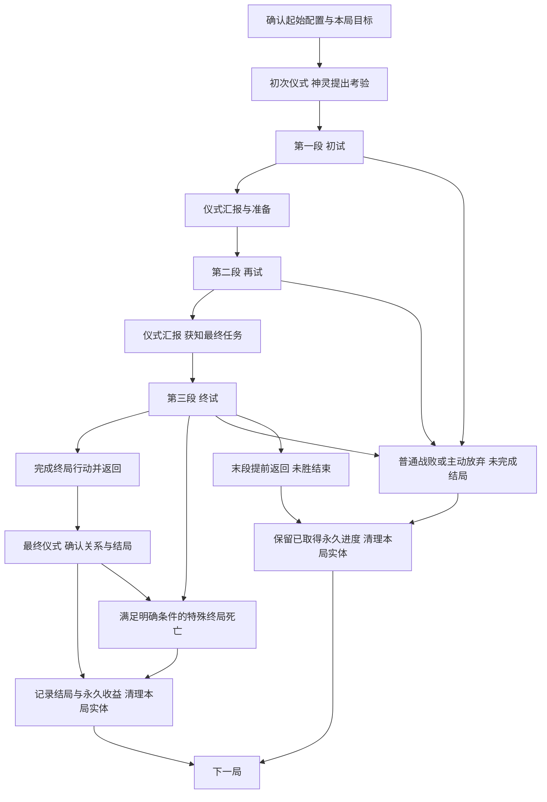

# 言咒肉鸽式仪式系统 卷入仪式的玩法框架与设计缺口

更新：2026-11-08。状态：当前探索方向的说明稿，Raw / Unqualified。用户已选定“卷入仪式”为单局叙事方向，并要求玩法内容按该框架组织；以下为据此整理的工作设计。具体神灵、物件、条件、数值及示意考验尚待设计，玩法体验 Hypothesis / NotRun；本文未替换项目现行GDD。

## 1 这是一套什么玩法

**玩家在文字界醒来，通过初次仪式召来神灵，接受并完成一场考验，最终决定如何结束自己与祂的这次关系。** 这是每局都能直接理解的目标。主线按“初次召神—初试—再试—终试—结局”展开；当前用三个内容体量大致相同的完整区域单元承载三次任务，区域之间返回文字界汇报和准备。

玩家从有限的起始配置出发，在物质界战斗、收集和加工材料，再通过仪式求知、取得回应、改变下一段机会，逐渐形成这一局的构筑。有限资源既要支持战斗，也可能用来准备供物、完成考验或回应其他存在。神灵的要求、玩家的实际行动和最终决定共同形成追忆、忤逆或信仰等阶段性结局。

一局负责把这次考验讲完，世界的深层故事主要通过跨局特殊仪式事件、神灵回应和知识成长展示。玩家不需要每局解决完整身世或世界谜案。知识、境界与明确永久解锁持续保留，主要实体物资和构筑随整局结束清理，下一局重新面对有限资源与机会。

长期飞升仍是更远的目标，普通局也有自己的完整结果。当前希望验证的体验是：玩家能依据神灵要求和已有理解安排构筑，并在途中改变自己的打算；具体内容尚不能证明这一体验已经成立。

## 2 两个世界与三个循环尺度

文字界和物质界决定玩家在哪里做事；节点、区域段和整局决定一次行动影响多长的进程。

| 概念 | 当前含义 |
| --- | --- |
| 物质界 | 进行战斗、采集、普通加工和现场调查的地方。玩家按区域路线推进，承担生命、耗材和携带压力。 |
| 文字界 | 以卡牌管理当前物资、地点、知识、联系对象和事件；准备出征、主持仪式、查看结果。普通加工不能在这里完成。 |
| 节点 | 一次战斗、采集、加工、事件或返回选择。节点处理结果进入下一节点。 |
| 区域段 | 一个有固定推进方向和返回位置的完整探索单元；三段规划体量相近。返回文字界后，这个区域段结束，整局可以继续。 |
| 整局 | 从确认起始配置开始，经过初次召神、有限区域考验及仪式汇报，到达成阶段性结局、普通战斗失败或主动结束为止。 |

因此，回到文字界并不等于完成一局，也不等于把收获变成永久资产。文字界中的大部分经营发生在局内，使用的也是本局物资。

三个循环分别是：

- **节点循环：**观察情境 → 决定战斗、取材或加工方式 → 承担消耗、取得结果 → 进入下一节点。
- **整局循环：**限定起始配置 → 初次召神 → 接受考验 → 探索与构筑 → 仪式汇报及下一次考验 → 最终任务 → 分歧结局或失败 → 结算。
- **跨局循环：**保留知识、境界、结局记录和明确解锁 → 特殊仪式事件与神灵回应产生新的理解 → 下局从限定起始配置重新构筑、探索其他关系与结局。

## 3 开局：醒来、观察基础配置、初次召神

玩家查看已解锁的起始方案、已知线索和本局通用目标后确认开始。首版仍暂用一套免费且可恢复的基础方案，后续解锁增加可选方案；不从永久仓库拿齐上一局装备。新局生命按预设满值初始化，发放本局装备实例、最低起步供给，以及足以启动首次仪式的方法和投入。

起始物通过描述、用途和祭坛预感暗示可能回应的神灵。玩家在第一次物质界探索前就能执行这场仪式，不需要先取得尚未探索才能找到的材料，也不默认献掉唯一的战斗配置。具体信物、供物是否消耗及其数量尚待设计，首次仪式不豁免通用的费用提示和一次性结算规则。

启动后，神灵给出第一项可理解的考验：去哪里、做什么、带回什么或证明什么。身份可以暂时神秘，执行要求与已能判断的代价必须清楚。玩家据此准备第一段；起始配置只影响召来对象和初期机会，不预先锁死结局。

首次醒来的介绍在后续局可缩短，已学知识和境界直接可用，已知的仪式规则不要求重复解谜。每局的初次接触仍负责建立当前任务实例，不能把上次完成记录当成这次已交付。

当前暂定三段，每段最多实际进入一次。查看、换装或取消尚未出发的准备不消耗区域机会，也不刷新已经生成的路线。返回文字界不自动满血、不补齐耗材；生命与物资压力连续，恢复必须来自明确的实际效果。

## 4 初试、再试、终试分别做什么

“初试、再试、终试”是阶段称呼，不是已经确定的地理名称，也不代表三次境界提升。不同神灵可以沿用同一结构，配以不同要求、材料用途、遭遇和回应。

### 三段体量相近，剧情重点后移

用户已明确三段在关卡和内容设计上保持大致相同的规模，每段都作为一个完整游玩单元。每段都提供战斗、资源取得、加工或取材选择、构筑调整机会、后段挑战和返回后的仪式；初试保留完整内容，终试也有完整的探索与成长过程。

| 设计维度 | 三段共同的安排 | 可以随阶段变化的部分 |
| --- | --- | --- |
| 路线与节点 | 使用同一规模的区域骨架，分支和推进机会数量相近 | 地点主题、具体节点内容、兼容替代路线 |
| 战斗与事件 | 遭遇数量、内容种类覆盖及完整路线的游玩量相近 | 敌人机制、难度、异常和事件身份 |
| 资源与构筑 | 都有取材、加工取舍、奖励与调整构筑的机会 | 材料等级、配方用途、构筑所需资源和收益强度 |
| 仪式衔接 | 每段结束均有汇报或最终仪式，承接本段结果 | 前两段开启下一项考验，末段确定结局 |
| 剧情分量 | 任务始终清楚，早期提供必要线索与征兆 | 重要回应、关系转折和结局行动主要安排在后半程 |

这里的“大致相同”指规划的关卡内容量和机会规模，不要求敌人强度、资源价值或实际耗时相等。教学通过初试中的提示和较易理解的内容完成，不因此缩短首段。后续难度和资源层级可以递进，具体节奏仍需核算。

当前将剧情重点放在再试后段、终试及对应的仪式回应中；早期仍要留下足够线索，支持玩家理解后续选择。关键剧情优先嵌入既有调查、事件、深层遭遇和汇报位置，不因终试承担结局就额外追加一整段地图或一串必打战斗。叙事分量的增加不扩大末段的基础关卡体量。

| 阶段 | 玩家眼前的任务 | 区域内容需要承担什么 | 返回后的仪式 |
| --- | --- | --- | --- |
| 初试 | 完成神灵提出的第一项具体要求 | 建立基本构筑，提供可带回的任务对象或可核验经历，以及有限材料来源 | 核验完成情况、表达神灵态度，给出下一项任务及其可达去处 |
| 再试 | 在已有关系中完成进一步要求 | 发展构筑，呈现神灵要求与玩家利益之间的取舍，提供可选结局的线索或机会 | 根据实际做法回应，说明最终任务及已能理解的条件与代价 |
| 终试 | 执行最终任务，落实所准备的选择 | 检验当前构筑和资源安排，完成交付、脱离或窃取等对应路径的关键行动 | 带回结果后完成最终仪式，确认关系、记录阶段性结局并结算 |

### 初试：让玩家知道怎样完成一次考验

第一次任务应当表达简明，玩家能从任务对象、地点和仪式预感判断下一步；初试的关卡内容量与后两段大致相同。基础所需物件或经历放在明确可达的主路径上；在前段完成后，可以提前返回汇报，也可以继续深入争取资源。神灵回应既说明任务是否完成，也评价玩家已实际做过的事。

首段仍可取得来源样本、现成供物与制作关系，用于返回后的引路或其他方法。这些投入服务本次考验和下一段机会，不再承担“玩家第一次能否施仪”的开局门槛。

### 再试：让要求影响玩家的安排

第二项任务应当让神灵要求与资源、构筑或遭遇发生联系。例如，同一件收获既能用于履约，也能帮助理解其来源或准备另一个结局；具体是否消耗以及可选用途必须明示。这里是内容组织要求，尚未指定正式物件或配方。

玩家可通过异常遭遇或仪式接触其他存在，取得线索或额外请求；这些机会不自动新增必做主线。不同处理应让神灵的回应有所依据，而不是只换一句赞扬后发放相同任务。正常推进不要求偶然抽到唯一稀有事件。

### 终试：把前面的打算变成实际行动

终局目标在出发前说明已知要求。追随、脱离或窃取力量需要各自的先行条件与最终行动，不能到终点无条件三选一。最终区域的第6位置承载对应关键事件，第7位置承担返回；常规路径返回文字界后尚未结束整局，还要完成最终仪式。

最终仪式在本局库存仍存在时核验凭证、支付已预告费用并确定结果，之后才清理实体。该准备窗口可以沿既有权限处理持有的知识和物资，不再开启第四段探索；具体可用方法与结局必需投入须在内容核算时明确。若某条忤逆路径以完成窃取后的死亡收束，则直接进入该特殊结局，不要求死者再返回交付。

### 每项考验都必须说明的内容

每项具体考验写清：提出者、目标地点或可达来源、必要物件／经历、实际完成动作、是否需要带回交付、汇报消耗、下一阶段的开启条件及提前返回的影响。最终任务再说明结局条件和结算时点。实物凭证与经历记录分开，不把“见过”“持有过”“已献上”视为同一件事。

任务未完成不能被汇报自动算作完成。若允许改换做法，必须提供事先可理解且仍可达的替代路径；不能依靠无尽回访补救，也不能拒绝一切要求就自动取得追忆或忤逆。当前没有定义具体神灵的失败容错分支，列入后续缺口。

## 5 考验在区域节点中怎样展开

初试、再试、终试分别占用一个体量相近的区域单元。当前共同工作模板采用七个推进位置，用于说明功能与接口；最终节点数和单元时长仍待内容设计，不因“一层”的比喻直接确定新数量。后续若调整规模，应共同规划三段的内容预算。其中第5位置是二选一，所以玩家不会同时走过加工与额外采集两支。

| 位置 | 节点职责 | 玩家主要考虑什么 |
| --- | --- | --- |
| 1 | 有限起始采集 | 取得本段基础材料，安排实际携带。 |
| 2 | 普通遭遇，或被一个明确的入口异常替换 | 根据已知主机制使用当前构筑，承担战斗消耗。 |
| 3 | 目标取材或调查 | 取得当前明确目标的材料、样本、书籍或线索。 |
| 4 | 返回选择 | 保住当前收获并结束本段，或继续承担后段风险。 |
| 5A／5B | 有限加工／额外采集二选一 | 将现有材料加工成更有用的东西，或取得更多、不同的原料。 |
| 6 | 深层遭遇；末段可承担终局事件 | 检验前面准备，继续消耗当前生命和物资。 |
| 7 | 终点收获与返回 | 处理实际装载并结束本段；末段带回终局结果，随后进入最终仪式，尚未结算整局。 |

前两段在第4位置返回，会放弃该段后续节点并推进到下一段准备，不能稍后回来补拿。最后一段在第4位置返回，则会直接结束本局且不算获胜。两种返回的后果需要在选择时清楚说明。

本次体量要求比较三段各自完整路线所提供的内容。提前返回可能使玩家实际走过的前两段较短，这属于主动取舍；仍需为每段后半部提供值得继续的收益。是否进一步调整提前返回与阶段完成的关系，可在节奏核算时复核，本次不改变上述退出规则。

玩家出发前可以查看路线连接、节点类型、返回位置、资源大类以及敌人类型和主要机制。具体普通掉落、尚未知晓的故事和隐藏发现抵达后揭示。首次查看出征准备时生成的路线会固定，换装、关闭准备或恢复游戏都不会重抽。

可选后段提供额外收益和更多方案。基础目标的唯一必需材料不能藏在某个可选分支里，使玩家合理提前返回后才发现无法继续。这里保证的是存在可执行路径，不保证任意消费和选择都能通关。

初试、再试中正常汇报必需的目标来源，应在第3位置及其前置可达路径覆盖；可选后段可以提供不同结局的额外线索、力量机会或更好的资源，但必须与基础推进条件区分。提前返回保证还有基础推进路径，不保证仍能达成所有结局。终试第6位置承担所选路径的关键终局行动，第7位置承担实际带出结果；不能在末段第4位置撤退就自动取得“追忆”结局。

## 6 仪式围绕考验承担什么作用

仪式是玩家在文字界主动投入物品、运用已学方法来改变状态的主要手段。它可以改变信息、地点、接触机会和事件；普通制造仍通过物质界的法器与配方完成。

“召神、汇报、最终表态”是叙事中的使用阶段；求知、引路、召唤与联系等是方法的实际功能。汇报沿用接触对象和条件请求，不额外增加一套独立经验或任务货币。

| 仪式用途 | 玩家投入和操作 | 主要结果 |
| --- | --- | --- |
| 求知 | 对书籍等对象使用已掌握方法，满足先修条件 | 掌握当前可理解的知识或方法。基础求知默认不额外消耗供物，书籍保留；特殊方法另有明确条件。 |
| 引路 | 投入合格来源样本与规定供物 | 初次可以发现地点；后续可以建立本局下一段的替代入口，不增加区域总数。 |
| 召唤与联系 | 初次使用起始仪式条件建立联系；之后通过已知方法、信物或考验凭证回应对象 | 初次获知考验；中间汇报实际行动并取得下一阶段要求；最终确认关系与结局。其他召唤仍可形成物质界遭遇。 |
| 异常干预 | 具备相应境界和方法后，以适配的既有异常为对象 | 按方法处理该事件，例如解除阻挡；不普遍清除所有异常。 |
| 拔擢 | 满足知识、经历与真实供物条件，主动施仪 | 永久取得下一阶段权限。 |
| 飞升 | 在相应目标局中完成终局准备及最终仪式 | 达成长期主线终点。具体仪式与结局尚待设计。 |

玩家先选已掌握的方法，再放入对象和所需供物。方法决定尝试什么行为，知识决定已懂得什么，境界决定能执行哪些交互，实际物品承担指向和代价。首版不设计摆放像素位置、旋转或拖动顺序谜题。必要的开局召神由起始方案提供可执行的方法和投入；后续额外方法仍需按规则学习。

启动前必须看清能否执行、缺少什么、哪些物品会消耗或保留。准备阶段可反复撤换，启动后一次结清结果，不能取消返料或重抽。仪式逐个主动结算，不依靠现实倒计时、离线收益或多祭坛并行。

合法仪式不再抽一次通用成功率。引路能够产生对应入口，求知能够取得当前可解读内容；具体目标和伴随后果由投入及相关状态决定，其中可以有少量提前显示征兆的随机变化。玩家仍可能误判样本来源或回应者，但不会仅因为一次通用失败判定而扣掉材料、没有结果。

### 神秘性来自怎样的信息

物品描述提供来源与传闻，配方说明加工关系和用途，祭坛预感回应当前真实投入。三者共同帮助玩家推理。预感可以隐藏回应者的身份，但真实消耗以及已能判断的后果性质应当清楚。

例如，一个样本的描述提到未知痕迹；供物说明它只能建立联系，不能筛除其他回应；祭坛预感随后指出门扉回应之外还有另一种存在。玩家据此决定是否承担开路后的事件，并在结果发生后修正理解。

这个例子只是说明信息关系，不预设每种样本都有一个可以净化的安全版本。同样投入、知识和相关状态下，反复拿起放下物品不会刷新预感。一次仪式记录的是本次发生的事实，不能自动证明所有同类材料永远产生相同后果。

任务指定去处时，基础入口及其合法取得路径必须一并交代。引路可以为下一次考验提供兼容的替代地点、不同资源或遭遇，不增加区域次数；替换地点也要能承担当前考验。已开放入口不再收重复开路费。仪式汇报可以提交任务凭证或核验已经发生的行为，具体要求由该项考验说明，不默认每次汇报都额外收一份供物。

## 7 完成考验需要怎样安排材料与构筑

玩家在节点上取得有限物资，选择实际带入背包的部分。装备、铭文、辅助物、材料、样本和实体书籍按各自规格共用真实出征背包；卡牌数量显示可以合并，实际占用不会因此消失。已经掌握的知识和地点记录不占携带空间。

节点提供待选物品区，供玩家比较、整理和选留。尚未取得的物品不能直接用于生产；离开后，未选物和已确认弃置物不会寄回文字界或跟到下一节点。区域中也不能调用留在文字界的库存。物资整理仍限于合法的非战斗或战后窗口。

安全返回时，实际带回的物品进入本局仓库。仓库暂不设总量硬上限，主要携带取舍发生在区域探索中；整局结束后仓库清理。装拆不会复制部件，已经用于制造或仪式的投入不返还。主动操作若会毁掉最后可继续的配置，需要有本局剩余机会内可达的恢复路径；没有这条路径时首版禁止该操作。

一部分基础原料同时用于战斗配方和供物制备，样本、特殊凭证等也可以有专门用途。因此，带回多少原料、何时把它加工成供物，以及为下一段留下多少战斗供给，都可以成为局内决策。

非战斗加工使用玩家实际部署的合法法器、已允许的配方及真实材料。加工节点暂给所有器具共享的5个生产拍，不是每台器具各给5拍；不能在剩余拍数内完工的批次不能启动。查看和排计划不耗拍，已经承诺的批次完成后才能离开，未完工进度不跨节点保存。

此前供物示例是两种材料各一份制成供物一份，暂定耗时2拍。它说明了生产和仪式的连接方式，尚不是已核算的真实配方。具体法器配置、输入要求、产物占形及战斗消耗仍需补齐。

本局构筑应表现为玩家逐渐形成的一套做事方法：能用哪些配方、材料如何周转、面对什么敌人更有优势、适合利用哪些仪式机会。目前这部分只有系统关系，尚未设计出可比较的完整构筑样例。

叙事条件必须落到真实资源用途：某件任务凭证若也能作为供物或战斗投入，应说明消耗后会失去哪项交付条件、是否已有其他可达路径。任务标签不免除背包占格，也不把“曾经拿到”改成“已完成献上”。可选神灵请求与主线争夺资源时，要让玩家能判断取舍；后续内容不能以隐蔽消耗使基础主线无故中断。

## 8 神灵回应、知识与跨局叙事

### 知识是永久理解，书籍是当前实物

探索中能直接理解的调查或见闻，在完成条件时记录。书中的深层知识需要实际带回文字界，通过求知解读。已经掌握的知识永久保留，原书通常保留在本局；尚未解读的书在整局结束时随实体清理。

知识推进依靠具体条件，如解读、观察、履约或献出真实物件，不采用通用知识点加点。知识树分开已知事实、未验证线索和已揭示缺口，逐步呈现相邻问题。缺口应给出可追查的方向，但不提前公开完整答案。

如果条件是亲眼观察，完成观察就可以学习；如果条件是带回或献出凭证，必须实际完成对应动作。看到奖励、曾经持有或计划提交，都不等于满足条件。已经学会的知识即使随后失败也保留。

### 考验与两种接触入口共享同一个对象

神灵和生物既可以在异常中遭遇，也可以通过仪式召唤。玩家可能先相遇、再根据线索学会召唤，也可能先读懂文本、召来从未见过的存在。每个对象不必都提供两种入口，遇见也不自动授予召唤方法。

接触可以产生战斗、交涉、条件请求或其他事件。若需要战斗，进入物质界遭遇；文字界承担仪式和回应。召唤不自动把对象变成可控制随从。

主线考验沿用“提出请求—获知条件—完成条件—取得回应”的关系。当前考验与对同一神灵的联系共享记录，不在仪式入口和异常入口各发一份独立任务。玩家可以接受、拒绝或暂缓，当前每个联系对象先限一个进行中的请求；主线考验占用该对象的这个位置，完成本次汇报后再开启下一项。拒绝某项主线要求不自动解锁反抗结局或跳过任务，需有已说明的其他路径；普通可选请求仍可自由拒绝或暂缓。准备和交付要检查真实材料与资格；重复打开不会重抽请求，同一局中换个入口联系同一已识别对象，也不会重置请求或重复发奖。

局内请求的活动状态在该局持续，整局结束后关闭。明确的主线一次性完成记录和永久奖励保留；后续新局可以出现提供本局收益的新请求实例，但不能再次领取同一永久奖励。具体哪些请求属于哪一类，仍需逐项定义。

### 异常影响具体地点

若首个教学内容包含入口异常，它替换该区域第2位置普通遭遇，用一场战斗驱离；第1位置起步供给保留，第3位置仍提供考验目标，原样例中的目标书籍可作为其中一种内容。它不额外增加一场战斗，也不把关键书籍放进随机战利品。

当前每个地点最多有一个未解决的主要通行阻挡，新增不兼容阻挡的仪式会在启动前被拒绝。异常不靠现实等待自动恶化，玩家可以在剩余区域机会允许时选择其他准备方向。已经结束的区域不能重新进入，不能继续沿用旧方案中的无限回访重试。

本局中已解决的事件继续保持解决；若随后失败，整局结束，新局是否出现相应事件由新局内容决定。永久留下的是已经理解的事实和明确成就，不是下一局所有地点都处于已清理状态。

### 单局完成一件事，跨局逐步理解世界

单局叙事只负责这位神灵的考验以及最终关系。特殊仪式事件、神灵对既往结局的回应、知识中新出现的联系，逐渐解释玩家为何醒来、起始物与神灵的关系、各次经历的意义。特殊事件出现条件仍需设计，不默认每局都有新揭密或固定反转。

同一神灵可以知道玩家曾经追随或忤逆过祂，但记得往事不等于当前任务已经完成，也不自动复发上次奖励。已解锁知识不重新包装成首次发现；身份之谜可以作为可选跨局线索，尚未选为第二条必做主线。具体世界事实、神灵身份与正式物件文案仍待另行形成。

## 9 境界成长与飞升怎样嵌入考验

当前长期成长采用共同的权限主干，知识、接触对象和材料准备可以分支，不要求先学完全部知识或联系全部存在。正式境界名称尚未确定。

| 阶段 | 主要权限 | 需要提供的实际选择 |
| --- | --- | --- |
| 初始阶段 | 引路、求知，学到方法后的基础召唤与联系 | 根据当前物资与线索选择方法和目标。 |
| 第一次拔擢后 | 仪式干预适配的既有异常 | 比较支付供物处理异常与在物质界亲自应对的代价。 |
| 第二次拔擢后 | 为允许选择落点的召唤指定兼容地点 | 比较不同地点的资源、路线与风险；必须存在真正有区别的合法选择。 |
| 飞升 | 在特定目标局中完成终局事件与最终仪式 | 将长期知识和已取得权限用于主线终点。 |

拔擢需要掌握知识、完成相关经历并支付真实供物。知识和经历可以跨局积累，需要献出的实体必须在当前局凑齐。拔擢在本局中间阶段完成后，新权限立即生效；此后即使失败，境界也不会退回。

每次拔擢应同时提供至少一种可以追查、可以实际运用的方法，不自动学会全部同阶内容。初始阶段已经可以学习基础召唤，不能再把这项既有能力当作拔擢奖励。

普通局通过这次考验与关系结局形成完整挑战。“初试—再试—终试”是本局推进阶段，不是三个永久境界；获得“信仰”或“忤逆”结局也不自动等于完成拔擢。达到飞升条件后，玩家可以进入相应目标局，完成其终局准备与仪式。飞升后允许继续开启已开放的其他局，保留长期进度；已经结束的那一局物资不会继续留存。

## 10 区域返回与结局结算分别保留什么

| 内容 | 返回文字界 后续区域仍在同一局 | 整局结束 |
| --- | --- | --- |
| 生命与剩余供给 | 连续，不自动补满 | 新局按起始方案重新初始化 |
| 实际装备、铭文、材料及本局仓库 | 实际持有或带回者保留，消耗不返还 | 清理，包括本局最初发放的实体 |
| 未解读的书、未交付的物件凭证 | 按实际持有状态保留 | 清理，不自动变成知识或已履约记录 |
| 已掌握知识、完成的学习条件、境界权限 | 保留 | 永久保留 |
| 已知地点与对象身份 | 保留已学信息 | 保留认知，本局可访问入口和出现状态重新确定 |
| 当前异常、临时效果与局内请求 | 按对应条件在本局持续 | 本局状态结束；后续新局建立适用实例 |
| 已达成的结局、明确主线完成与永久解锁 | 保留 | 保留，不重复领取同一永久奖励；未完成的结局条件不自动兑现 |

特别需要区分“记住上局解除过一个异常”与“这局相同地点已经没有异常”。记录可以永久存在，当前世界状态仍属于当前一局。跨局重现对象的具体叙事解释尚未确定，玩法重置不直接定义世界中的复活规则。

## 11 桌面围绕当前考验组织信息

文字界保留卡牌桌面，只展开当前准备、比较和追查的对象，其余物资、地点、知识和联系记录可以分类查找。收拢一张卡不等于丢弃实体，知识引用也不等于又获得一本书。

同一时刻只启用一种实物准备：仪式投入或出征装载。切换时释放旧预留、保留计划；恢复计划要重新检查实际库存。普通查看不会取消准备，缺少物品的计划不会被当成已经持有。

目标追踪暂定一个主目标和两个可固定关注目标，显示已满足条件、缺少物资、已知来源及阻碍。玩家可以从缺口查看已掌握配方或进入地点准备，但不会自动制作、出征或启动仪式，也不会借导航提前揭示未知答案。

真正执行前，仪式汇总消耗、保留和预感，出征汇总当前区域、剩余机会、路线与带入配置。结果先说明这次改变了什么，再允许回看投入、当时预感和观察事实。失败结算应清楚说明哪些知识仍在、哪些本局实体已清理。

主目标始终显示本局“完成这场考验”，其下呈现当前阶段、具体要求、返回后需要完成的汇报以及最终仪式是否尚未进行。知识缺口和可选请求放在关注目标中，避免同时出现几条同等优先的主线。终局预感显示当前能确认的关系走向、缺少条件和代价；隐藏结局可以保留探索空间，已掌握的条件不能故意模糊。

## 12 一局示意：从回应考验到决定关系

以下只说明内容怎样按主线组织，所有“目标物、书籍、信物、供物”都是功能称呼，尚未形成真实物件规格或资源核算。

1. **初次召神。** 玩家观察起始配置，用方案提供的方法和投入完成仪式，收到“前往某地取得指定对象并带回”的初试。首次回应暗示神灵的态度，但不要求玩家先理解完整来历。
2. **初试探索与汇报。** 玩家经过有限采集和普通遭遇，在目标节点取得任务对象，以及供后续仪式使用的样本和现成供物。第4位置可返回；继续深入则争取更多材料。返回后交付实际对象，神灵确认考验结果并提出再试。
3. **准备再试。** 玩家可求知或利用样本引路，比较下一段兼容地点。引路的后果可能是一个替换普通遭遇的入口异常；处理它不会增加区域次数。汇报所建立的基础路径仍能承担任务，替代地点提供不同资源或机会。
4. **再试探索与汇报。** 玩家完成下一项具体要求，同时可能获得有关自身的记录、发现可夺取力量的机会，或通过实际行为满足更深的追随条件。不同发现只提供结局的可能性，还需要继续准备。返回后可解读书籍，神灵回应实际做法并提出最终任务。
5. **终试与结局。** 玩家按剩余生命、材料和已获线索准备最终区域。满足脱离条件并完成离开仪式的行动可通向追忆；有准备地完成窃取可通向忤逆；完成最终要求并接受追随可通向信仰。常规路径带回结果，最终仪式确定结局；已明确定义的特殊终局死亡直接结算。

同一永久知识与境界下，下一局可以因起始方案、神灵回应、资源机会和遭遇不同，选择不同做法。重复游玩依靠这些变化与跨局回应，不靠每局删除已学知识。尚需用至少两份真实内容账目证明这些选择存在，而非只有剧情措辞不同。

## 13 阶段性结局与普通失败

结局由“起始倾向＋途中关键行为与遭遇＋终局行动”共同形成。起始物提供机会与暗示，途中行为准备条件，最后只出现当前实际能够成立的结果。具体解锁条件、互斥关系与提示尺度尚待逐项设计。

| 结局方向 | 当前的故事与行为框架 | 永久收益侧重 |
| --- | --- | --- |
| 追忆 | 保留关键记录或记忆，找到并实际完成脱离本次仪式的途径，带着疑问开始流浪 | 新知识、剧情线索与后续事件资格 |
| 忤逆 | 找到可乘之机，实际窃取力量并承担反抗后果；其中可包含被神明杀死的收场 | 窃得力量带来的基础配置改善或新起始方案 |
| 信仰 | 完成相应考验，最终主动接受追随关系 | 神灵赐福与相应仪式回报改善 |

追忆结束的是这次考验，流浪是开放的故事去向，不在已经结算的同一局继续无限探索。忤逆中的死亡只有在该路径预先定义的关键目标已达成时才属于特殊结局；普通战斗失败仍结束整局，不因出言反抗或受到致命伤自动发奖。需要战斗的场景仍发生在物质界，文字界承担仪式和回应。

进入区域后主动放弃、普通战败，或末段第4位置提前返回，都未完成阶段性结局。首版不额外提供复活次数；已取得的知识和境界保留，未完成结局的奖励不发放。暂停或关闭应用恢复同一局，不判失败，也不重抽路线或已经承诺的结果。

结局奖励保留用户提出的知识成长、基础配置改善和仪式回报提升。具体强度、启用限制、重复达成奖励及叠加方式为Unknown；不默认反复刷同一结局无限提高所有起始属性或仪式产出。不同结局记录可以积累，某次信仰不自动永久锁死其他方向。结局独有的一次性奖励不能重复领取，剧情回应和本局效果也不能混算成永久奖励。

完整顺序为：终局行动完成 → 常规返回并保留本局凭证 → 最终仪式及关系决定 → 记录结局与明确永久收益 → 清理本局实体。明确的特殊终局死亡从对应事件直接进入记录和清理。结算后不能再用已清理物品补做求知、拔擢或献祭。

## 14 已明确的边界与接下来的设计缺口

用户已选定“卷入仪式”作为单局主线，叙事以一个简单目标和阶段性多结局展开，并明确初试、再试、终试的关卡内容量大致相同，重要剧情可以集中在后半段。有限区域、连续生命与资源压力、知识和境界跨局保留、主要实体局内持续、可推理仪式、两种神灵／生物接触入口继续有效。开局首次仪式和结局前最终仪式已接入工作流程。

三段长度、七位置区域、第5位置加工／采集二选一、共享5拍加工预算、两种原料各1份制供物1份且耗时2拍、首版一套基础起始方案，以及一个主目标加两个关注目标，仍是工作参数。两次拔擢的权限主干沿既有设计；这些数量与节奏没有经过玩法验证。

具体神灵、地名、考验对象、配方、敌人和奖励未定。身份探索、送还遗物、偿还祭债不再作为并列待选主线，其构思保留在来源记录；身份线索是否纳入跨局事件仍属可选内容。未继承已清空的旧世界观。

| 顺序 | 缺口 | 下一步需要形成什么 |
| --- | --- | --- |
| 1 | 一位神灵与三个完整单元 | 先制定三段共用的节点规模、遭遇数量、资源与构筑机会预算，再明确各段任务、带回要求和汇报；主要剧情嵌入后半程，保持三段内容量相近。先限定一个对象，不扩写完整神谱。 |
| 2 | 三种结局的具体成立条件 | 各选少量关键行为，写清来源、可达时点、消耗、最终行动、互斥关系及提示；区分普通失败与忤逆特殊死亡。明确基础可达结局及哪些结局依赖可选发现。 |
| 3 | 起始方案和完整资源账目 | 核算第一次仪式、三段连续战斗、任务投入、供物加工、恢复与背包占用，确认首次召神可执行、前两段提前返回后仍能推进、最后仪式有真实投入。 |
| 4 | 考验对构筑和路线的影响 | 在同一永久权限下写两种机会组合，比较材料用途、配置、引路替代地点和神灵回应，证明任务会改变行动，不只是换名字的交付清单。 |
| 5 | 终局准备窗口与任务容错 | 明确末段带回后允许哪些仪式、关键凭证保护与消耗提示、缺失条件怎样反馈；任务偏离时是否有可达替代方案，不能隐式加区域或自动算完成。 |
| 6 | 永久奖励与重复达成 | 明确知识、起始能力与仪式支持的具体收益、强度、一次性资格、启用与叠加方式；保持每局重新构筑的意义。 |
| 7 | 跨局特殊事件与神灵记忆 | 明确少量触发条件及回应变化，区分永久经历、当前请求和一次性奖励；避免重复揭示已知信息，或把叙事记忆变成免费完成当前任务。 |
| 8 | 拔擢、飞升与桌面表现 | 补实际权限用途、对应知识／材料、飞升目标局；检验当前考验、区域次数、结局条件和长期知识缺口是否容易区分。 |

请求指向的地点、所需物与交付窗口必须在剩余区域内可达；永久已知不等于本局入口开放。异常干预和召唤落点仍需有真正值得比较的对象，不能只开放一个实际上必选的按钮。恢复、加工与战斗预算仍是完整局成立的必要条件，不能被叙事顺序替代。

永久权限还需与新局的起始方案、材料来源和目标难度配套，避免解锁后无处可用或直接跳过构筑。结局收益也要说明为何值得完成终试，并检查是否出现只取得永久知识便反复主动放弃的单一最优路径。旧方案按持续远征计算的首次拔擢次数预算不直接作为新整局长度。

## 15 下一阶段按一场考验细化

下一步先制定三段共用的区域单元内容预算，再为一位神灵写出“起始配置—初次召神—初试与汇报—再试与汇报—终试及三种结局”的内容账目。并列检查三段的完整路线、遭遇量、资源与构筑机会，以及提前返回对实际体验长度的影响；在此基础上将任务与重要剧情放入对应位置，再写正式名词与细节文案。

随后在同一知识与境界下更换一组资源和遭遇，核对玩家是否仍有明确目标，却会采用不同的配置与仪式安排。先做文档中的依赖核对，实际法器、铭文、配方、占形和敌人规格按后续授权与正式内容来源补齐；本轮没有运行原型、模拟或玩家测试。

## 来源与维护

本文按用户要求维护为独立阅读说明，决定依据保存在[设计记录](../sources/inbox/2026-11-06-meta-system-design.md#ritual-trial-framework)。本轮编辑输入版本为 `38d604d54acb52cff629ae9dd3146c56c7883407`，使用该说明稿、原方向记录及用户本轮对三段体量的要求；更早固定背景沿来源中的阅读合同，不因当前分支上的其他资料改变。

此前已选定“卷入仪式”，并将旧教学顺序和末段即时结算样例改为主线下的开局召神、考验汇报和最终仪式。本次进一步明确三段为体量相近的完整单元，修正“初试任务具体而短”的表述，将剧情分量和关卡规模分开安排。未被替换的资源、知识、权限与区域边界继续沿用。具体条件及示意内容仍属工作设计，不因方向被选定即成为正式物件规格或已验证玩法。

设计记录保留意图和决定依据，本文集中解释当前方案与缺口，后续决定变化时同步更新。本文继承原来源的Raw / Unqualified资格，不是现行GDD、正式提案或实现规格；没有将其他研究资料、旧世界观或代码纳入依据。
