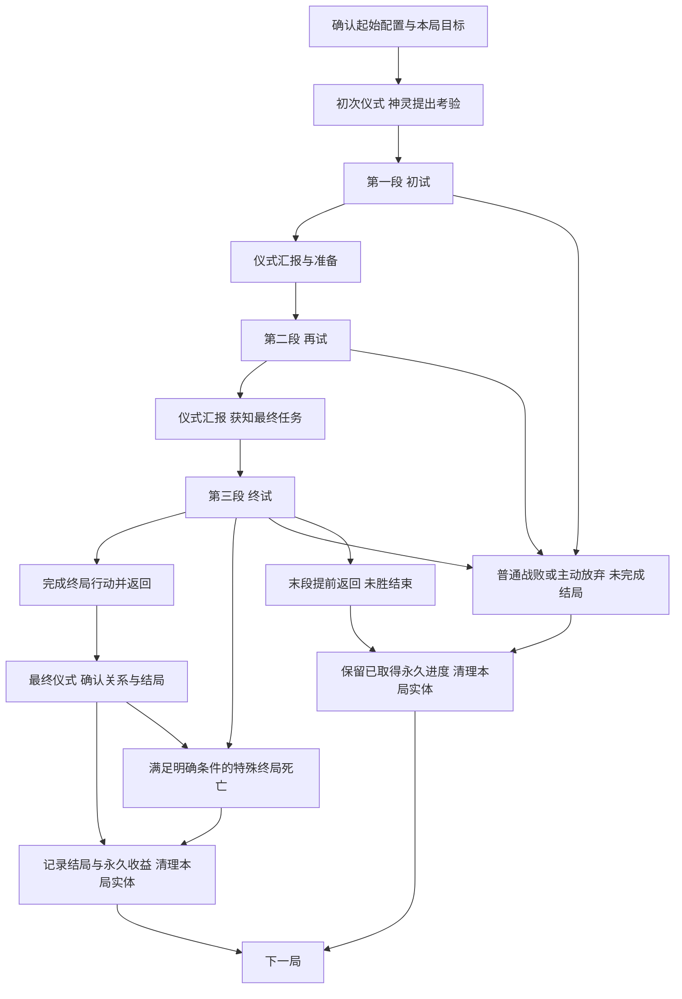

# 言咒肉鸽式仪式系统 卷入仪式的玩法框架与设计缺口

更新：2026-11-09。状态：当前探索方向的说明稿，Raw / Unqualified。用户已选定“卷入仪式”为单局叙事方向，并于2026-11-09确认第16节仪式第一版作为后续工作设计。未展开内容及新增部分仍待逐项审核，玩法体验 Hypothesis / NotRun；本文未替换项目现行GDD。

本轮已依据肉鸽理论完成框架审查，完善内容从[第15节](#framework-improvement)进入。用户已确认信仰基础路径，并补充强调：主线召神仪式必须进行，其必要投入为一部分通用材料／金币＋一个核心材料；探索返回后还可用余量进行其他仪式。提前返回的正常推进前提是已取得最低必要投入。具体材料、基础费用数值与功能样例仍待细化。

已确认的仪式工作版见[第16节](#ritual-rules-content-v1)。用户要求持续补齐缺口、逐部分审核；当前进度与下一部分见[第17节](#ritual-gap-review)。工作设计确认不等于正式GDD采纳或玩法验证通过。

## 1 这是一套什么玩法

**玩家在文字界醒来，通过初次仪式召来神灵，接受并完成一场考验，最终决定如何结束自己与祂的这次关系。** 这是每局都能直接理解的目标。主线按“初次召神—初试—再试—终试—结局”展开；当前用三个内容体量大致相同的完整区域单元承载三次任务，区域之间返回文字界汇报和准备。

玩家从有限的起始配置出发，在物质界战斗、收集和加工材料，再通过仪式求知、取得回应、改变下一段机会，逐渐形成这一局的构筑。有限资源既要支持战斗，也可能用来准备供物、完成考验或回应其他存在。神灵的要求、玩家的实际行动和最终决定共同形成追忆、忤逆或信仰等阶段性结局。

一局负责把这次考验讲完，世界的深层故事主要通过跨局特殊仪式事件、神灵回应和知识成长展示。玩家不需要每局解决完整身世或世界谜案。知识、境界与明确永久解锁持续保留，主要实体物资和构筑随整局结束清理，下一局重新面对有限资源与机会。

长期飞升仍是更远的目标，普通局也有自己的完整结果。当前希望验证的体验是：玩家能依据神灵要求和已有理解安排构筑，并在途中改变自己的打算；具体内容尚不能证明这一体验已经成立。

## 2 两个世界与三个循环尺度

文字界和物质界决定玩家在哪里做事；节点、区域段和整局决定一次行动影响多长的进程。

| 概念 | 当前含义 |
| --- | --- |
| 物质界 | 进行战斗、采集、普通加工和现场调查的地方。玩家按区域路线推进，承担生命、耗材和携带压力。 |
| 文字界 | 以卡牌管理当前物资、地点、知识、联系对象和事件；准备出征、主持仪式、查看结果。普通加工不能在这里完成。 |
| 节点 | 一次战斗、采集、加工、事件或返回选择。节点处理结果进入下一节点。 |
| 区域段 | 一个有固定推进方向和返回位置的完整探索单元；三段规划体量相近。返回文字界后，这个区域段结束，整局可以继续。 |
| 整局 | 从确认起始配置开始，经过初次召神、有限区域考验及仪式汇报，到达成阶段性结局、普通战斗失败或主动结束为止。 |

因此，回到文字界并不等于完成一局，也不等于把收获变成永久资产。文字界中的大部分经营发生在局内，使用的也是本局物资。

三个循环分别是：

- **节点循环：**观察情境 → 决定战斗、取材或加工方式 → 承担消耗、取得结果 → 进入下一节点。
- **整局循环：**限定起始配置 → 初次召神 → 接受考验 → 探索与构筑 → 仪式汇报及下一次考验 → 最终任务 → 分歧结局或失败 → 结算。
- **跨局循环：**保留知识、境界、结局记录和明确解锁 → 特殊仪式事件与神灵回应产生新的理解 → 下局从限定起始配置重新构筑、探索其他关系与结局。

## 3 开局：醒来、观察基础配置、初次召神

玩家查看已解锁的起始方案、已知线索和本局通用目标后确认开始。首版仍暂用一套免费且可恢复的基础方案，后续解锁增加可选方案；不从永久仓库拿齐上一局装备。新局生命按预设满值初始化，发放本局装备实例、最低起步供给，以及足以启动首次仪式的方法和投入。

起始物通过描述、用途和祭坛预感暗示可能回应的神灵。玩家在第一次物质界探索前就能执行这场仪式，不需要先取得尚未探索才能找到的材料，也不默认献掉唯一的战斗配置。具体信物、供物是否消耗及其数量尚待设计，首次仪式不豁免通用的费用提示和一次性结算规则。

启动后，神灵给出第一项可理解的考验：去哪里、做什么、带回什么或证明什么。身份可以暂时神秘，执行要求与已能判断的代价必须清楚。玩家据此准备第一段；起始配置只影响召来对象和初期机会，不预先锁死结局。

首份完整局以完成考验后主动选择信仰为基础可达路径。基础路径不依赖偶然稀有掉落，仍要求玩家支付费用、完成任务并活着到达相应结算；不是保证任意消费都能成功。追忆、忤逆需要额外发现及本局行动。主线召神及所选路径要求的推进仪式必须进行，其他仪式不能替代它们。必要投入按“通用材料／金币等基础消耗＋一个符合要求的核心材料”核算；任务条件另行核验，任务对象若同时充当核心材料，只记同一实体，不重复收两份。当前功能账目见第15节。

首次醒来的介绍在后续局可缩短，已学知识和境界直接可用，已知的仪式规则不要求重复解谜。每局的初次接触仍负责建立当前任务实例，不能把上次完成记录当成这次已交付。

当前暂定三段，每段最多实际进入一次。查看、换装或取消尚未出发的准备不消耗区域机会，也不刷新已经生成的路线。返回文字界不自动满血、不补齐耗材；生命与物资压力连续，恢复必须来自明确的实际效果。

## 4 初试、再试、终试分别做什么

“初试、再试、终试”是阶段称呼，不是已经确定的地理名称，也不代表三次境界提升。不同神灵可以沿用同一结构，配以不同要求、材料用途、遭遇和回应。

### 三段体量相近，剧情重点后移

用户已明确三段在关卡和内容设计上保持大致相同的规模，每段都作为一个完整游玩单元。每段都提供战斗、资源取得、加工或取材选择、构筑调整机会、后段挑战和返回后的仪式；初试保留完整内容，终试也有完整的探索与成长过程。

| 设计维度 | 三段共同的安排 | 可以随阶段变化的部分 |
| --- | --- | --- |
| 路线与节点 | 使用同一规模的区域骨架，分支和推进机会数量相近 | 地点主题、具体节点内容、兼容替代路线 |
| 战斗与事件 | 遭遇数量、内容种类覆盖及完整路线的游玩量相近 | 敌人机制、难度、异常和事件身份 |
| 资源与构筑 | 都有取材、加工取舍、奖励与调整构筑的机会 | 材料等级、配方用途、构筑所需资源和收益强度 |
| 仪式衔接 | 每段结束均有汇报或最终仪式，承接本段结果 | 前两段开启下一项考验，末段确定结局 |
| 剧情分量 | 任务始终清楚，早期提供必要线索与征兆 | 重要回应、关系转折和结局行动主要安排在后半程 |

这里的“大致相同”指规划的关卡内容量和机会规模，不要求敌人强度、资源价值或实际耗时相等。教学通过初试中的提示和较易理解的内容完成，不因此缩短首段。后续难度和资源层级可以递进，具体节奏仍需核算。

当前将剧情重点放在再试后段、终试及对应的仪式回应中；早期仍要留下足够线索，支持玩家理解后续选择。关键剧情优先嵌入既有调查、事件、深层遭遇和汇报位置，不因终试承担结局就额外追加一整段地图或一串必打战斗。叙事分量的增加不扩大末段的基础关卡体量。

| 阶段 | 玩家眼前的任务 | 区域内容需要承担什么 | 返回后的仪式 |
| --- | --- | --- | --- |
| 初试 | 完成神灵提出的第一项具体要求 | 建立基本构筑，提供可带回的任务对象或可核验经历，以及有限材料来源 | 核验完成情况、表达神灵态度，给出下一项任务及其可达去处 |
| 再试 | 在已有关系中完成进一步要求 | 发展构筑，呈现神灵要求与玩家利益之间的取舍，提供可选结局的线索或机会 | 根据实际做法回应，说明最终任务及已能理解的条件与代价 |
| 终试 | 执行最终任务，落实所准备的选择 | 检验当前构筑和资源安排，完成交付、脱离或窃取等对应路径的关键行动 | 带回结果后完成最终仪式，确认关系、记录阶段性结局并结算 |

### 初试：让玩家知道怎样完成一次考验

第一次任务应当表达简明，玩家能从任务对象、地点和仪式预感判断下一步；初试的关卡内容量与后两段大致相同。基础所需物件或经历放在明确可达的主路径上；在前段完成任务条件并取得返回后主线仪式的最低投入后，可以提前返回，也可以继续深入争取更多核心材料和通用资源，供返回后进行其他仪式。神灵回应既说明任务是否完成，也评价玩家已实际做过的事。

首段仍可取得来源样本、现成供物与制作关系，用于返回后的引路或其他方法。这些投入服务本次考验和下一段机会，不再承担“玩家第一次能否施仪”的开局门槛。

### 再试：让要求影响玩家的安排

第二项任务应当让神灵要求与资源、构筑或遭遇发生联系。例如，同一件收获既能用于履约，也能帮助理解其来源或准备另一个结局；具体是否消耗以及可选用途必须明示。这里是内容组织要求，尚未指定正式物件或配方。

玩家可通过异常遭遇或仪式接触其他存在，取得线索或额外请求；这些机会不自动新增必做主线。不同处理应让神灵的回应有所依据，而不是只换一句赞扬后发放相同任务。正常推进不要求偶然抽到唯一稀有事件。

### 终试：把前面的打算变成实际行动

终局目标在出发前说明已知要求。追随、脱离或窃取力量需要各自的先行条件与最终行动，不能到终点无条件三选一。最终区域的第6位置承载对应关键事件，第7位置承担返回；常规路径返回文字界后尚未结束整局，还要完成最终仪式。

最终仪式在本局库存仍存在时核验凭证、支付已预告费用并确定结果，之后才清理实体。该准备窗口可以沿既有权限处理持有的知识和物资，不再开启第四段探索；具体可用方法与结局必需投入须在内容核算时明确。若某条忤逆路径以完成窃取后的死亡收束，则直接进入该特殊结局，不要求死者再返回交付。

### 每项考验都必须说明的内容

每项具体考验写清：提出者、目标地点或可达来源、必要物件／经历、实际完成动作、是否需要带回交付、汇报消耗、下一阶段的开启条件及提前返回的影响。最终任务再说明结局条件和结算时点。实物凭证与经历记录分开，不把“见过”“持有过”“已献上”视为同一件事。

任务未完成不能被汇报自动算作完成。若允许改换做法，必须提供事先可理解且仍可达的替代路径；不能依靠无尽回访补救，也不能拒绝一切要求就自动取得追忆或忤逆。当前没有定义具体神灵的失败容错分支，列入后续缺口。

## 5 考验在区域节点中怎样展开

初试、再试、终试分别占用一个体量相近的区域单元。当前共同工作模板采用七个推进位置，用于说明功能与接口；最终节点数和单元时长仍待内容设计，不因“一层”的比喻直接确定新数量。后续若调整规模，应共同规划三段的内容预算。其中第5位置是二选一，所以玩家不会同时走过加工与额外采集两支。

| 位置 | 节点职责 | 玩家主要考虑什么 |
| --- | --- | --- |
| 1 | 有限起始采集 | 取得本段基础材料，安排实际携带。 |
| 2 | 普通遭遇，或被一个明确的入口异常替换 | 根据已知主机制使用当前构筑，承担战斗消耗。 |
| 3 | 目标取材或调查，覆盖最低仪式投入 | 完成当前任务要求，取得必要基础消耗与一个合格核心材料；同一收获中也可能有额外核心材料。任务对象与核心材料重合时不重复计数。 |
| 4 | 返回选择 | 保住当前收获并结束本段，或继续承担后段风险。 |
| 5A／5B | 有限加工／额外采集二选一 | 将现有材料加工成更有用的东西，或取得更多、不同的原料。 |
| 6 | 深层遭遇；末段可承担终局事件 | 检验前面准备，继续消耗当前生命和物资。 |
| 7 | 终点收获与返回 | 处理实际装载并结束本段；末段带回终局结果，随后进入最终仪式，尚未结算整局。 |

前两段在第4位置返回，会放弃该段后续节点并推进到下一段准备，不能稍后回来补拿。最后一段在第4位置返回，则会直接结束本局且不算获胜。两种返回的后果需要在选择时清楚说明。

本次体量要求比较三段各自完整路线所提供的内容。提前返回可能使玩家实际走过的前两段较短，这属于主动取舍；仍需为每段后半部提供值得继续的收益。是否进一步调整提前返回与阶段完成的关系，可在节奏核算时复核，本次不改变上述退出规则。

玩家出发前可以查看路线连接、节点类型、返回位置、资源大类以及敌人类型和主要机制。具体普通掉落、尚未知晓的故事和隐藏发现抵达后揭示。首次查看出征准备时生成的路线会固定，换装、关闭准备或恢复游戏都不会重抽。

可选后段提供额外收益和更多方案。基础目标的唯一必需材料不能藏在某个可选分支里，使玩家合理提前返回后才发现无法继续。这里保证的是存在可执行路径，不保证任意消费和选择都能通关。

初试、再试中正常推进必需的任务与最低仪式投入，应在第3位置及其前置可达路径覆盖。提前返回后仍能推进，以玩家实际取得并保留这份最低投入、满足任务条件为前提；仅见过掉落、缺少基础消耗或已花掉核心材料都不算满足。可选后段提供更多仪式材料、不同结局的线索或力量机会，不保证提前返回后仍能达成所有结局。没有最低投入时应显示无法正常推进的缺口，不把一次返回自动当作任务完成；不因此新增禁止一切撤退的规则。终试第6位置承担所选路径的关键终局行动，第7位置承担实际带出结果；即使已有材料，末段第4返回也不是获胜。

## 6 仪式围绕考验承担什么作用

仪式是玩家在文字界主动投入物品、运用已学方法来改变状态的主要手段。它可以改变信息、地点、接触机会和事件；普通制造仍通过物质界的法器与配方完成。

**主线必要仪式与其他可选仪式并存。** 一轮探索结束并返回文字界后，玩家必须完成主线要求的召神／推进仪式，也可以在既有方法、权限与目标允许时进行其他仪式。主线最低投入以外的承载物、供物、核心材料和通用资源，是这些额外机会的实际来源；不是只有推进主线的一次用途。这里不新增“必须先做主线才能做其他仪式”的固定顺序，但准备其他仪式时要看清是否占用了主线所需材料；最终结算后的库存清理不变。

“召神、汇报、最终表态”是叙事中的使用阶段；求知、引路、召唤与联系等是方法的实际功能。汇报沿用接触对象和条件请求，不额外增加一套独立经验或任务货币。

| 仪式用途 | 玩家投入和操作 | 主要结果 |
| --- | --- | --- |
| 求知 | 对书籍等对象使用已掌握方法，满足先修条件 | 掌握当前可理解的知识或方法。基础求知默认不额外消耗供物，书籍保留；特殊方法另有明确条件。 |
| 引路 | 投入合格来源样本与规定供物 | 初次可以发现地点；后续可以建立本局下一段的替代入口，不增加区域总数。 |
| 召唤与联系 | 初次使用起始仪式条件建立联系；之后通过已知方法、信物或考验凭证回应对象 | 初次获知考验；中间汇报实际行动并取得下一阶段要求；最终确认关系与结局。其他召唤仍可形成物质界遭遇。 |
| 异常干预 | 具备相应境界和方法后，以适配的既有异常为对象 | 按方法处理该事件，例如解除阻挡；不普遍清除所有异常。 |
| 拔擢 | 满足知识、经历与真实供物条件，主动施仪 | 永久取得下一阶段权限。 |
| 飞升 | 在相应目标局中完成终局准备及最终仪式 | 达成长期主线终点。具体仪式与结局尚待设计。 |

玩家先选已掌握的方法，再放入对象和所需供物。方法决定尝试什么行为，知识决定已懂得什么，境界决定能执行哪些交互，实际物品承担指向和代价。首版不设计摆放像素位置、旋转或拖动顺序谜题。必要的开局召神由起始方案提供可执行的方法和投入；后续额外方法仍需按规则学习。

启动前必须看清能否执行、缺少什么、哪些物品会消耗或保留。准备阶段可反复撤换，启动后一次结清结果，不能取消返料或重抽。仪式逐个主动结算，不依靠现实倒计时、离线收益或多祭坛并行。

合法仪式不再抽一次通用成功率。引路能够产生对应入口，求知能够取得当前可解读内容；具体目标和伴随后果由投入及相关状态决定，其中可以有少量提前显示征兆的随机变化。玩家仍可能误判样本来源或回应者，但不会仅因为一次通用失败判定而扣掉材料、没有结果。

### 神秘性来自怎样的信息

物品描述提供来源与传闻，配方说明加工关系和用途，祭坛预感回应当前真实投入。三者共同帮助玩家推理。预感可以隐藏回应者的身份，但真实消耗以及已能判断的后果性质应当清楚。

例如，一个样本的描述提到未知痕迹；供物说明它只能建立联系，不能筛除其他回应；祭坛预感随后指出门扉回应之外还有另一种存在。玩家据此决定是否承担开路后的事件，并在结果发生后修正理解。

这个例子只是说明信息关系，不预设每种样本都有一个可以净化的安全版本。同样投入、知识和相关状态下，反复拿起放下物品不会刷新预感。一次仪式记录的是本次发生的事实，不能自动证明所有同类材料永远产生相同后果。

任务指定去处时，基础入口及其合法取得路径必须一并交代。引路可以为下一次考验提供兼容的替代地点、不同资源或遭遇，不增加区域次数；替换地点也要能承担当前考验。已开放入口不再收重复开路费。主线仪式核验任务条件，并使用通用材料／金币等基础消耗与一个核心材料；前段来源覆盖这两部分，不能要求先走可选加工支路才能正常推进。核心材料可以同时是任务对象，不默认另加一项独立任务税。其他仪式沿各自投入要求，不统一套用同样收费；已有基础求知不额外收供物的边界继续有效。

## 7 完成考验需要怎样安排材料与构筑

玩家在节点上取得有限物资，选择实际带入背包的部分。装备、铭文、辅助物、材料、样本和实体书籍按各自规格共用真实出征背包；卡牌数量显示可以合并，实际占用不会因此消失。已经掌握的知识和地点记录不占携带空间。

节点提供待选物品区，供玩家比较、整理和选留。尚未取得的物品不能直接用于生产；离开后，未选物和已确认弃置物不会寄回文字界或跟到下一节点。区域中也不能调用留在文字界的库存。物资整理仍限于合法的非战斗或战后窗口。

安全返回时，实际带回的物品进入本局仓库。仓库暂不设总量硬上限，主要携带取舍发生在区域探索中；整局结束后仓库清理。装拆不会复制部件，已经用于制造或仪式的投入不返还。主动操作若会毁掉最后可继续的配置，需要有本局剩余机会内可达的恢复路径；没有这条路径时首版禁止该操作。

一部分基础原料同时用于战斗配方和供物制备，样本、特殊凭证等也可以有专门用途。因此，带回多少原料、何时把它加工成供物，以及为下一段留下多少战斗供给，都可以成为局内决策。

仪式经济要分开记两类投入：**通用材料／金币等基础消耗**提供使用成本，**核心材料**满足具体仪式的对象或关键条件。一次探索可能取得多个核心材料；为主线保留一个合格实例后，其余可用于适配的其他仪式，同时仍需支付那些仪式各自的基础消耗。不是任意核心材料都能替代任意仪式要求，也不是多一个核心材料就自动送一次免费仪式。金币作为基础消耗形式已纳入设计方向，具体取得、携带、替代通用材料的关系与跨局清理规则尚待明确，不由“金币”一词引入完整商店经济或永久余额。

非战斗加工使用玩家实际部署的合法法器、已允许的配方及真实材料。加工节点暂给所有器具共享的5个生产拍，不是每台器具各给5拍；不能在剩余拍数内完工的批次不能启动。查看和排计划不耗拍，已经承诺的批次完成后才能离开，未完工进度不跨节点保存。

此前供物示例是两种材料各一份制成供物一份，暂定耗时2拍。它说明了生产和仪式的连接方式，尚不是已核算的真实配方。具体法器配置、输入要求、产物占形及战斗消耗仍需补齐。

本局构筑应表现为玩家逐渐形成的一套做事方法：能用哪些配方、材料如何周转、面对什么敌人更有优势、适合利用哪些仪式机会。目前这部分只有系统关系，尚未设计出可比较的完整构筑样例。

叙事条件必须落到真实资源用途：某件任务凭证若也能作为供物或战斗投入，应说明消耗后会失去哪项交付条件、是否已有其他可达路径。任务标签不免除背包占格，也不把“曾经拿到”改成“已完成献上”。可选神灵请求与主线争夺资源时，要让玩家能判断取舍；后续内容不能以隐蔽消耗使基础主线无故中断。

## 8 神灵回应、知识与跨局叙事

### 知识是永久理解，书籍是当前实物

探索中能直接理解的调查或见闻，在完成条件时记录。书中的深层知识需要实际带回文字界，通过求知解读。已经掌握的知识永久保留，原书通常保留在本局；尚未解读的书在整局结束时随实体清理。

知识推进依靠具体条件，如解读、观察、履约或献出真实物件，不采用通用知识点加点。知识树分开已知事实、未验证线索和已揭示缺口，逐步呈现相邻问题。缺口应给出可追查的方向，但不提前公开完整答案。

如果条件是亲眼观察，完成观察就可以学习；如果条件是带回或献出凭证，必须实际完成对应动作。看到奖励、曾经持有或计划提交，都不等于满足条件。已经学会的知识即使随后失败也保留。

### 考验与两种接触入口共享同一个对象

神灵和生物既可以在异常中遭遇，也可以通过仪式召唤。玩家可能先相遇、再根据线索学会召唤，也可能先读懂文本、召来从未见过的存在。每个对象不必都提供两种入口，遇见也不自动授予召唤方法。

接触可以产生战斗、交涉、条件请求或其他事件。若需要战斗，进入物质界遭遇；文字界承担仪式和回应。召唤不自动把对象变成可控制随从。

主线考验沿用“提出请求—获知条件—完成条件—取得回应”的关系。当前考验与对同一神灵的联系共享记录，不在仪式入口和异常入口各发一份独立任务。玩家可以接受、拒绝或暂缓，当前每个联系对象先限一个进行中的请求；主线考验占用该对象的这个位置，完成本次汇报后再开启下一项。拒绝某项主线要求不自动解锁反抗结局或跳过任务，需有已说明的其他路径；普通可选请求仍可自由拒绝或暂缓。准备和交付要检查真实材料与资格；重复打开不会重抽请求，同一局中换个入口联系同一已识别对象，也不会重置请求或重复发奖。

局内请求的活动状态在该局持续，整局结束后关闭。明确的主线一次性完成记录和永久奖励保留；后续新局可以出现提供本局收益的新请求实例，但不能再次领取同一永久奖励。具体哪些请求属于哪一类，仍需逐项定义。

### 异常影响具体地点

若首个教学内容包含入口异常，它替换该区域第2位置普通遭遇，用一场战斗驱离；第1位置起步供给保留，第3位置仍提供考验目标，原样例中的目标书籍可作为其中一种内容。它不额外增加一场战斗，也不把关键书籍放进随机战利品。

当前每个地点最多有一个未解决的主要通行阻挡，新增不兼容阻挡的仪式会在启动前被拒绝。异常不靠现实等待自动恶化，玩家可以在剩余区域机会允许时选择其他准备方向。已经结束的区域不能重新进入，不能继续沿用旧方案中的无限回访重试。

本局中已解决的事件继续保持解决；若随后失败，整局结束，新局是否出现相应事件由新局内容决定。永久留下的是已经理解的事实和明确成就，不是下一局所有地点都处于已清理状态。

### 单局完成一件事，跨局逐步理解世界

单局叙事只负责这位神灵的考验以及最终关系。特殊仪式事件、神灵对既往结局的回应、知识中新出现的联系，逐渐解释玩家为何醒来、起始物与神灵的关系、各次经历的意义。特殊事件出现条件仍需设计，不默认每局都有新揭密或固定反转。

同一神灵可以知道玩家曾经追随或忤逆过祂，但记得往事不等于当前任务已经完成，也不自动复发上次奖励。已解锁知识不重新包装成首次发现；身份之谜可以作为可选跨局线索，尚未选为第二条必做主线。具体世界事实、神灵身份与正式物件文案仍待另行形成。

## 9 境界成长与飞升怎样嵌入考验

当前长期成长采用共同的权限主干，知识、接触对象和材料准备可以分支，不要求先学完全部知识或联系全部存在。正式境界名称尚未确定。

| 阶段 | 主要权限 | 需要提供的实际选择 |
| --- | --- | --- |
| 初始阶段 | 引路、求知，学到方法后的基础召唤与联系 | 根据当前物资与线索选择方法和目标。 |
| 第一次拔擢后 | 仪式干预适配的既有异常 | 比较支付供物处理异常与在物质界亲自应对的代价。 |
| 第二次拔擢后 | 为允许选择落点的召唤指定兼容地点 | 比较不同地点的资源、路线与风险；必须存在真正有区别的合法选择。 |
| 飞升 | 在特定目标局中完成终局事件与最终仪式 | 将长期知识和已取得权限用于主线终点。 |

拔擢需要掌握知识、完成相关经历并支付真实供物。知识和经历可以跨局积累，需要献出的实体必须在当前局凑齐。拔擢在本局中间阶段完成后，新权限立即生效；此后即使失败，境界也不会退回。

每次拔擢应同时提供至少一种可以追查、可以实际运用的方法，不自动学会全部同阶内容。初始阶段已经可以学习基础召唤，不能再把这项既有能力当作拔擢奖励。

普通局通过这次考验与关系结局形成完整挑战。“初试—再试—终试”是本局推进阶段，不是三个永久境界；获得“信仰”或“忤逆”结局也不自动等于完成拔擢。达到飞升条件后，玩家可以进入相应目标局，完成其终局准备与仪式。飞升后允许继续开启已开放的其他局，保留长期进度；已经结束的那一局物资不会继续留存。

## 10 区域返回与结局结算分别保留什么

| 内容 | 返回文字界 后续区域仍在同一局 | 整局结束 |
| --- | --- | --- |
| 生命与剩余供给 | 连续，不自动补满 | 新局按起始方案重新初始化 |
| 实际装备、铭文、材料及本局仓库 | 实际持有或带回者保留，消耗不返还 | 清理，包括本局最初发放的实体 |
| 未解读的书、未交付的物件凭证 | 按实际持有状态保留 | 清理，不自动变成知识或已履约记录 |
| 已掌握知识、完成的学习条件、境界权限 | 保留 | 永久保留 |
| 已知地点与对象身份 | 保留已学信息 | 保留认知，本局可访问入口和出现状态重新确定 |
| 当前异常、临时效果与局内请求 | 按对应条件在本局持续 | 本局状态结束；后续新局建立适用实例 |
| 已达成的结局、明确主线完成与永久解锁 | 保留 | 保留，不重复领取同一永久奖励；未完成的结局条件不自动兑现 |

特别需要区分“记住上局解除过一个异常”与“这局相同地点已经没有异常”。记录可以永久存在，当前世界状态仍属于当前一局。跨局重现对象的具体叙事解释尚未确定，玩法重置不直接定义世界中的复活规则。

## 11 桌面围绕当前考验组织信息

文字界保留卡牌桌面，只展开当前准备、比较和追查的对象，其余物资、地点、知识和联系记录可以分类查找。收拢一张卡不等于丢弃实体，知识引用也不等于又获得一本书。

同一时刻只启用一种实物准备：仪式投入或出征装载。切换时释放旧预留、保留计划；恢复计划要重新检查实际库存。普通查看不会取消准备，缺少物品的计划不会被当成已经持有。

目标追踪暂定一个主目标和两个可固定关注目标，显示已满足条件、缺少物资、已知来源及阻碍。玩家可以从缺口查看已掌握配方或进入地点准备，但不会自动制作、出征或启动仪式，也不会借导航提前揭示未知答案。

真正执行前，仪式汇总消耗、保留和预感，出征汇总当前区域、剩余机会、路线与带入配置。结果先说明这次改变了什么，再允许回看投入、当时预感和观察事实。失败结算应清楚说明哪些知识仍在、哪些本局实体已清理。

主目标始终显示本局“完成这场考验”，其下呈现当前阶段、具体要求、返回后需要完成的汇报以及最终仪式是否尚未进行。知识缺口和可选请求放在关注目标中，避免同时出现几条同等优先的主线。终局预感显示当前能确认的关系走向、缺少条件和代价；隐藏结局可以保留探索空间，已掌握的条件不能故意模糊。

## 12 一局示意：从回应考验到决定关系

以下只说明内容怎样按主线组织，所有“目标物、书籍、信物、供物”都是功能称呼，尚未形成真实物件规格或资源核算。

1. **初次召神。** 玩家观察起始配置，用方案提供的方法和投入完成仪式，收到“前往某地取得指定对象并带回”的初试。首次回应暗示神灵的态度，但不要求玩家先理解完整来历。
2. **初试探索与汇报。** 玩家经过有限采集和普通遭遇，在目标节点取得任务对象，以及供后续仪式使用的样本和现成供物。第4位置可返回；继续深入则争取更多材料。返回后交付实际对象，神灵确认考验结果并提出再试。
3. **准备再试。** 玩家可求知或利用样本引路，比较下一段兼容地点。引路的后果可能是一个替换普通遭遇的入口异常；处理它不会增加区域次数。汇报所建立的基础路径仍能承担任务，替代地点提供不同资源或机会。
4. **再试探索与汇报。** 玩家完成下一项具体要求，同时可能获得有关自身的记录、发现可夺取力量的机会，或通过实际行为满足更深的追随条件。不同发现只提供结局的可能性，还需要继续准备。返回后可解读书籍，神灵回应实际做法并提出最终任务。
5. **终试与结局。** 玩家按剩余生命、材料和已获线索准备最终区域。满足脱离条件并完成离开仪式的行动可通向追忆；有准备地完成窃取可通向忤逆；完成最终要求并接受追随可通向信仰。常规路径带回结果，最终仪式确定结局；已明确定义的特殊终局死亡直接结算。

同一永久知识与境界下，下一局可以因起始方案、神灵回应、资源机会和遭遇不同，选择不同做法。重复游玩依靠这些变化与跨局回应，不靠每局删除已学知识。尚需用至少两份真实内容账目证明这些选择存在，而非只有剧情措辞不同。

## 13 阶段性结局与普通失败

结局由“起始倾向＋途中关键行为与遭遇＋终局行动”共同形成。起始物提供机会与暗示，途中行为准备条件，最后只出现当前实际能够成立的结果。具体解锁条件、互斥关系与提示尺度尚待逐项设计。

| 结局方向 | 当前的故事与行为框架 | 永久收益侧重 |
| --- | --- | --- |
| 追忆 | 保留关键记录或记忆，找到并实际完成脱离本次仪式的途径，带着疑问开始流浪 | 新知识、剧情线索与后续事件资格 |
| 忤逆 | 找到可乘之机，实际窃取力量并承担反抗后果；其中可包含被神明杀死的收场 | 窃得力量带来的基础配置改善或新起始方案 |
| 信仰 | 首份完整局的基础可达结局：完成相应考验，支付仪式投入，最终主动接受追随关系 | 神灵赐福与相应仪式回报改善 |

追忆结束的是这次考验，流浪是开放的故事去向，不在已经结算的同一局继续无限探索。忤逆中的死亡只有在该路径预先定义的关键目标已达成时才属于特殊结局；普通战斗失败仍结束整局，不因出言反抗或受到致命伤自动发奖。需要战斗的场景仍发生在物质界，文字界承担仪式和回应。

进入区域后主动放弃、普通战败，或末段第4位置提前返回，都未完成阶段性结局。首版不额外提供复活次数；已取得的知识和境界保留，未完成结局的奖励不发放。暂停或关闭应用恢复同一局，不判失败，也不重抽路线或已经承诺的结果。

结局奖励保留用户提出的知识成长、基础配置改善和仪式回报提升。具体强度、启用限制、重复达成奖励及叠加方式为Unknown；不默认反复刷同一结局无限提高所有起始属性或仪式产出。不同结局记录可以积累，某次信仰不自动永久锁死其他方向。结局独有的一次性奖励不能重复领取，剧情回应和本局效果也不能混算成永久奖励。

完整顺序为：终局行动完成 → 常规返回并保留本局凭证 → 最终仪式及关系决定 → 记录结局与明确永久收益 → 清理本局实体。明确的特殊终局死亡从对应事件直接进入记录和清理。结算后不能再用已清理物品补做求知、拔擢或献祭。

## 14 已明确的边界与接下来的设计缺口

用户已选定“卷入仪式”作为单局主线，叙事以一个简单目标和阶段性多结局展开，并明确初试、再试、终试的关卡内容量大致相同，重要剧情可以集中在后半段。有限区域、连续生命与资源压力、知识和境界跨局保留、主要实体局内持续、可推理仪式、两种神灵／生物接触入口继续有效。开局首次仪式和结局前最终仪式已接入工作流程。

三段长度、七位置区域、第5位置加工／采集二选一、共享5拍加工预算、两种原料各1份制供物1份且耗时2拍、首版一套基础起始方案，以及一个主目标加两个关注目标，仍是工作参数。主线仪式必做、其投入为基础消耗＋一个核心材料、最低投入前段可达、余量可供其他仪式及信仰基础路径是已确认边界；基础费用数量、集中第3位置提供及第15节具体任务仍为候选。两次拔擢的权限主干沿既有设计；这些数量与节奏没有经过玩法验证。

具体神灵、地名、正式考验对象、配方、敌人和奖励未定。第15节已补一个功能对象及两组机会候选，尚未填入真实内容。身份探索、送还遗物、偿还祭债不再作为并列待选主线，其构思保留在来源记录；身份线索是否纳入跨局事件仍属可选内容。未继承已清空的旧世界观。

| 顺序 | 缺口 | 下一步需要形成什么 |
| --- | --- | --- |
| 1 | 一位神灵与三个完整单元 | 第15节已有共用预算与连续任务候选；仍需真实遭遇、物件、工作量与时长，不能把功能槽位数当内容已做完。 |
| 2 | 三种结局的具体成立条件 | 信仰基础可达已确认；第15节列出三条行为链与互斥动作，需落实线索、方法、实体规格和费用后再查可达性。 |
| 3 | 起始方案和完整资源账目 | 前段覆盖主线的基础消耗与一个核心材料，余量可供其他仪式；实际起始配置、连续生命、战斗耗材、加工与背包仍未核算。最低仪式材料可得不等于整局生存预算已成立。 |
| 4 | 考验对构筑和路线的影响 | 第15节已有同权限双组合的行动差异候选；真实配方与敌人未齐，尚不能证明两种构筑均合法、均有情境价值。 |
| 5 | 终局准备窗口与任务容错 | 明确末段带回后允许哪些仪式、关键凭证保护与消耗提示、缺失条件怎样反馈；任务偏离时是否有可达替代方案，不能隐式加区域或自动算完成。 |
| 6 | 永久奖励与重复达成 | 明确知识、起始能力与仪式支持的具体收益、强度、一次性资格、启用与叠加方式；保持每局重新构筑的意义。 |
| 7 | 跨局特殊事件与神灵记忆 | 明确少量触发条件及回应变化，区分永久经历、当前请求和一次性奖励；避免重复揭示已知信息，或把叙事记忆变成免费完成当前任务。 |
| 8 | 拔擢、飞升与桌面表现 | 补实际权限用途、对应知识／材料、飞升目标局；检验当前考验、区域次数、结局条件和长期知识缺口是否容易区分。 |

请求指向的地点、所需物与交付窗口必须在剩余区域内可达；永久已知不等于本局入口开放。异常干预和召唤落点仍需有真正值得比较的对象，不能只开放一个实际上必选的按钮。恢复、加工与战斗预算仍是完整局成立的必要条件，不能被叙事顺序替代。

永久权限还需与新局的起始方案、材料来源和目标难度配套，避免解锁后无处可用或直接跳过构筑。结局收益也要说明为何值得完成终试，并检查是否出现只取得永久知识便反复主动放弃的单一最优路径。旧方案按持续远征计算的首次拔擢次数预算不直接作为新整局长度。

## 15 理论审查后的完善方案

### 15.1 判断与本轮优先级

**当前框架可以继续细化，尚不能证明完整肉鸽体验成立。最需要补的是“机会变化怎样改变玩家的资源分配和行动”，以及这些行动能否在真实供给下完成。** 三段同规模、有限进入、连续资源、局内实体与永久知识分离、先行动后结局的结构继续保留。审查原文定位与八系统逐项判断见[本轮来源记录](../sources/inbox/2026-11-06-meta-system-design.md#ritual-framework-review)，理论依据为[肉鸽框架§2—6](../sources/research/2026-11-08-roguelike-design-source-pack/SYNTHESIS.md)。

本轮已能推导：前两段提前返回减少后续机会；没有加工机会就不能把未加工原料算成供物；最后一次离开物质界后不能补做普通制造。尚不知道：实际供给能否覆盖连续战斗、恢复、占格和仪式。需要未来试玩判断：深入是否诱人、任务是否改变构筑、熟练后是否仍愿再开。以下先闭合功能关系，全部新增样例仍为Raw候选。

### 15.2 共用预算与实际路线

七位置继续作为工作模板，三段使用相同功能预算。表中的“机会”表示需要设计的选择，不代表额外节点或免费发物。

| 位置／共同预算 | 初试 | 再试 | 终试 |
| --- | --- | --- | --- |
| 1：一次有限基础取材 | 让起始能力有料可用，比较携带与留空 | 补前段短板或继续原有供料方向 | 为已预告终局压力分配剩余物资 |
| 2：一个普通／替换遭遇位置 | 展示一种可读压力，不能只做介绍 | 对已形成方案施加不同压力 | 预演最终要求，暴露仍可调整的短板 |
| 3：一次任务调查与有限取材 | 取得初试最低基础消耗与核心材料，可有额外收获 | 完成本段核验，取得再试最低投入，可有额外核心材料 | 完成本段准备，取得最终仪式最低投入；第6行动仍未完成 |
| 4：一次明确承诺 | 已齐最低投入则可返回推进，或深入争取更多仪式材料；显示缺口与放弃机会 | 已齐最低投入则可返回推进，或深入；显示额外仪式及结局机会的损失 | 提前结束且未胜，或继续；再次提醒最终仪式账目 |
| 5A／5B：加工或额外取材二选一 | 用已取得物改善供料／仪式余量，或补资源 | 补短板／准备额外仪式，或增加供应 | 准备已知终局方法或战斗供给，或补原料；不保证两支都支持每种结局 |
| 6：一个深层挑战／关键事件位置 | 检验初步方案，提供下一段有用的收益机会 | 检验转型并产生本局可选关系证据 | 按已具备条件执行一种关键终局行动 |
| 7：一次有限收获与带回 | 比较资源、备用部件与任务占格 | 比较带回的关系证据与战斗储备 | 带回已完成行动的结果与供物，进入最终仪式 |
| 文字界：必要主线仪式与其他可选仪式 | 支付基础消耗及核心材料、核验初试；余量可用于其他仪式 | 支付最低投入、核验再试；余量可用于其他仪式，并明确终局条件 | 结算前可沿合法窗口使用余量；核验终局动作、支付必要投入、确认结局，然后清理 |

每段完整路线规划两个挑战位置、一次基础取材、一次目标取材、一次加工／采集分支、一次终点选留及一次仪式。挑战位置不等于固定战斗数量；终试第6若同时包含剧情与战斗，整体仍占这一个预算，不额外附加“剧情战”。实际配方、敌人和物件量未确定，尚不计算分钟数。

| 路线 | 实际经过的推进位置 | 保留的基础条件 | 放弃与代价 |
| --- | --- | --- | --- |
| 三段完整 | 7＋7＋7＝21 | 三段任务来源、供物来源与终局行动 | 多承担两次前段深层挑战，增加资源使用和装载压力；收益必须在后续仍有用途 |
| 初试早回，其余完整 | 4＋7＋7＝18 | 初试目标与供物在1—3可达 | 少初试加工／额外取材、深层收益与终点收获 |
| 初试完整，再试早回 | 7＋4＋7＝18 | 再试任务与供物可达，仍有基础信仰机会 | 本轮候选的再试深层关系证据缺席，追忆／忤逆可能不成立 |
| 前两段均早回 | 4＋4＋7＝15 | 存在基础信仰路径的设计要求不变 | 前两段没有非战斗加工节点；必须用可达供给维持到终试，不保证现有未定配置已经能做到 |
| 终试早回 | 末段只走1—4 | 已学知识及实际永久进度保留 | 没有第6终局动作，不获阶段性结局奖励，实体按整局结束清理 |

以上是模板的静态计数，不是内容量或实际时长的测量。完整三段相近与玩家主动缩短前两段并不矛盾。后段值得进入的候选理由是“修正当前短板、为下一段换机会、准备不同终局”；撤退的理由是“当前已能继续，额外消耗不值得”。若同一后段对所有状态都必走或都无用，先改收益与威胁关系，不立即取消提前返回。

### 15.3 一个神灵对象的连续考验候选

首份内容先围绕**取得与同一神灵有关的核心材料、通过仪式推进关系、决定终局怎样处置力量**展开。神灵身份和世界解释Unknown；“承载物X”是核心材料的功能占位，不是正式物件。各段使用真实取得的实例X1、X2、X3，可有额外同类或其他适配核心材料。关系与任务记录贯穿三段，不再把同一个X连续展示三次当作默认费用方案；永久经历不能替代本局材料。具体仪式中核心材料消耗或保留要逐项明示，下表暂以必要仪式消耗一个实例细化，未将这种消耗方式提升为所有仪式的通则。

| 阶段 | 明确请求与可达来源 | 玩家动作／消耗 | 可见回应及下一步 |
| --- | --- | --- | --- |
| 初次仪式 | 起始方案提供方法、基础消耗与核心材料X0；告知初试的最低材料需求与来源 | 主动进行必要召神，按明示规则支付两类投入；起始战斗能力不能因此消失 | 给基础地点及取材要求；只需知道怎么做，不要求先懂神灵身份 |
| 初试 | 第3位置及前置可达路径取得X1与本次基础消耗，也可能多取得核心材料 | 带回最低投入，完成必要仪式并核验任务；其他适配材料可用于额外仪式 | 记录本局履约事实并给出再试；允许基础地点或兼容引路地点 |
| 再试 | 完成现场核验并取得X2与本次基础消耗；后段可提供更多核心材料及关系线索 | 支付必要投入，核验本局经历；比较余量用于其他召唤、联系或引路的价值 | 预告终试处置、已知可选方法、全部已知费用和不可逆动作 |
| 终试准备 | 第3位置取得并核对X3与本局终局目标的关联，同时取得基础消耗；不在此凭空生成加工产物 | 保留最低投入，记录本局终局资格；第5分支为可选准备窗口。若后续改为制造，须重新核对合法工序 | 明示当前可走结局、缺失物及即将失去的加工机会；基础信仰不能依赖前两段可选加工 |
| 终试行动与终仪 | 第6执行归还准备、解除关系或窃取；第7带回结果及必要投入 | 具体条件见下节；常规终仪结算基础消耗及核心材料，之后才清理 | 回应本局真实行为，确定一个结局；结算前的其他仪式沿终局窗口权限执行 |

这里用同一关系的推进串联三次取材与仪式。核心材料既有主线最低需求，也有余量的其他用途；继续探索能增加仪式选择，拿够最低投入则可以收手。策略价值仍需由具体额外仪式及其后果支撑，不能只增加材料数量而不给适配用途。X尚无战斗功能；它的作用先来自携带占用、仪式分配与对后续机会的影响。

再试第6候选提供两类可选调查：追查关系形成的记录，或观察力量转移的缺口。每次调查都要对应已存在事件中的实际操作和有限收获，不免费把两类证据同时记账。第一次学习可通过带回记录后求知；熟练局已知方法直接可用，但仍需取得本局相应证据与材料。具体能否同局取得两类、占用多少机会由内容定，不假定三结局总能齐备。

### 15.4 三条结局由什么行为形成

2026-11-09第5部分确认后，本版脱离准备物具体为1合格门纹石，窃取准备物为1空壳；均为实际携入的物件，现场消耗，不强制终试5A加工。完整方法、记录和消耗沿§17.19—17.24；这里原先依赖未定加工物的候选已被替换。

本节X指终试取得的核心实例X3；“供物”中的基础消耗与核心材料按15.5分开核算，不能在已计入X后再虚增一个相同核心材料费用。前段消耗的X1／X2不能再拿来结算。

| 路径 | 先行条件与线索 | 第6关键动作 | 带回与最终仪式 | 失败／互斥 |
| --- | --- | --- | --- | --- |
| 信仰：基础可达 | 本局取回、核验并准备好X；初次请求及各次汇报给出完整基础要求；额外供物有前段来源 | 通过本次终局挑战，完成归还准备 | 实际带回X与供物，主动接受追随；交付并消耗X，另支付供物 | 未做第6动作不能只献供物结局；选择另一路不可逆处置后，不能拿原X再归还 |
| 追忆：可选 | 已掌握脱离方法＋本局取得关系记录／证据＋实际脱离准备物；线索来自再试可选调查及求知 | 支付准备物，解除本次关系并取得已脱离的事实／凭证；不能只拒绝请求 | 带回所需凭证和供物，执行离开仪式；知识已学部分永久保留，实体按定义消耗 | 普通提前返回不是脱离；永久知道方法不替代本局证据、准备和实际解除 |
| 忤逆：可选 | 已掌握窃取方法＋本局发现可用缺口＋实际窃取准备物；已预告反抗后果 | 支付准备物，完成窃取而使X进入不同状态；相应挑战仍需真正解决 | 常规分支带回结果和供物，执行对应终仪；特殊死亡分支只在其明确事件终点结算 | 窃取未完成时死亡是普通失败；完成窃取后在其他战斗随意死亡，也不能冒充特殊终局事件 |

在第6不可逆处置前，玩家可以重新选择自己实际满足的路径；处置后只有与事实一致的结算，不能在终仪用三个按钮改写已发生事件。一局只结算一个关系结果；历史结局可以跨局积累。具体方法可能要求额外供物，须提前写入对应账目，不默认已付基础供物覆盖一切。

特殊终局死亡仅保留为可选内容接口，本轮不虚构必杀流程或奖励值。启用它时须在事件中写出“准备已支付→窃取实际完成→该事件预告的终局死亡”，明确此路径是否在死亡前支付最后仪式费用；不得以跳过最终供物为默认优势。本轮最小内容先闭合常规带回的三条路径。

### 15.5 资源账目：先区分必要费用与可选投资

**每次主线必要仪式的最低投入＝明确数量的通用材料／金币等基础消耗＋一个符合要求的核心材料。** 主线仪式必须进行，额外仪式可选；材料不必恰好只够一次。核心材料可以是承载物、供物或样本等具体对象中的关键一项，“核心”表示用途，不新增一种万能任务货币。任务对象能同时承担核心材料条件时，只核验同一实例。

O0—O3现在表示四次仪式各自的**完整投入组合**，不再表示各1份单一供物。基础消耗用哪些材料或金币、各需多少、两者能否替代，均待具体仪式定义；不能把“／”直接当作自由兑换规则。核心材料的消耗／保留也需明示，不默认跨仪式无限复用。

| 费用 | 候选来源与最迟取得时点 | 支付与其他用途 |
| --- | --- | --- |
| O0：初次召神的基础消耗＋X0 | 起始方案实际发放，第一次探索之前 | 主动完成必要仪式；与最低战斗配置同时成立，不能献掉唯一开战能力 |
| O1：初试推进的基础消耗＋X1 | 初试第3位置，或其明确前置来源；第4返回前可取得 | 核验本次任务及两类投入；如挪作他用，须显示剩余合法来源与缺口 |
| O2：再试推进的基础消耗＋X2 | 再试第3位置，或其明确前置来源 | 核验经历及两类投入；拿齐最低材料可以第4返回，不强迫走5A |
| O3：最终仪式的基础消耗＋合格终局核心材料 | 终试第3位置覆盖来源，之后完成所选路径的第6行动 | 返回后进行最终仪式；核心材料状态须匹配实际终局行动，不能只在第7临时抽取或回文字界再生产 |
| 额外引路、可选方法或拔擢投入 | 额外采集、明确现成掉落或合法加工；逐项单独记来源 | 支付后换取对应机会；必要O1—O3不能在账目中同时用于这些支出 |

每段分别核算两类账：实际基础资源－主线基础费用－其他已承诺消耗＝可分配基础余量；实际合格核心材料－主线保留的1个实例－其他已承诺占用＝可分配核心余量。余量非负且适配某项已掌握仪式，才有执行该仪式的条件；基础费用与核心材料不能互相凭空抵消。这些是实物核算，不新增自动锁定机制。

例如，若某次主线仪式需要基础资源c＋核心材料K，玩家拿到c和1个K、完成任务条件后，就满足正常提前返回的材料前提；若拿到更多基础资源及3个适配K，主线留1个，其余2个可以分配给已知的其他仪式。这不保证能施仪两次：还要看各自基础费用、方法与目标，数量仅作示意。额外核心材料可能在前段同批收获，也可能来自深入后的机会，不规定所有余量只能在后段掉落。

材料价值因此覆盖**必要推进＋可选仪式**。分析重点改为：拿够最低投入后，额外核心材料对应哪些值得冒险的仪式；回来后哪些余量值得花、哪些值得留给后续。既有“a＋b→供物，2拍”可继续作为候选加工来源，但不能据此声称它能生产任意核心材料；需要具体配方支持。主线基础费用本身仍可承担推进成本，不要求每次必要缴费都成为可跳过的选择。

提前返回路线没有前两段5A，因此其基础战斗供给也不能暗中依赖这两个节点。每段分别记：入场存量＋本段实际选留－战斗／恢复／加工／交付＝本段剩余；结果不能为负。生命按入场生命－实际损失＋合法恢复延续，并受真实上限约束。损失和恢复未定，不能用供物账目冒充这条核算。

必要物在出征预览、节点选留和仪式投入中显示用途与最后已知补救窗口。备用计划不预占两份实物；普通警告不自动补料。禁止毁掉最后可继续配置沿第7节既有边界，不扩张为“系统替玩家阻止所有败局”。若玩家明确花掉必要供物，且剩余机会已无合法补救，应显示当前无法完成哪项任务，不自动交付、不重开区域；是否保留其他已具备路径按实际状态判断。

### 15.6 同知识、同境界的两份机会组合

比较时固定同一基础起点、已知方法、境界、节点预算和神灵对象；不是靠第二局新增永久能力制造差别。先用已掌握可选方法的熟练局比较；新手的学习来源另按15.3安排。两组O0—O3均按“基础消耗＋一个核心材料”安排最低来源，不因某组材料贫乏取消基础来源。额外仪式的差异来自真实余量与适配用途。

| 决策位置 | 组合A：当前供给有余，下一段主机制偏向前期压力 | 组合B：战斗供给偏紧，基础路线偏向持续消耗 |
| --- | --- | --- |
| 初试选留／后段 | 已拿齐O1，还取得一个适配引路的额外核心材料；基础资源有余，可选5A加工该仪式需要的供物，放弃5B原料增量 | 当前只够O1及最低战斗安排；可以第4返回。若决定深入，则选5B争取基础资源／额外核心材料，但需承担后段风险 |
| 初试返回后的仪式 | 预留并支付O1完成主线；额外核心材料连同对应基础投入用于引路。候选替代地点有较适合现有方案的材料，也有预告的入口异常 | 支付O1完成主线；若未取得适配余量，就不引路，走基础地点。若深入取得了余量，可重新比较其他仪式，不预先锁死选择 |
| 再试构筑方向 | 针对早期压力准备尽早可用的行动，减少依赖迟到产物；承担异常替换第2遭遇的代价 | 针对持续消耗安排材料效率和实际恢复／防护来源；不假定仅堆防御就能无限拖延 |
| 再试深入理由 | 当前配置能承担后段时，调查关系记录，争取追忆的本局证据；若不足可早回改走基础信仰 | 供给补足后可深入调查窃取缺口；若补给仍不足，选择早回并放弃可选结局机会 |
| 终试准备 | 有关系证据、断契方法和合格门纹石时准备脱离；石可从库存携入或合法5B来源取得，5A仍可用于其他合法加工 | 有缺口证据、夺火方法和空壳时准备窃取；缺壳不能指望第7收获补做第6，可在承诺前改走信仰 |
| 终局 | 具备条件才执行脱离，留O3及凭证完成终仪；也可在不可逆行动前改选信仰 | 具备条件才执行窃取并承担后果，留O3完成常规终仪；补给不足不能仅靠“反抗”获奖 |

这里给出两条**待核算的条件性计划**，不是玩家必然行为或已算通路线。可见的差异应包括：是否加工额外供物、是否引路、携带什么、针对何种威胁调整、是否深入及怎样准备终局。不能因为A讲追忆、B讲忤逆就算重玩成立；即使两组最终都选信仰，前述资源与构筑选择也应有情境价值。

两组都能访问基本行动所需组件的设计要求不变，变化可以改变取得代价和时点，不能把B做成缺唯一核心件的坏种子。下一步需为“尽早可用”和“持续效率”各填真实行动、触发、转换、供给、保护及转型方案；现有材料不足以宣称两种完整构筑已成立。

反例也必须保留：A若引路费用超过收益，应可以不引路；B若额外取材仍无法支持基础推进，说明供给／威胁组合不合法；两组若总能靠同一配置、同一仪式顺序解决，说明变化尚未触及有效决策。没有玩家观察前，不把任何一项写成已证实。

### 15.7 生成、信息与终局准备约束

每个内容组合先明确以下接口，再考虑随机权重；本轮没有设计或验证完整生成器。

- **不变量**：基础信仰所需地点、任务动作、必要供物及可运行起点必须有可达来源；前两段第4返回仍有基础推进路径。兼容替代地点也承接同一请求，不因引路重新领任务。
- **可变化部分**：非必要资源搭配、可选加工的收益、敌人主要压力、兼容地点的代价、可选关系证据和机会。先说明哪一变化会改变哪一步行动，不靠名称和文案换皮证明多样性。
- **揭示时点**：出发前给资源大类、主要威胁和任务费用；第4比较下一部分收益类型与风险；最迟在第5分支承诺前说明已知结局所需的加工与供物。隐藏身份可以晚揭示，已能判断的执行成本不能晚于最后准备机会。
- **固定与干预**：准备首次生成后冻结；引路是支付成本换兼容机会，不是反复打开界面重抽。普通掉落可晚揭示，必要供物不能依赖此前未保证的稀有结果。
- **终局返回窗口**：保留本局库存，查看、整理和使用已掌握且有合法目标的文字界方法；先检查关键凭证与终仪供物。求知可以学习已带回的书，拔擢必须真实付费；不能普通加工、开第四段，或用召唤变相恢复已关闭的区域。若某项仪式会另开物质界遭遇，首份内容先不把它配置为终局补救通路。
- **结束反馈**：成功记录本局动作、关系结果和新增永久收益；失败说明直接失败事件、此前可回查的关键消耗和仍保留的知识。记录最后一击不能替代解释资源怎样耗尽；也不自动把系统推测写成玩家的真正失误。

### 15.8 需要什么证据才能继续收敛

| 下一项 | 需要补齐的最小内容 | 能回答什么／仍不能回答什么 |
| --- | --- | --- |
| 真实基础账目 | 一套起始器具／铭文／材料、基础供物、恢复来源、两类遭遇与实际占形；逐段列装载和消耗 | 能查15位置与21位置路线是否存在合法执行链；不能由静态账目证明目标玩家能完成 |
| 可选结局账目 | 一类本局证据、一个准备方法、真实输入和对应第6动作，先闭合其中一条，再补另一条 | 能查可选方法是否改变行动、是否抢占战斗资源；不能以“条件写齐”证明玩家愿意追求 |
| 同权限双组合 | 将15.6的功能需求替换成真实资源和敌人，保留相同永久知识与内容预算 | 能比较合法选择与机会成本；未来试玩才能判断实际是否调整打法 |
| 永久奖励 | 为知识、起始能力及仪式支持分别明确一次性奖励、启用条件、强度和重复处理 | 能排除重复领奖和无限叠加漏洞；尚不能证明结局收益对长期兴趣的影响 |
| 未来玩法观察，NotRun | 获得实验授权后观察同一玩家的预测、选留、加工、撤退、仪式和再开理由 | 若行为不随情境变化，回查提示、到达率或优势策略；若只为新知识完成一次就离开，检查熟练局目标价值，不撤销已学知识来强迫继续 |

优先保留知识成长、基础配置改善和仪式回报三个既定收益方向。推荐让新配置和仪式支持仍受每局起点与实际投入约束，避免无上限累计；具体是否互斥启用、收益强度与上限尚未决定。主动获取一次知识后结束是允许的目标选择，不自动定性为作弊；只有在已掌握内容反复产生可重复收益或压倒所有其他目标时，才有相应经济问题的证据。

本轮已完成框架层的原文审查、路线计数、功能依赖与候选条件对照；真实物件核算、生成验证、原型、模拟和真人体验均未运行。后续继续在本说明稿和来源页更新，不另建第二套完整设计正文。

## 16 仪式规则与具体内容第一版

提出：2026-11-08；用户确认：2026-11-09。本节作为后续工作设计生效，包含暂名、费用、材料用途、仪式效果与下一段最多一个额外入口等限制；具体材料来源示例继续作为后续细化的基准，不把样例库存推定为每局固定全部获得。来源整体仍Raw / Unqualified，不是正式规则或物件库。具体内容覆盖普通局基础仪式至第一次拔擢；第二次拔擢与飞升仍需专门内容。

### 16.1 已有设计总结

| 已确认的设计 | 本版必须遵守的含义 |
| --- | --- |
| 文字界主持仪式，物质界采集、加工和战斗 | 仪式改变信息、联系、地点、事件和权限；不在祭坛执行普通制造或直接开战 |
| 主线必要仪式必须完成，返回后还可做其他仪式 | 必要推进与余量分配并存；不强制所有可选仪式排在主线之后 |
| 主线最低投入为基础消耗＋一个核心材料 | 前段存在可达来源；任务条件与材料都满足才构成正常提前返回的前提；余量可用于适配的其他仪式 |
| 先选已掌握方法，再放入真实投入 | 方法、知识、境界与材料各有职责；不把总材料量当作万能仪式强度 |
| 准备可撤换，启动一次结清 | 精确显示消耗、保留、缺项及征兆；无现实等待、并行经营或启动后撤回重抽 |
| 合法仪式的基本用途可靠兑现 | 无通用成功率；神秘性来自尚未知晓的目标与有征兆的伴随后果 |
| 基础求知免额外供物，书保留 | 知识永久掌握，不靠重复解读同一本书重复领奖 |
| 区域机会有限，生命与物资连续 | 引路只增加兼容选择，不增加区域次数；额外仪式不能变相补刷或恢复已结束区域 |
| 同对象共享请求与事实 | 每对象一个进行中请求，重复接触不重抽、不重复奖励；接触不自动获得随从 |
| 知识／境界永久，主要实体局内 | 已学方法不重复解锁，当前使用仍要材料与目标；最终结算前完成所有要做的仪式 |

已有权限主干为：初始可学求知、引路及基础召唤／联系；第一次拔擢后可干预适配的既有异常；第二次拔擢后可为允许的召唤选择兼容地点。首次拔擢仍需知识、完成一项相关请求的经历及真实供物，不改为施仪次数经验条。

### 16.2 已确认的工作规则

**推荐体验：拿到材料时就能想到几种用途，回到祭坛后根据下一段目标分配，付出的材料改变下一步能做什么。** 主线负责明确推进，可选仪式分别提供信息、路线和联系；不要求每个仪式都给予战斗数值提升。

1. **费用先用一种可携带基础材料。** 本版暂名“香料”，不额外发明法力槽。主线每次2份香料＋1个适配核心；其他仪式独立标价。金币继续保留为可调整的基础消耗方案，本版不同时强制收费，也不默认金币能兑换香料。
2. **核心材料按来源与用途匹配。** 本版付费仪式使用的核心材料默认消耗，书籍等求知对象例外保留；具体方法明确写出。普通烬核可用于主线接触或问兆，但不能替代门纹石引路；材料并非一类万能券。
3. **阶段资格读取行为，核心材料承担支付。** 初试／再试供物可以来自同类额外收获，不能因为拿到某颗核就跳过现场任务；终仪还需本局第6动作形成的合格核心状态或凭证。没有必要把每颗基础核心都锁成唯一任务物。
4. **一个实例只用于一笔承诺。** 准备主线时显示“最低需要／已持有／余量”；切换仪式释放实物预留，保留计划。可选仪式会侵占主线最低投入时明确指出缺口，不用免费补发或默认复制解决。
5. **启动不等于一律安全。** 预感先明示作用范围与代价，再表达未知。此次具体样例先采用确定的条件后果；不增加通用失败率，也不要求引入随机才有神秘感。
6. **重复次数由实际目标约束。** 不加全局“每天一次／每段只能施仪一次”。同一请求推进一次、同一路线问兆一次、同一入口开通一次、同一异常解除一次；无新作用就拒绝且不扣料。换实际目标后仍按方法检查。
7. **结果先显示变化。** 例如“已新增候选入口；该入口有封门异常；本局仍剩两段”，随后展示回应文本。已掌握结论不反复装成首次发现。
8. **最后窗口检查目标是否仍存在。** 最终返回后仍能求知、履约或进行具备条件的拔擢；已无下一段时，问兆／引路等面向下一段的仪式拒绝启动。最终仪式结算后不再花已清理库存。

### 16.3 一组具体材料与来源候选

以下名字只用于本轮讨论。实体占形、战斗配方兼容及正式文案未定，不据此建立第二套内容库。表中来源是内容安排建议，不是已存在的掉落表。

| 暂名 | 可观察外观／用途线索 | 在本版中的用途 | 建议来源 |
| --- | --- | --- | --- |
| 香料 | 可燃的干燥碎屑，用作仪式基础消耗 | 燃契、问兆、引路、招客、解缚、启阶；不同费用争夺同一存量 | 开局2份；每段第1—3位置合计至少提供主线所需2份，额外份数由后段收获提供。尚不假定它已能用于战斗配方 |
| 烬核 | 内部有余光，靠近祭坛时产生回应 | 主线接触、问兆、首次拔擢；同类多颗可分配给不同用途 | 开局1颗；每段前段提供至少1颗适配主线的核，额外核可在同次收获或后段取得 |
| 门纹石 | 裂纹指向某处入口，描述留下来源线索 | 引路；与适配封门异常有关时用于解缚；也能交付指定联系请求 | 明确的5B／7取材机会。首份联系链的空壳与门纹石必须有同局可取得的安排，不靠唯一稀有随机掉落 |
| 空壳 | 内部空洞，祭坛预感出现回答声 | 联系“缚门客”的核心材料 | 初试后段第7位置的明确选留机会；是否取得会与其他携带物争空间 |
| 《仪式手记》 | 三个可辨识章节分别讲观火、辨径和呼唤 | 基础求知后学会问兆、引路、招客；实体书不是施仪资格本身 | 初试第3位置提供可选带回对象，不列为主线必要消耗；熟练局已掌握者可不带 |
| 《解缚页》 | 解释识别封门联系及取得干预资格的条件 | 学会启阶方法与解缚方法；解缚仍须第一次拔擢权限 | 完成本节“缚门客”请求后取得，带回／持有并求知；不凭看到奖励自动掌握 |

“至少提供”是有限来源的规划要求，不代表进入节点就自动入库；仍要实际选择并带走。费用保底与战斗补给分开核算，不能把全部香料同时算进主线和其他已承诺支出。

### 16.4 具体仪式

**燃契：主线召神与汇报。** 初始方法由起始方案提供。投入2香料＋1烬核，全部消耗；对象为本局主线联系。开局建立联系、取得初试；初试与再试返回后分别核验本阶段真实任务，再给下一项要求。当前任务未完成不能通过多献一核跳过，阶段已推进也不能重复收费领奖。首次可只见轮廓，已知对象则正常显示身份记录。准备显示：“消耗2香料、1烬核；本次核验初试；完成后开启再试。”这使主线成本可靠、清楚，余核仍可用于其他方法。

**释读：基础求知。** 投入实际书籍作为对象，额外费用为0，书保留；已有先修与境界条件仍要满足。解读《仪式手记》时一次获得当前可理解的问兆、引路、招客方法，不逐章额外缴费；《解缚页》使玩家知道如何启阶，以及启阶后怎样处理指定封门异常。已学部分可直接查看，不重放施仪、不重复奖励。成本主要是取得、携带与成功带回这本书。

**问兆：花一颗余核换下一段的具体准备信息。** 初始境界可在学会方法后使用，投入1香料＋1烬核，全部消耗；选择一条已生成、尚未进入的候选区域路线。揭示该路线第5B实际资源清单与第6可选事件尚未公开的附加条件；例如“5B有2香料、1烬核”“深层可选请求要求带回原件，使用它会失去此交付机会”。若没有附加条件，明确显示无额外条件。出发前本就应公开的敌人类型、主要机制、主线费用与必要条件不能拿来重复收费，也不能为了卖问兆而隐藏。结果只读取冻结内容，不重抽、不改善掉落、不改变对象；同一路线已有这些信息时不能再次付费。预感：“火中映出岔路后的收获，前方并未因此改变。”玩家付出的代价是一颗本可用于其他仪式或保留的核。

**引路：付材料换下一段的兼容地点。** 初始境界可用，投入2香料＋1门纹石，全部消耗；石的来源确定候选地点，不是启动后随机抽一张地图。具体样例打开“灰井”作为下一段替代入口：保留当前主线任务与前段最低来源；其第5B提供2香料＋1烬核，作为不同于原路线的资源机会。该块样例石带有封门痕迹，所以打开的灰井第2位置被“封门异常”替换，不增加战斗位置。预感明确说明“入口会成立；一处阻挡随之显现”，未知的可以是守门者身份。玩家可比较后选择原入口或灰井，不增加区域次数；即使最后没选灰井，已付费用也不退。当前工作版下一段最多开放一个额外入口，防止反复买候选筛资源；这项工作参数已随第16节获确认，后续如需改变再明确修订。

**招客：建立一个有具体条件的额外联系。** 初始境界可用，投入2香料＋1空壳，全部消耗；本样例召来可在文字界回应的“缚门客”，该暂名仅标识一个联系对象。它提供请求：“记录一次亲自驱离入口阻挡的经历，并献出1门纹石，换取《解缚页》。”经历可引用已保留的真实记录，材料必须本局持有；拒绝或暂缓不退招客成本，也不产生自动惩罚。接受后再次打开联系查看同一请求，不再收招客费。履约作为该请求的交付仪式，消耗1门纹石、不另收香料，取得实体书并记录完成经历。书经释读才授予知识；履约前不能直接购买启阶资格。已掌握奖励知识后，不靠新局重召重复领书；已履约但知识尚未学会的书页恢复，按已确认的§17.12办理，不重复收取请求交付材料。没有新请求、补领资格或其他实际作用时，招客预先拒绝收费。若在异常中已识别并建立同一联系，也共享此请求，不要求再付一次招客费。

**解缚：用资源改变一个既有异常的处理方式。** 需要第一次拔擢权限和已学解缚方法，投入2香料＋1与目标关联的门纹石，全部消耗；目标必须是本局尚未解决、方法明确适配的封门异常。样例结果解除该阻挡，第2位置恢复预先固定的普通遭遇；不算战胜异常、不发其战斗专属掉落，仍需按普通路线推进。预感明确：“封门联系将被切断；该位置仍有普通遭遇。”首次教学阻挡沿已定内容先用战斗驱离；解缚适用于此后符合条件的内容，不追溯跳过初次教学。它与战斗处理的取舍是香料／核心材料，对照异常战斗的消耗与特有经历；不是花钱取消整段挑战。

**启阶：第一次拔擢。** 暂用3香料＋1烬核，全部消耗；先决条件是掌握《解缚页》提供的启阶方法，并完成缚门客的那项请求。求知与请求经历可跨局保留，香料和核在当前局备齐。主动启动后永久开放适配异常的仪式干预权限，已知解缚方法立即可以针对合格目标使用；不加通用攻击数值、不扣知识、不重新学基础召唤。费用高于普通仪式意味着可能要在本局扩展机会与永久权限之间取舍。取得条件前不能只堆更多烬核强行升级；已经拔擢后不得重复支付或领奖。

**终式：将已经做出的行动结算为关系结果。** 本版三条常规路径均建议支付2香料＋1个与路径匹配的终局核心实例；该实例可以兼作凭证，不另复制一件任务物。信仰为“归还”：核验完成考验及第6归还准备，献出核心，主动接受关系；追忆为“断契”：核验已掌握方法、本局证据及第6已完成脱离，使用解除联系后的核心作为凭证；忤逆为“夺火”：核验第6实际窃取成功，使用承载窃取结果的核心。三者均消耗本次明确投入，记录相应结局后清理实体；最终才出现的选项不能倒改第6事实。终局核心的这些状态由对应物质界事件记录，不在文字界额外制造。特殊终局死亡仍沿单独事件定义，本版不借它免除尚未设计的代价。

### 16.5 一轮探索返回后，玩家实际怎样分配

以下是首段的候选机会组合，用于展示算账，费用均沿上文；不代表掉落、背包或战斗已验证。

- **开局**：起始提供2香料＋1烬核，燃契后两者用尽；战斗起步配置另有明确预算，不能被这笔仪式吃掉。
- **前段最低收获**：第1—3位置取得2香料＋1烬核，完成初试任务，并可选带回《仪式手记》。第4返回后可以完成燃契；本轮没有余量执行付费可选仪式，但仍可免费释读所带书。
- **完整深入样例**：在上述基础上，第5B选留1门纹石，第6收获额外4香料＋2烬核，第7选留1空壳；成功带回合计6香料、3烬核、1门纹石、1空壳。全部能否装下、战斗消耗多少仍待实物核算。这里只记仪式材料，不将同一笔料同时列作战斗消耗。

完成主线燃契后，余量为**4香料、2烬核、1门纹石、1空壳**。已学相应方法时，有以下不同计划：

| 计划 | 执行与消耗 | 执行后余量 | 实际改变 |
| --- | --- | --- | --- |
| 改走地点 | 引路：2香料＋门纹石；再对灰井问兆：1香料＋烬核 | 1香料、1烬核、1空壳 | 得到另一个有阻挡的兼容入口，且知道其5B收获和第6附加条件；仍可决定走原路线 |
| 准备长期权限 | 招客：2香料＋空壳；若已有所需经历，交付门纹石取得《解缚页》，再释读 | 2香料、2烬核 | 学会启阶与解缚方法，但启阶要3香料，当前仍缺1份，不能凭材料总数足够而支付 |
| 多收集一些再启阶 | 在上一计划后，下一段通过明确来源再取得至少1香料，同时保留下一次主线最低投入；满足全部账目后施行启阶 | 按下一段真实收入与主线费用重算，不能直接套用上一行余量 | 本局中途可取得新权限，但不能把未来同一份香料同时支付主线和拔擢 |
| 保留余量 | 只完成主线和需要的免费释读 | 4香料、2烬核、1门纹石、1空壳 | 留作后续主线、引路、问兆或已知拔擢准备；保留本身有机会成本，当前没有额外结果 |

第三行“至少1香料”只描述距启阶本身的差额，不是下一段总供给要求；下一段主线和生存消耗仍另计。若没有亲自驱离阻挡的经历，招客计划停在已接受请求，之后必须真实完成相应条件，不能因为已经交了接触费就直接获得知识。

这组内容的比较对象是：改下一段地点与信息、准备永久权限，或留存材料。主线始终占一份最低投入，额外核心材料有明确接收方。玩家也可以组合这些计划，但每笔费用必须真付，重复目标不能复制收益。

### 16.6 当前方案的取舍与待调整位置

| 建议 | 想解决的问题 | 愿意接受的代价／需要检查 |
| --- | --- | --- |
| 首版香料作共同基础消耗，三类核心承担不同用途 | 玩家能直接比较余量与仪式机会，核心不会全部沦为同一种券 | 香料会成为共同瓶颈；若频繁只缺香料，需改供给或费用。金币替代方案由用户决定 |
| 烬核同时用于主线、问兆与启阶 | 多拿同类核心有实际用途，必需与可选之间存在分配 | 问兆若信息价值太弱会被长期跳过；不能靠故意隐藏本该公开的基本规则抬价 |
| 下一段暂限一个额外入口 | 控制候选膨胀与付费筛选，先检验引路本身价值 | 会限制连续发现的自由度，是可直接调整的工作参数 |
| 招客提供一个明确知识请求 | 把接触、经历、交付、求知和首次拔擢接成可追查链 | 首次完成后该请求不再是持续消耗口；熟练局重玩需由其他有实际作用的联系内容承接，不能重复收费卖同一本知识 |
| 解缚改变异常，而不清空节点 | 保持既定区域规模，区分付材料处理与战斗处理 | 若普通遭遇与异常没有实质差别，仪式就无价值；敌人具体规格仍待设计 |
| 终式沿先行事实结算 | 保证结局由局内准备与行动形成 | 需要在最后准备窗口前清楚展示条件，不能把不满足条件变成结束时才揭露的陷阱 |

本节工作方案已于2026-11-09获用户确认，后续按第17节逐部分补齐，并允许明确修订。当前尚未确定的真实几何、配方、战斗／恢复与掉落概率保持Unknown；没有运行玩法实验或将名称入正式内容库。本节表中的取舍继续作为后续审查关注点，不重复将整版当作未确认方案。

## 17 仪式缺口逐部分落实

2026-11-09。用户要求持续推进，每部分设计后审核，通过后进入下一部分。既有第16节已确认，以下进度只覆盖仪式系统及与现有探索的必要接口，不自动扩展成全部游戏设计、完整世界设定或实现任务。用户确认某一部分不代表尚未提交的后续方案自动通过。

### 17.1 审核顺序与完成条件

| 部分 | 需要给出的具体设计 | 本轮状态 |
| --- | --- | --- |
| 仪式第一版 | 方法、材料、费用、结果、重复边界与初次拔擢链 | 已确认，见§16 |
| 1：材料来源与收支 | 前段最低投入、深入收益、选留、不同收获组合和缺料反馈 | 2026-11-09已确认，见§17.2—17.5 |
| 2：仪式结果与区域内容 | 原路线／灰井的实际差别、问兆的有用信息、封门与普通遭遇的差别；关联已确认的成本 | 2026-11-09已确认，见§17.6—17.10；战斗数值与实物接口仍未核算 |
| 3：知识、联系与首次拔擢 | 第一次学习至启阶的同局／跨局可达链、请求失败与中断、解锁后可用目标 | 2026-11-09已确认，见§17.11—17.14，含未学奖励书的恢复例外 |
| 4：熟练局与重复接触 | 知识已学后空壳及联系的有效用途、新请求、不会反复购买旧知识的收益安排 | 2026-11-09已确认，见§17.15—17.18，含两类有限局内委托与对应奖励 |
| 5：结局与最终窗口 | 追忆／忤逆的实际方法和证据、三条终局动作、最后支付及特殊死亡边界 | 2026-11-09已确认，见§17.19—17.24；本版先闭合三条常规返回路径 |
| 6：高阶仪式 | 第二次拔擢、至少两个有差别的兼容落点、飞升目标局的实际准备与终仪 | 2026-11-09已确认，见§17.25—17.30 |
| 7：整体交叉复核 | 各已确认部分的依赖、重复支付、不可达目标、材料循环、永久奖励和信息时点 | 7A永久奖励已提出，见§17.31—17.35，待审核；通过后继续7B整体一致性与剩余依赖核对 |

第1—6部分已通过，本轮只请求审核第7A部分永久奖励；第7B整体核对尚未完成。后续独立整理可以继续，但影响玩法的新选择须在对应部分呈现；不能用本次“持续推进”代替用户审核。需要正式资格晋级、GDD采纳或实验时，分别说明当时的具体输入与范围，不默认已经获准。

### 17.2 第1部分：主线最低供给

**已确认：最低投入固定可达，额外收获随不同机会组合变化；拿够后可以收手，深入才承担更多收益与风险。** 本部分来源与收支方案于2026-11-09获用户确认；第16节仪式费用保持不变，实际平衡与体验尚未验证。

| 位置 | 首份普通路线的仪式材料安排 | 对玩家意味着什么 |
| --- | --- | --- |
| 开局 | 实际提供2香料＋1烬核，执行首次燃契；战斗起步物资另计 | 不必先探索才能召神，不能重复开始准备来领物 |
| 每段第1位置 | 有限取材提供2香料 | 本段主线基础费用有明确来源；材料仍须实际选留，普通战斗物资与它另行记账 |
| 每段第3位置 | 完成本阶段任务后取得1个适配的核心材料；初试还可选留《仪式手记》 | 与第1位置合计覆盖本次主线的2香料＋1核心；终试核心仍需第6行动形成对应状态 |
| 第4位置 | 显示当前主线是否具备任务条件及最低投入，以及后段机会类型 | 初试／再试材料齐全可返回推进；终试同位置返回仍未胜，不因材料齐全跳过第6动作 |

最低来源按内容固定提供，不靠击败敌人后从大池随机抽到任务核心。取得仍受选留、携带和成功返回影响；没有取得、主动消耗或弃置的物品不能算已持有。区域中不能调用文字界仓库，返回后的支付可以使用本局已有库存；出发预览与返回预览应分别区分“此刻带着”和“返回后总共可用”。

不同机会组合可以在第3位置另给一颗普通烬核，但这属于额外收获，不降低其他组合的最低来源，也不令终试多出一份已经完成终局动作的核心。最低投入不等于保底生存：生命、战斗耗材和背包能否支持路线，要在对应接口核算。

### 17.3 第1部分：深入后的具体收获

保持七位置和5A／5B二选一；同一条路线不会既加工又领取5B奖励。以下来源安排已于2026-11-09获用户确认，作为当前工作规格。

| 位置 | 普通路线推荐内容 | 边界与取舍 |
| --- | --- | --- |
| 5A加工 | 沿已有合法器具、材料和配方，共享5生产拍 | 本部分不虚构香料或核心材料的新配方，不自动获得5B物资；其具体收益在第2部分与真实内容接口对照 |
| 5B取材 | 从本节点实际提供的“1门纹石”或“2香料”中选一项 | 前者服务引路／交付／解缚，后者补多种仪式的基础费用；不先领取两项再把未选项寄回仓库 |
| 6深层挑战 | 完成挑战后得到本局预先固定的一组额外收获，见下表 | 不增加挑战节点。未完成时不按已得奖励记账，普通战败仍结束整局 |
| 7终点选留 | 从“1空壳、1门纹石、2香料”中选一项，再完成实际装载 | 空壳没有有效联系用途时可以选其他材料；选另一项仍放弃本次空壳机会。没有通用免费转换 |

灰井5B沿第16节已确认样例提供“2香料＋1烬核”，不套用普通路线的二选一；其优势仍对应引路成本与封门异常。其他节点是否共享普通路线的本轮预算，作为本部分推荐；灰井的具体挑战与信息差异在第2部分展开。

| 深层收获组合 | 第6位置额外收入 | 不计5B／7选项时，全段材料合计 | 主线仪式后剩余 |
| --- | --- | --- | --- |
| 均衡 | 4香料＋2烬核 | 6香料＋3核心 | 4香料＋2烬核 |
| 香料较多 | 6香料＋1烬核 | 8香料＋2核心 | 6香料＋1烬核 |
| 烬核较多 | 2香料＋3烬核 | 4香料＋4核心 | 2香料＋3烬核 |

这三组先作为内容设计比较，不宣称等价值，也不据此确定正式随机权重。每段仍只有一个第6位置；组合在路线首次生成时固定，不能重开准备重抽。出发前说明资源倾向和主要威胁，抵达后揭示实际掉落；问兆仍只按已确认范围揭示5B清单与第6可选事件附加条件，不自动扩张为预知全部战利品。

三组共同保留最低来源，变化落在余量：香料多的局面更容易付多项基础费用，但核心用途受限；烬核多的局面需要决定有限香料先支持哪项仪式。额外收获能改变分配只是设计假设，当前未证明这三个数值档位平衡或一定值得深入。

### 17.4 第1部分：三条账目与第一次拔擢的材料条件

以下仅核对仪式物资，不是玩法模拟、敌人可胜证明或装载证明。各项知识／经历要求仍分别检查。

**只取最低投入。** 每段第1—3位置合计2香料＋1核心，完成任务后初试／再试在第4返回，支付后无新增仪式余量。可以用以前本局留下的库存做其他仪式，但不能从这笔最低收入再挪出一份假余量。第三段仍需完成第6关键行动才能正常结局。

**为下一段换入口。** 初试选择普通5B的门纹石、第6均衡收获、第7空壳，带回6香料、3烬核、1门纹石、1空壳。完成燃契、引路和对新路线问兆后，剩1香料、1烬核、1空壳；下一段仍由自己的最低来源支持主线。这与§16.5的示例一致，新增规格为该份收获给出了具体位置。

**同局准备首次拔擢。** 起点没有驱离经历时，可用初试已取得的方法与材料引路到灰井。上述计划后，进入灰井并亲自驱离第2封门异常，取得所需真实经历；若再试选择灰井5B、第6均衡收获、第7门纹石，则新增8香料、4核心、1门纹石。与上一段余量合计9香料、5核心、1空壳、1门纹石。依次支付再试燃契（2香料＋1核）、招客（2香料＋空壳）、交付（门纹石）、免费释读及启阶（3香料＋1核），剩2香料＋3普通烬核。终试必要材料仍从终试前段取得，普通余核不冒充完成第6动作的终局凭证。

这条链只说明在推荐收获下材料可以支付；必须先赢得封门战、完成各段任务、实际带回所选物品。若选择5A而非灰井5B，或第7不拿门纹石，便要按真实库存重新判断，不能沿用同一余额。也不要求玩家在首局就完成这条链：已掌握知识和完成经历可跨局保留，供物仍须当局凑齐。第一次拔擢后的可用异常，在下一部分按终试或后续局安排，不能凭材料余额声称已经展示权限价值。

### 17.5 第1部分：玩家如何看懂收支，以及本次审核边界

返回选择建议显示三项：本次任务条件；返回后可用于主线的“2香料＋1合格核心”；若继续将面对的主要威胁和收益类型。只有实际取得与合法库存才计数，不把将来可能掉落算作已持有。终试额外显示“尚未完成终局行动，当前返回为未胜结束”。

准备可选仪式时，显示本笔真实消耗和支付后主线缺口。主线已经完成则不继续虚扣本阶段费用；尚未完成则在比较余量时列出所需数量，不强制新增库存锁定。若玩家仍主动消耗必需材料，原有缺口提示与最后可继续配置保护继续适用，不自动补发。

用户已确认本部分的前段最低来源、普通5B二选一、第6三种余量组合、第7三选一、灰井5B与收支方案。收入数值作为工作规格继续使用，掉落概率与平衡仍未验证。第2部分继续设计这些仪式结果对应的区域机会、问兆内容和异常处理差别。

背包占形／装载、香料与战斗配方的竞争、连续生命与恢复尚未获得真实规格，保留为明确依赖。当前两份方向文档足以设计来源和算仪式账，不能用它们宣称完整路线合法或玩法已通过。

### 17.6 第2部分：原路线与灰井的实际差别

2026-11-09提出并获用户确认。本部分保持既定仪式费用、来源数量、节点规模及退出规则。已确认范围为区域选择、遭遇行为方向与可选事件合同；不假称已有可运行敌人、伤害表或配置。地点与事件暂名仅用于本方案，无新增世界历史。

普通路线暂称“旧径”；灰井是用有封门痕迹的门纹石打开的替代地点。两者都承载同一个本阶段任务，进入其中一处便使用本段机会。原入口不因引路消失，支付后也可以不选灰井，但不退开路成本。

| 比较项 | 旧径：基础入口 | 灰井：额外入口 |
| --- | --- | --- |
| 进入资格 | 当前阶段主线开放，无额外开路费 | 先用2香料＋1门纹石引路；本段已开入口不重复收费 |
| 第1／3位置 | 主线2香料＋1合格核心及对应任务 | 与旧径相同，不能因换地点缺任务或最低材料 |
| 第2位置 | 普通巡守：持续、相对均匀的压力 | 未解除时为封门守卫：开场集中压力，之后在蓄势与重击之间交替；解缚后恢复预先固定的普通巡守 |
| 第5A | 同一共享5拍的加工机会，需要真实合法配方 | 同左，不增加特殊免费加工权限 |
| 第5B | 门纹石1／香料2二选一 | 香料2＋烬核1，沿已确认内容 |
| 第6位置 | 一个深层挑战，配本局固定收获组合；可有覆痕调查 | 同样一个深层挑战与固定收获组合；可有覆痕调查或与封门有关的逆流调查，不自动两项俱全 |
| 第7位置 | 空壳1／门纹石1／香料2三选一 | 同左，完成装载后返回 |
| 特有的行动价值 | 不支付引路费；可从5B取得供下一次引路／履约使用的门纹石 | 能取得亲自驱离阻挡的经历，以及符合本局条件时的力量缺口；以开路成本和封门压力为代价 |

**收支不能只看灰井多一颗核。** 若原路线5B选择香料2，灰井5B是香料2＋核1；加上开路费用后，改变为“少2香料、少1门纹石、多1烬核”，还需承担不同遭遇。若原路线会选门纹石，则还失去了那次门纹石收入。灰井是否值得去，取决于当前缺什么、想获得哪项经历／发现及能否应对封门，不能直接称为净赚路线。

### 17.7 第2部分：封门挑战与解缚各改变什么

推荐两种行为模式，以下强弱词为相对设计目标，具体生命、伤害、回合映射和敌人程序仍待允许范围内的真实规格核对。

- **普通巡守**：从开场开始持续施压，攻击间隔与强度相对稳定。预期考验是持续供给、反复防护与避免资源过早耗尽。它不因叫“普通”就保证任何构筑都安全。
- **封门守卫**：开场明确预告一次重击；此后按“蓄势→重击”交替，蓄势阶段的直接攻击压力较低。预期考验是早期能否保护自己或尽早形成有效输出，以及能否利用间隔准备。这里不新增必须打断、特殊属性钥匙、额外战斗或强制限时判负。

玩家在出发前免费看到上述主要模式，包括开场重击；不能把生存必需预警藏进付费问兆。首次教学异常仍用战斗处理。已具备解缚权限后，面对后续适配异常可选择：

| 做法 | 仪式支出 | 第2位置及记录 | 本段其他影响 |
| --- | --- | --- | --- |
| 直接挑战封门 | 无解缚费用；已付开路费照常存在 | 实际战胜后记录亲自驱离；普通战败结束整局，不保留削血 | 本段若有逆流调查，可以保留其先行资格 |
| 出发前解缚 | 2香料＋1块与异常关联的门纹石，启动时消耗 | 撤销封门，恢复固定普通巡守；记录“仪式解除”，不算亲自驱离 | 不取得这次封门的亲战经历，也不满足本段逆流调查的对应条件；不减少主线或固定第6收获 |
| 改走旧径 | 不再付解缚费用；引路既付成本不退 | 按旧径普通遭遇推进 | 放弃本段灰井5B和相关调查，不新增区域机会 |

从尚未开灰井到完成引路＋解缚，总支出为**4香料＋2门纹石**，不能把开门已经消耗的石再拿去解缚。两块石都要分别满足对应方法的来源关联；同名不代表任意来源通用。首版封门不额外发实体战利品，先以驱离经历和条件性调查价值体现亲战收益；不会为补偿解缚成本临时抬高第6固定奖励。

解缚的预期价值是将当前不擅长的集中压力换成已知普通模式，而非购买必胜。不同配置可能反而更擅长封门模式，因此不预设解缚对所有玩家都更优。真实敌人强度及生存差异未核算前，只能审核这个取舍方向。

### 17.8 第2部分：两个可选深层调查

调查嵌在第6既有挑战结束后的事件处理窗口，不另加节点或战斗。每个区域第6最多附带其中一种调查，也可以没有；具体组合在路线生成时固定。条件不满足仍能取得已确认的固定挑战收获并继续主线，只失去该项可选发现。下列记录属于本局已发生事实，其永久知识部分与当前局资格分别保存。

| 调查候选 | 玩家需要提前准备什么 | 第6实际动作与结果 | 对后续的作用与限制 |
| --- | --- | --- | --- |
| 覆痕调查 | 带一块符合本事件来源条件的门纹石；可以从库存携出，或在本段5B取得。不能用已献出的石 | 完成深层挑战后，用实物对照现场痕迹并记录；石只作识别对象，保留。取得本局“关系形成记录”，并学到这类关系可能解除的线索 | 为后续追忆准备提供一种本局证据候选；尚未等于学会完整断契方法或达成结局。旧径和灰井均可出现 |
| 逆流调查 | 本段第2封门必须由玩家亲自驱离；已在别段／上局取得的驱离经历不能替代 | 完成深层挑战后，主动追查本段封门破除留下的联系，记录可利用的力量缺口；不再扣一份香料／核心 | 为后续忤逆准备提供一种本局机会候选；尚未获得窃取方法、力量或奖励。仅在本段原有适配封门的灰井内容中生成 |

覆痕所需门纹石的关联类型应在问兆结果和抵达事件时明确，不按隐藏属性猜谜；是否适配在具体物件来源落地前仍需核对。若5B能取得本事件所需石，玩家可选择牺牲5A加工去补；若需要库存中的另一来源石，必须出发前实际装载。第7取得的石不能倒流补做第6调查。

逆流把“付材料解除异常”和“亲自应对异常”接到后续选择。它只占可选结局准备，不得成为基础信仰的秘密必要条件。提前解缚后，若该调查已经由问兆知晓，则同步显示该项资格已失去；未知时也须在解缚确认中明示“不获得本次亲战经历，依赖亲战的可选机会将无法成立”，不假称一切后果都相同。

观察所得的一般知识可永久保留；本局取得的关系记录与本段实际缺口只证明本次发生过什么。新局不能用历史记录冒充已经调查了当前关系。其完整结局使用条件将在第5部分展开，不在本轮暗中保证追忆／忤逆可达。

### 17.9 第2部分：问兆的信息与示例

费用保持1香料＋1烬核。主线目标、最低投入、路线连接、返回位置、敌人主要机制与仪式已知代价均免费公开；问兆只针对尚未掌握的5B具体清单及第6可选事件附加条件。查看已有结果免费，新的知识只改善解释，不重抽实际内容。

| 信息层 | 玩家看到什么 | 如何影响行动 |
| --- | --- | --- |
| 出发前免费预览 | 此处是普通或封门遭遇、主要压力模式、资源倾向、第6有无可选调查机会；已经核实为固定的5B清单直接显示 | 可以判断是否值得进一步准备，避免付费后才发现本就没有可提供的信息 |
| 问兆结果 | 本次5B实际可选物；具体调查类型、所需实物来源／携带要求，或是否依赖本段亲自驱离；显示已满足及缺失条件 | 决定从仓库带石、选择5B还是5A、是否解缚，或改选另一地点 |
| 抵达第6 | 调查对象、所有可执行动作、当下精确条件与结果记录方式 | 没问兆也能理解并做决定；只是部分准备机会已经过去，不能靠事后补料倒流 |

本部分固定了旧径／灰井5B的清单，熟练玩家已知时应直接显示，不能每局重新遮住出售；若第6也无新附加条件可揭示，问兆在启动前说明“没有新的可揭示信息”，不扣料。每次生成时哪个调查出现、需要哪一种合格来源可以不同，但只能在明确内容条件内变化，不为了让问兆有用而故意随机改主线门槛。

具体回应示例：

- **旧径／覆痕**：“本次取材可选门纹石或香料。深层留有可辨认的旧痕，需要带一块与此处关联的门纹石；对照后原石保留。”玩家若仓库有合格石，可以装载后走5A；没有则比较走5B取石，或放弃这项发现。
- **灰井／逆流**：“深处的裂隙依赖入口封门被亲自击破。若以解缚消除封门，本段仍能完成考验，但这处缺口不会成立。”玩家据此比较亲战、解缚与放弃可选忤逆机会。
- **信息已知**：“这条路线的资源和附加条件均已掌握，无需再次施仪。”直接回看，不再次支付；若后续主动行为使条件失效，结果状态随事实更新，不提供退款或重抽。

问兆价值的具体假设是：付费提前知道一个会影响装载、加工／取材或异常处理的条件。若这些决定本来无论如何都一样，问兆就缺乏价值，应调整可选条件或定价，而不是扣住基本规则不告诉玩家。

### 17.10 第2部分：本次审核范围与仍需的实物证据

本部分已确认：旧径／灰井上述差别、普通持续压力与封门集中压力的行为方向、解缚记录与可选机会的区别、两类第6调查，以及已知固定信息不重复收费的问兆处理。新增调查不改变第1部分的固定材料奖励、不替代任务条件，也不增设仪式次数或新通用货币。

真实生命、伤害、行动时序、可用防护与输出配置尚未补齐。本轮未读取新的战斗GDD或内容库，不能声称这两类敌人已按现行战斗规格实现或证明一个更难。5A具体配方与真实占形仍缺，所以“提前携石可选5A”只说明保留了加工机会，不证明已有一条比5B更好的合法配方。进入相应实物核算前，应按阅读合同明确加入敌人／战斗规则及选定配置、配方、占形，禁止用示意伤害或虚构现成物件填补。

第2部分已通过，当前按第3部分完成第一次取书、联系、请求、拔擢及新权限实际使用的流程，并处理缺料、中断、失败及跨局记录。第4部分再补已完成一次性请求后的联系价值；本次确认不提前覆盖未展示的新请求或长期收益。

### 17.11 第3部分：第一次学习、联系与履约

2026-11-09提出并获用户确认。保持既定费用和权限；本部分明确先后关系、各步完成的时点及中断恢复。缚门客是可选联系对象，不是主线神灵；它的请求不占主线神灵的请求位置，也不成为基础信仰结局的额外必做任务。

| 步骤 | 玩家实际做什么 | 当步完成后得到什么 | 尚未得到什么 |
| --- | --- | --- | --- |
| 取书 | 初试第3位置选留《仪式手记》，实际带回文字界 | 一件可供释读的实体书 | 看到、拿起或带回不自动学会方法 |
| 释读手记 | 主动执行基础求知，费用0，保留书 | 永久学会问兆、引路、招客，按已有条件可用 | 不发相应材料，不自动开启入口或联系对象 |
| 建立联系 | 消耗2香料＋1空壳招来缚门客；若本局已通过其他合格入口建立同一联系，则直接查看 | 本局联系，以及同一项明确请求 | 接触费不包含后续交付费用，不直接授予拔擢资格 |
| 接受／暂缓／拒绝 | 查看“亲自驱离一次入口阻挡＋交付1门纹石”的条件；未接受可拒绝，同局再查看仍是原请求 | 接受后记录本局进行中的请求；暂缓后仍可继续 | 不扣交付材料，不预发奖励，不因拒绝产生自动惩罚或重抽新任务 |
| 取得驱离经历 | 亲自战胜一个适配入口阻挡；已有永久记录可引用 | 永久保留这项经历；界面标明具体来自哪一局 | 解缚不算亲自驱离；此历史经历不能替代逆流调查要求的“本段亲自驱离” |
| 实际履约 | 具备经历且当前持有合格门纹石时，主动执行交付仪式，消耗1石，不另收香料 | 永久请求完成记录，实体《解缚页》到本局库存 | 没有释读前仍不算学会启阶／解缚；只见过石不能交付 |
| 释读解缚页 | 主动基础求知，费用0，书保留 | 永久学会启阶与解缚方法 | 解缚权限仍未开放；已知方法不替代境界 |
| 启阶 | 请求已完成、方法已掌握，当局实付3香料＋1烬核 | 第一次拔擢永久生效；已知解缚方法可对合格目标使用 | 不送门纹石、不解除当前所有异常，也不视为已实际用过新权限 |

驱离可以发生在建立联系之前，也可以在接受请求之后；条件只认真实完成，不强制玩家为了顺序再打一场。主线汇报与可选联系均逐个主动结算，但不新增固定先后顺序。该请求没有现实截止时间，进入下一段也不自动取消；整局结束时关闭活动请求，已发生的永久经历与已完成记录按下节保留。

本局第一次招客付费后，反复查看同一进行中请求、接受或暂缓不再花空壳；换入口也不重发任务。同一请求的交付、扣石、完成记录和授予书籍是一次结果，恢复游戏不得只扣了石却丢掉该笔已承诺的书，或多领一次。

### 17.12 第3部分：失败与知识奖励书恢复

原文本存在一个条件缺口：履约记录永久保留，未读实体书在整局结束时清理，而一次性请求不允许重复领取；若三个条件机械叠加，可能形成“任务已完成、书已失去、方法永远学不到”。用户已确认加入**未学知识的补领资格**，修订原先“不重复领书”的笼统表述。已掌握知识不重复奖励，未掌握的知识按下表恢复学习载体。

| 结束时的实际状态 | 永久保留 | 下一局怎样继续 |
| --- | --- | --- |
| 手记未读，或尚未带回 | 已有其他知识／经历 | 初试第3位置仍有正常取书机会；再次带回并释读，没有新增知识恢复费用 |
| 已学招客、请求尚未完成 | 已学方法、已取得的驱离经历 | 下一局按正常费用重新建立本局联系，接受同一未完成的首次请求；不重做已有驱离经历，门纹石重新取得 |
| 已完成交付、解缚页尚未读 | 永久履约记录、驱离经历及待学知识授予资格 | 下一局建立本局联系后可补领该页，不再交门纹石、不重做请求；召请仍按2香料＋1空壳支付，若已有合格联系入口则不重复收招客费 |
| 已学启阶／解缚，尚未拔擢 | 已学方法、履约记录、驱离经历 | 不再需要招客或领书；当局备齐3香料＋1烬核即可主动启阶 |
| 已完成第一次拔擢 | 以上记录及永久权限 | 下一局直接按具体方法检查解缚目标和实际材料，不重复启阶 |

已确认的补领限制：仅适用于已完成请求但对应知识尚未掌握、当前没有该页、且本局尚未发放过该页的情况。同一局第一次授予或补领后，若主动弃置该页，本局不再次发放；后续新局仍可按资格补领，避免永久阻断。暂停／恢复沿同一发放状态，不重置次数。

《解缚页》在本版仅承担求知功能，没有出售、加工或充当其他供物的用途；补领不附赠香料、核心材料或重复履约奖励。知识已掌握后补领资格关闭；已持有的书可以保留至本局结束或在合法整理窗口放弃，不因它存在而再奖励一次知识。这里保留的是获取未学知识的资格，不是跨局保存或凭空复制实体仓库。

最终结算前若还有可免费解读的未读书，显示具体未完成项并允许玩家返回当前准备窗口处理；玩家仍可选择结束，不强制自动学习。提醒降低误失机会，但不能代替上述恢复路径。普通战败时不能结算后补读已清理的书。

### 17.13 第3部分：拔擢后第一次实际使用

首次拔擢可以在本局中间完成，也可以只保留方法与经历，在另一局备料完成。不要求一局同时完成所有学习、仪式和首次运用。界面分别记录“已经取得权限”和“已经实际解缚过一次”，不能把前者计作后者。

**本局能用时直接用。** 还有未进入区域、适配的未解决封门、已学方法，以及2香料＋1合格门纹石时，可以在文字界执行解缚；若还要先引路开启灰井，另算2香料＋1石。没有目标或缺料就显示具体缺口，不免费附送一个异常或供物来展示升级。

**本局无法使用时，给出下一局可执行的准备方向。** 已取得第一次拔擢的玩家，新局初试选择普通5B门纹石、第6均衡收获、第7门纹石，成功带回6香料、3烬核、2门纹石。完成主线燃契后剩4香料、2烬核、2石；下一段引路再解缚共花4香料、2石，剩0香料、2烬核。再试主线最低投入由再试自己的前段来源取得，不能把未来香料提前支付给刚才的仪式。两块石要分别适配引路和本次异常，来源兼容仍需实物规格核对。

这是已确认来源与费用下的一条条件性材料路径。玩家仍需实际完成初试深层挑战、携带所选物品；解缚后还要应对普通巡守。此处没有证明战斗胜率、恢复或背包合法，也没有新增取材节点。

在第一次启阶后的提示中，建议同时展示：已开放“解缚”、当前可作用目标、费用、当前缺少的材料／目标，以及下一段或下一局可追查来源。若本局只剩最终结算且无可作用目标，应直接说明本局无法再展示该权限，不把无目标的按钮当成功教学。

### 17.14 第3部分：本次审核内容与后续

本部分已确认：学习／联系／交付／拔擢的上述完成时点与持续范围；同局查看请求不重复收费；首次驱离经历可跨局引用但不替代逆流的本段条件；已履约未读书的补领例外；首次解缚可以跨局完成，且提供具体来源指引。费用不变、不增加区域、不自动学习，也不把普通失败兑换成未完成奖励。

最重要的新取舍是补领规则：保留已完成工作的价值，同时要求下一局实际接触并取得学习载体；代价是可能再付一次联系成本。同局一次发放限制只适用于该书的补领，不新增“所有仪式每局一次”。用户可单独调整这项例外，其余顺序不依赖补领价格才能成立。

第3部分已通过，当前继续第4部分：为已学完《解缚页》的玩家设计仍有实际价值的联系和空壳用途，保持每对象一个进行中请求，不重复出售旧知识；已拔擢玩家也能使用相同局内委托。

### 17.15 第4部分：熟练局联系的职责

2026-11-09提出并获用户确认。空壳在熟练局可用于建立本局委托关系：玩家用已知方法联系缚门客，选择一项符合当前目标的任务，行动成功后取得明确的本局材料。新收益不增加永久属性、不重复提供旧知识，也不由现实时间产生。

首次知识请求与未学书页恢复继续沿已确认规则；只有已掌握《解缚页》相关知识后，才开放本部分两类常规委托。是否已实际启阶不影响接取，但有些奖励用途仍要对应权限。一般已识别对象的已知委托目录可免费查看，接取需要本局已建立有效联系；若需招客，仍消耗2香料＋1空壳。已有本局联系不再重复收招客费。

这两类委托只绑定**尚未进入的下一段初试或再试**，不绑定终试。玩家通常在熟练局初试返回后，为再试选择委托；不能到终局前才临时接一项任务换最后材料。限定早中段的目的是让结果还能改变后续探索，不将末段提前退出包装成领奖路径。

接取前可以基于已知信息查看条件、奖励和合法目标；没有可执行的请求或其他实际作用时，不允许先扣空壳才宣布无事可做。新的目标事实仍要通过探索或问兆取得，不能通过委托目录免费揭示尚未知晓的覆痕事件。

### 17.16 第4部分：两项可重复的新局委托

以下名称、条件和奖励已获本部分工作设计确认；每种模板每局最多完成并领取一次，新局可以创建新的实例。原主线与第6固定奖励保持不变，下表是有条件的追加收入。

| 委托 | 接取时须已知的条件 | 本局实际要求与交付 | 明确奖励与取舍 |
| --- | --- | --- | --- |
| 验痕委托 | 下一段为初试／再试，且已经通过问兆或其他合法观察知道其中有可执行的覆痕调查；合格门纹石的来源可追查 | 出发前接受并绑定该段；在该段第6实际完成覆痕调查，安全返回并完成该阶段燃契；再交付1普通烬核。调查用石仍按原规则保留 | 得2块已明示来源、可服务后续兼容灰井引路／解缚的门纹石。承担深入风险并花一颗余核，换后续地点与异常处理所需材料；不靠历史覆痕记录领奖 |
| 收手委托 | 下一段为初试／再试，基础任务和最低材料在第4前可达 | 出发前接受并绑定该段；完成任务、带回最低投入，在第4返回且未进入5—7；实际完成该阶段燃契后回复，不另交材料 | 得2香料＋1普通烬核。用放弃本段后半部收获及可选发现换取有限余量；不是完成整局、不额外发结局或永久奖励 |

验痕奖励的两块门纹石须在接取预览中明确来源和已知用途，不发两块没有任何剩余合法目标的石还宣称奖励可用。它们来自该对象的有限任务报酬，不是假称祭坛把一颗核按普通配方加工成两块石。材料进入本局库存，不保留到下一局。

验痕需要的事件在接取前必须已经知道，故不会替代问兆；若当前只知道“有可选调查”却未辨明是否覆痕，委托显示当前无已知合格目标，不泄露哪个未知地点恰好符合。玩家可以先问兆，再决定是否付空壳建立联系。

收手要求真实放弃该段后半部，不能走完第6后再从其他返回位置伪报早回。其报酬少于本部分采用的完整深入示例，而且没有5B／7收获；不同深层组合仍需分别比较，不先断言哪条路线总是更优。主线燃契必须完成才发报酬，不能用尚未支付的委托奖励反过来凑同一笔主线费用。

### 17.17 第4部分：接取、变更与重复边界

同一对象仍只有一个进行中请求。下一段出发前可以免费改变拟接取的模板或取消，不支付第二次招客费；此时没有行动承诺或奖励。实际出发时绑定请求、目标区域及条件；进入后只能按原请求完成或放弃，不能看到结果后回改成恰好满足的任务。

- 第4返回会使验痕无法完成，本次请求关闭且无报酬；收手则进入“等待完成阶段燃契并回复”的状态。
- 进入第5位置便使收手本次条件失效；可以继续探索，不能反过来补领早回奖励。本局不增加违约惩罚，也不退已经完成的招客成本。
- 绑定灰井后改进旧径、或者用已知会失去该调查的操作改变准备时，在出发前重新核验目标；不能让请求悄悄指向另一片区域。出发后不重抽事件或另开区域补做。
- 普通战败结束本局，未完成的委托关闭，不发报酬；已经合法取得的本局材料仍随整局结束清理。永久知识和既有首次请求完成记录不受影响。
- 同一实例的交付扣料、报酬取得和完成记录一次结清；重复打开、换接触入口、恢复游戏都不重复发奖。每模板每局最多实际结算一次，不把次数限制推广到所有仪式。

若本局首次知识请求仍进行中，不能同时接常规委托；先完成或按原规则处理那个请求。已完成知识请求但尚未读书时，优先显示已确认的补领／释读路径，不能跳过知识资格直接把它当熟练局。终试返回后可处理已经具备条件的交付，但不能再接需要新区域的这两类请求；通常这两项应在进入终试前完成。

### 17.18 第4部分：费用比较与本次审核范围

以熟练局初试完整深入、普通5B选择门纹石、第6均衡、第7空壳为例：完成初试燃契后，库存为4香料、2烬核、1门纹石、1空壳；本局尚未联系缚门客。

**选择收手委托。** 招客后剩2香料、2烬核、1门纹石。接受再试收手委托，下一段只取得其最低2香料＋1核心，在第4返回并支付再试燃契，这笔收入与主线费用抵消；回复领取2香料＋1核后，库存为4香料、3普通烬核、1门纹石。没有取得再试5B、第6固定收获或第7奖励。相较同样早回但不招客，实质是花掉一枚空壳并承担提前承诺，最终多得1核；不是无成本加料。

**选择验痕委托。** 若问兆确认下一段有可执行覆痕，先花1香料＋1核，再招客，库存剩1香料、1烬核、1门纹石。将这块合格石装载，下一段完成覆痕；其5B若仍选门纹石、第6均衡、第7香料2，则带回新增8香料、3核心、1门纹石，原调查石保留。合计9香料、4核心、2石；支付再试燃契与委托交付共2香料＋2核，再领2石，最终为7香料、2普通烬核、4门纹石。若门纹石不适配、实际没有带上或未能完成调查，就不能套用此余额。

上述委托奖励新增的是一次有限、有条件的支线收入。验痕不产空壳，收手也不产空壳；回复不能再生成可无成本重复领取的新实例，两者都要求真实消耗一个区域机会。只有有意义的后续用途存在时才值得接取，不能从账面增加材料直接推断更好玩。

本部分已确认两类委托的作用、条件和奖励，已学知识后的开放条件、出发时承诺及每模板每局一次的结算边界。它们不改变主线最低费用、原第6收获或结局奖励。真实装载、战斗生存与经济平衡仍未验证。当前继续第5部分，将覆痕／逆流记录、具体方法、终局行动与最终仪式接成三条明确结局路径。

### 17.19 第5部分：已有边界与本版补充

2026-11-09提出并获用户确认。既有设计已经确认信仰基础可达、可选结局需要本局准备、第6实际行动、第7带回、终式支付2香料＋1合格终局核心，以及一个整局只结算一个关系结果。本部分新增完整方法来源、具体事件投入、承诺时点和最后窗口处理；不把已经拥有一般线索写成已经掌握完整方法。

推荐本版直接采用现有门纹石／空壳作为可选终局事件的实物投入，不强制新增“脱离准备物／窃取准备物”的加工配方。这是对§15.4、§15.6原加工候选的已确认调整；这两处已同步，不再将原候选作为当前必需条件。代价是这两条结局不必选择终试5A；携入材料者可以保留加工机会，也可以选择5B。后续若设计加工版本，须另行说明用途和机会成本，不能把当前不存在的配方作为已具备条件。

这两项现场操作只适用于本局考验核心和已调查关系，不授予初始境界通用解除异常的权限，不替代启阶后的解缚。仪式方法的学习、文字界终式及物质界的现场动作分别定义；不在物质界开启一个可任意主持全部仪式的入口。

### 17.20 第5部分：方法怎样学到、证据怎样使用

推荐扩展已有《仪式手记》的可读内容，不增加随机掉落的新书。它原有的问兆、引路、招客仍按已确认条件学习；下面两部分在具备对应调查理解后可主动免费释读，书保留。已学方法永久保留，新局不用重复带书；尚未学会时必须持有实际手记，不能只凭历史物件记录释读。

| 方法 | 首次学习条件与动作 | 本局使用还要什么 | 不会因此获得什么 |
| --- | --- | --- | --- |
| 归还 | 起始燃契说明完整基础流程，并授予本考验的归还／终式方法，不另收费 | 前两次燃契已完成，终试实际准备和第6归还动作，合格核心与2香料 | 不自动接受追随、不自动完成挑战 |
| 断契 | 完成覆痕调查，取得“这类关系可以解除”的观察知识；在文字界持有手记，主动释读相关内容 | 本局初试或再试取得的关系形成记录，以及与记录所指关系适配的1门纹石，实际携入终试 | 历史覆痕只满足学习理解，不能替代本局记录；学会不自动断开联系 |
| 夺火 | 完成逆流调查，理解封门被亲自驱离后留下的力量缺口；在文字界持有手记，主动释读相关内容 | 本局初试或再试取得的力量缺口记录，以及实际携入终试的1空壳 | 历史驱离／逆流不替代本局缺口，空壳也不能仅凭持有就变成窃得力量 |

覆痕／逆流的一般观察知识可跨局用于解读。用于结局的本局记录必须属于这次主线关系；多个记录分别保留来源，不用一条笼统“做过调查”解锁所有对象。逆流的“本段亲自驱离”在取得调查记录时核验；记录一旦合法取得，可按已预告的联系用于本局终试，不要求终试再生成一处同样封门。

初试或再试调查后，玩家可以在当次返回时学习；手记若仍留在文字界本局仓库，可直接使用。书已丢失且方法未学会，本局不能无中生有补书；下局初试第3仍有正常取书机会。永久观察理解不会因书丢失而清除。

本版明确只有初试／再试的对应调查能够完成这两条终局路径的准备，终试第6才发现的同类线索不追认为早已完成准备。若在那里仍配置调查，可以提供一般知识与后续局线索，但须预先标明本局已过方法学习／准备窗口；不能在抵达之后才告诉玩家此前展示的结局机会不可用。基础信仰不依赖手记、拔擢或任一可选调查。

### 17.21 第5部分：三条终局动作与真实支付

终试第3取得本局合格核心，记为同一实例X3；第1供给的2香料用于终式。第6先完成已有预算内的共同终局挑战，再进入非战斗的核心处置窗口。本版不额外虚构第二场忤逆战斗、必杀或更高难度；挑战的真实敌人和配置仍待战斗接口核算。选择差别来自此前调查、方法、携带、实物用途和对本局关系的不可逆处置。

| 路径 | 第6承诺前的条件 | 第6实际动作与消耗 | 带回后在文字界完成什么 |
| --- | --- | --- | --- |
| 信仰／归还 | 完成基础任务与共同挑战，持有X3；无需可选准备 | 玩家确认将X3归入待交还状态，记录归还准备；此时不消耗X3，也尚未接受追随 | 主动接受关系，执行归还终式，消耗2香料＋该X3，记录信仰 |
| 追忆／断契 | 已学断契，本局关系形成记录有效，持有X3及1合格门纹石 | 用石对准记录指明的联系，主动解除本次关系；消耗该石，把原X3置为已脱离状态，保留作为结果凭证 | 执行断契终式，消耗2香料＋该X3，记录追忆；不能只拒绝追随或提前返回就取得该结果 |
| 忤逆／夺火 | 已学夺火，本局力量缺口有效，持有X3及1空壳 | 用空壳承接已知缺口，将该力量转入原X3；空壳耗尽并消耗，X3置为窃取成功状态，主线关系记录为本局已反抗 | 执行夺火终式，消耗2香料＋该X3，记录忤逆；窃取成功尚不提前发永久奖励 |

额外投入的石／壳与X3是不同实物；同一空壳若已经用于招客，就不能再窃取。覆痕调查保留的石可以在后续终试中消耗，但它必须兼容这次断契，不能仅因同名就算合格。终局核心状态只变更原实例，不额外发一件无占形的凭证或第二颗力量核心。已承诺的现场动作与投入一次结清，不再抽通用成功率。

在第6处置前，可以退回查看当前背包和条件，改选任何实际满足的路径；不能回到第5重新加工或领取放弃的收获。额外准备已经带来机会成本，但尚未执行的石／壳不会因查看而消耗。条件不齐且X3和基础条件仍完整时，归还仍是可用退路。执行任一路径处置后，本局只剩对应终式；即使拥有多颗普通烬核，也不能重做三次事件或拿另一颗核改变结果。

反抗的本版确定后果是失去本局归还／信仰结算资格，必须按窃取结果收束；不暗加未预告的后续追杀或永久敌对惩罚。共用战斗能否给三条路径足够不同的体验仍待验证。特殊死亡结局继续作为未启用的内容接口，本部分先审核三条常规返回路径；普通死亡，包括窃取后其他普通战败，均不触发忤逆奖励。日后启用特殊事件，须另审死亡前实际支付、窃取成功和明确事件终点，不能借死亡免除必要仪式费用。

### 17.22 第5部分：最终返回后还能做什么

终试第7返回后保留本局库存，进入“终式待完成”，不先显示胜利或清理。界面列明：已做的第6动作、唯一匹配的终式、2香料与具体核心实例、可用余量、未读知识及已具备条件的其他仪式。归还路径还要玩家主动接受追随；查看或暂缓不会自动结算。

| 行动 | 最后窗口的处理 |
| --- | --- |
| 释读持有书籍 | 仍可免费主动学习，知识按条件永久生效；此时新学断契／夺火不倒改第6行为 |
| 交付已具条件的请求／补领未学书页 | 沿既有规则核验并结算；需要招客时仍付费，已有联系不重复收取；不能接需要新区域的新委托 |
| 启阶及其他已具条件的拔擢 | 可以实付完成，权限即刻永久生效；提示当前无剩余区域时无法在本局试用，不送展示材料 |
| 问兆、引路、解缚或产生新物质界遭遇的召唤 | 当前没有合法后续目标则拒绝且不收费；不能开第四段、重访或补做终局行动 |
| 整理与其他有明确合法目标的文字界仪式 | 仍按各自方法；不允许普通制造、卖物换料或其他尚未定义的补救操作 |
| 执行终式 | 再核验真实状态与实物，一次完成扣料、结局记录和已明确的奖励记录，随后清理本局实体；重复查看结局不再收费或发奖 |

核心与2香料默认作为终式计划的预留对象，展示可用余量；预留不复制实物，也不禁止玩家调整计划。其他仪式不会自动把终局核心选成普通余核。若手动投入会侵占终式最低材料，须在该次确认中直接列出剩余缺口、是否还有当前合法来源及“可能只能未完成结束本局”，不能只给泛化危险提示。它是一个真实取舍，不自动补发或回滚已完成的可选仪式。

若因缺料仍不能终式，可回看当前仓库、处理已经合法可交付的请求、取消尚未启动的投入；只有实际取得的材料才能消缺。没有来源时保留暂停／继续查看和主动结束本局的选择，结束记未完成，不给结局收益；不凭第6已经成功而免付。关键动作前、第7选留离开前和最后可选消费前均应显示同一账目，避免最后一刻才揭露费用。

未读书提醒沿第3部分，不自动学习，也不在结束后补读。玩家在归还准备后拒绝追随，可暂缓或主动结束，但不能免费改成追忆。暂停恢复同一实例和付款状态，不重抽事件、不重复取得奖励。

### 17.23 第5部分：三条条件性材料路径

以下只核对仪式库存，不证明生存、背包占形或战斗构筑合法；未列战斗消耗不得理解为战斗免费。每段主线任务及调查均假定实际完成，石的来源兼容必须成立。

**基础信仰。** 开局2香料＋1核支付起始燃契；初试和再试各取最低2香料＋1合格核，于第4返回支付各段燃契。终试取得2香料＋X3，保留至第6完成挑战和归还准备、第7带回，支付终式。后段实际额外收获另列，基本仪式本身不依赖它们；此账目不证明连续战斗所需物资也足够。

**追忆。** 已知再试覆痕可由当段普通5B的石完成，选5B门纹石、第6均衡、第7门纹石，得到6香料、3核心、2合格石；调查不耗石。支付再试燃契后剩4香料、2普通核、2石。持手记免费学会断契，携1合格石进入终试。终试取得最低2香料＋X3，在第6消耗所携石，返回支付2香料＋X3；不计终试额外收获时，本局仓库与带回物合计剩4香料、2普通核、1石。首次发现覆痕也可在抵达时获知并用已取的适配石完成，不强制额外购买问兆；若需要出发前准备或希望预先判断，再按问兆真实费用另计。

**忤逆。** 熟练或首次学会基础方法的局，初试普通5B门纹石、第6均衡、第7空壳，主线后剩4香料、2普通核、1石、1壳；用引路2香料＋该石开再试灰井。再试亲自驱离封门并完成逆流，选灰井5B、第6均衡、第7香料2，新增10香料、4核心；合计12香料、6普通核、1壳。支付再试燃契后剩10香料、5普通核、1壳，持手记免费学会夺火；携壳进入终试，取最低2香料＋X3，消耗壳完成窃取并带回，支付终式后剩10香料、5普通核。不计终试额外收获，不额外假定缚门客联系或启阶；若另做问兆、招客或拔擢，逐项再扣，不能复用同一空壳。

上述可选路径都依赖当前局真实生成并完成相应调查，不能保证每局三条全开。问兆若用来预判，费用必须在施仪时已有，不能从后来深层收入中倒借。

### 17.24 第5部分：审核范围与尚未闭合的内容

本部分已确认：手记条件释读的两种方法、初试／再试当前证据要求、追忆耗1石与忤逆耗1壳的现场投入、第6共用挑战后的不可逆处置、最终窗口与缺料结束规则；三条常规终式仍各付2香料＋同一实例的终局核心。本版不启用特殊死亡支线，保留后续内容接口。

关键取舍是用已有实物明确可选结局准备，暂时取消对未设计加工物的依赖；代价是三条路径在终局战斗上共用挑战，差别主要发生在此前路线和材料分配。若用户希望反抗还改变战斗本身，应另补同一第6预算内的战斗分支及真实规格，不能从反抗叙事直接推定战斗更难。

已确认的追忆知识／后续线索、忤逆起始方案、信仰仪式支持等永久奖励方向继续保留；具体效果、启用槽位和重复收益尚未设计，本部分不以结局记录代替这些奖励，也不发未定义的数值。整体缺口完成前仍须提出并审核奖励方案。真实战斗／恢复、配方与占形核算同样不能被上述账目替代。

本部分已通过，当前继续第6部分：第二次拔擢、至少两个有实际区别的兼容召唤落点、飞升目标局的知识与供物准备。第7整体复核须列出尚未闭合项并继续细化，不得因前面几项通过就宣称全部设计或玩法已验证。

### 17.25 第6部分：第二次拔擢的取得与作用

2026-11-09提出并获用户确认。既有权限主干不变：初始可学习基础召唤，首次拔擢可干预适配异常，第二次拔擢可为允许的方法指定兼容落点。本部分补一套具体知识、费用、召唤内容和飞升目标；名称均为工作暂名，不确立世界身份或正式物件。

推荐第二次拔擢称“定址”：已经启阶、实际成功解缚过一次适配异常后，持《仪式手记》主动免费释读对应内容，学会定址和“驻影”方法。解缚经历可跨局引用；只读过方法、亲战驱离或已经支付引路，均不能冒充实际解缚。定址在文字界消耗**4香料＋1普通烬核**，权限立即永久生效，不送实体或额外属性。

定址前置均在第一境界可完成，不要求先指定召唤落点。驻影在学会后、定址前已经能按方法的固定默认位置使用；定址只开放落点选择，不把原有招客等基础召唤锁到第二境界。《仪式手记》仍由初试第3正常取得；不用已学完就关闭补领的《解缚页》承载这一新知识，避免再次形成书籍恢复闭锁。

首次定址后同时展示驻影的两个位置、费用、当前合法目标和冲突原因。若本局没有剩余区域，允许完成拔擢，但说明实际使用要等新局，不为演示追加一次探索。已经定址不再收第二次拔擢费用；其他未知方法仍需各自学习。

### 17.26 第6部分：驻影与两个兼容落点

驻影在出发前的文字界进行，消耗**2香料＋1空壳**，将暂称“应召影”的对象安排到下一段一个已开放、未进入且兼容的地点。它是需要在物质界实际应对的遭遇，不是缚门客的另一入口，不提供免费招客、随从或同一份知识请求。主持成功只确定显现，接触完成与报酬要等实际解决遭遇。

一条兼容路线可以同时具有入口与深层两处不同落点；两者分别占第2或第6位置，不增加节点、战斗数量、返回点或区域次数。召唤替换该处原有挑战，其余主线任务、基础供给、固定第6收获和既有调查条件保持。两个位置与报酬均已获本部分工作设计确认。

| 落点 | 合法条件与实际遭遇 | 成功后明确得到什么 | 选择代价 |
| --- | --- | --- | --- |
| 入口落点：第2位置 | 固定默认落点；须没有未解决的不兼容封门。应召影采用开场重击、随后蓄势／重击交替的已知行为方向，替换普通巡守 | 一次有限报酬2香料＋1普通烬核；记录本次接触完成 | 较早承受集中压力，但能在第4正常早回；支付的空壳不会返还。报酬必须实际选留带回，不直接送入仓库 |
| 深层落点：第6位置 | 须已定址；替换原深层挑战，采用持续施压的行为方向。与本位置不兼容的固定事件不同时配置 | 一次有限报酬1合格门纹石＋1普通烬核；同时记录接触完成，原第6固定收获另按已确认组合取得 | 要实际进入后半段并完成挑战；第4早回则没有本次接触和召唤报酬。石的来源和剩余用途在施仪前明示 |

这里的“入口／深层”是具体不同位置，不是把一个落点改两个名字。已有普通巡守／封门行为方向可作为内容设计基准，但应召影不是原封门守卫；战胜它不算亲自驱离适配封门，不能因此取得逆流资格。两种模式的真实伤害、时序与可应对配置尚未核算，不能断言深层必然更难或入口必然更省生命。

灰井第2若仍有封门，入口驻影不能覆盖它；可以先按原费用解缚，恢复普通遭遇后再驻影，两笔成本分别支付。已解缚仍不算亲自驱离。选择深层驻影则不改变入口封门，原逆流能否调查仍取决于本段亲自驱离及原调查生成结果。第6的召唤报酬是挑战结果，不增加第二个可选调查；已有覆痕／逆流最多一种的限制不变。

仅有一个合法位置时明确显示原因；没有合法位置不收费。第二境界的内容供给至少应存在同时兼容两处的路线，不能靠长期只给单落点来宣称选择成立。普通旧径没有特殊冲突事件的版本承担这一首个双落点样例，具体生成频率仍待定。

### 17.27 第6部分：召唤承诺、记录与重复

驻影启动前可免费比较落点与路线。启动后显现绑定该区域和位置，不能免费搬移、退款或重抽报酬；同一下一段最多安排一个驻影显现，不能先放入口再放深层来增加两份收益。此限制只针对这个方法，不推广为所有召唤次数上限。

仍可选择另一条已开放路线，但离开前明示将放弃已付费显现；不会把它自动搬到所选路线，也不允许因放弃而在同一段重召一份。深层显现遇到第4提前返回时随该段机会关闭，不发报酬。遭遇失败按普通战败结束本局，未完成接触不记为成功。

一次解决同时记录“实际接触完成”、所处落点及本局关系，并生成一次报酬；材料是否实际选留另记。该完成经历可用于后续知识学习，跨局保留；本局作用记录在整局结束后不再是新局资格。恢复游戏或换接触入口不重复生成报酬。不提供额外可接取请求，避免绕过同一对象的一项进行中请求边界。

若最后窗口已没有可进入的区域，驻影拒绝启动且不收费；它不能用来另开遭遇、打完末段再补一次接触或补刷飞升材料。飞升所需本局接触只能在该目标局的初试／再试完成，不能由历史定址或召唤付费记录替代。

### 17.28 第6部分：飞升目标局的完整流程

推荐飞升作为明确选择的目标局，沿三段结构与开局／两次汇报仪式，不在普通局最后临时增加第四个结局按钮。进入条件为：已定址、已经完成过至少一项普通关系结局、已掌握“升界”方法。三种普通结局任选一种满足经历，不要求全部收集、不锁永久阵营。

升界方法在已定址且真实解决过一次驻影遭遇后，持《仪式手记》主动免费释读取得；接触经历可跨局，方法永久。可以在普通局最后窗口读懂后再结局，下一局才选择飞升目标；没有实体书时按下局初试正常来源获取，不自动给书。普通局进行到一半才满足入局条件，也不把正在进行的目标改成飞升。

| 阶段 | 本目标局的必要行动与来源 | 实际结果及费用 |
| --- | --- | --- |
| 开始前 | 选择飞升目标，预告本局驻影接触、终试解缚和最终费用；普通目标仍可选 | 初始燃契仍付2香料＋1核，不免费增加起始库存 |
| 初试／再试 | 按正常来源取得材料，在其中一段出发前驻影，并在实际落点解决遭遇；入口／深层均可 | 取得本局“锚定记录”，是已完成接触的非实体事实，不占包、不变成可交易材料；两次主线燃契仍各付2香料＋1合格核 |
| 终试出发前 | 飞升目标的基础终试入口固定具有适配封门，来源与解法在选择目标时说明；必须实际解缚 | 付2香料＋1适配门纹石，记录本局终试的仪式解除；恢复普通遭遇，不免去第2战斗。该封门属于目标内容，不额外收引路费 |
| 终试前段与第6 | 第1、3仍给2香料＋X3；完成基础任务与共同终局挑战，同时核验本局锚定及指定解缚 | 玩家主动把本局锚定联系接入X3，将同一实例改为“升界准备完成”；没有凭空复制核心、额外战斗或一次成功率 |
| 第7返回与最后窗口 | 实际带回升界状态X3；库存仍保留，可按最后窗口处理合法仪式 | 升界终式消耗**4香料＋该X3**，记录一次飞升达成后清理本局实体；此目标不再额外收一遍普通终式的2香料 |

飞升比普通终式多需2香料，终试前段仍只固定提供原定2香料，其余从前段余量或终试已公开的合法收获准备，不改第1部分固定产出。所有费用在选择目标时就显示；终试第4仍是未完成退出，不能因为已经升阶或已有锚定而获胜。飞升局的初试／再试仍允许提前返回，但必须保留完成这次目标所需的剩余机会；是否已经成功接触比是否深入某一段更关键。

本目标的生成约束同时提供一条初试普通5B门纹石来源，明确适配终试指定封门；初试第7仍可选空壳，再试至少有一条兼容入口驻影的普通路线。均衡收获下的示例见下节；若初试采用香料较少的组合，应在出发预览中列出终试5B补2香料的合法选择，不能仍把那份收入算作出发前已经可用。它们是本目标须落实的来源约束，不是已经核验的真实物件规格，也不强制玩家选取或保留。

指定封门若选择亲战驱离，可以通行但不满足这次飞升要求；进入终试后不能返回补做出发前解缚。提示须在出发前明确两者不同，也显示当前材料来源。缺少本局锚定、指定解缚或终仪投入时不能飞升，不自动改发普通信仰／追忆／忤逆；玩家可以在开始新局时选择普通目标，不能在本局错过准备后临时把主目标换成免费退路。

这个目标要求两种既有权限实际服务当前任务：指定显现位置决定何时承担接触与取得准备，仪式解缚处理终试特定阻挡。两处都保留原位置挑战预算；其真实战斗及装载可达性仍待核算。指定解缚是本版飞升的必需动作，主要取舍发生在先前如何筹料与安排召唤，不声称这一步本身仍有两条等价解法。

飞升成功保留知识、境界及一次完成记录，可继续新开已开放的普通或飞升目标局；不保留上局实体、不添加第三次拔擢或无限属性增长。再次达成只增加该次完成记录，不重复领取一次性永久奖励；额外收藏／剧情奖励仍需明确定义，不能本轮默发。

### 17.29 第6部分：条件性账目与成长衔接

**第二次拔擢可支付。** 已启阶且曾实际解缚的玩家，在一局初试选择普通5B门纹石、第6均衡、第7空壳，完成主线后有4香料、2普通核、1石、1壳。持手记免费学会定址／驻影，实付4香料＋1核后剩0香料、1核、1石、1壳，永久取得选址权限。本局立即驻影还缺2香料，不能倒借再试收入；可继续探索后再准备，也可下一局使用，不免费送展示费用。

**入口与深层对比。** 已定址的新局从同样初试余量4香料、2核、1石、1壳出发，驻影后剩2香料、2核、1石。入口成功接触并实际保留报酬后变为4香料、3核、1石；再试最低收入与燃契抵消，可以第4返回。深层则需继续完成第6，取得其固定收获及另给的1石＋1核，才兑现此次召唤价值。两者都消耗一枚空壳，报酬不生成空壳，不存在同一段内循环召唤；总收入还须按实际5B／6／7选择核算。

**飞升采用入口接触的一条材料路径。** 假定已经满足飞升入局资格，初试按上述完整路线，主线后余4香料、2核、1石、1壳。为再试入口驻影，成功后带回2香料＋1核报酬，完成再试基础任务并第4返回；支付再试燃契后仍为4香料、3普通核、1石。使用其中2香料＋该合格石解缚终试，剩2香料、3普通核。终试前段取得2香料＋X3，连同已有2香料保留，完成第6升界动作并返回，支付4香料＋X3后剩3普通核；终试后段额外收获未计入，不用于填补更早支出。

该路径实际使用了空壳、门纹石及两种已取得权限，没有要求再试必须深入，也没有把终试最低香料暗改为4份。它依赖初试完整收获、两次目标遭遇及终试挑战可完成、合格石可以带出，以及具体材料能装下；这里只通过仪式库存算术，不能视为战斗、恢复或背包已经可运行。

### 17.30 第6部分：审核范围与下一部分

本部分已确认：实际解缚＋手记释读解锁定址／驻影；定址4香料＋1核；驻影2香料＋1壳，定址前固定入口、定址后可选入口或深层，替换原遭遇及两套有限报酬；飞升的入局知识／经历条件、本局锚定、指定解缚、终局动作及4香料＋X3的独立终式。上述新增费用、召唤报酬和飞升目标条件已获本部分确认，未扩展到尚未设计的结局永久奖励。

取舍包括：选择落点主要改变风险出现的时间、能否早回和报酬用途；飞升明确要求运用已取得权限，但指定解缚成为本目标的必要支出；跨局准备不强制全部集中一局。普通三结局和基础费用保持已确认方案，飞升目标例外从开局就公开，不在最后追加费用。

本部分已通过，当前进入第7部分整体交叉复核，先补尚未定义的永久奖励、启用与重复收益，再检查本次各仪式的来源、状态、冲突和结算。仍缺真实敌人／战斗与恢复、选定法器配方和物件占形；届时列出精确依赖并按阅读合同处理，不用文档通过冒充实物核算完成。玩法保持Hypothesis / NotRun，未运行实验。

### 17.31 第7A部分：永久解锁与本局启用

2026-11-09提出，待审核。前三种结局此前只确定知识／线索、起始配置和仪式回报的奖励方向，尚未定义实际效果与叠加方式。飞升已经明确是长期目标，完成后可以继续开局。本部分补首版可执行的奖励规则，不把前六部分确认当作以下奖励已经通过。

推荐设置一个“本局传承”选择：永久解锁的奖励可以共存，每局开始时选**至多一项**，也可以不选；本局开始确认后固定，不能中途轮换领取各项好处。已有知识、境界、方法、历史结局和目标资格始终保留，不占这一个选择，也不会因未选某项奖励而遗忘。选择只控制新增奖励效果，不代替这局的调查、请求、实物交付或终局行动。

奖励在实际完成对应终式时首次永久解锁，从下一局才能选用；第6已经完成动作但未支付终式、普通战败或提前结束，都不提前解锁。只有结束时明确定义的知识授予才直接记为已学，不能借奖励自动释读仓库中其他未读书。物资奖励在新局初始化时按规则生成，不是把上一局实体搬过来。

所有传承都可用于普通目标或飞升目标，既有目标入局条件仍单独核验。传承选择不会自动决定本局结局：曾选信仰奖励的局仍可按实际条件完成追忆／忤逆；飞升奖励也不强制下一局继续飞升。

### 17.32 第7A部分：四项具体奖励

以下均为待审核的新工作内容。名称只是功能暂名，不增加正式阵营、世界事实或第三境界。

| 首次完成 | 永久获得的选项 | 本局选择后实际效果 | 明确限制与代价 |
| --- | --- | --- | --- |
| 追忆 | 回观：掌握利用既往脱离理解观察当前联系的方法，并解锁其传承效果 | 本局可主动执行一次费用为0的问兆，所得信息仍严格沿已确认问兆范围；执行前显示使用此次机会 | 要求已掌握问兆、存在合法目标和新信息。没有新信息时拒绝且不消耗次数；不送材料，不解锁未知路线，不替代本局覆痕／逆流。用过后其他问兆仍付原价 |
| 忤逆 | 余烬：一种额外起始材料安排 | 新局除原有起始配置外，多给1颗普通烬核；起始燃契仍需实付2香料＋1合格核 | 额外核是本局实体，按正常携带、供物和清理规则；不是终局核心，不提供合格门纹石或空壳。已有战斗／配方用途未定义，本奖励只承诺已知仪式用途，不声称提升攻击力 |
| 信仰 | 续香：一项有限仪式回报 | 本局首次区域汇报，即初试燃契成功完成后，返还1香料到本局库存 | 必须先有完整2香料＋1核并完成任务，才可支付并取得返还；不能用尚未收到的返还垫付本次费用。起始燃契不触发，再试及终式不重复返还 |
| 飞升 | 定筹：一种初试收获的预先安排 | 在本局实际生成内容揭示前，主动选定初试第6采用已确认的三组收获之一：4香料＋2核、6香料＋1核或2香料＋3核 | 替代初试该组的生成选择，不额外增加掉落；须实际抵达并完成第6才取得。只改这一组，不改敌人、调查、石的关联来源、5B／7或后两段收获，不在看见结果后改选 |

追忆的永久方法和本局一次回观效果分开记录：知道方法可以永久回看，但本轮未启用该传承时不能免费使用。其他结局独有的剧情／后续事件线索仍保留扩展方向；本版实际交付的是上述机制与结局经历，不虚构已完成的新故事事件来充作奖励。

余烬生成在本局起始库存，数量清楚列为“基础＋传承”；要带进物质界仍占真实背包空间。放弃本局不会保存这颗核，重新开局也不会把前一局余量累加。默认起始仪式所需2香料＋1核不因选择该项而减少，额外核心不能复制成多份同时投入。

续香的扣料、返还与本局已触发标记属于一次成功仪式结果。材料不足、任务未完成、准备取消或支付失败都不发返还；恢复同一局、反复打开汇报或再次联系不重发。它改善一次实际仪式的净支出，不将每次燃契价格改为1香料，也不返还核心。

定筹必须先选传承和具体组合，再确认开局并生成本局内容；之后选择不可撤回。沿同一局暂停／恢复时保持原组合，不重抽其他内容。初试第4早回会失去此项深层收益，不能改为领一份开局补偿；选择定筹也不额外发普通结局奖励。它提供规划能力，不保证所有未来目标都可达。

### 17.33 第7A部分：重复结局、结算与旧进度

每个选项首次解锁一次，已有选项不因再次达成升级、加次数或多占一份。重复完成结局记录该局实际目标、关系结果及关键行动，允许查看；不另发通用永久货币、累计属性或可存到下局的材料。再次飞升同样不提高境界、不再增加一个传承位置。

每局初始化时，按所选项建立唯一效果状态：回观未使用／已使用；余烬已发放；续香未触发／已触发；定筹已固定组合。它们随这一局持续，不能靠返回文字界、换对象入口、暂停或重新载入重置。下一局重新建立状态，但上一局实体与未用次数全部清理，不累积多个免费问兆或香料返还。

终式结算将本局完成记录、首次解锁及其已授予标记一起处理，防止扣完核心却漏解锁或恢复后多领。新解锁只进入下一局可选列表，不在刚结束的局里补发物资、返香或补看一次问兆。主动结束和普通失败仍保留真正取得的知识／境界，未完成的结局传承不发。

若后续把本工作版实施到已有有效结局记录的版本，按已记录的真实完成结果补齐对应一次性解锁即可，不要求玩家重打；不能仅凭曾有某条准备记录、剧情文本或未确认导入资料判定完成。本轮只定设计规则，不处理实际存档或实现迁移。

### 17.34 第7A部分：奖励对仪式经济的影响

沿此前常用样例：初试普通5B门纹石、第6均衡、第7空壳，成功完成初试燃契后，无传承时余4香料、2普通核、1石、1壳。下面比较的是相同实际行动、物品已选留带回的条件，不包含战斗或背包成本。

| 选择 | 在这个样例里增加了什么选择 | 仍要承担什么 |
| --- | --- | --- |
| 回观 | 一次有新信息的问兆免去原1香料＋1核；问兆后仍有4香料、2核、1石、1壳 | 若这一局根本不需要问兆，没有直接物资收益；也不能把未用机会换成实物 |
| 余烬 | 初试汇报后多保留开局额外核，合计4香料、3核、1石、1壳，可选择问兆、启阶等已有合格用途 | 香料仍可能不足；额外核不能代替引路／解缚的合格石，也不能代替招客／驻影的空壳 |
| 续香 | 初试汇报后多1香料，合计5香料、2核、1石、1壳 | 先付齐主线，再得到一次回报；后续不足的核心类型仍要实际取得 |
| 定筹 | 可预先选择香料较多组合，使同样5B／7安排在汇报后为6香料、1核、1石、1壳；或选核心较多组合，为2香料、3核、1石、1壳 | 它改变两类材料的比例，不在两份里各取较多项；早回没有该项收益，也不同时获得前三项传承 |

若本来就会问兆，回观相对无传承节省1香料＋1核，账面收益可能高于其他单项；这是本候选有意给信息规划的条件性价值，尚未证明平衡。余烬与续香更适合已经知道路线需求、希望直接安排实物的人；定筹适合明确打算初试深入且希望控制供给比例的人。这些是设计假设，不能从用途不同直接推断不存在最优选项。

原有材料可达性不依赖任何传承：首个普通信仰局、两次拔擢以及第6部分的飞升示例继续按未启用传承核算。结局奖励可以扩展余量和规划，但不成为补救原账目缺口的必要条件。每局一次免费问兆是回观的明确特例，不把所有知识查询、仪式或联系改成免费。

### 17.35 第7A部分：审核范围与整体复核边界

本次请求确认四项奖励的具体效果、首次终式后解锁、下一局至多启用一项、开局后不切换，以及重复达成只留完成记录而不叠加强度的规则。飞升的定筹在生成前选定初试收获，属于明确新增的生成输入；不把它混成第1部分早已确认的免费改奖权限。

主要取舍是以有限、可选择的长期收益鼓励完成整局，同时保留材料稀缺与每局重新准备。重复通关的目标会更多落在尝试其他传承、实际路线和结局，而不是不断累加永久数值；能否长期支持重玩尚需验证。

通过后继续第7B：对照各部分核对重复支付、知识恢复、材料来源、召唤冲突、调查时点、失败和最终结算，整理当前工作版中仍残留的旧候选表述。新的规则缺口若需要取舍，继续单独给出具体方案审核；不能把交叉复核当作默许修改已确认方案。

真实敌人／战斗与恢复、法器配方、物件占形和生成覆盖仍属外部依赖。仪式工作设计可以先完成内部规则审核，但完整局可运行与玩法成立须分别取证；没有这些资料和后续授权，不运行模拟或试玩，也不宣布“所有游戏设计已完成”。

## 来源与维护

本文按用户要求维护为独立阅读说明，理论审查依据保存在[设计记录](../sources/inbox/2026-11-06-meta-system-design.md#ritual-framework-review)，本轮输入、第一版确认及新部分审核状态见[2026-11-09审核记录](../sources/inbox/2026-11-06-meta-system-design.md#ritual-gap-review-20261109)。用户指定的肉鸽理论仍为分析依据，未扩大到其链接的原始资料或现行内容库。更早固定背景继续沿原来源，不因分支移动自动升级。

此前已选定“卷入仪式”，接入开局召神、考验汇报和最终仪式，并明确三段为体量相近的完整单元。本轮在这些边界内开展理论审查，记录Q59／Q60用户决定，补共用预算、功能任务、资源账目、结局条件和双组合候选。未被替换的资源、知识、权限与退出边界继续沿用。具体条件及示意内容仍属工作设计，不因方向被选定即成为正式物件规格或已验证玩法。

设计记录保留意图和决定依据，本文集中解释当前方案与缺口，后续决定变化时同步更新。本文继承原来源的Raw / Unqualified资格，不是现行GDD、正式提案或实现规格；除用户指定的肉鸽理论外，没有加入其他研究、旧世界观或代码。玩法验证保持Hypothesis / NotRun。
