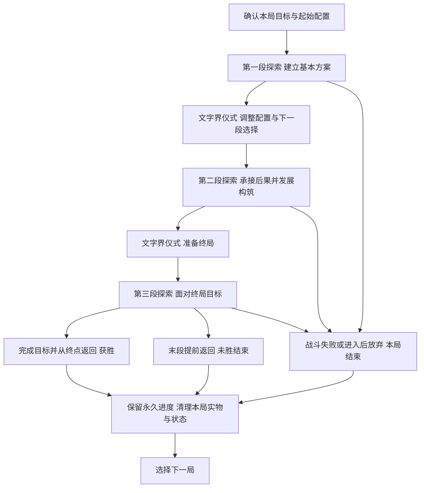

# 言咒肉鸽式仪式系统 当前方案与设计缺口

更新：2026-11-08。状态：当前探索方向的说明稿，Raw / Unqualified；方向与边界已有用户确认，数值及具体内容仍待设计，玩法体验未验证。本文未替换项目现行GDD。

## 1 这是一套什么玩法

言咒当前的新方向，是让玩家在一场有明确终点的肉鸽旅程中，交替进行物质界探索和文字界仪式。玩家从有限的起始配置出发，在探索中战斗、收集和加工材料，再用仪式改变接下来的机会：打开另一处地点、解读知识、召唤神灵或生物、处理异常，逐渐形成这一局的构筑，最后完成本局目标。

仪式经营是整局成长的一部分。玩家需要决定有限的材料拿去支撑战斗、准备供物，还是完成某个存在提出的请求；这些安排会影响下一段去哪里、面对什么，以及带什么配置。整局结束时，这一局的实体物资和构筑清理，已经掌握的知识、境界权限及明确解锁继续保留。

玩家追求的短期目标是赢下当前一局，长期目标是通过理解世界和完成拔擢获得新权限，最终达成飞升。普通局有独立胜负，不必每局都拔擢，也不必等到飞升才算完成一次游戏。

这套结构希望产生三种相互连接的体验：在节点上作出资源取舍，在整局内把零散收获组织成一套可用方案，在多局之间逐渐理解仪式规律和世界联系。当前最需要进一步证明的是：知识增加后，玩家是否会更会判断和安排，而非只是更快地照着清单收材料。

## 2 两个世界与三个循环尺度

文字界和物质界决定玩家在哪里做事；节点、区域段和整局决定一次行动影响多长的进程。

| 概念 | 当前含义 |
| --- | --- |
| 物质界 | 进行战斗、采集、普通加工和现场调查的地方。玩家按区域路线推进，承担生命、耗材和携带压力。 |
| 文字界 | 以卡牌管理当前物资、地点、知识、联系对象和事件；准备出征、主持仪式、查看结果。普通加工不能在这里完成。 |
| 节点 | 一次战斗、采集、加工、事件或返回选择。节点处理结果进入下一节点。 |
| 区域段 | 一段有固定推进方向和返回位置的短探索。返回文字界后，这个区域段结束，整局可以继续。 |
| 整局 | 从确认本局目标和起始配置开始，到达成终局目标、战斗失败或主动结束为止，包含有限个区域段及区域间的仪式准备。 |

因此，回到文字界并不等于完成一局，也不等于把收获变成永久资产。文字界中的大部分经营发生在局内，使用的也是本局物资。

三个循环分别是：

- **节点循环：**观察情境 → 决定战斗、取材或加工方式 → 承担消耗、取得结果 → 进入下一节点。
- **整局循环：**限定起始配置 → 多段探索与仪式准备 → 构筑发展 → 完成终局挑战或失败 → 结算。
- **跨局循环：**保留知识、境界和明确解锁 → 下局拥有更多理解与可用方法 → 面对新的资源和机会组合重新构筑。

## 3 一整局怎样开始和结束

### 开局

玩家选择已解锁的本局目标，查看主要要求、已知危险及起始方案，再确认开始。首版暂用一套免费且可恢复的基础配置。后续可以解锁不同起始方案，但每局从限定方案中选择，不从永久仓库自由拿齐上一局的装备。

新局以预设满生命开始，取得该方案规定的本局装备实例和最低起步供给。已掌握知识和境界权限立即可用，但施行具体方法仍需相应材料、目标与其他条件。具体起始物件和供给数量尚未确定。

### 局内推进

当前暂按三个区域段组织一局。每段只能实际进入一次；第一、第二段返回文字界后，玩家用已经带回的材料施仪、调整合法配置，并准备下一段。查看和取消尚未出发的准备不消耗区域机会，也不会重新抽取已经生成的路线。

区域间生命和剩余物资连续。回文字界不会自动满血、补齐消耗品或恢复弃置物；恢复必须来自明确的效果或以后设计的合法仪式。各区域的起始采集只提供该段的有限物资。

### 胜负与退出

首个普通目标的工作样例是：解决最后一段的指定终局事件，并从终点返回。暂将第6位置作为终局遭遇，第7位置作为目标完成后的返回位置；具体敌人、事件与奖励仍待设计。

战斗失败，或进入区域后主动放弃，会结束整局。首版没有额外复活次数。暂停或关闭应用后恢复的是同一局，不因此失败，也不重抽路线和已经承诺的仪式结果。

普通胜利结算后，本局实体清理，不能再用它们补做尚未完成的求知或拔擢。若某种目标确实需要最后带回材料并举行仪式，那场仪式必须事先写入胜利条件，不能在已经宣布胜利后追加要求。

## 4 一个区域怎样游玩

普通区域采用七个推进位置。其中第5位置是二选一，所以玩家不会同时走过加工与额外采集两支。

| 位置 | 节点职责 | 玩家主要考虑什么 |
| --- | --- | --- |
| 1 | 有限起始采集 | 取得本段基础材料，安排实际携带。 |
| 2 | 普通遭遇，或被一个明确的入口异常替换 | 根据已知主机制使用当前构筑，承担战斗消耗。 |
| 3 | 目标取材或调查 | 取得当前明确目标的材料、样本、书籍或线索。 |
| 4 | 返回选择 | 保住当前收获并结束本段，或继续承担后段风险。 |
| 5A／5B | 有限加工／额外采集二选一 | 将现有材料加工成更有用的东西，或取得更多、不同的原料。 |
| 6 | 深层遭遇；末段可承担终局事件 | 检验前面准备，继续消耗当前生命和物资。 |
| 7 | 终点收获与返回 | 处理实际装载并结束本段；末段按目标条件结算整局。 |

前两段在第4位置返回，会放弃该段后续节点并推进到下一段准备，不能稍后回来补拿。最后一段在第4位置返回，则会直接结束本局且不算获胜。两种返回的后果需要在选择时清楚说明。

玩家出发前可以查看路线连接、节点类型、返回位置、资源大类以及敌人类型和主要机制。具体普通掉落、尚未知晓的故事和隐藏发现抵达后揭示。首次查看出征准备时生成的路线会固定，换装、关闭准备或恢复游戏都不会重抽。

可选后段提供额外收益和更多方案。基础目标的唯一必需材料不能藏在某个可选分支里，使玩家合理提前返回后才发现无法继续。这里保证的是存在可执行路径，不保证任意消费和选择都能通关。

## 5 仪式怎样改变这一局

仪式是玩家在文字界主动投入物品、运用已学方法来改变状态的主要手段。它可以改变信息、地点、接触机会和事件；普通制造仍通过物质界的法器与配方完成。

| 仪式用途 | 玩家投入和操作 | 主要结果 |
| --- | --- | --- |
| 求知 | 对书籍等对象使用已掌握方法，满足先修条件 | 掌握当前可理解的知识或方法。基础求知默认不额外消耗供物，书籍保留；特殊方法另有明确条件。 |
| 引路 | 投入合格来源样本与规定供物 | 初次可以发现地点；后续可以建立本局下一段的替代入口，不增加区域总数。 |
| 召唤与联系 | 根据方法、线索或信物发起接触 | 获得回应、建立联系，或让某个存在在物质界成为可接触的遭遇。 |
| 异常干预 | 具备相应境界和方法后，以适配的既有异常为对象 | 按方法处理该事件，例如解除阻挡；不普遍清除所有异常。 |
| 拔擢 | 满足知识、经历与真实供物条件，主动施仪 | 永久取得下一阶段权限。 |
| 飞升 | 在相应目标局中完成终局准备及最终仪式 | 达成长期主线终点。具体仪式与结局尚待设计。 |

玩家先选已掌握的方法，再放入对象和所需供物。方法决定尝试什么行为，知识决定已懂得什么，境界决定能执行哪些交互，实际物品承担指向和代价。首版不设计摆放像素位置、旋转或拖动顺序谜题。

启动前必须看清能否执行、缺少什么、哪些物品会消耗或保留。准备阶段可反复撤换，启动后一次结清结果，不能取消返料或重抽。仪式逐个主动结算，不依靠现实倒计时、离线收益或多祭坛并行。

合法仪式不再抽一次通用成功率。引路能够产生对应入口，求知能够取得当前可解读内容；具体目标和伴随后果由投入及相关状态决定，其中可以有少量提前显示征兆的随机变化。玩家仍可能误判样本来源或回应者，但不会仅因为一次通用失败判定而扣掉材料、没有结果。

### 神秘性来自怎样的信息

物品描述提供来源与传闻，配方说明加工关系和用途，祭坛预感回应当前真实投入。三者共同帮助玩家推理。预感可以隐藏回应者的身份，但真实消耗以及已能判断的后果性质应当清楚。

例如，一个样本的描述提到未知痕迹；供物说明它只能建立联系，不能筛除其他回应；祭坛预感随后指出门扉回应之外还有另一种存在。玩家据此决定是否承担开路后的事件，并在结果发生后修正理解。

这个例子只是说明信息关系，不预设每种样本都有一个可以净化的安全版本。同样投入、知识和相关状态下，反复拿起放下物品不会刷新预感。一次仪式记录的是本次发生的事实，不能自动证明所有同类材料永远产生相同后果。

## 6 材料 背包 加工与本局构筑

玩家在节点上取得有限物资，选择实际带入背包的部分。装备、铭文、辅助物、材料、样本和实体书籍按各自规格共用真实出征背包；卡牌数量显示可以合并，实际占用不会因此消失。已经掌握的知识和地点记录不占携带空间。

节点提供待选物品区，供玩家比较、整理和选留。尚未取得的物品不能直接用于生产；离开后，未选物和已确认弃置物不会寄回文字界或跟到下一节点。区域中也不能调用留在文字界的库存。物资整理仍限于合法的非战斗或战后窗口。

安全返回时，实际带回的物品进入本局仓库。仓库暂不设总量硬上限，主要携带取舍发生在区域探索中；整局结束后仓库清理。装拆不会复制部件，已经用于制造或仪式的投入不返还。主动操作若会毁掉最后可继续的配置，需要有本局剩余机会内可达的恢复路径；没有这条路径时首版禁止该操作。

一部分基础原料同时用于战斗配方和供物制备，样本、特殊凭证等也可以有专门用途。因此，带回多少原料、何时把它加工成供物，以及为下一段留下多少战斗供给，都可以成为局内决策。

非战斗加工使用玩家实际部署的合法法器、已允许的配方及真实材料。加工节点暂给所有器具共享的5个生产拍，不是每台器具各给5拍；不能在剩余拍数内完工的批次不能启动。查看和排计划不耗拍，已经承诺的批次完成后才能离开，未完工进度不跨节点保存。

此前供物示例是两种材料各一份制成供物一份，暂定耗时2拍。它说明了生产和仪式的连接方式，尚不是已核算的真实配方。具体法器配置、输入要求、产物占形及战斗消耗仍需补齐。

本局构筑应表现为玩家逐渐形成的一套做事方法：能用哪些配方、材料如何周转、面对什么敌人更有优势、适合利用哪些仪式机会。目前这部分只有系统关系，尚未设计出可比较的完整构筑样例。

## 7 知识与神灵生物接触

### 知识是永久理解，书籍是当前实物

探索中能直接理解的调查或见闻，在完成条件时记录。书中的深层知识需要实际带回文字界，通过求知解读。已经掌握的知识永久保留，原书通常保留在本局；尚未解读的书在整局结束时随实体清理。

知识推进依靠具体条件，如解读、观察、履约或献出真实物件，不采用通用知识点加点。知识树分开已知事实、未验证线索和已揭示缺口，逐步呈现相邻问题。缺口应给出可追查的方向，但不提前公开完整答案。

如果条件是亲眼观察，完成观察就可以学习；如果条件是带回或献出凭证，必须实际完成对应动作。看到奖励、曾经持有或计划提交，都不等于满足条件。已经学会的知识即使随后失败也保留。

### 两种接触入口共享同一个对象

神灵和生物既可以在异常中遭遇，也可以通过仪式召唤。玩家可能先相遇、再根据线索学会召唤，也可能先读懂文本、召来从未见过的存在。每个对象不必都提供两种入口，遇见也不自动授予召唤方法。

接触可以产生战斗、交涉、条件请求或其他事件。若需要战斗，进入物质界遭遇；文字界承担仪式和回应。召唤不自动把对象变成可控制随从。

条件请求采用“提出请求—获知条件—完成条件—取得回应”的关系。玩家可以接受、拒绝或暂缓，当前每个联系对象先限一个进行中的请求。准备和交付要检查真实材料与资格；重复打开不会重抽请求，同一局中换个入口联系同一已识别对象，也不会重置请求或重复发奖。

局内请求的活动状态在该局持续，整局结束后关闭。明确的主线一次性完成记录和永久奖励保留；后续新局可以出现提供本局收益的新请求实例，但不能再次领取同一永久奖励。具体哪些请求属于哪一类，仍需逐项定义。

### 异常影响具体地点

首个教学异常替换第2位置普通遭遇，用一场战斗驱离；第1位置起步供给保留，第3位置仍提供目标书籍。它不额外增加一场战斗，也不把关键书籍放进随机战利品。

当前每个地点最多有一个未解决的主要通行阻挡，新增不兼容阻挡的仪式会在启动前被拒绝。异常不靠现实等待自动恶化，玩家可以在剩余区域机会允许时选择其他准备方向。已经结束的区域不能重新进入，不能继续沿用旧方案中的无限回访重试。

本局中已解决的事件继续保持解决；若随后失败，整局结束，新局是否出现相应事件由新局内容决定。永久留下的是已经理解的事实和明确成就，不是下一局所有地点都处于已清理状态。

## 8 境界成长与飞升

当前长期成长采用共同的权限主干，知识、接触对象和材料准备可以分支，不要求先学完全部知识或联系全部存在。正式境界名称尚未确定。

| 阶段 | 主要权限 | 需要提供的实际选择 |
| --- | --- | --- |
| 初始阶段 | 引路、求知，学到方法后的基础召唤与联系 | 根据当前物资与线索选择方法和目标。 |
| 第一次拔擢后 | 仪式干预适配的既有异常 | 比较支付供物处理异常与在物质界亲自应对的代价。 |
| 第二次拔擢后 | 为允许选择落点的召唤指定兼容地点 | 比较不同地点的资源、路线与风险；必须存在真正有区别的合法选择。 |
| 飞升 | 在特定目标局中完成终局事件与最终仪式 | 将长期知识和已取得权限用于主线终点。 |

拔擢需要掌握知识、完成相关经历并支付真实供物。知识和经历可以跨局积累，需要献出的实体必须在当前局凑齐。拔擢在本局中间阶段完成后，新权限立即生效；此后即使失败，境界也不会退回。

每次拔擢应同时提供至少一种可以追查、可以实际运用的方法，不自动学会全部同阶内容。初始阶段已经可以学习基础召唤，不能再把这项既有能力当作拔擢奖励。

普通局围绕当前目标形成完整挑战。达到飞升条件后，玩家可以进入相应目标局，完成其终局准备与仪式。飞升后允许继续开启已开放的其他局，保留长期进度；已经结束的那一局物资不会继续留存。

## 9 什么保留到下一段 什么保留到下一局

| 内容 | 返回文字界 后续区域仍在同一局 | 整局结束 |
| --- | --- | --- |
| 生命与剩余供给 | 连续，不自动补满 | 新局按起始方案重新初始化 |
| 实际装备、铭文、材料及本局仓库 | 实际持有或带回者保留，消耗不返还 | 清理，包括本局最初发放的实体 |
| 未解读的书、未交付的物件凭证 | 按实际持有状态保留 | 清理，不自动变成知识或已履约记录 |
| 已掌握知识、完成的学习条件、境界权限 | 保留 | 永久保留 |
| 已知地点与对象身份 | 保留已学信息 | 保留认知，本局可访问入口和出现状态重新确定 |
| 当前异常、临时效果与局内请求 | 按对应条件在本局持续 | 本局状态结束；后续新局建立适用实例 |
| 明确的主线完成与永久解锁 | 保留 | 保留，不重复领取同一永久奖励 |

特别需要区分“记住上局解除过一个异常”与“这局相同地点已经没有异常”。记录可以永久存在，当前世界状态仍属于当前一局。跨局重现对象的具体叙事解释尚未确定，玩法重置不直接定义世界中的复活规则。

## 10 玩家在桌面上怎样找到下一步

文字界保留卡牌桌面，只展开当前准备、比较和追查的对象，其余物资、地点、知识和联系记录可以分类查找。收拢一张卡不等于丢弃实体，知识引用也不等于又获得一本书。

同一时刻只启用一种实物准备：仪式投入或出征装载。切换时释放旧预留、保留计划；恢复计划要重新检查实际库存。普通查看不会取消准备，缺少物品的计划不会被当成已经持有。

目标追踪暂定一个主目标和两个可固定关注目标，显示已满足条件、缺少物资、已知来源及阻碍。玩家可以从缺口查看已掌握配方或进入地点准备，但不会自动制作、出征或启动仪式，也不会借导航提前揭示未知答案。

真正执行前，仪式汇总消耗、保留和预感，出征汇总当前区域、剩余机会、路线与带入配置。结果先说明这次改变了什么，再允许回看投入、当时预感和观察事实。失败结算应清楚说明哪些知识仍在、哪些本局实体已清理。

## 11 一段具体经历怎样串起来

以下是第一教学局的说明性流程，用于理解系统连接，不是已完成数值核算的关卡。

玩家从基础配置开始，在第一段通过普通遭遇，在目标节点取得一份来源样本和一份现成供物，并通过调查学到供物的制作关系。到第4位置时，可以直接返回开路，也可以继续争取加工或额外材料。首次开路需要的物资不要求强制走第5位置加工。

返回文字界后，玩家摆入样本和供物。预感明确指出会发现一个入口，同时有另一种回应造成通行阻碍。启动后两份实物消耗，新地点成为下一段可选入口，并带着这个异常。玩家可以据此准备配置。

第二段中，玩家先取得有限起始供给，再处理替换普通遭遇的入口异常，然后找到后续仪式书。带回文字界后，基础求知将可理解内容转成永久知识。若当前材料和条件允许，可以继续施行学到的方法、联系对象或处理适配事件；这并不保证本局一定完成拔擢。

在第三段之前，玩家需要面对一份具体账目：还剩多少生命，哪些材料用于终局战斗，哪些已经投进仪式，当前构筑能处理什么。进入末段后，完成终局条件并返回才算普通胜利。若中途战斗失败，整局结束；已经解读的知识保留，未解读的书和其他本局实体清理。

以后重新开始时，玩家不必再学相同知识或重复首次教学。新的路线、资源和接触机会应让已学方法有不同的应用选择。这些变化目前还需要具体内容支撑。

## 12 哪些已经明确 哪些仍只是工作参数

已明确的核心结构包括：有限区域构成一整局；区域间回文字界进行仪式经营；生命与物资压力连续；胜负结束本局；主要实体和构筑局内持续；知识、境界及明确解锁跨局保留。神灵与生物可以通过异常或仪式接触，仪式以可推理规则为主。

以下数字和安排用于当前设计展开，后续需要随内容核算与体验检查调整。

| 工作参数或样例 | 当前取值或安排 | 仍需回答的问题 |
| --- | --- | --- |
| 整局长度 | 3个区域段 | 实际战斗与准备时长、成长幅度是否合适？ |
| 普通区域结构 | 7位置，第4或第7返回，第5二选一 | 后段是否值得深入，是否形成固定选择？ |
| 非战斗加工 | 每节点共享5拍 | 能否覆盖必要制作，又留下可比较的生产安排？ |
| 供物示意配方 | 两种原料各1份制1份供物，耗时2拍 | 实际器具、输入要求、占形和资源供给是否允许？ |
| 初始配置 | 一套免费基础方案 | 能否支撑首段、恢复最低运转，并允许本局有成长？ |
| 普通终局样例 | 末段指定事件加终点返回 | 到底检验什么构筑能力，成功提供什么明确收益？ |
| 长期权限 | 两次拔擢后进入飞升目标 | 每次权限是否有足够适配目标，取得节奏如何？ |
| 目标追踪 | 1个主目标加2个关注目标 | 能否清楚表达本局目标与长期缺口，不增加管理负担？ |

旧方案按多次持续远征安排的首次拔擢次数预算，已经不能直接作为新整局的长度。需要按照新边界重新计算。

## 13 后续设计缺口与优先级

### 首先补齐一局能够成立的具体内容

| 优先顺序 | 当前缺口 | 下一份设计必须说清什么 |
| --- | --- | --- |
| 1 | 普通终局的目标与价值 | 选定一个具体终局事件，写清触发、完成、失败和奖励。说明为什么玩家愿意争取胜利，而不只学到知识就主动结束。 |
| 2 | 本局构筑的发展过程 | 至少描述两套可比较的构筑形成过程：起始有什么、途中出现哪些机会、材料怎样运转、仪式如何影响方案、终局怎样检验它。 |
| 3 | 连续生命与资源预算 | 逐段核算战斗消耗、有限采集、恢复来源、供物投入、生产时间和背包占用，确认在区域间不满血的条件下有可执行路径。 |
| 4 | 路线生成与引路的实际价值 | 明确基础路线和仪式替代入口怎样提供不同选择，哪些内容随机、哪些必定可达，以及提前返回后的最低可行准备。 |
| 5 | 仪式与构筑的实际连接 | 选出少量具体方法，写出投入、主要结果、伴随后果和下一步用途，避免每次仪式都只是兑换一张新的任务卡。 |

“一局能够成立”还没有被证明。起始法器、铭文、配方要求、真实材料身份、产物携带资格、敌人配置和恢复效果都还需要对应内容支持，不能把示意名称当作现成规格。

### 接着处理有限整局带来的依赖问题

| 缺口 | 为什么现在必须处理 | 需要形成的结果 |
| --- | --- | --- |
| 请求是否能在剩余区域内完成 | 旧方案允许多次回访，现在最多只有有限几次探索；请求可能指向刚刚结束的区域 | 每项请求明确所需物、来源、可达时点、交付窗口和是否属于跨局主线条件。不能接受后才发现本局没有完成机会。 |
| 永久条件与局内任务怎样区分 | 同一对象可经两种入口出现，旧记录又会跨局保留 | 明确哪些经历可复用，哪些请求每局重新建立，哪些奖励永久只领一次；已有身份信息不能复制活动请求。 |
| 末段收获怎样使用 | 普通胜利会立即清理本局实物，末段新书或供物可能没有求知／使用窗口 | 决定终点适合给什么奖励。若需要结算前仪式阶段，应明确修改目标流程；当前不能假定胜利后仍可使用库存。 |
| 永久境界怎样影响新局 | 老存档拥有更多方法和权限，仍从限定起始配置开始 | 明确可选起始、目标难度及当前可用方法之间的关系，避免新权限无材料可用，或旧内容被永久能力直接跳过。 |
| 异常干预与显现落点是否有选择 | 第一权限可能变成必用按钮，第二权限可能只有一个合法地点 | 给出至少一个值得比较的异常处理情境，以及两个各具价值的兼容显现地点，并检查区域次数与事件冲突。 |
| 失败与主动结束的动机 | 知识学会即保留，玩家可能只完成学习后放弃终局 | 明确知识取得、主线推进与普通胜利各自的价值，检查是否形成反复快速获取永久进度的单一玩法。 |

这些问题需要具体情境和账目，不宜仅靠追加通用货币、好感条或更多随机奖励解决。发现缺口时应先检查已有循环能否承担其作用。

### 最后完善长线与表现

第二次拔擢的具体知识、经历和供物，飞升目标局的事件及最终仪式，都还没有形成完整内容。它们需要接在已经能运转的普通整局之后，并体现先前获得权限的用途。

世界观还需要解释文字界和物质界的具体关系、跨局对象与事件的重现方式、正式境界和飞升含义。目前只有用户给出的基本边界，没有据此完成故事设定。玩法说明中的示意名称不能直接当作世界事实。

桌面还需要验证物资归属、真实预留、当前区域次数、长期知识缺口与本局目标能否同时被理解。现阶段已确定需要表达的信息，尚未完成界面与操作体验验证。

## 14 下一阶段怎样推进

先选定一个普通整局目标，再为三个区域分别写出起始状态、有限来源、可选行为、必要消耗、返回结果和终局依赖。把仪式放进这份账目，检查它实际改变了哪一段探索或哪一种构筑选择。

在同一永久知识和境界下，另写一份机会不同的整局方案作比较。重点看材料用途、地点选择、接触对象和构筑路径是否真正改变，以及基础目标是否仍然可达。第一份完整局可以用于初次学习，另一份应能够说明规则学会后为何仍值得再玩。

具体内容具备后，再检查玩家能否依据线索推理、是否根据库存改变加工／采集选择、能否理解失败保留范围，以及新权限是否改变行动。当前没有执行试玩或原型验证，也不能据此认定节奏、平衡和重复体验已经成立。

## 来源与维护

本文是2026-11-08按用户要求整理的独立阅读说明，来源为[设计记录](../sources/inbox/2026-11-06-meta-system-design.md)，共同输入版本为 `bb80d372004b7d8881f97511b83d335abf22d820`。以其中“肉鸽整局边界工作版”及修订对照为最新边界，其他系统沿未被替换的确认内容整理。

设计记录保留意图与决定依据，本文集中解释当前方案和缺口，不另设一套玩法决定或问题编号。后续决定变化时需同步更新本说明，避免再次混入旧边界。本文继承原来源的Raw / Unqualified资格，不是现行GDD、正式提案或实现规格。
